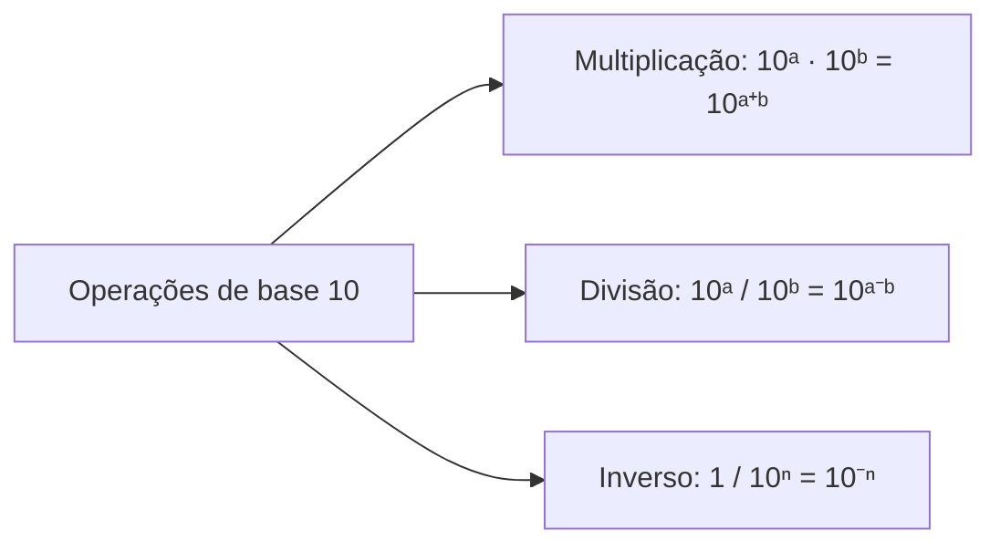
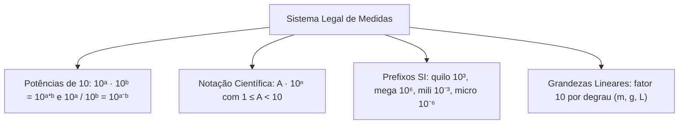

O domínio das grandezas e unidades de medida constitui requisito indispensável nas provas de concurso. No serviço operacional, calcular distâncias de isolamento, vazões e dosagens de produtos químicos exige rapidez no cálculo mental com potências de base dez e conversões decimais precisas.

Dominar as propriedades dos expoentes e a escala métrica evita erros graves provocados por distratores das bancas. Neste capítulo, estudaremos as operações fundamentais com potências de dez, a notação científica normalizada, os prefixos do Sistema Internacional e as regras de conversão linear para comprimento, massa e capacidade.

> [!objetivos]
> - Aplicar propriedades operatórias de multiplicação e divisão com potências de base dez.
> - Escrever números reais na forma normalizada da notação científica.
> - Identificar os prefixos métricos oficiais e suas respectivas potências de dez.
> - Realizar conversões lineares entre múltiplos e submúltiplos de metro, grama e litro.

## Potências de dez e propriedades operatórias

As potências de base dez fundamentam o sistema posicional decimal. Uma potência de dez com expoente inteiro positivo expressa a unidade seguida de zeros correspondentes ao número do expoente. Dessa forma, 10¹ vale 10, 10² resulta em 100, 10³ representa 1.000 e 10⁶ atinge 1.000.000. O expoente zero resulta na unidade (10⁰ = 1).

Quando o expoente é um inteiro negativo, a potência representa uma fração decimal da unidade, correspondendo ao inverso da potência positiva. Assim, 10⁻¹ equivale a 0,1; 10⁻² vale 0,01; 10⁻³ equivale a 0,001; e 10⁻⁶ corresponde a 0,000001. A quantidade de casas decimais após a vírgula é determinada pelo módulo do expoente negativo.

Na multiplicação de potências de mesma base, mantém-se a base dez e somam-se algebricamente os expoentes. Por exemplo, (11 · 10⁹) · (6 · 10⁻⁶) = 66 · 10³ = 66.000. Na divisão, conserva-se a base e subtrai-se o expoente do divisor: (15 · 10⁹) / (3 · 10⁻⁵) = 5 · 10⁹⁻⁽⁻⁵⁾ = 5 · 10¹⁴.

## Notação científica e normalização

A notação científica permite registrar magnitudes macroscópicas ou microscópicas de maneira padronizada. Um número está escrito em notação científica quando assume o formato A · 10ⁿ, no qual a mantissa A obedece à condição estrita 1 ≤ A < 10 e o expoente n é um número inteiro.

Para normalizar um valor, desloca-se a vírgula até restar um único algarismo diferente de zero antes dela. Se a vírgula caminhar para a esquerda, o expoente será positivo e igual ao número de casas andadas. Se caminhar para a direita, o expoente será negativo. Ao converter 12000 para notação científica, reescreva como 1,2 · 10⁴. Para decimais como 0,00003 e 0,0014, o deslocamento gera 3 · 10⁻⁵ e 1,4 · 10⁻³. Da mesma forma, 5319821 se expressa como 5,319821 · 10⁶, enquanto 24693 torna-se 2,4693 · 10⁴.

| Número original | Sentido do deslocamento | Notação científica | Ordem de grandeza |
| :--- | :--- | :--- | :--- |
| 542.000.000.000.000.000 | 17 posições para esquerda | 5,42 · 10¹⁷ | Macroscópica |
| 45.000 | 4 posições para esquerda | 4,5 · 10⁴ | Milhares |
| 0,000000076 | 8 posições para direita | 7,6 · 10⁻⁸ | Microscópica |
| 0,0032 | 3 posições para direita | 3,2 · 10⁻³ | Milésimos |

Em operações de produto e quociente, multiplicam-se ou dividem-se primeiramente as mantissas e depois ajusta-se a potência de dez para manter a mantissa no intervalo [1, 10). Por exemplo, (4 · 10⁵) · (5 · 10⁴) = 20 · 10⁹ = 2,0 · 10¹⁰. As regras principais da aritmética preservam a coerência básica do cálculo.

## Prefixos do Sistema Internacional de Unidades

O Sistema Internacional de Unidades (SI) padroniza prefixos que indicam fatores de escala decimais aplicáveis às unidades fundamentais. A memorização desses prefixos é cobrada com frequência em questões teóricas e práticas.

Os múltiplos mais importantes compreendem deca (da = 10¹), hecto (h = 10²), quilo (k = 10³), mega (M = 10⁶), giga (G = 10⁹) e tera (T = 10¹²). Os submúltiplos contemplam deci (d = 10⁻¹), centi (c = 10⁻²), mili (m = 10⁻³), micro (µ = 10⁻⁶), nano (n = 10⁻⁹) e pico (p = 10⁻¹²).

| Prefixo | Símbolo | Potência | Valor decimal | Aplicação típica |
| :--- | :--- | :--- | :--- | :--- |
| Giga | G | 10⁹ | 1.000.000.000 | Comunicações e frequências |
| Mega | M | 10⁶ | 1.000.000 | Potência de motores |
| Quilo | k | 10³ | 1.000 | Distância e massa |
| Hecto | h | 10² | 100 | Pressão atmosférica (hPa) |
| Deca | da | 10¹ | 10 | Medida linear (decâmetro) |
| Deci | d | 10⁻¹ | 0,1 | Decímetro, decilitro |
| Centi | c | 10⁻² | 0,01 | Centímetro |
| Mili | m | 10⁻³ | 0,001 | Miligrama, mililitro |
| Micro | µ | 10⁻⁶ | 0,000001 | Micrômetro |
| Nano | n | 10⁻⁹ | 0,000000001 | Comprimento de onda |

O uso correto de maiúsculas e minúsculas é essencial. A letra "m" isolada é metro; como prefixo minúsculo, é mili (10⁻³). Já "M" maiúsculo significa mega (10⁶). Confundi-los gera um desvio de 10⁹ vezes no resultado.

## Grandezas lineares: comprimento, massa e capacidade

Nas grandezas lineares, cada mudança de posição contígua na escala representa uma multiplicação ou divisão por dez (fator 10¹). Da unidade maior para a menor contígua, multiplica-se por 10 (vírgula para a direita). Da menor para a maior, divide-se por 10 (vírgula para a esquerda).

A escala de comprimento no SI tem como base o metro (m): km, hm, dam, m, dm, cm, mm. Para massa, o referencial usual de prefixos é o grama (g): kg, hg, dag, g, dg, cg, mg. Vale destacar que 1 tonelada (t) corresponde a 1.000 kg (10⁶ g). Para capacidade, utiliza-se o litro (L): kL, hL, daL, L, dL, cL, mL.

| Escala linear | Múltiplos | Unidade base | Submúltiplos | Fator por degrau |
| :--- | :--- | :--- | :--- | :--- |
| Comprimento | km, hm, dam | Metro (m) | dm, cm, mm | 10 |
| Massa | kg, hg, dag | Grama (g) | dg, cg, mg | 10 |
| Capacidade | kL, hL, daL | Litro (L) | dL, cL, mL | 10 |

Para converter 54,12 dam em cm, avançam-se três posições para a direita (m, dm, cm), multiplicando-se por 10³: 54,12 · 1.000 = 54.120 cm. De modo análogo, 52,7 hL equivalem a 527.000 cL, pois são quatro degraus para a direita (multiplicação por 10⁴). Na escala básica de massa, converter 345 hg em gramas demanda dois degraus de avanço à direita, resultando em 34.500 g. No comprimento, 321 mm equivalem a 0,321 m e 112 cm correspondem a 1,12 m.

> [!atencao]
> A regra de multiplicar ou dividir por 10 por degrau aplica-se exclusivamente a grandezas lineares (expoente 1). Para grandezas de área (expoente 2), o fator é 100 por degrau. Para volume cúbico (expoente 3), o fator é 1.000 por degrau.

## Resolução de problema contextualizado

A análise de exercícios contextualizados consolida o procedimento de conversão simultânea de grandezas lineares em situações de prova.

> [!resolvido]
> **Questão:** Uma equipe de bombeiros militares dispõe de três rolos de mangueira para combate a incêndio: o primeiro mede 0,45 km, o segundo mede 28 dam e o terceiro mede 1.700 dm. Se a guarnição necessita montar linhas operacionais de 25 metros cada, quantas linhas completas poderão ser confeccionadas?
>
> **Resolução:**
> 1. *Padronização no metro (m):*
>    - Primeiro rolo: 0,45 km = 0,45 · 1.000 = 450 m (três degraus à direita).
>    - Segundo rolo: 28 dam = 28 · 10 = 280 m (um degrau à direita).
>    - Terceiro rolo: 1.700 dm = 1.700 / 10 = 170 m (um degrau à esquerda).
> 2. *Comprimento total reunido:*
>    Comprimento total = 450 m + 280 m + 170 m = 900 metros.
> 3. *Cálculo das linhas de 25 m:*
>    Quantidade de linhas = 900 / 25 = 36 linhas completas.
>
> Resposta: A equipe poderá confeccionar 36 linhas completas de combate a incêndio.

> [!pegadinha]
> Fique alerta com a grafia de "dam" (decâmetro = 10 m) e "dm" (decímetro = 0,1 m). A troca inadvertida altera o resultado por um fator de 100 vezes, induzindo a alternativas incorretas elaboradas pela banca.

## Mapa do capítulo

Neste capítulo examinamos a base teórica e prática do sistema legal de medidas e do cálculo com potências de base dez. Revisamos a forma normalizada de notação científica, a tabela oficial de prefixos do Sistema Internacional e as regras de transformação sequencial para comprimento, massa e capacidade.

### Para fixar
- Multiplicação de potências de mesma base soma expoentes; divisão subtrai o expoente do divisor.
- Notação científica exige coeficiente A com 1 ≤ A < 10 e expoente n inteiro.
- Deslocar a vírgula para a esquerda aumenta o expoente; para a direita, diminui.
- Prefixos métricos essenciais: quilo (10³), hecto (10²), deca (10¹), deci (10⁻¹), centi (10⁻²), mili (10⁻³), micro (10⁻⁶).
- Grandezas lineares (m, g, L) variam por fator 10 a cada degrau na tabela de conversão.
- Para passar a uma unidade menor contígua, multiplica-se por 10; para passar a uma unidade maior, divide-se por 10.
- Uma tonelada equivale a 1.000 quilogramas ou 1.000.000 gramas.
