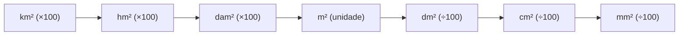
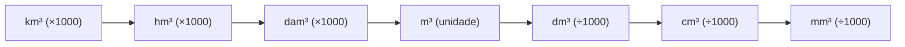
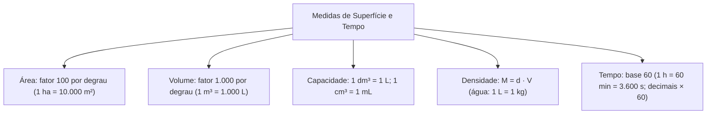

A correta articulação entre grandezas bidimensionais, volumétricas e temporais é requisito frequente nas provas de concurso. Como introdução ao estudo aplicado, dimensionar perímetros de sinistros, calcular o volume de água em reservatórios e cronometrar intervenções táticas exige domínio seguro das regras de conversão não lineares e do sistema sexagesimal de contagem de tempo.

Diferente do comprimento linear, medidas de superfície e volume variam com potências quadráticas e cúbicas, alterando os fatores por degrau de conversão. Paralelamente, a contagem de tempo adota base 60, o que demanda atenção redobrada no manejo de frações decimais e empréstimos operatórios.

> [!objetivos]
> - Aplicar o fator 100 por degrau na conversão de medidas de área e relacionar unidades agrárias.
> - Efetuar conversões na escala de volume cúbico aplicando o fator 1.000 por degrau.
> - Utilizar as equivalências fundamentais entre capacidade e volume (1 dm³ = 1 L e 1 m³ = 1.000 L).
> - Associar capacidade, volume e massa por meio da densidade da água e de outros materiais.
> - Operar adições, subtrações e conversões sexagesimais com horas inteiras e partes decimais.

## Unidades de área e medidas agrárias

A grandeza área expressa a extensão de superfícies bidimensionais e tem como unidade SI o metro quadrado (m²). Por envolver duas dimensões lineares, o fator de transformação entre posições contíguas é 10² = 100. Ao deslocar-se para a direita (rumo a uma unidade menor), multiplica-se por 100 a cada degrau; ao deslocar-se para a esquerda (unidade maior), divide-se por 100 por degrau.

A sequência completa compreende: km², hm², dam², m², dm², cm² e mm². Na prática rural e em perímetros de isolamento, empregam-se as medidas agrárias: o are (1 a = 1 dam² = 100 m²) e o hectare (1 ha = 1 hm² = 10.000 m²). Um quilômetro quadrado equivale a 100 hectares (1 km² = 1.000.000 m²).

| Unidade de área | Símbolo | Equivalência em m² | Aplicação agrária |
| :--- | :--- | :--- | :--- |
| Quilômetro quadrado | km² | 1.000.000 m² | 100 hectares (ha) |
| Hectômetro quadrado | hm² | 10.000 m² | 1 hectare (ha) |
| Decâmetro quadrado | dam² | 100 m² | 1 are (a) |
| Metro quadrado | m² | 1 m² | Padrão do SI |
| Decímetro quadrado | dm² | 0,01 m² | Submúltiplo |
| Centímetro quadrado | cm² | 0,0001 m² | Seção de condutores |
| Milímetro quadrado | mm² | 0,000001 m² | Bitola de fios |

Para converter 11,11 km² em dm², contam-se quatro degraus para a direita (hm², dam², m², dm²). Multiplica-se o valor por 100⁴ (10⁸ = 100.000.000): 11,11 · 100.000.000 = 1.111.000.000 dm².

## Unidades de volume e equivalência com capacidade

O volume mede o espaço tridimensional ocupado por um corpo. A unidade SI é o metro cúbico (m³). Envolvendo três dimensões lineares independentes, o fator de transformação entre unidades consecutivas é 10³ = 1.000.

A sucessão volumétrica compreende km³, hm³, dam³, m³, dm³, cm³ e mm³. Para a direita, multiplica-se por 1.000 a cada degrau; para a esquerda, divide-se por 1.000. Para converter 6.500.000.000.000 mm³ em dam³, realizam-se quatro degraus para a esquerda (cm³, dm³, m³, dam³), dividindo por 1.000⁴ (10¹²), o que resulta em 6,5 dam³.

A correspondência entre volume e capacidade decorre de duas relações clássicas: 1 dm³ = 1 L e 1 cm³ = 1 mL. Disso decorre que 1 m³ = 1.000 dm³ = 1.000 L.

| Medida cúbica | Litros | Mililitros | Emprego prático |
| :--- | :--- | :--- | :--- |
| 1 m³ | 1.000 L | 1.000.000 mL | Tanques de viaturas |
| 1 dm³ | 1 L | 1.000 mL | Galões operacionais |
| 1 cm³ | 0,001 L | 1 mL | Ampolas e seringas |

Se um tanque contém 22.500 cm³ de líquido gerador de espuma, essa quantidade corresponde a 22.500 mL, o que equivale a 22,5 L ou 22,5 dm³ (após dividir por 1.000).

## Correspondência entre capacidade, volume e massa

A equivalência direta entre volume e massa vincula-se à substância avaliada. Para água pura destilada em condições normais, 1 litro possui massa aproximada de 1 quilograma (1 L = 1 kg). Portanto, 1 m³ de água (1.000 L) tem massa de 1.000 kg (1 tonelada) e 1 mL (1 cm³) tem massa de 1 grama.

Para fluidos e sólidos diversos, a relação depende da densidade absoluta: d = M / V, de onde se extrai M = d · V.

> [!bizu]
> Observe rigorosamente as unidades de densidade. Se dada em g/cm³, mantenha o volume em cm³ para obter a massa em gramas. Se dada em kg/L, mantenha o volume em litros para obter o resultado em quilogramas.

Exemplo: um recipiente com 2 L de óleo de densidade 0,8 kg/L terá massa de M = 0,8 · 2 = 1,6 kg. Caso o recipiente contivesse água, a massa totalizaria 2,0 kg.

## Unidades de tempo e aritmética sexagesimal

O tempo fundamenta-se no sistema sexagesimal (base 60) para suas divisões elementares: 1 minuto possui 60 segundos (1 min = 60 s) e 1 hora tem 60 minutos (1 h = 3.600 s). O dia civil possui 24 horas, a semana reúne 7 dias, o ano comum possui 365 dias e o ano bissexto compreende 366 dias.

Ao subtrair horários nos quais os minutos do subtraendo superam os do minuendo, empresta-se 1 hora da coluna horária, somando 60 minutos à coluna vizinha. Para calcular o intervalo de 6h40 a 8h25, reescreve-se 8h25 como 7h85 (pois 25 + 60 = 85). Subtraindo: 7h - 6h = 1h e 85min - 40min = 45min, obtendo-se 1h45min de duração.

Na divisão de uma duração global por um número de eventos, converte-se o tempo para a menor unidade. Se uma viatura cumpre 9 voltas em 33 minutos, converte-se 33 min em 1.980 segundos (33 · 60). Dividindo por 9, resultam 220 segundos por volta. Para converter 220 s em minutos e segundos, divide-se por 60: quociente 3 (minutos) e resto 40 (segundos), totalizando 3min40s por volta.

Para minutos acumulados acima de 60, divide-se por 60: 310 minutos equivalem a 5 horas e 10 minutos (quociente 5, resto 10). Em segundos, 520 segundos equivalem a 8 minutos e 40 segundos (quociente 8, resto 40).

## Horas decimais e conversões fracionárias

A parte decimal de uma medida horária não expressa minutos diretamente. Para convertê-la, multiplica-se a fração decimal por 60. Se restar nova fração, multiplica-se novamente por 60 para apurar os segundos.

Considere uma ocorrência cuja duração foi de 3,28 horas:
1. Parte inteira: 3 horas.
2. Parte decimal: 0,28 · 60 = 16,8 minutos (16 minutos inteiros).
3. Fração decimal residual: 0,8 · 60 = 48 segundos.
4. Duração apurada: 3 horas, 16 minutos e 48 segundos (3h16min48s).

> [!pegadinha]
> Valores decimais como 2,5 horas indicam 2 horas e meia (2h30min), e não 2 horas e 5 minutos nem 2 horas e 50 minutos. Da mesma forma, 4,15 horas equivalem a 4 horas mais 0,15 · 60 = 9 minutos (4h09min). As bancas exploram essa confusão frequente nas alternativas de resposta.

## Resolução guiada de problema contextualizado

A fixação integrada dos temas ocorre com a resolução de cenários práticos.

> [!resolvido]
> **Questão contextualizada:** Um caminhão auto bomba tanque do Corpo de Bombeiros possui reservatório com 4 metros de comprimento, 2,5 metros de largura e 1,2 metro de profundidade. Durante um combate a incêndio, a viatura opera com vazão de 150 litros por minuto durante 48 minutos ininterruptos. Qual é o volume de água restante no tanque, expresso em decímetros cúbicos?
>
> **Resolução passo a passo:**
> 1. *Volume total do tanque:*
>    Volume = 4 m · 2,5 m · 1,2 m = 12 m³.
> 2. *Capacidade em litros:*
>    Como 1 m³ = 1.000 L, o tanque armazena 12 · 1.000 = 12.000 litros de água.
> 3. *Consumo na operação:*
>    Volume consumido = 150 L/min · 48 min = 7.200 litros.
> 4. *Volume restante no reservatório:*
>    Água restante = 12.000 L - 7.200 L = 4.800 litros.
> 5. *Conversão para decímetros cúbicos (dm³):*
>    Como 1 L = 1 dm³, 4.800 litros equivalem a 4.800 dm³.
>
> Resposta: Restam exatamente 4.800 dm³ de água no interior do tanque.

## Mapa do capítulo

Neste capítulo examinamos a estrutura das grandezas de área e volume sob a ótica das potências métricas e analisamos a aritmética sexagesimal do tempo. Fixamos que superfícies variam de 100 em 100, volumes progridem de 1.000 em 1.000 e a relação entre capacidade e volume conecta-se pela igualdade 1 dm³ = 1 L.

### Para fixar
- Unidades de área variam por fator 100 a cada degrau na escala métrica.
- Medidas agrárias: 1 hectare (ha) = 1 hm² = 10.000 m²; 1 are (a) = 1 dam² = 100 m².
- Unidades de volume variam por fator 1.000 a cada degrau na escala cúbica.
- Equivalências fundamentais: 1 m³ = 1.000 L; 1 dm³ = 1 L; 1 cm³ = 1 mL.
- Para a água, 1 L corresponde a 1 kg (1 m³ = 1 tonelada). Para demais materiais, calcula-se M = d · V.
- A contagem de tempo adota base sexagesimal: 1 hora = 60 minutos = 3.600 segundos; 1 dia = 24 horas.
- Em subtrações temporais com minutos insuficientes, toma-se 1 hora emprestada equivalente a 60 minutos.
- Decimais de horas são convertidos em minutos multiplicando-se a fração por 60; frações de minutos convertem-se em segundos da mesma forma.
