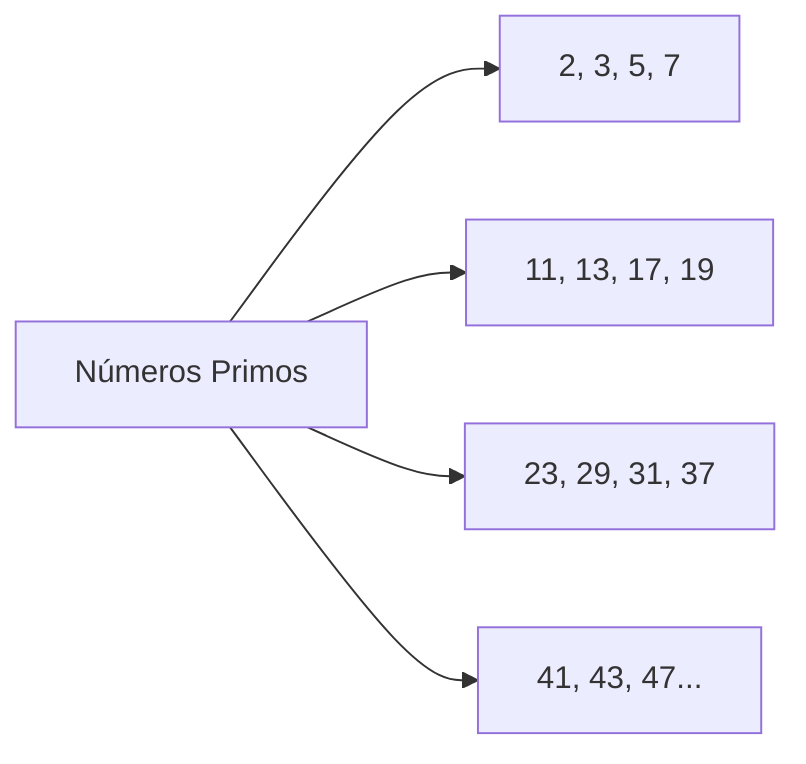
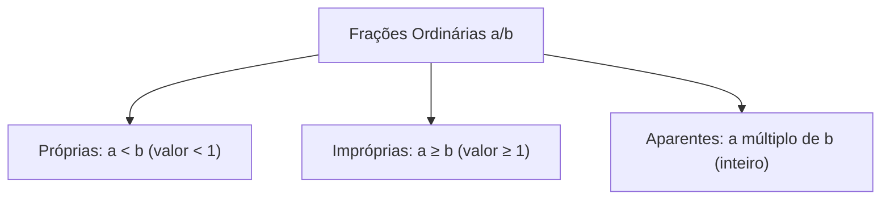
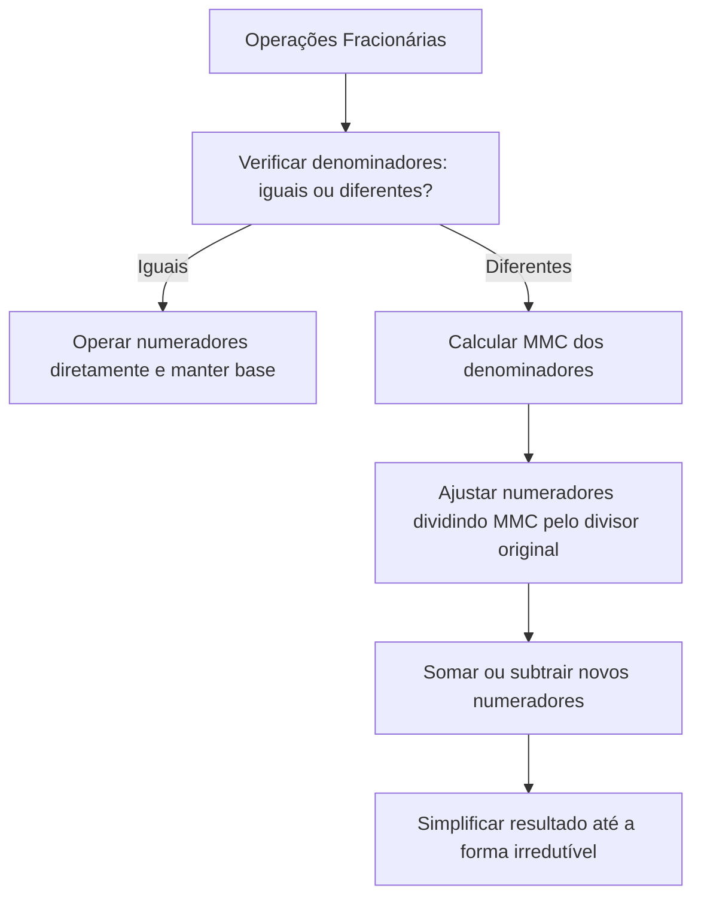

As operações com frações constituem a base para resolver problemas de proporcionalidade, divisão de recursos e escalas em concursos. Nos serviços de emergência e de segurança, a distribuição de efetivo, a partilha de combustível e o escalonamento de equipes exigem manipulação rápida de números fracionários e técnicas de fatoração.

Compreender números primos e a determinação do menor denominador comum garante precisão nos cálculos e evita erros induzidos pelas bancas. Neste capítulo, estudaremos divisibilidade e números primos, o cálculo do Mínimo Múltiplo Comum (MMC), frações equivalentes e irredutíveis e as operações de adição e subtração.

> [!objetivos]
> - Aplicar critérios de divisibilidade e decomposição em fatores primos.
> - Calcular o Mínimo Múltiplo Comum (MMC) entre inteiros por fatoração simultânea.
> - Reconhecer frações equivalentes e simplificá-las até a forma irredutível.
> - Realizar adições e subtrações com denominadores distintos utilizando o denominador comum.

## Múltiplos, números primos e divisibilidade

Os múltiplos de um inteiro positivo n decorrem do produto n · k, com k natural (0, 1, 2, ...). Há infinitos múltiplos para todo número natural não nulo. Um número natural maior que 1 é primo quando possui exatamente dois divisores naturais: 1 e ele mesmo. O número 2 é o único primo par; os demais são ímpares.

A sucessão dos primeiros primos compreende 2, 3, 5, 7, 11, 13, 17, 19, 23, 29, 31, 37, 41, 43 e 47. De acordo com o Teorema Fundamental da Aritmética, todo número composto decompõe-se de forma única em fatores primos.

Os critérios práticos de divisibilidade facilitam a fatoração: divisível por 2 se o final for par; por 3 se a soma dos algarismos for múltipla de 3; e por 5 se terminar em 0 ou 5. Esses critérios aceleram os cálculos sem exigir divisões longas.

## Determinação do Mínimo Múltiplo Comum (MMC)

O Mínimo Múltiplo Comum (MMC) de inteiros positivos é o menor número natural não nulo divisível por todos eles. Seu cálculo realiza-se com a decomposição simultânea em fatores primos, dividindo-se os números até que todos atinjam 1. O MMC é o produto dos divisores primos utilizados.

| Etapa | Valores em fatoração | Divisor primo |
| :--- | :--- | :--- |
| Inicial | 5, 10, 15, 20, 50 | 2 |
| Divisão por 2 | 5, 5, 15, 10, 25 | 2 |
| Divisão por 2 | 5, 5, 15, 5, 25 | 3 |
| Divisão por 3 | 5, 5, 5, 5, 25 | 5 |
| Divisão por 5 | 1, 1, 1, 1, 5 | 5 |
| Final | 1, 1, 1, 1, 1 | Produto: 2² · 3 · 5² = 300 |

O MMC entre 5, 10, 15, 20 e 50 resulta em 300. Propriedades úteis simplificam o cálculo:
1. *Eliminação de divisores:* se um número divide outro presente no conjunto, pode ser descartado do cálculo (5 e 10 dividem 50).
2. *Múltiplo global:* se um termo é divisível por todos os outros, ele próprio é o MMC.
3. *Primos entre si:* se não compartilham fatores primos, o MMC é o produto direto entre eles.

## Estrutura, classificação e equivalência de frações

A fração a/b indica a divisão do numerador a pelo denominador b (com b ≠ 0). O denominador indica a partição do todo em partes iguais e o numerador quantifica as partes selecionadas.

As frações classificam-se em próprias (a < b, como 3/5), impróprias (a ≥ b, como 7/4) e aparentes (a é múltiplo de b, equivalendo a inteiro, como 12/3 = 4).

Frações equivalentes expressam o mesmo valor ou proporção. Multiplicando ou dividindo numerador e denominador pelo mesmo número não nulo, preserva-se a equivalência. Assim, 12/36 equivale a 1/3 (dividindo por 12) e 84/120 equivale a 7/10 (dividindo por 12). Visualmente, 2/6 de uma barra representa a mesma porção que 1/3.

## Frações irredutíveis e simplificação contínua

Uma fração é classificada formalmente como irredutível quando o numerador e o denominador são números primos entre si, também chamados de coprimos. Isso significa que o único divisor natural comum compartilhado simultaneamente por ambos os termos é o número 1. A apresentação da fração em sua forma irredutível é uma exigência sistemática nas alternativas de resposta dos concursos.

Para reduzir uma fração extensa à sua forma irredutível mais compacta, o estudante pode adotar dois procedimentos consagrados pela aritmética. O primeiro consiste nas divisões sucessivas por fatores primos comuns evidentes (como dividir repetidas vezes por 2, 3 ou 5). O segundo procedimento, mais veloz e direto, consiste em calcular previamente o Maior Divisor Comum (MDC) entre o numerador e o denominador e, em seguida, dividir ambos os termos de uma única vez por esse valor apurado.

| Fração original | Divisões sucessivas | Forma irredutível | Termos coprimos |
| :--- | :--- | :--- | :--- |
| 12/36 | ÷ 12 | 1/3 | 1 e 3 |
| 84/120 | ÷ 12 | 7/10 | 7 e 10 |
| 44/60 | ÷ 4 | 11/15 | 11 e 15 |
| 140/350 | ÷ 70 | 2/5 | 2 e 5 |

A identificação imediata da irredutibilidade poupa esforço mental expressivo durante a prova. Quando uma fração atinge um numerador que seja um número primo e que não divida o denominador (como 7/10 ou 11/15), a fração já se encontra obrigatoriamente irredutível, tornando desnecessária qualquer verificação posterior. Essa forma final simplificada torna a visualização da grandeza muito mais clara e agiliza multiplicações ou divisões em etapas seguintes.

## Operações de adição e subtração de frações

Para somar ou subtrair frações, os denominadores precisam ser equalizados, garantindo parcelas de mesma dimensão.

Quando os denominadores são idênticos, conserva-se a base e operam-se os numeradores. Havendo denominadores desiguais, determina-se previamente o MMC dos denominadores. Em seguida, divide-se o MMC pelo denominador de origem e multiplica-se o quociente pelo numerador respectivo.

Exemplos práticos de operação:
1. *Soma múltipla:* 2/3 + 1/5 + 7/10. O MMC(3, 5, 10) = 30.
   - Ajuste: (30/3) · 2 = 20; (30/5) · 1 = 6; (30/10) · 7 = 21.
   - Soma: (20 + 6 + 21) / 30 = 47/30 (irredutível).
2. *Subtração direta:* 44/60 - 20/30. Com denominador comum 60:
   - 44/60 - 40/60 = 4/60 = 1/15 (simplificada por 4).
3. *Operação combinada:* 1/6 + 3/8 + 7/10. Com MMC(6, 8, 10) = 120:
   - Numeradores ajustados: (20 + 45 + 84) / 120 = 149/120 (irredutível).

> [!pegadinha]
> Nunca some numeradores e denominadores isoladamente (como escrever que 1/2 + 1/3 = 2/5). A soma exige obrigatoriamente a padronização prévia dos denominadores pelo MMC.

## Resolução guiada de problema contextualizado

A análise passo a passo de um problema aplicado reforça as operações fracionárias.

> [!resolvido]
> **Questão contextualizada:** Um destacamento de bombeiros mobilizou seu efetivo em três frentes durante enchentes: 2/5 do efetivo atuaram no resgate de ilhados, 1/4 operou no transporte de mantimentos e 3/10 executaram contenções de encostas. A parcela restante permaneceu de prontidão no quartel. Qual fração do efetivo total permaneceu de prontidão?
>
> **Resolução passo a passo:**
> 1. *Conjunto total do efetivo:* Representa-se a totalidade do efetivo pela unidade inteira 1.
> 2. *Soma das frações mobilizadas:*
>    Soma = 2/5 + 1/4 + 3/10.
> 3. *Cálculo do MMC dos denominadores (5, 4, 10):*
>    MMC(5, 4, 10) = 20.
> 4. *Equalização com denominador 20:*
>    - 2/5 = 8/20 (pois 20 / 5 · 2 = 8).
>    - 1/4 = 5/20 (pois 20 / 4 · 1 = 5).
>    - 3/10 = 6/20 (pois 20 / 10 · 3 = 6).
> 5. *Total das frações em campo:*
>    Total em campo = (8 + 5 + 6) / 20 = 19/20.
> 6. *Cálculo da fração restante de prontidão:*
>    Fração no quartel = 20/20 - 19/20 = 1/20.
>
> Resposta: Apenas 1/20 do efetivo total do destacamento permaneceu no quartel.

> [!bizu]
> A fração restante ou complementar obtém-se subtraindo a fração conhecida da unidade inteira. Sabendo que 19/20 estavam empenhados, restava imediatamente 1/20 para atingir o total de 20/20.

## Mapa do capítulo

Neste capítulo examinamos a estrutura das frações ordinárias e as operações de adição e subtração. Compreendemos o papel dos números primos na decomposição pelo MMC, as regras de equivalência e a necessidade de equalizar denominadores antes de operar frações.

### Para fixar
- Múltiplos de n são produtos n · k com k natural; há infinitos múltiplos.
- Primos têm exatamente dois divisores naturais (1 e ele mesmo); 2 é o único primo par.
- O MMC é o menor múltiplo comum positivo, calculado pela decomposição simultânea em primos.
- Termos que dividem outros elementos da lista podem ser excluídos do cálculo do MMC.
- Frações equivalentes mantêm a proporção e decorrem da multiplicação ou divisão por termo não nulo.
- A forma irredutível apresenta numerador e denominador coprimos.
- Adição e subtração com denominadores diferentes exigem MMC para unificação antes de operar numeradores.
- Nunca se somam denominadores diretamente na adição fracionária.
