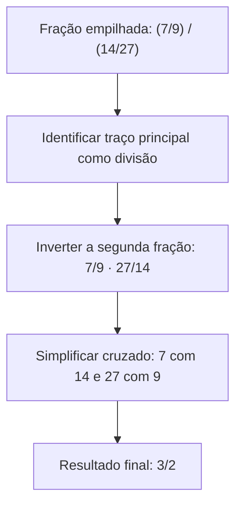
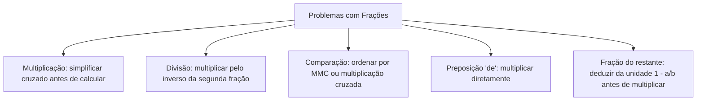

A interpretação matemática de problemas verbais envolvendo operações em conjuntos numéricos (naturais, inteiros, racionais e reais) é uma competência elementar nas provas de concurso. No planejamento de suprimentos, no racionamento de combustíveis e no cálculo de razões e proporções, o candidato precisa dominar o encadeamento de frações ordinárias com rapidez e segurança.

A dificuldade dessas questões não reside nas fórmulas, mas na correta identificação da base de referência sobre a qual cada fração incide. A preposição "de" traduz-se em multiplicação e a expressão "fração restante" exige o emprego estruturado da fração complementar. Neste capítulo, estudaremos a multiplicação com cancelamento cruzado, a divisão de frações empilhadas, os critérios para comparar e ordenar grandezas fracionárias e a resolução de problemas em etapas sucessivas.

> [!objetivos]
> - Executar operações em conjuntos numéricos racionais por cancelamento cruzado antes de multiplicar.
> - Resolver divisões fracionárias e frações empilhadas multiplicando pela inversa da segunda.
> - Comparar frações pelos métodos do MMC, produto cruzado e conversão decimal em razões e proporções.
> - Interpretar o conectivo "de" como multiplicação e reconstruir o total multiplicando pelo inverso da fração.
> - Resolver problemas com retiradas encadeadas distinguindo a fração do total primitivo da fração do restante.

## Multiplicação de frações e simplificação cruzada

A multiplicação de frações ordinárias realiza-se multiplicando numerador por numerador e denominador por denominador: (a/b) · (c/d) = (a · c) / (b · d). Não há cálculo de MMC na multiplicação fracionária. Contudo, multiplicar os valores diretamente quase sempre produz números extensos difíceis de simplificar no final da prova.

A técnica mais eficiente é o cancelamento cruzado prévio: qualquer numerador pode ser simplificado com qualquer denominador por divisores comuns antes de efetuar a multiplicação.

No produto (5/6) · (8/15), cancela-se 5 com 15 (restam 1 e 3) e 8 com 6 (restam 4 e 3). O resultado imediato é (1 · 4) / (3 · 3) = 4/9, dispensando simplificar 40/90. Em expressões com frações compostas como 1/6 + 3/8 + 7/10, o MMC(6, 8, 10) = 120 fornece (20 + 45 + 84) / 120 = 149/120.

| Operação proposta | Simplificações cruzadas aplicadas | Multiplicação direta | Resultado irredutível |
| :--- | :--- | :--- | :--- |
| (5/6) · (8/15) | 5 com 15 (÷5) e 8 com 6 (÷2) | (1/3) · (4/3) | 4/9 |
| (7/10) · (25/14) | 7 com 14 (÷7) e 25 com 10 (÷5) | (1/2) · (5/2) | 5/4 |
| (9/16) · (4/27) | 9 com 27 (÷9) e 4 com 16 (÷4) | (1/4) · (1/3) | 1/12 |
| (11/13) · (26/33) | 11 com 33 (÷11) e 26 com 13 (÷13) | (1/1) · (2/3) | 2/3 |

Nas frações irredutíveis, numerador e denominador não compartilham fatores primos (são primos entre si). Por exemplo, 90 = 2 · 3² · 5 e 91 = 7 · 13 não possuem fatores comuns; portanto, 91/90 já é irredutível, e a soma dos seus termos resulta em 91 + 90 = 181.

## Divisão de frações e frações empilhadas

Dividir uma fração por outra equivale a multiplicar a primeira fração pelo inverso da segunda fração: (a/b) ÷ (c/d) = (a/b) · (d/c), com c ≠ 0 e d ≠ 0. Inverte-se exclusivamente a segunda fração (o divisor).

Em frações empilhadas, o traço principal horizontal representa o sinal de divisão. Assim, (7/9) / (14/27) reescreve-se como (7/9) · (27/14). Ao simplificar 7 com 14 (restam 1 e 2) e 27 com 9 (restam 3 e 1), obtém-se diretamente 3/2.

Em expressões combinadas, resolvem-se multiplicações e divisões prioritariamente antes de somas e subtrações. Se um enunciado criar uma regra simbólica do tipo x # y = x / [x + x/y], coloca-se x em evidência no denominador: x + x/y = x(1 + 1/y) = x(y + 1)/y. A expressão simplifica-se para y / (y + 1), independendo do valor de x. Se y = 1/3, obtém-se (1/3) / (4/3) = 1/4.

## Métodos de comparação e ordenação de frações

Para determinar qual fração representa a maior grandeza em problemas de razões e proporções, utilizam-se três métodos consagrados:

1. *Método do menor denominador comum (MMC):* Iguala-se o denominador de todas as frações pelo MMC e compara-se apenas o numerador.
2. *Método da multiplicação cruzada:* Para frações a/b e c/d com termos positivos, se a · d > b · c, então a/b > c/d.
3. *Método da conversão decimal:* Divide-se o numerador pelo denominador, comparando os valores decimais obtidos.

| Frações para ordenar | Denominadores | MMC | Equivalentes equalizadas | Ordem crescente apurada |
| :--- | :--- | :--- | :--- | :--- |
| 3/4, 5/8, 7/12 | 4, 8, 12 | 24 | 18/24, 15/24, 14/24 | 7/12 < 5/8 < 3/4 |
| 2/3, 3/5, 5/8 | 3, 5, 8 | 120 | 80/120, 72/120, 75/120 | 3/5 < 5/8 < 2/3 |
| 4/7, 5/9 | 7, 9 (cruzado) | - | 4 · 9 = 36 e 7 · 5 = 35 | 5/9 < 4/7 |

Na verificação decimal de 3/4, 5/8 e 7/12, os valores 0,75, 0,625 e 0,5833... confirmam a ordenação crescente 7/12 < 5/8 < 3/4.

## O conectivo "de" e a obtenção do todo a partir da fração

Em problemas contextualizados, a preposição "de" indica multiplicação. Se uma barra de chocolate é dividida em 12 pedaços iguais, 1/4 dessa barra corresponde a 1/4 · 12 = 3 pedaços. Se uma pessoa recebe 1/4 da barra e entrega a metade a um colega, ele deu 1/2 de 1/4 = 1/8 da barra. Se a barra pesava 600 g, 1/4 equivale a 150 g. Em problemas de fatias, se alguém come 2 fatias de uma pizza de 12 pedaços e divide uma terceira fatia com Flávio, ele comeu 2/12 + 1/24 = 5/24 da pizza, enquanto Flávio comeu 1/24.

Quando o problema apresenta a parte numérica e requer o todo integral, divide-se o valor pela fração ou multiplica-se pelo inverso. Se 3/5 de uma remessa de mantimentos pesam 300g, cada quinta parte pesa 100g e a remessa total (5/5) pesará 5 · 100g = 500g. Para 900g ou 200g, o cálculo segue a mesma proporcionalidade direta.

> [!bizu]
> Atalho do inverso: para encontrar o total a partir da parte conhecida, multiplique o valor pelo inverso da fração. Se 3/5 correspondem a 300g: Total = 300 · (5/3) = 500g.

## Fração complementar e retiradas encadeadas de estoque

A fração complementar expressa a parcela que resta para atingir o todo unitário: 1 - a/b = (b - a)/b. Se foram consumidos 7/10 de um estoque de alimentos, restam 1 - 7/10 = 3/10.

Nas provas, é comum o encadeamento de frações que incidem sobre o remanescente em vez do total primitivo:
- *Frações sobre o total primitivo:* retiram-se 1/8, 1/6 e 1/4 de um estoque de alimentos de 480 kg. Somam-se as frações com MMC 24: 3/24 + 4/24 + 6/24 = 13/24. O consumo é 480 · (13/24) = 260 kg e restam 220 kg (11/24).
- *Frações sobre o remanescente:* se Paulo paga 1/4 de entrada de uma moto e financia 2/3 do restante, o financiado é 2/3 de 3/4 = 1/2 do total primitivo. A parcela final quitada representa o restante não financiado: 1/3 de 3/4 = 1/4 do total.

| Etapa | Base da fração | Cálculo efetuado | Parcela do montante primitivo |
| :--- | :--- | :--- | :--- |
| Entrada paga | Total primitivo | 1/4 do total | 1/4 (25%) |
| Saldo após entrada | Unidade menos entrada | 1 - 1/4 | 3/4 do total (75%) |
| Financiamento | Saldo restante | 2/3 de 3/4 | 1/2 do total (50%) |
| Parcela final | Restante do saldo | 1/3 de 3/4 | 1/4 do total (25%) |

> [!pegadinha]
> Ler "fração do restante" como "fração do total" gera distratores premeditados pela banca. Identifique sempre a palavra "restante" e aplique a fração complementar antes de calcular produtos sucessivos.

## Resolução guiada de problema contextualizado

A fixação dos conceitos consolida-se com a resolução de um caso prático de suprimentos operacionais.

> [!resolvido]
> **Questão contextualizada:** Uma reserva tática do Corpo de Bombeiros recebeu um lote de 1.800 litros de combustível para alimentação de viaturas e geradores. Na primeira semana de atendimento, foi consumido 1/6 desse volume inicial. Na segunda semana, os veículos consumiram 2/5 do combustível que sobrou após a primeira semana. Na terceira semana, foi consumida uma quantia equivalente a 1/3 do volume inicial do lote. Ao término da terceira semana, qual é o volume de combustível que ainda resta no depósito, em litros?
>
> **Resolução passo a passo:**
> 1. *Consumo da primeira semana (fração do lote primitivo):*
>    Consumo 1 = 1/6 · 1.800 L = 300 litros.
> 2. *Combustível restante após a primeira semana:*
>    Saldo 1 = 1.800 - 300 = 1.500 litros.
> 3. *Consumo da segunda semana (fração do restante):*
>    Consumo 2 = 2/5 · 1.500 L = 2 · 300 = 600 litros.
> 4. *Consumo da terceira semana (fração do lote primitivo inicial):*
>    Consumo 3 = 1/3 · 1.800 L = 600 litros.
> 5. *Consumo total acumulado:*
>    Total consumido = 300 L + 600 L + 600 L = 1.500 litros.
> 6. *Combustível remanescente no depósito:*
>    Volume restante = 1.800 L - 1.500 L = 300 litros.
>
> Resposta: Restam exatamente 300 litros de combustível na reserva tática.

## Mapa do capítulo

Neste capítulo examinamos as operações fracionárias avançadas de multiplicação e divisão no contexto de razões e proporções e operações em conjuntos numéricos (naturais, inteiros, racionais e reais). Vimos como o cancelamento cruzado agiliza o cálculo, como inverter o divisor na divisão e como diferenciar consumos sobre o total daqueles incidentes sobre a fração complementar remanescente.

### Para fixar
- Multiplique frações em linha (numerador por numerador e denominador por denominador), simplificando cruzado antes.
- Para dividir frações, multiplique a primeira fração pelo inverso da segunda fração.
- Frações empilhadas tratam o traço horizontal principal como sinal de divisão.
- Ordene grandezas fracionárias igualando denominadores via MMC, produto cruzado ou conversão decimal.
- O conectivo "de" expressa operação de multiplicação aritmética.
- Reconstitua o total multiplicando o valor numérico da parte pelo inverso da fração correspondente.
- A fração complementar de a/b expressa-se por (b - a)/b.
- Diferencie com rigor frações sobre o total primitivo de frações aplicadas sobre o saldo remanescente.
