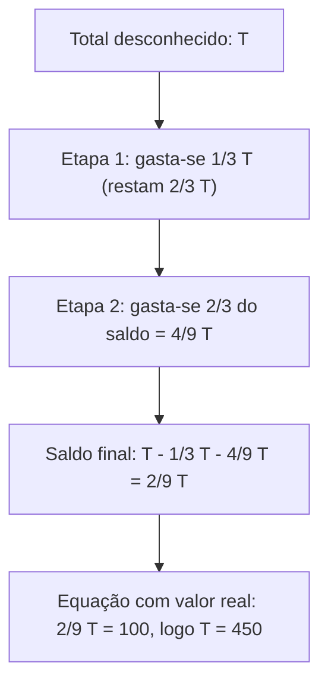
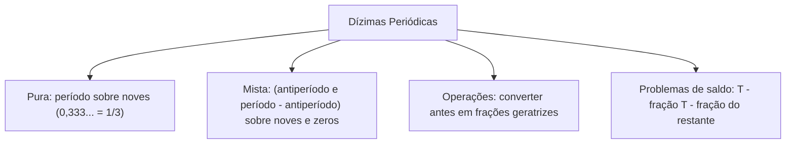

A resolução de problemas com números racionais exige transformar enunciados em equações e manipular dízimas periódicas no contexto de operações em conjuntos numéricos (naturais, inteiros, racionais e reais). Nas provas de concurso, questões sobre partilha de efetivo e razões e proporções combinam saldos fracionários com decimais infinitos.

Converter dízimas em frações geratrizes possibilita realizar contas de adição, multiplicação e simplificação exata. Neste capítulo, estudaremos a modelagem de etapas sucessivas com frações do restante, as regras para determinar a fração geratriz de dízimas puras e mistas e as operações de soma de decimais periódicos.

> [!objetivos]
> - Modelar problemas verbais de operações em conjuntos numéricos com frações aplicadas sobre saldos restantes.
> - Converter dízimas periódicas puras em frações geratrizes aplicando a regra dos noves no denominador.
> - Determinar a fração geratriz de dízimas mistas pelo método prático estruturado em razões e proporções.
> - Efetuar operações somatórias entre dízimas periódicas utilizando frações ordinárias equivalentes.

## Modelagem algébrica de problemas com frações e saldos

A modelagem de problemas fracionários inicia-se definindo uma variável para a quantidade total desconhecida (como T). Cada etapa do enunciado é expressa em função dessa variável ou do saldo restante. Se de um total T um candidato cumpre 1/3, restam 2T/3. Se depois cumpre 2/3 do restante, essa parte é (2/3) · (2T/3) = 4T/9. O saldo final não resolvido é T - T/3 - 4T/9 = 2T/9. Se restam 100 questões, 2T/9 = 100 e T = 450.

Esse modelo resolve divisões familiares e escolhas de alunos. Por exemplo, Gérson, Gilson e Geraldo decidem partilhar uma coleção de miniaturas M em Manaus. Gérson recebe 2/5 de M, restando 3M/5. Gilson ganha 1/3 desse saldo, recebendo M/5. O saldo final de Geraldo é 2M/5 = 48 miniaturas, o que resulta em M = 120 e garante 24 para o segundo irmão. De modo similar, se em uma sala de alunos 1/3 torce por um clube, 1/4 torce pelo Nacional e os 35 alunos restantes não torcem, monta-se 5A/12 = 35, obtendo-se 84 alunos ao todo.

## Dízimas periódicas puras e frações geratrizes

Dízima periódica é um número decimal infinito em que um bloco de algarismos se repete. Esse bloco é o período. A dízima é pura quando o período surge logo após a vírgula.

Na conversão para fração geratriz sem parte inteira, escreve-se o período no numerador e colocam-se no denominador tantos noves quantos forem os algarismos repetidos. Para 0,333..., usa-se 3/9 = 1/3. Para 0,4545..., obtém-se 45/99 = 5/11. Com repetições como 0,23232323..., a geratriz é 23/99. Com cinco algarismos periódicos como 0,6723467234..., escreve-se 67234/99999.

| Dízima pura | Período | Dígitos no período | Fração geratriz | Forma irredutível |
| :--- | :--- | :--- | :--- | :--- |
| 0,333... | 3 | 1 dígito | 3/9 | 1/3 |
| 0,4545... | 45 | 2 dígitos | 45/99 | 5/11 |
| 0,23232323... | 23 | 2 dígitos | 23/99 | 23/99 |
| 0,6723467234... | 67234 | 5 dígitos | 67234/99999 | 67234/99999 |

Com parte inteira, soma-se o valor inteiro: 5,333... = 5 + 1/3 = 16/3. O valor 0,999... equivale exatamente a 9/9 = 1.

## Dízimas periódicas mistas e método prático

A dízima é mista quando há algarismos não periódicos (antiperíodo) entre a vírgula e o período. A regra prática determina:
1. *Numerador:* subtrai-se do número formado pelo antiperíodo com o período a parte não periódica.
2. *Denominador:* colocam-se noves para cada dígito do período e zeros para cada dígito do antiperíodo.

| Dízima mista | Antiperíodo e período | Montagem prática | Fração obtida | Forma simplificada |
| :--- | :--- | :--- | :--- | :--- |
| 0,55333... | antiperíodo 55, período 3 | (553 - 55) / 900 | 498/900 | 83/150 |
| 0,60666... | antiperíodo 60, período 6 | (606 - 60) / 900 | 546/900 | 91/150 (ou 182/300) |
| 0,1666... | antiperíodo 1, período 6 | (16 - 1) / 90 | 15/90 | 1/6 |
| 6,4531212... | antiperíodo 453, período 12 | 6 + (45312 - 453) / 99000 | 6 + 44859/99000 | 638859/99000 |

> [!bizu]
> Regra do geratriz: Numerador = (até o fim do primeiro período) - (parte que não repete). Denominador = 9 para cada casa periódica e 0 para cada casa do antiperíodo. Em 0,60666..., calcula-se (606 - 60) / 900 = 546/900.

## Operações combinadas e soma de dízimas periódicas

Nunca multiplique ou divida diretamente dízimas em formato decimal. Converta sempre em frações geratrizes antes de operar.

Para somar dízimas como F = 0,8666..., G = 0,7111... e H = 0,4222...:
1. Separando partes exatas e periódicas: (0,8 + 0,7 + 0,4) + (1/10) · (6/9 + 1/9 + 2/9) = 1,9 + 0,1 = 2,0.
2. Por frações geratrizes: F = 78/90 = 13/15; G = 64/90 = 32/45; H = 38/90 = 19/45.
3. Denominador comum 45: 39/45 + 32/45 + 19/45 = 90/45 = 2.

> [!pegadinha]
> Alternativas de gabarito podem trazer frações geratrizes não simplificadas, como 546/900 ou 182/300 em vez de 91/150. Amplie ou simplifique frações antes de julgar a resposta ausente.

## Resolução guiada de problema contextualizado

Examinemos um problema envolvendo etapas sucessivas e decimais periódicos.

> [!resolvido]
> **Questão contextualizada:** Um programa de instrução técnica para novos integrantes do Corpo de Bombeiros foi planejado em três módulos sucessivos. No primeiro módulo, os militares cumpriram 0,333... da carga total da capacitação. No segundo módulo, cumpriram 2/5 da carga restante após o primeiro módulo. O terceiro módulo reuniu 80 horas práticas de salvamento. Qual era a carga total planejada para a capacitação completa?
>
> **Resolução passo a passo:**
> 1. *Fração geratriz do primeiro módulo:*
>    0,333... = 3/9 = 1/3 da carga horária total C.
> 2. *Carga restante após o primeiro módulo:*
>    Saldo 1 = C - 1/3 C = 2/3 C.
> 3. *Carga cumprida no segundo módulo:*
>    Módulo 2 = (2/5) · (2/3 C) = 4/15 C.
> 4. *Fração do terceiro módulo:*
>    Saldo restante = C - 1/3 C - 4/15 C = (15/15 - 5/15 - 4/15) C = 6/15 C = 2/5 C.
> 5. *Cálculo da carga total:*
>    Como 2/5 C = 80 horas, tem-se 2 C = 400, o que determina C = 200 horas.
>
> Resposta: A capacitação completa possuía carga total de 200 horas.

## Mapa do capítulo

Neste capítulo examinamos a modelagem de frações em operações em conjuntos numéricos e o cálculo de dízimas periódicas no âmbito de razões e proporções. Vimos como traduzir saldos remanescentes e como encontrar frações geratrizes para dízimas puras e mistas.

### Para fixar
- Em problemas sucessivos, aplique cada nova fração sobre o saldo remanescente apurado.
- Dízima periódica pura tem período logo após a vírgula e denominador composto por noves.
- Dízima mista tem antiperíodo entre vírgula e período; denominador reúne noves e zeros.
- O numerador da dízima mista resulta da subtração do número até o fim do primeiro período pelo antiperíodo.
- O decimal 0,999... equivale rigorosamente ao número inteiro 1.
- Converta dízimas em frações geratrizes antes de multiplicar ou dividir.
