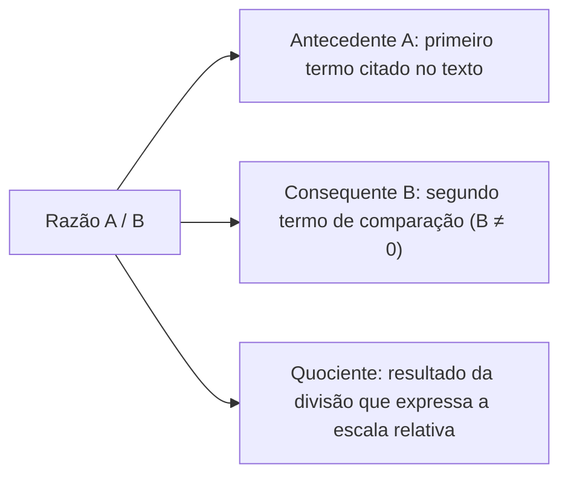
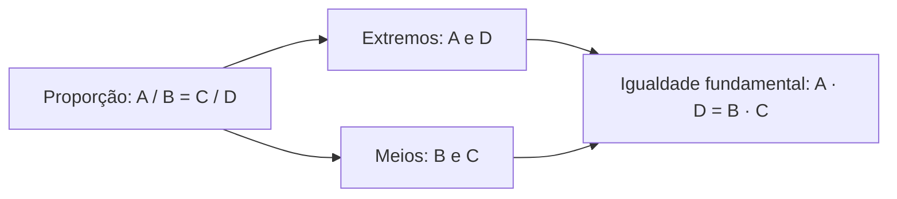
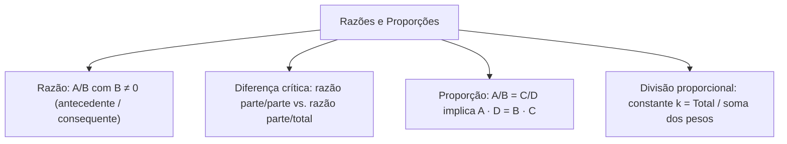

O estudo das razões e proporções e da divisão proporcional constitui um dos eixos mais cobrados nos concursos públicos. No planejamento operacional, a proporcionalidade é empregada para distribuir contingentes entre delegacias e batalhões, dimensionar linhas de suprimento de água e calcular índices criminais e taxas de atendimento.

Dominar as propriedades fundamentais das proporções e da multiplicação cruzada permite simplificar equações complexas e evitar armadilhas comuns criadas pela inversão da ordem dos termos comparados. Neste capítulo, estudaremos a definição estrutural de razão, a distinção entre razão parte/parte e parte/total, a propriedade fundamental que iguala o produto dos meios ao produto dos extremos e as técnicas de divisão proporcional pela soma e diferença de termos.

> [!objetivos]
> - Compreender o conceito de razão como quociente entre grandezas e respeitar a ordem rigorosa dos termos.
> - Diferenciar a razão entre partes complementares da razão entre uma parte e o montante total.
> - Aplicar a propriedade fundamental da proporção por meio da multiplicação cruzada em equações fracionárias.
> - Utilizar as propriedades da soma e da diferença de razões para resolver divisões proporcionais diretas.

## Conceito de razão e o papel da ordem dos termos

Na matemática elementar, a razão entre dois números reais A e B (com B diferente de zero) é definida formalmente como o quociente da divisão de A por B, representada pelas notações A/B, A : B ou pela expressão verbal "A está para B". O termo superior A recebe a denominação técnica de antecedente, enquanto o termo inferior B é chamado de consequente.

A ordem dos elementos na razão é um aspecto de observância mandatória, pois alterar as posições inverte completamente o significado quantitativo da relação. Se em um posto de triagem há 10 adultos e 5 criancas, a razão entre adultos e criancas expressa-se por 10/5 = 2, indicando que existem duas vezes mais adultos do que criancas. Se a pergunta inverter a ordem, a razão será 5/10 = 0,5. Da mesma forma, se em um pelotão há 156 militares entre homens e mulheres, e a razão de homens para mulheres é de 5 para 7, a análise comparativa entre as partes esclarece a composição do efetivo. No Brasil, pesquisas sobre fakenews e sobre pessoas com deficiencia empregam razões com antecedentes e consequentes bem definidos para medir proporções populacionais com exatidão sem cometer algum desvio de amostragem.

Em problemas contextualizados, é imperativo calcular previamente a grandeza solicitada antes de montar a razão final. Suponha que em uma operação integrada a força A realizou 30 milhões de abordagens e a força B cumpriu 6 milhões de abordagens. Se o examinador perguntar qual é a razão entre a diferença dessas abordagens e as ações da força B, calcula-se primeiro a diferença A - B = 30 - 6 = 24 milhões, e em seguida divide-se esse resultado por B: 24 / 6 = 4.

## Comparação entre partes e a razão com o conjunto total

Uma das causas mais recorrentes de erro em provas de concursos consiste em confundir a razão entre duas partes com a razão entre uma dessas partes e a totalidade do conjunto.

Considere uma ocorrência com C civis resgatados e S socorristas empenhados. Se o enunciado afirma que a razão entre civis resgatados e socorristas é de 1 para 3 (C/S = 1/3), essa informação relaciona duas partes distintas do grupo. Dela decorre que S = 3C, o que significa que para cada civil resgatado há exatamente 3 socorristas em ação.

Para determinar a razão entre os civis resgatados e o conjunto total de pessoas presentes na cena (T = C + S), deve-se expressar o total em função de uma única variável. Como S = 3C, o total é T = C + 3C = 4C. Portanto, a razão de civis em relação ao total de pessoas será C / T = C / (4C) = 1/4. Afirmar erroneamente que os civis representam 1/3 do total seria um equívoco conceitual grave.

| Descrição do grupo | Razão expressa no texto | Relação algébrica | Razão com o conjunto total | Porcentagem do total |
| :--- | :--- | :--- | :--- | :--- |
| Razão parte/parte | Civis / Socorristas = 1/3 | S = 3 · C | Civis / Total = 1/4 | 25% civis e 75% socorristas |
| Razão de misturas | Desinfetante / Água = 2/5 | Água = 2,5 · Desinfetante | Desinfetante / Solução = 2/7 | Aproximadamente 28,6% |
| Proporção de aprovados | Aprovados / Reprovados = 3/7 | Reprovados = (7/3) · Aprovados | Aprovados / Inscritos = 3/10 | Exatamente 30% |
| Distribuição de viaturas | Resgate / Combate = 4/1 | Resgate = 4 · Combate | Resgate / Frota = 4/5 | Exatamente 80% |

Ao interpretar qualquer enunciado, sublinhe os termos envolvidos para identificar de forma explícita se a comparação proposta relaciona uma parte a outra parte ou se relaciona uma parte ao total agregado.

## Proporções e a propriedade fundamental dos meios e extremos

Uma proporção é definida algebricamente como a igualdade entre duas ou mais razões equivalentes. A escrita canônica A/B = C/D (ou a notação clássica A : B :: C : D) expressa quatro grandezas em correspondência mútua, com denominadores não nulos (B ≠ 0 e D ≠ 0). Os termos A e D situam-se nas pontas da expressão e são denominados extremos; os termos B e C localizam-se na porção central e recebem o nome de meios. É possível rearranjar termos para encontrar utilidade prática em qualquer novo cenário de cálculo sem alterar o equilíbrio matemático.

A propriedade fundamental das proporções estabelece que, em toda proporção válida, o produto dos termos extremos é rigorosamente igual ao produto dos termos meios: A · D = B · C. Essa relação fornece a ferramenta operacional conhecida popularmente como multiplicação cruzada.

Para exemplificar a aplicação prática, resolva a equação fracionária x/2 = (x + 7)/4. Multiplicando em cruz os termos correspondentes:
1. 4 · x = 2 · (x + 7).
2. Distribuindo a multiplicação pelos parênteses: 4x = 2x + 14.
3. Subtraindo 2x de ambos os lados: 2x = 14.
4. Isolando a incógnita: x = 14 / 2 = 7.

| Proporção original | Multiplicação cruzada | Equação linear resultante | Valor apurado da incógnita |
| :--- | :--- | :--- | :--- |
| x/2 = (x + 7)/4 | 4 · x = 2 · (x + 7) | 4x = 2x + 14 | x = 7 |
| 3/5 = 12/y | 3 · y = 5 · 12 | 3y = 60 | y = 20 |
| (2w - 1)/3 = (w + 4)/2 | 2 · (2w - 1) = 3 · (w + 4) | 4w - 2 = 3w + 12 | w = 14 |
| 5/(k + 2) = 15/27 | 5 · 27 = 15 · (k + 2) | 135 = 15k + 30 | k = 7 |

Ao efetuar a multiplicação cruzada, preserve sempre os parênteses em torno de binômios para não cometer erros na aplicação da propriedade distributiva da multiplicação sobre a adição.

## Propriedades da soma e da diferença em divisões proporcionais

Além da multiplicação cruzada, a teoria das proporções disponibiliza propriedades operatórias especiais que aceleram cálculos de divisão proporcional direta. A propriedade da soma assegura que, dada a proporção A/B = C/D = E/F = k, a razão entre a soma dos numeradores e a soma dos denominadores iguala a constante de proporcionalidade k: (A + C + E) / (B + D + F) = k.

Essa propriedade resolve partilhas de efetivo em partes diretamente proporcionais. Considere que 140 viaturas devam ser partilhadas entre três comandos A, B e C na proporção dos números 5, 10 e 20:
A/5 = B/10 = C/20 = k, com A + B + C = 140.
Pela propriedade da soma: k = 140 / (5 + 10 + 20) = 140 / 35 = 4.
Multiplicando k pelos denominadores, calculam-se as cotas:
- Comando A: A = 5 · 4 = 20 viaturas.
- Comando B: B = 10 · 4 = 40 viaturas.
- Comando C: C = 20 · 4 = 80 viaturas.
Soma conferida: 20 + 40 + 80 = 140 viaturas.

De maneira correspondente, a propriedade da diferença estabelece que A/B = C/D = (A - C) / (B - D), desde que o denominador não seja nulo. Se tivermos a igualdade (x + 1)/10 = (x - 4)/5, subtraem-se termos correspondentes:
k = [(x + 1) - (x - 4)] / (10 - 5) = 5 / 5 = 1.
Como k = 1, iguala-se (x + 1)/10 = 1, obtendo x + 1 = 10 e x = 9, resolvendo a equação com rapidez.

> [!bizu]
> Na divisão diretamente proporcional, a constante de proporcionalidade k é obtida de forma imediata dividindo-se o valor total a ser partilhado pela soma das partes ou pesos proporcionais: k = Total / (p₁ + p₂ + p₃). Cada beneficiário receberá sua cota calculada como cota = peso · k.

> [!pegadinha]
> Cuidado para não confundir divisão em partes proporcionais diretas com divisão em partes inversamente proporcionais. Na divisão direta, quem tem maior peso ou índice recebe a maior quantia; na divisão inversa, divide-se pelos inversos dos números dados.

## Resolução guiada de problema contextualizado

Examinemos um cenário contextualizado de aplicação de proporções em concursos.

> [!resolvido]
> **Questão contextualizada:** O Comando Geral do Corpo de Bombeiros Militar de Pernambuco decidiu descentralizar um lote de 180 novos equipamentos de proteção respiratória autônoma (EPR) entre três grupamentos operacionais: Grupamento Metropolitano, Grupamento da Zona da Mata e Grupamento do Sertão. A partilha deve ser rigorosamente proporcional ao número de ocorrências atendidas no último trimestre, que foram representadas pelos índices 2, 3 e 5, respectivamente. Quantos equipamentos de proteção respiratória a mais o Grupamento do Sertão receberá em relação ao Grupamento Metropolitano?
>
> **Resolução passo a passo:**
> 1. *Definição das grandezas e dos índices:*
>    - Grupamento Metropolitano (M): peso 2.
>    - Grupamento da Zona da Mata (Z): peso 3.
>    - Grupamento do Sertão (S): peso 5.
>    - Total de equipamentos: M + Z + S = 180.
> 2. *Montagem da série de razões proporcionais:*
>    M/2 = Z/3 = S/5 = k.
> 3. *Cálculo da constante de proporcionalidade k pela propriedade da soma:*
>    k = (M + Z + S) / (2 + 3 + 5) = 180 / 10 = 18.
> 4. *Determinação dos equipamentos de cada grupamento:*
>    - Grupamento Metropolitano: M = 2 · 18 = 36 equipamentos.
>    - Grupamento da Zona da Mata: Z = 3 · 18 = 54 equipamentos.
>    - Grupamento do Sertão: S = 5 · 18 = 90 equipamentos.
> 5. *Cálculo da diferença solicitada pela questão:*
>    A questão pede quantos equipamentos a mais o Sertão receberá em relação ao Metropolitano:
>    Diferença = S - M = 90 - 36 = 54 equipamentos.
>
> Resposta: O Grupamento do Sertão receberá exatamente 54 equipamentos de proteção respiratória a mais que o Grupamento Metropolitano.

## Mapa do capítulo

Neste capítulo analisamos as bases de razões e proporções e os fundamentos da divisão proporcional direta. Fixamos a definição técnica de razão como quociente, sistematizamos a regra fundamental da multiplicação cruzada dos meios e extremos e detalhamos a utilização da constante k pela soma dos pesos em divisões de recursos.

### Para fixar
- A razão A/B expressa a comparação por divisão entre o antecedente A e o consequente B (B ≠ 0).
- A ordem dos termos determina a grandeza da razão; inverter termos altera o quociente para o seu recíproco.
- Se a razão entre duas partes complementares é 1/3, a razão de uma delas para o total é 1/4.
- Em toda proporção válida A/B = C/D, o produto dos meios iguala o produto dos extremos (A · D = B · C).
- A propriedade da soma assegura que a soma dos numeradores sobre a soma dos denominadores conserva a constante k.
- Na divisão diretamente proporcional, a constante k resulta de Total / soma dos pesos; cada cota vale peso · k.
- A propriedade da diferença permite eliminar incógnitas comuns quando a diferença dos denominadores é não nula.
