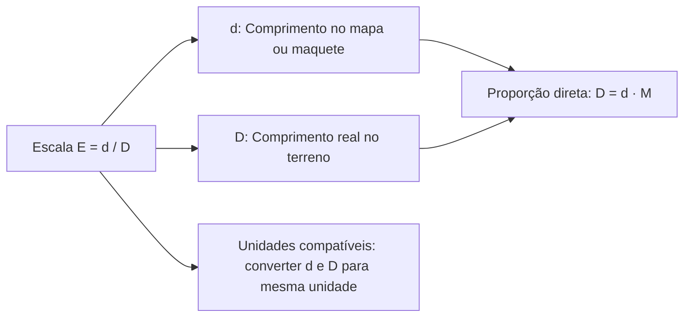
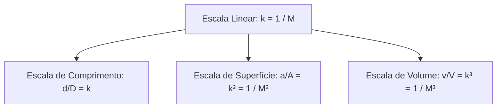
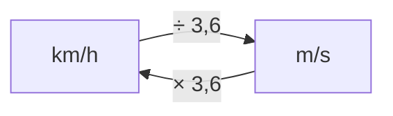
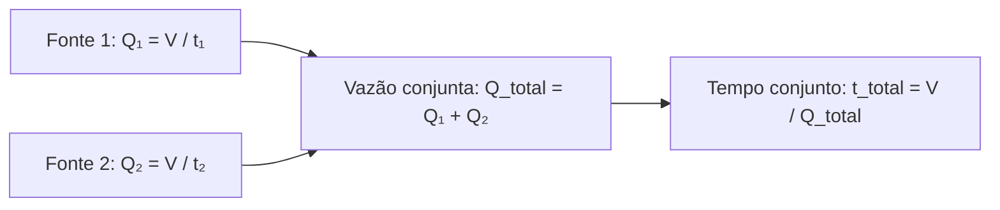
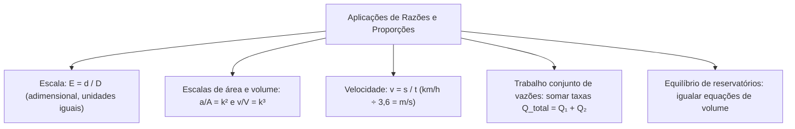

O estudo de escalas, velocidade média e vazão volumétrica reúne aplicações práticas de razões e proporções e relações de dependência entre grandezas exigidas nas provas de concurso. No planejamento de resgates e combate a incêndios, o oficial toma decisões com base em plantas cartográficas, tempo de deslocamento de viaturas e vazão de bombas hidráulicas.

Essas grandezas operam algebricamente como razões diretas. Enquanto a escala compara distâncias de mesma espécie em representações gráficas, a velocidade média relaciona deslocamento com tempo, e a vazão quantifica a transferência de volume por unidade temporal. Neste capítulo, estudaremos escalas lineares e de superfície, a cinemática de perseguições e travessias e a modelagem de vazões conjuntas em reservatórios.

> [!objetivos]
> - Aplicar escalas numéricas cartográficas alinhando previamente as unidades de medida lineares.
> - Compreender a variação quadrática e cúbica em escalas de área e de volume.
> - Calcular velocidade média e converter grandezas entre km/h e m/s com o fator 3,6.
> - Resolver problemas de trabalho conjunto de fontes de abastecimento somando suas vazões.

## Escala numérica e proporcionalidade geométrica

A escala numérica expressa a razão constante entre a medida linear representada no papel, mapa ou maquete (d) e a medida linear real no terreno (D). A fórmula canônica é E = d / D, registrada como fração unitária 1 : M, em que M é o fator de redução.

A escala numérica é uma razão adimensional. Por isso, a dimensão do desenho e a do terreno devem estar expressas na mesma unidade antes da simplificação. A notação 1 : 50.000 indica que cada 1 centímetro no mapa corresponde a 50.000 centímetros reais no terreno (500 metros ou 0,5 km). Em problemas práticos, compare comprimentos alinhando milímetros, centímetros ou metros de modo homogêneo.

Analise as aplicações práticas de cálculo de escala:
1. *Maquete para terreno:* Uma maquete de helicóptero na escala 1 : 24 possui fuselagem de 20cm de extensão. O comprimento real do aparelho no solo é D = 20 · 24 = 480 centímetros, o que equivale a 4,8 metros.
2. *Planta cadastral:* Em planta na escala 1 : 2.500, a distância gráfica entre hidrantes na folha técnica é de 20cm. A distância real no terreno resulta em D = 20 · 2.500 = 50.000 cm = 500 metros.
3. *Terreno para o desenho:* Uma avenida reta com extensão de 600m deve ser lançada em carta de escala 1 : 4.000. Convertendo 600m em 60.000 cm, divide-se pelo fator 4.000: d = 60.000 / 4.000 = 15 centímetros no papel. Se o desenho mostrasse 20cm, a distância real equivaleria a 800 metros.

| Escala adotada | Dimensão gráfica (d) | Fator de redução (M) | Medida real apurada (D) | Contexto típico de uso |
| :--- | :--- | :--- | :--- | :--- |
| 1 : 24 | 20cm | 24 | 480 cm (4,8 m) | Maquetes arquitetônicas e periciais |
| 1 : 2.500 | 20cm | 2.500 | 50.000 cm (500 m) | Plantas cadastrais urbanas de hidrantes |
| 1 : 4.000 | 15 cm | 4.000 | 60.000 cm (600m) | Loteamentos e perímetros de contenção |
| 1 : 50.000 | 4 cm | 50.000 | 200.000 cm (2 km) | Cartas topográficas e áreas rurais |

> [!bizu]
> Para converter rapidamente escalas em mapas: cortar dois zeros transforma centímetros em metros (50.000 cm = 500 m), e cortar cinco zeros transforma centímetros diretamente em quilômetros (1.000.000 cm = 10 km).

## Escalas de área e de volume

Em virtude da semelhança geométrica entre figuras, quando duas figuras planas possuem razão linear de escala k = d / D, a razão entre a área do desenho (a) e a área real (A) é igual ao quadrado da escala linear: a / A = k² = (d / D)². Para sólidos semelhantes, a razão entre o volume da maquete (v) e o volume real (V) é igual ao cubo da escala linear: v / V = k³ = (d / D)³.

Se uma sala de operações possui 6 cm de largura por 8 cm de comprimento em planta na escala 1 : 100:
1. Área no papel: a = 6 · 8 = 48 cm².
2. Escala de área: k² = (1/100)² = 1 / 10.000.
3. Área real: A = 48 · 10.000 = 480.000 cm² = 48 m².
A área real é 10.000 vezes maior que a área gráfica (100²), e não apenas 100 vezes. Se um reservatório em escala 1 : 50 possui capacidade maquetada de 2 litros, o volume real correspondente será 2 · 50³ = 2 · 125.000 = 250.000 litros.

## Velocidade média e conversão entre unidades cinemáticas

A velocidade média (v_m) expressa a razão entre a distância percorrida (Δs) e o tempo transcorrido (Δt): v_m = Δs / Δt.

No deslocamento tático de viaturas e nos laudos periciais de trânsito, as grandezas são expressas habitualmente em km/h ou no padrão fundamental de m/s. Sabendo que 1 km = 1.000 m e 1 h = 3.600 s:
1 km/h = 1.000 m / 3.600 s = 1 m / 3,6 s.
Regras práticas de conversão:
- De km/h para m/s: divide-se o valor numérico por 3,6.
- De m/s para km/h: multiplica-se o valor numérico por 3,6.

Exemplos práticos de cinemática:
- 72 km/h divididos por 3,6 resultam em 20 m/s.
- Uma viatura que percorre 144 km em 2 horas mantém velocidade média de 72 km/h (20 m/s).
- Um percurso de 50 km completado em 30 minutos (0,5 h) atinge 100 km/h.
- Um deslocamento de 200 metros completado em 25 segundos resulta em 8 m/s (28,8 km/h).

| Velocidade em km/h | Operação | Velocidade em m/s | Tempo para 100 metros |
| :--- | :--- | :--- | :--- |
| 36 km/h | ÷ 3,6 | 10 m/s | 10 segundos |
| 72 km/h | ÷ 3,6 | 20 m/s | 5 segundos |
| 108 km/h | ÷ 3,6 | 30 m/s | 3,33 segundos |

Em circuitos fechados, calcula-se a extensão linear da volta. Se uma viatura a 100 km/h por 2 horas cumpre 45 voltas em pista, a distância total é 200 km, e cada volta mede 200 / 45 = 40/9 km. A 180 km/h durante 2 horas percorrem-se 360 km, cumprindo 360 / (40/9) = 81 voltas completas.

## Modelagem de perseguições e travessia de túneis

Em problemas de perseguição no mesmo sentido com velocidades constantes, o tempo até o encontro é idêntico para os dois móveis. Considere o exemplo clássico da perseguição na savana: um tigre a 30 m/s persegue um javali a 10 m/s que partiu com vantagem inicial de 1000 metros. A presa javali percorre distância x e o predador tigre percorre 1000 + x no mesmo tempo t:
x / 10 = (1000 + x) / 30.
Multiplicando em cruz: 30x = 10 · (1000 + x), o que resulta em 30x = 10.000 + 10x, logo 20x = 10.000 e x = 500 metros. O javali percorre 500 metros e o tigre percorre 1.500 metros até o alcance, que ocorre após 50 segundos de corrida ininterrupta.

Na travessia completa de túneis ou pontes por veículos de comprimento L que cruzam obstáculo de comprimento C, a dianteira percorre a distância total C + L.

> [!atencao]
> A travessia completa só se consuma quando a traseira do veículo ultrapassa totalmente a saída do obstáculo. A distância percorrida pela dianteira é igual ao comprimento do túnel somado ao comprimento do próprio móvel (C + L).

Se um trem de comprimento L com velocidade v constante atravessa um túnel de 85 m em 5 s e outro de 160 m em 8 s:
v = (L + 85) / 5 e v = (L + 160) / 8.
Igualando as expressões de velocidade: 8 · (L + 85) = 5 · (L + 160), gerando 8L + 680 = 5L + 800, logo 3L = 120 e L = 40 metros. A velocidade da composição resulta em v = (40 + 85) / 5 = 25 m/s.

## Vazão volumétrica e trabalho conjunto

A vazão volumétrica (Q) mede o volume de fluido (V) transferido por unidade de tempo (t): Q = V / t. Quando duas fontes abastecem o mesmo reservatório simultaneamente para encher sua capacidade, somam-se as suas vazões individuais.

Se a torneira A enche um tanque em 4 horas (vazão V/4) e a torneira B enche em 6 horas (vazão V/6), operando juntas a vazão combinada será:
Q_total = V/4 + V/6 = 5V / 12 por hora.
O tempo para atingir a capacidade integral V será:
t = V / (5V / 12) = 12 / 5 horas = 2,4 horas (2h24min).

| Fontes em operação | Tempos individuais | Equação de vazões | Tempo conjunto apurado |
| :--- | :--- | :--- | :--- |
| Duas torneiras (A e B) | 4 h e 6 h | 1/4 + 1/6 = 5/12 | 12/5 h = 2h24min |
| Duas bombas (P e S) | 2 h e 3 h | 1/2 + 1/3 = 5/6 | 6/5 h = 1h12min |
| Três adutoras | 6 h, 10 h e 15 h | 1/6 + 1/10 + 1/15 = 1/3 | 3 horas |
| Torneira e dreno de fundo | Enche em 3 h e drena em 5 h | 1/3 - 1/5 = 2/15 | 15/2 h = 7h30min |

Para três torneiras em que duas levam 9 h e 12 h para encher e o conjunto completo leva 4 h:
1/9 + 1/12 + 1/t = 1/4.
1/t = 1/4 - 1/9 - 1/12 = 2/36 = 1/18, logo t = 18 horas para a terceira torneira operando isolada.

## Reservatórios com enchimento e esvaziamento concorrente

A dinâmica de reservatórios conectados exige o equacionamento da variação temporal do volume estocado. Quando um recipiente sofre alimentação e esgotamento concorrentes, a taxa horária de acúmulo de líquido equivale à diferença algébrica entre a taxa de alimentação (vazao1) e a taxa de descarga (vazao2). O volume acumulado em função do tempo t resulta da expressão V(t) = V₀ + (vazao1 - vazao2) · t, onde V₀ expressa o volume inicial já existente no reservatório.

Em problemas de dois reservatórios que mudam de nível simultaneamente, avalia-se o instante em que os volumes se tornam iguais. Considere dois tanques idênticos de 900 litros. O primeiro recipiente encontra-se inicialmente com carga total de 900 litros e passa a ter o volume retirado1 pela válvula de descarga à taxa vazao1 = 10 L/h. O segundo recipiente está totalmente vazio e recebe água por vazao2 = 15 L/h, correspondendo ao volume inserido ao longo do tempo.

Equacionando os volumes de cada recipiente após t horas:
- Volume no primeiro recipiente: V₁(t) = 900 - 10t (com 10t correspondendo ao total retirado1).
- Volume no segundo recipiente: V₂(t) = 15t (com 15t representando o total inserido).
Para determinar o momento em que os volumes dos dois compartimentos se igualam, monta-se a igualdade V₁(t) = V₂(t):
900 - 10t = 15t
25t = 900
t = 900 / 25 = 36 horas.

Após 36 horas contínuas de operação, cada recipiente conterá exatamente 15 · 36 = 540 litros de água. O volume retirado1 do primeiro foi de 360 litros (10 · 36), enquanto o volume inserido no segundo totalizou 540 litros. Se um terceiro recipiente recebesse uma taxa inserido2 de 20 L/h partindo de 180 litros iniciais, sua curva seria V₃(t) = 180 + 20t, permitindo cruzar níveis em instantes determinados com facilidade.

> [!pegadinha]
> Verifique sempre se a vazão de entrada supera a de saída antes de calcular tempos para encher um recipiente. Caso a saída seja maior em um tanque vazio, o reservatório permanecerá sem acúmulo de líquido.

## Resoluções guiadas de problemas contextualizados

Acompanhe a aplicação das técnicas em problema contextualizado do serviço de bombeiros.

> [!resolvido]
> **Questão contextualizada:** Durante a contenção de incêndio florestal, um caminhão auto bomba tanque com reservatório de 15.000 litros atua alimentando duas linhas de mangueira simultâneas: a primeira descarrega 250 litros por minuto e a segunda descarrega 150 litros por minuto. Simultaneamente, uma carreta tanque de apoio reabastece a viatura de combate à taxa contínua de 100 litros por minuto. Estando o tanque da viatura inicialmente cheio, em quantos minutos o reservatório se esgotará por completo?
>
> **Resolução passo a passo:**
> 1. *Vazão total de saída (consumo de água):*
>    Q_saida = 250 L/min + 150 L/min = 400 litros por minuto.
> 2. *Vazão de entrada (reabastecimento contínuo):*
>    Q_entrada = 100 litros por minuto.
> 3. *Vazão líquida de esvaziamento:*
>    Q_liquida = Q_saida - Q_entrada = 400 - 100 = 300 litros por minuto.
> 4. *Tempo até o esgotamento total:*
>    Tempo = Volume inicial / Q_liquida = 15.000 / 300 = 50 minutos.
>
> Resposta: O reservatório da viatura de combate levará exatamente 50 minutos para se esgotar por completo.

> [!exemplo]
> Quando bombas secundárias entram em operação após o início da ocorrência, parcele o cálculo em etapas cronológicas distintas, deduzindo o saldo da primeira etapa antes de somar as novas vazões.

## Mapa do capítulo

Neste capítulo examinamos as aplicações de razões e proporções e relações de dependência entre grandezas em contextos de escalas, velocidade média e vazão volumétrica. Sistematizamos o cálculo de escalas adimensionais, conversões cinemáticas com o fator 3,6 e o princípio de aditividade de vazões no abastecimento e esgotamento de reservatórios.

### Para fixar
- Escala é a razão entre comprimento representado e comprimento real (E = d / D).
- Antes de calcular a escala, iguale as unidades de medida lineares.
- Em escalas lineares com fator k, áreas variam com k² e volumes variam com k³.
- Para converter velocidade de km/h em m/s divide-se por 3,6; o inverso multiplica por 3,6.
- A travessia completa de túnel ou ponte exige percorrer a extensão do obstáculo mais o comprimento do móvel.
- Vazão volumétrica expressa a razão Q = V / t.
- Fontes que operam juntas para encher um reservatório têm suas vazões somadas diretamente.
- Em processos concorrentes de enchimento e esvaziamento, a vazão líquida resulta da diferença entre entrada e saída.
