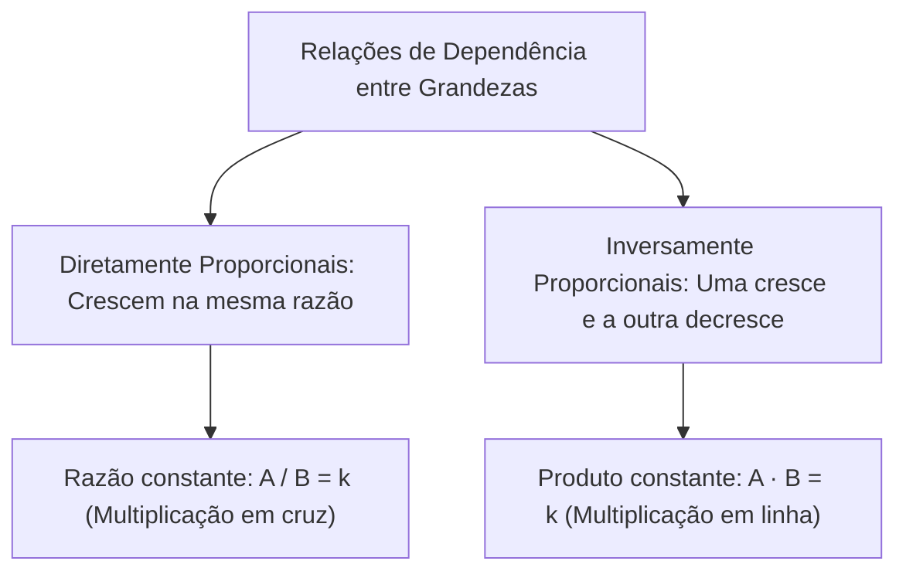
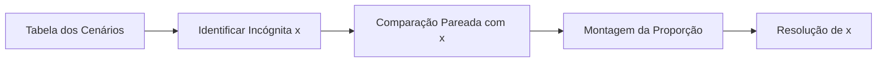
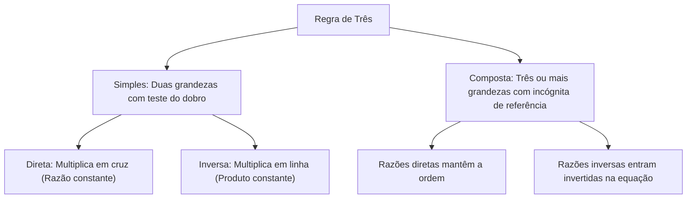

A regra de três é o método operacional para resolver problemas de proporcionalidade entre grandezas. Na rotina dos serviços de emergência e de segurança, esse raciocínio orienta o cálculo de combustível de viaturas, o dimensionamento de pessoal e a escala de plantões.

Nas provas, dominar esse conteúdo exige discernir se duas grandezas variam no mesmo sentido (diretamente proporcionais) ou em sentidos opostos (inversamente proporcionais). Erros na identificação desse comportamento invertem razões e geram resultados ilógicos. Neste capítulo, estudaremos a constante de proporcionalidade k, a regra de três simples direta e inversa e o método sistemático da regra de três composta.

> [!objetivos]
> - Diferenciar grandezas diretamente proporcionais de grandezas inversamente proporcionais mediante o teste do dobro.
> - Compreender a constante k e estruturar proporções diretas e inversas sem equívocos.
> - Resolver problemas de regra de três simples e composta com simplificação de frações.

## Grandezas e constante de proporcionalidade na regra de três simples

Grandeza é tudo aquilo que pode ser medido ou contado, como o número de médicos em um posto, horas de trabalho, volume de combustível ou quantidade de pessoas. Ao relacionarmos duas grandezas vinculadas a uma tarefa, elas apresentam dois tipos essenciais de dependência:

1. *Grandezas diretamente proporcionais:* Ocorrem quando o aumento de uma grandeza acarreta o aumento proporcional da outra. A razão matemática entre os valores correspondentes é constante: A / B = k.
   - Exemplo com médicos e pacientes: Se 4 médicos atendem 54 pacientes por dia em um posto ou delegacia, quantos pacientes seis médicos atenderão? Mais profissionais atendem mais pessoas (relação direta). Pela proporção cruzada P1 · M2 = P2 · M1 (onde as expressões p1m2 e p2m1 se igualam), temos 54 · 6 = P · 4, logo P = 324 / 4 = 81 pacientes. O cruzamento atua como facilitador operacional que reduz a complexidade dos cálculos.
2. *Grandezas inversamente proporcionais:* Ocorrem quando o aumento de uma grandeza produz a redução proporcional da outra. O produto matemático entre elas é fixo: A · B = k.
   - Exemplo com estoque de alimentos: Um estoque de alimentos planejado para alimentar um grupo de 200 pessoas durante 30 dias define um total fixo de 200 · 30 = 6000 pessoa-dias. Se recebermos mais 50 pessoas, totalizando 250 indivíduos no grupo, os produtos p1t1 e p2t2 valem o mesmo montante de k: 250 · T = 6000. O suprimento vai durar T = 6000 / 250 = 24 dias. Alguns acham erradamente que multiplicar em cruz resolveria, mas se retiramos pessoas do grupo o estoque durará mais tempo.

| Relação entre Grandezas | Comportamento lógico | Relação matemática invariável | Regra prática de cálculo |
| :--- | :--- | :--- | :--- |
| **Diretamente proporcional** | Ambas sobem ou descem juntas | Razão constante: A / B = k | Multiplica-se em cruz |
| **Inversamente proporcional** | Quando uma sobe, a outra desce | Produto constante: A · B = k | Multiplica-se em linha horizontal |

> [!bizu]
> O teste do dobro: Para saber o sentido da relação, pergunte: "Se dobrarmos a primeira grandeza, a segunda dobra ou cai pela metade?" Dobra: direta. Cai pela metade: inversa.

> [!pegadinha]
> Multiplicar em cruz relações inversas: Multiplicar em cruz relações de estoque ou tempo gera respostas absurdas. Se 6 bombeiros realizam um serviço em 10 horas, mais bombeiros gastarão menos tempo (6 · 10 = 15 · t, resultando em 4 horas). Multiplicar em cruz geraria 25 horas, resultado incoerente.

## A estrutura da regra de três composta

A regra de três composta envolve três ou mais grandezas interdependentes que atuam conjuntamente na realização de um trabalho ou serviço.

Roteiro de resolução em quatro passos:
1. *Tabela dos cenários:* Alinhe os dados em colunas, colocando a grandeza que contém a incógnita x na primeira coluna à esquerda como termo referencial.
2. *Comparação pareada individual:* Compare cada uma das outras grandezas isoladamente com a coluna da incógnita x. Pergunte: "Se esta grandeza aumentar, a grandeza da incógnita precisa aumentar ou diminuir?".
3. *Montagem da equação:* Isole a fração da incógnita no primeiro membro. No segundo membro, multiplique as razões das demais grandezas. As grandezas diretas mantêm a posição dos números; as grandezas inversas são invertidas.
4. *Simplificação:* Simplifique as frações antes de calcular os produtos finais para agilizar o tempo de prova.

| Tipo da grandeza frente à incógnita | Variação com x | Disposição na equação |
| :--- | :--- | :--- |
| **Diretamente Proporcional** | Mesmo sentido | Mantém a ordem original da tabela |
| **Inversamente Proporcional** | Sentido oposto | Inverte o numerador com o denominador |

> [!atencao]
> Unidades homogêneas: Antes de armar a proporção, padronize as unidades de medida (todas as horas em minutos ou dias no mesmo padrão).

## Resolução guiada de problema com questão de concurso

Vejamos a aplicação prática em uma questão de concurso.

> [!resolvido]
> **Questão contextualizada:** Em uma central de atendimento, 6 servidores atendem 28 cidadãos em um plantão de 8 horas. Mantida a mesma produtividade média, quantos servidores serão necessários para atender 42 cidadãos trabalhando em um regime de 6 horas?
> A) 8 servidores.
> B) 9 servidores.
> C) 10 servidores.
> D) 12 servidores.
> E) 14 servidores.
>
> **Resolução passo a passo:**
> 1. *Identificação dos dois cenários:*
>    - Servidores: cenário 1 = 6; cenário 2 = x (referência)
>    - Cidadãos atendidos: cenário 1 = 28; cenário 2 = 42
>    - Horas de trabalho: cenário 1 = 8; cenário 2 = 6
>
> 2. *Análise comparativa com a coluna dos servidores:*
>    - Servidores e Cidadãos: Mais cidadãos exigem mais servidores (relação direta, mantém 28 / 42).
>    - Servidores e Horas: Menos horas de trabalho exigem mais servidores (relação inversa, inverte para 6 / 8).
>
> 3. *Montagem e simplificação da proporção:*
>    6 / x = (28 / 42) · (6 / 8)
>    - Simplificando 28 / 42 por 14: obtemos 2 / 3.
>    - Simplificando 6 / 8 por 2: obtemos 3 / 4.
>    - Multiplicação: (2 / 3) · (3 / 4) = 6 / 12 = 1 / 2.
>
> 4. *Determinação de x:*
>    6 / x = 1 / 2
>    1 · x = 6 · 2 -> x = 12 servidores.
>
> Resposta correta: Alternativa D.

## Mapa do capítulo

Examinamos as bases da proporcionalidade direta e inversa e o algoritmo para resolução de regras de três simples e compostas.

### Para fixar
- Grandezas diretamente proporcionais mantêm a razão constante (A / B = k); resolvem-se em cruz.
- Grandezas inversamente proporcionais mantêm o produto constante (A · B = k); multiplicam-se em linha.
- No problema do estoque de alimentos para alimentar pessoas, a relação com o tempo é estritamente inversa.
- Na regra de três composta, a coluna da incógnita é a referência comparativa para todas as outras grandezas.
- Razões de grandezas inversas entram invertidas no produto da proporção.
- Padronize as unidades de medida antes de calcular e confira a coerência do resultado.
