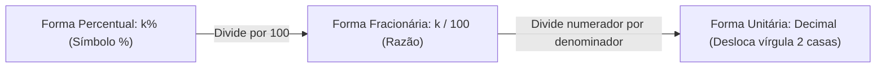
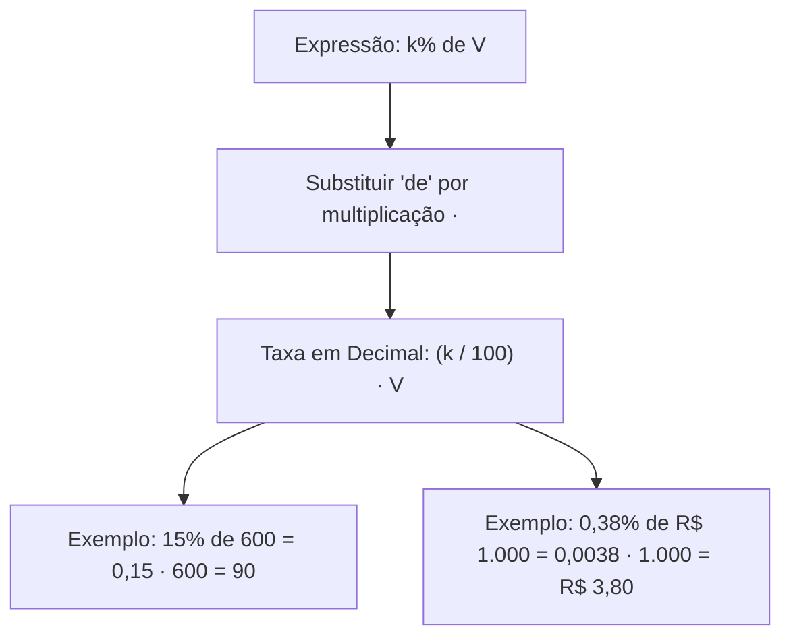
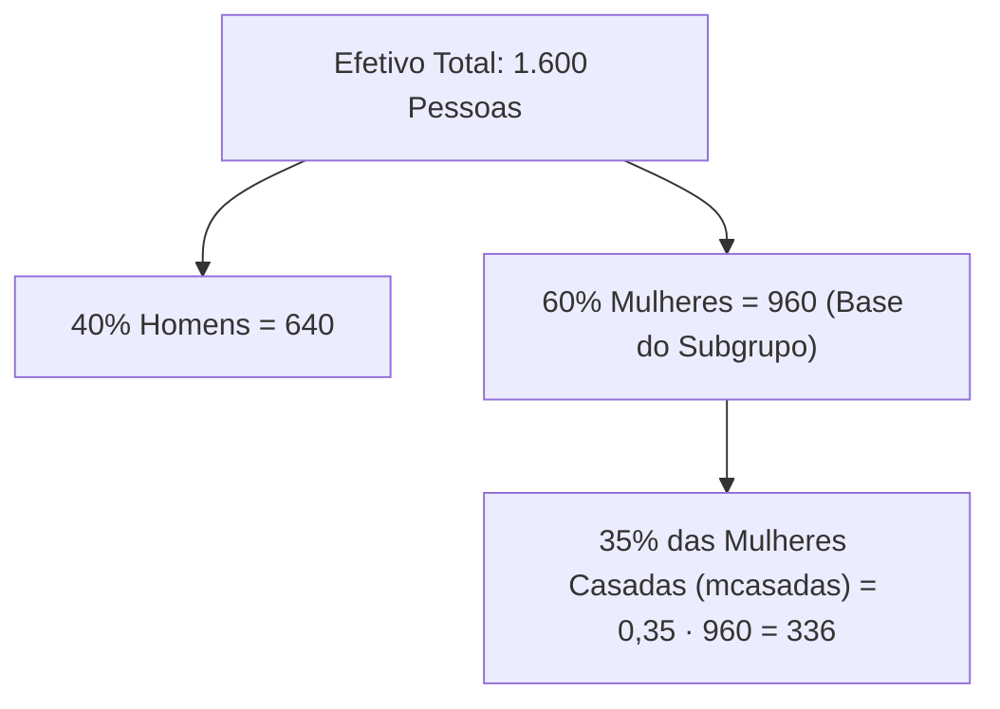
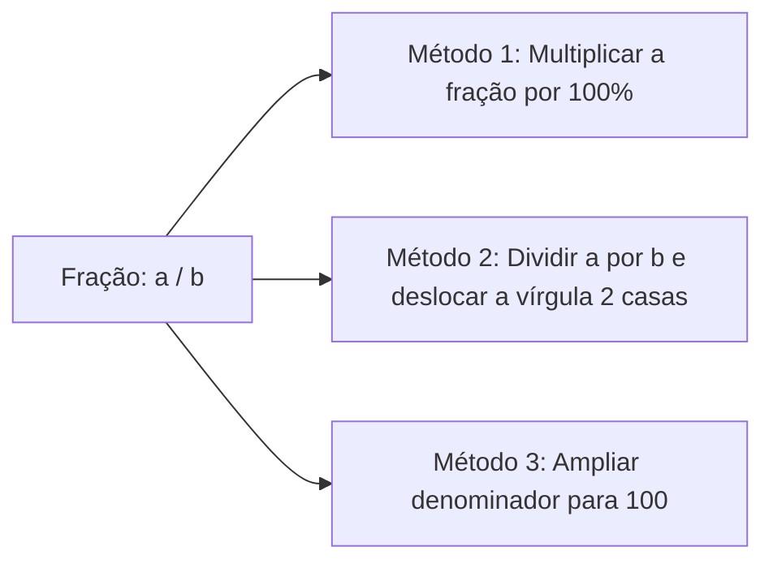
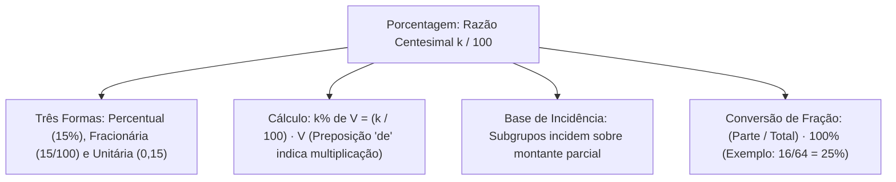

A porcentagem é um dos instrumentos matemáticos mais aplicados na administração pública e na segurança. Nos serviços de emergência e de segurança, os índices percentuais balizam a análise da criminalidade, a resolução de inquéritos, a execução orçamentária e as despesas com manutenção de viaturas.

Nos concursos públicos, o tema da porcentagem é cobrado em cálculos diretos e em problemas de raciocínio financeiro. As pegadinhas envolvem a confusão entre taxa percentual e forma unitária decimal, a aplicação de taxas decimais muito baixas ou superiores a 100%, e a identificação da base real de cálculo. Neste capítulo, examinaremos a razão centesimal, as três formas de representação, o cálculo sobre valores absolutos, o controle da base de incidência e a conversão de frações ordinárias em taxas.

> [!objetivos]
> - Compreender a porcentagem como razão centesimal de denominador 100.
> - Converter entre as formas percentual, fracionária e unitária (decimal).
> - Calcular porcentagens de valores absolutos, interpretando "de" como multiplicação.
> - Identificar a base de cálculo em problemas contextualizados com subgrupos.
> - Transformar frações ordinárias em taxas percentuais.

## Conceito de porcentagem e as três formas de representação

A palavra porcentagem significa "por cento" ou "a cada centena". Uma porcentagem é uma razão cujo denominador é igual a 100. Representa-se uma taxa percentual k pelo símbolo %, indicando a fração k / 100.

Todo valor percentual pode ser expresso em três formas matemáticas equivalentes:
1. *Forma Percentual:* Representação gráfica com o símbolo %. Exemplos: 15%, 8%, 120%, 0,38%.
2. *Forma Fracionária:* Razão centesimal com denominador 100. Exemplos: 15 / 100 (simplificada: 3 / 20), 8 / 100 (2 / 25), 120 / 100 (6 / 5) e 0,38 / 100.
3. *Forma Unitária (Decimal):* Quociente da divisão da taxa por 100. Desloca-se a vírgula duas casas para a esquerda. Exemplos: 15% = 0,15; 8% = 0,08; 120% = 1,20; e 0,38% = 0,0038.

A forma unitária toma o número 1 como referência para a totalidade (100% = 1,00). Porcentagens superiores a 100% indicam valores maiores que a referência: uma taxa de 235% corresponde na forma unitária a 2,35; uma taxa de 1.700% equivale na forma unitária ao número inteiro 17.

| Taxa percentual | Forma percentual | Forma fracionária | Fração simplificada | Forma unitária (decimal) |
| :--- | :--- | :--- | :--- | :--- |
| Cinco por cento | 5% | 5 / 100 | 1 / 20 | 0,05 |
| Vinte por cento | 20% | 20 / 100 | 1 / 5 | 0,20 |
| Cinquenta por cento | 50% | 50 / 100 | 1 / 2 | 0,50 |
| Setenta e cinco por cento | 75% | 75 / 100 | 3 / 4 | 0,75 |
| Cem por cento | 100% | 100 / 100 | 1 / 1 | 1,00 |
| Cento e cinquenta por cento | 150% | 150 / 100 | 3 / 2 | 1,50 |
| Zero vírgula trinta e oito por cento | 0,38% | 0,38 / 100 | 38 / 10.000 | 0,0038 |
| Mil e setecentos por cento | 1.700% | 1.700 / 100 | 17 / 1 | 17,00 |

> [!bizu]
> Passagem para a forma unitária: O símbolo % significa dividir por 100. Ao calcular, converta a taxa para decimal ou fração. Multiplicar direto pela taxa sem dividir por 100 produz um resultado 100 vezes maior que o correto.

## Cálculo da porcentagem de um número e armadilhas de taxa

Para calcular k% de um valor V, multiplica-se V pela forma fracionária ou decimal da taxa:

Resultado = (k / 100) · V = Taxa unitária · V

A preposição "de" indica multiplicação. Assim, "15% de 600" traduz-se por 0,15 · 600 = 90.

Casos essenciais em concursos:
1. *Taxas decimais inferiores a 1%:* 0,89% de 400 exige dividir 0,89 por 100 (0,0089 · 400 = 3,56, e não 356). Da mesma forma, 0,38% de R$ 1.000,00 equivale a 0,0038 · 1.000 = R$ 3,80.
2. *Taxas superiores a 100%:* 1.700% de 18 equivale a multiplicar 18 pela forma unitária 17: 17 · 18 = 306 (e não 30.600).
3. *Porcentagem de porcentagem:* 12% de 0,15 equivale a 0,12 · 0,15 = 0,018 (ou 1,8%).

| Enunciado do cálculo | Conversão decimal | Operação | Resultado |
| :--- | :--- | :--- | :--- |
| **15% de 600** | 0,15 · 600 | 15 · 6 | 90 |
| **0,89% de 400** | 0,0089 · 400 | 0,89 · 4 | 3,56 |
| **0,38% de R$ 1.000** | 0,0038 · 1.000 | 0,38 · 10 | R$ 3,80 |
| **1.700% de 18** | 17 · 18 | 17 · 18 | 306 |
| **12% de 0,15** | 0,12 · 0,15 | 12 · 0,0015 | 0,018 |

> [!pegadinha]
> Cuidado com 0,89% e 0,38%: Se a taxa possui o símbolo %, o número deve ser dividido por 100, deslocando a vírgula duas casas à esquerda (0,89% = 0,0089).

## A identificação da base de cálculo e problemas com subgrupos

Um erro comum em provas é aplicar a porcentagem sobre a base errada. Em questões com subgrupos, multas, juros, contratos e comissões, deve-se isolar a base de incidência indicada no texto.

Exemplos práticos de fixação da base:
1. *Subgrupos populacionais:* Em um efetivo de 1.600 pessoas, se 40% são homens (640), as mulheres representam 60% (960). Se 35% das mulheres são casadas (mcasadas), calcula-se 35% de 960 = 336, e nunca 35% de 1.600.
2. *Contratos e investimentos:* Pedro mantém reservas na poupança. Quando um valor é creditado após a aquisição de equipamentos ou pgto de contas, os rendimentos incidem sobre o saldo líquido remanescente.
3. *Produção cultural e orçamentos:* Na produção de um filme, se o diretor (tdiretor) e os produtores (tprodutores) queriam dividir receitas, a comissão incide sobre a bilheteria bruta, enquanto impostos incidem sobre o lucro líquido.
4. *Diferença temporal:* Se uma proposta reduz um tempo de 170 min (2 h e 50 min) em 20% (136 min) e outra o aumenta em 10% (187 min), a diferença entre elas é de 51 min, correspondendo a exatamente 30% da base original de 170 min.
5. *Multa e juros:* Uma mensalidade de R$ 250,00 com multa de 2% (R$ 5,00) e juros simples de 0,5% ao dia por 10 dias (5% = R$ 12,50) atinge o total de R$ 267,50.
6. *Corretagem e imposto:* Venda de imóvel por R$ 750 mil, compra por R$ 400 mil e reforma de R$ 160 mil. A corretagem de 5% sobre a venda equivale a R$ 37,5 mil. O lucro líquido é de R$ 152,5 mil, sobre o qual o imposto de 15% resulta em R$ 22.875,00.

| Situação contextual | Base de incidência correta | Operação | Resultado |
| :--- | :--- | :--- | :--- |
| **Mulheres casadas (mcasadas)** | Número de mulheres (960) | 0,35 · 960 | 336 casadas |
| **Multa de mora (2%)** | Valor nominal (R$ 250) | 0,02 · 250 | R$ 5,00 |
| **Juros de 10 dias (5%)** | Valor nominal (R$ 250) | 0,05 · 250 | R$ 12,50 |
| **Corretagem (5%)** | Venda bruta (R$ 750 mil) | 0,05 · 750.000 | R$ 37.500,00 |
| **Imposto (15%)** | Lucro líquido (R$ 152,5 mil) | 0,15 · 152.500 | R$ 22.875,00 |

> [!atencao]
> Corretagem na venda e imposto no lucro: Taxas de corretagem incidem sobre a venda bruta; impostos incidem sobre o lucro real apurado após as deduções.

## Transformação de fração ordinária em taxa percentual

Para expressar uma fração ordinária a / b na forma de taxa percentual, aplicam-se métodos aritméticos diretos:

Três caminhos de conversão:
1. *Multiplicação por 100%:* Multiplica-se o numerador por 100 e divide-se pelo denominador.
   - 4 / 5: (4 / 5) · 100% = 80%.
   - 7 / 8: (7 / 8) · 100% = 87,5%.
   - 15 / 12: simplificada para 5 / 4 -> (5 / 4) · 100% = 125%.
2. *Conversão decimal preliminar:* Divide-se a por b e desloca-se a vírgula duas casas para a direita.
   - 16 / 64: simplificada para 1 / 4 = 0,25 -> 25%.
3. *Ampliação fracionária:* Multiplica-se numerador e denominador pelo mesmo fator para atingir denominador 100.
   - 3 / 20: multiplica-se por 5 -> 15 / 100 = 15%.

Determinação da taxa de uma parte sobre o montante global:
Para expressar a porcentagem de uma parte p em relação ao todo T, calcula-se:

Taxa = (Parte / Total) · 100%

Exemplo: Em um grupamento com 120 viaturas, 18 estão em manutenção. A taxa de indisponibilidade é (18 / 120) · 100% = (3 / 20) · 100% = 15%.

| Fração | Simplificação | Decimal | Taxa equivalente |
| :--- | :--- | :--- | :--- |
| **1 / 2** | Irredutível | 0,50 | 50% |
| **1 / 4** | Irredutível | 0,25 | 25% |
| **3 / 4** | Irredutível | 0,75 | 75% |
| **4 / 5** | Irredutível | 0,80 | 80% |
| **7 / 8** | Irredutível | 0,875 | 87,5% |
| **15 / 12** | 5 / 4 | 1,25 | 125% |
| **16 / 64** | 1 / 4 | 0,25 | 25% |
| **3 / 20** | Irredutível | 0,15 | 15% |

> [!bizu]
> Frações clássicas de prova: Memorize as equivalências: 1/2 = 50%, 1/4 = 25%, 3/4 = 75%, 1/5 = 20%, 2/5 = 40%, 1/8 = 12,5% e 1/10 = 10%.

## Resolução guiada de problema com questão de concurso

Vejamos a aplicação em uma questão típica de concurso.

> [!resolvido]
> **Questão contextualizada:** Em uma operação de fiscalização, foram abordados 800 veículos. Desse total, 35% foram autuados por irregularidades. Dentre os veículos autuados, 25% apresentavam falhas nos extintores de incêndio obrigatórios. O total de veículos com falhas nos extintores foi de:
> A) 50 veículos.
> B) 70 veículos.
> C) 85 veículos.
> D) 90 veículos.
> E) 110 veículos.
>
> **Resolução passo a passo:**
> 1. *Total de autuados sobre a frota:*
>    Autuados = 35% de 800 = 0,35 · 800 = 280 veículos.
>
> 2. *Falhas no extintor sobre os autuados:*
>    A taxa de 25% incide sobre a base dos 280 autuados.
>    Falhas = 25% de 280 = (1 / 4) · 280 = 70 veículos.
>
> 3. *Cálculo em linha:*
>    Resultado = 0,25 · 0,35 · 800 = 70 veículos.
>
> Resposta correta: Alternativa B.

## Mapa do capítulo

Examinamos a razão centesimal, as três formas de representação, o cálculo sobre valores e o controle da base de incidência.

### Para fixar
- Porcentagem é uma fração centesimal com denominador 100 (k% = k / 100).
- A forma unitária decimal divide a taxa por 100 (deslocando a vírgula duas casas à esquerda).
- Porcentagens superiores a 100% indicam valores maiores que a referência (1.700% = 17).
- O conectivo "de" indica multiplicação na matemática financeira.
- Taxas decimais inferiores a 1% continuam divididas por 100 (0,38% = 0,0038).
- Em subgrupos, a porcentagem incide sobre a base parcial do grupo, não sobre o total geral.
- Para transformar frações ordinárias em porcentagens, multiplique por 100%.
- A relação entre parte e montante calcula-se por (Parte / Total) · 100%.
