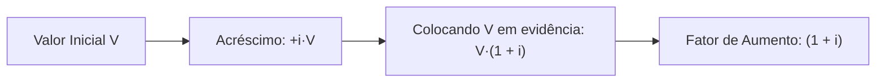
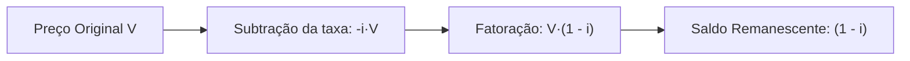
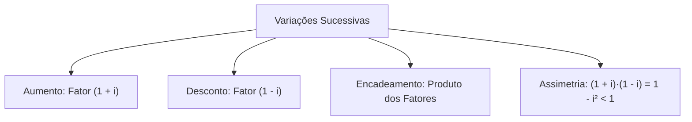

No estudo das porcentagens, os aumentos e descontos sucessivos são muito frequentes em concursos da área de segurança. Essas variações incidem sobre bases móveis. Por isso, nunca devemos somar taxas percentuais de forma direta.

A chave do tema está nos fatores multiplicativos. Eles condensam o valor inicial e o acréscimo ou abatimento em uma única etapa de conta.

> [!objetivos]
> - Compreender a dedução do fator de aumento (1 + i) e de desconto (1 - i).
> - Operar variações sucessivas multiplicando os fatores de cada etapa.
> - Evitar o erro de somar taxas percentuais sobre bases distintas.
> - Reconhecer a assimetria entre aumentos e descontos consecutivos de mesma taxa.
> - Calcular a taxa acumulada a partir do produto dos fatores decimais.

## Mecanismo algébrico e fator de aumento

Quando uma grandeza sofre aumento percentual, o novo valor soma o original com o acréscimo. Se uma quantia V passa por uma taxa de aumento i na forma decimal, temos a relação direta:

V_final = V + i · V = V · (1 + i)

O termo (1 + i) é o fator multiplicativo de aumento. O número 1 representa o valor integral (100%). A parcela i expressa o acréscimo proporcional.

Pense em um equipamento de comunicação com preço inicial de R$ 1.000. Se ele sofre aumento de 8%, convertemos a taxa para a forma unitária: 8% = 0,08. O cálculo do novo preço é direto:

V_final = 1.000 · (1 + 0,08) = 1.000 · 1,08 = R$ 1.080

Se esse bem recebe outro aumento de 9% no mês seguinte, essa taxa incide sobre R$ 1.080. Ela não incide sobre o capital primitivo. Operamos o produto encadeado:

V_final = 1.080 · (1 + 0,09) = 1.080 · 1,09 = 1.000 · 1,08 · 1,09 = R$ 1.177,20

A soma ingênua das taxas (8% + 9% = 17%) daria R$ 1.170. Esse valor ignora os juros sobre juros gerados pela mudança de base. A taxa acumulada líquida decorre do produto dos fatores:

Fator acumulado = 1,08 · 1,09 = 1,1772
Taxa acumulada = (1,1772 - 1) · 100% = 17,72%

> [!atencao]
> **Cuidado com a Forma Unitária na Base**
> Em sucessões de aumentos i1, i2, ..., in, o valor final multiplica todos os fatores:
> V_final = V_inicial · (1 + i1) · (1 + i2) · ... · (1 + in)
> Jamais some taxas sucessivas. A soma aritmética ignora o crescimento da base em cada etapa.

## Fator de desconto e reduções sucessivas

O raciocínio para reduções segue a mesma lógica, mudando o sinal da operação. Se uma quantia V sofre desconto de taxa i, o valor final guarda a diferença entre o total e a parcela retirada:

V_final = V - i · V = V · (1 - i)

A expressão (1 - i) é o fator multiplicativo de desconto. Se o preço de R$ 1.000 sofre desconto de 8%, usamos a taxa na forma unitária 0,08:

V_final = 1.000 · (1 - 0,08) = 1.000 · 0,92 = R$ 920

Quando vários descontos ocorrem em sequência, cada fator atua sobre o saldo da etapa anterior. Por exemplo, descontos sucessivos de 15% e 6% não somam 21%. O cálculo exato multiplica os fatores decimais:

Fator acumulado = (1 - 0,15) · (1 - 0,06) = 0,85 · 0,94 = 0,7990

O bem preserva 79,90% de seu valor de partida. A taxa de desconto acumulada é o complemento para o total:

Desconto líquido = (1 - 0,7990) · 100% = 20,10%

O desconto real de 20,10% é menor que a soma de 21%. Isso ocorre porque o segundo desconto incidiu sobre uma base já reduzida.

## A assimetria entre aumento e desconto consecutivos

Muitas questões afirmam que um aumento de x% seguido de redução de x% recupera o valor inicial. Essa afirmação é falsa. A causa é a assimetria das bases de cálculo.

Considere uma base de 100 unidades com aumento de 10% e desconto posterior de 10%:

1. No início, o acréscimo de 10% eleva o valor: 100 · 1,10 = 110.
2. Em seguida, o abatimento de 10% incide sobre 110: 110 · 0,90 = 99.

O resultado final é 99, com perda líquida de 1%. De modo geral, combinar aumento e desconto de mesma taxa i produz o fator:

(1 + i) · (1 - i) = 1 - i²

Como o termo i² é sempre positivo para taxas reais, o fator resultante será menor do que 1. O desconto sobre a base maior supera o ganho inicial.

| Cenário de Variação | Produto dos Fatores | Valor Final (Base 100) | Variação Líquida |
| :--- | :--- | :--- | :--- |
| Aumento único de 15% | 1,15 | 115,00 | +15,00% |
| Dois aumentos de 10% | 1,10 · 1,10 | 121,00 | +21,00% |
| Aumentos de 10%, 11% e 12% | 1,10 · 1,11 · 1,12 | 136,75 | +36,75% |
| Aumento 10% e desconto 10% | 1,10 · 0,90 | 99,00 | -1,00% |
| Descontos de 15% e 6% | 0,85 · 0,94 | 79,90 | -20,10% |
| Dois aumentos e dois descontos de 20% | 1,20² · 0,80² | 92,16 | -7,84% |

A ordem dos aumentos e descontos não altera o resultado final. A multiplicação é comutativa.

> [!resolvido]
> **Exercício Resolvido: Encadeamento de Aumentos e Descontos**
> Uma viatura com preço de R$ 1.000 passa por aumentos de 8% e 9%, seguidos de desconto de 17%. Determine o preço final e a variação acumulada.
>
> **Resolução passo a passo:**
> 1. Escrevemos os fatores multiplicativos:
>    - Aumento de 8%: fator = 1,08
>    - Aumento de 9%: fator = 1,09
>    - Desconto de 17%: fator = 0,83
>
> 2. Multiplicamos os fatores sobre o valor inicial:
>    V_final = 1.000 · 1,08 · 1,09 · 0,83
>    V_final = 1.000 · 1,1772 · 0,83 = R$ 977,08
>
> 3. Calculamos a variação líquida:
>    Variação = ((977,08 / 1.000) - 1) · 100% = -2,292%
>
> **Conclusão:** O preço final é R$ 977,08. Há uma redução líquida de 2,292%, ficando R$ 22,92 abaixo do valor original.

## Mapa do capítulo

Estudamos os fatores de aumento e de desconto, o encadeamento multiplicativo e a assimetria entre variações sucessivas.

### Para fixar
- Fator de aumento com taxa i na forma unitária decimal: (1 + i).
- Fator de desconto com taxa i na forma unitária decimal: (1 - i).
- Em etapas sucessivas, multiplique os fatores de cada período.
- Aumentos de 8% e 9% geram fator 1,1772, ou seja, aumento de 17,72%.
- Descontos de 15% e 6% deixam 79,90% do valor inicial (queda de 20,10%).
- Aumento e desconto de mesma taxa não se anulam; geram perda líquida de i².
- A ordem dos fatores não altera o resultado final da operação.
- A taxa acumulada obtém-se por (Fator Final - 1) · 100%.
