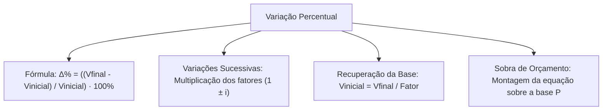

A análise da variação percentual é fundamental para interpretar estatísticas criminais e execuções orçamentárias nos órgãos de segurança pública. Comparar dois momentos de uma grandeza exige rigor na determinação da base de referência.

Nas provas, as questões exigem o domínio da fórmula da taxa relativa, a composição de variações sucessivas e a recuperação do valor de partida quando apenas o montante reajustado é fornecido.

> [!objetivos]
> - Aplicar a fórmula fundamental da variação percentual relativa identificando a base correta.
> - Interpretar variações percentuais positivas e negativas em grandezas monetárias e físicas.
> - Calcular a taxa acumulada de múltiplos reajustes sucessivos sem somar porcentagens.
> - Recuperar valores iniciais a partir do valor final e do fator de reajuste.
> - Resolver problemas clássicos de provas envolvendo sobra de orçamento e compras programadas.

## Conceito e fórmula da variação percentual relativa

A variação percentual relativa expressa a razão entre a mudança absoluta de uma grandeza e o seu valor primitivo na forma centesimal. A base de comparação é sempre o valor inicial Vinicial.

Se uma grandeza varia de Vinicial para Vfinal, a fórmula da variação percentual relativa Δ% é formulada por:

Δ% = ((Vfinal - Vinicial) / Vinicial) · 100%

O numerador expressa a diferença Vfinal - Vinicial. O denominador fixa a referência Vinicial.

Quando Vfinal supera Vinicial, o resultado é positivo, indicando aumento. Quando Vfinal é menor que Vinicial, a diferença é negativa, indicando redução percentual.

Vejamos uma compra pública. Uma mercadoria custava R$ 195 e passa para R$ 219,43 após correção de mercado. Para encontrar a taxa percentual de aumento:

1. Calculamos a variação absoluta: Vfinal - Vinicial = 219,43 - 195 = 24,43.
2. Dividimos pela base inicial: 24,43 / 195 ≈ 0,12528.
3. Multiplicamos por 100 para obter o percentual: 0,12528 · 100% ≈ 12,53%.

A mesma relação se aplica a grandezas físicas e ambientais monitoradas por peritos. Suponha que a concentração de partículas inaláveis no ar reduza de 54 microgramas por metro cúbico para 29 microgramas por metro cúbico:

Δ% = ((29 - 54) / 54) · 100% = (-25 / 54) · 100% ≈ -46,30%

O sinal negativo evidencia uma redução relativa de 46,30% na concentração de partículas inaláveis. Em questões de concurso, a banca pode registrar o resultado como "queda de 46,30%", dispensando o sinal negativo.

> [!atencao]
> **Base de Referência na Variação Relativa**
> O denominador da razão é sempre Vinicial.
> Trocar Vinicial por Vfinal no denominador altera o índice e induz ao erro.

## Composição de variações sucessivas e taxa acumulada

Quando uma grandeza sofre vários reajustes, cada nova variação incide sobre o valor vigente naquele instante. Para achar a taxa acumulada iacumulada, transformamos cada taxa em seu fator multiplicativo.

Sejam i1, i2, ..., in as taxas percentuais de aumento ou desconto em etapas consecutivas. O valor final Vfinal relaciona-se com Vinicial pelo produto encadeado:

Vfinal = Vinicial · (1 ± i1) · (1 ± i2) · ... · (1 ± in)

O produto dos fatores constitui o fator multiplicativo acumulado. A taxa iacumulada é obtida subtraindo a unidade desse produto final:

iacumulada = (Fator acumulado - 1) · 100%

Considere um produto cujo preço original P sofre aumento de 15% e depois desconto de 10%. O preço final Pfinal resulta de:

Pfinal = P · (1 + 0,15) · (1 - 0,10) = P · 1,15 · 0,90 = 1,035 · P

O fator acumulado é 1,035. Subtraindo a unidade, temos a taxa iacumulada:

iacumulada = (1,035 - 1) · 100% = +3,50%

A soma simplista das taxas (+15% - 10% = +5%) é errada. O desconto de 10% incide sobre a base já majorada de 115%.

Analogamente, consideremos dois descontos sucessivos de 15% e 10% concedidos a Ernesto na compra de materiais:

Fator acumulado = (1 - 0,15) · (1 - 0,10) = 0,85 · 0,90 = 0,765

O preço final pago corresponde a 76,5% do valor inicial. O desconto acumulado efetivo é o complemento em relação a 100%:

Desconto efetivo = (1 - 0,765) · 100% = 23,50%

Note que o desconto total é de 23,50%, e não 25%. O segundo abatimento incide sobre a base de 85%.

Em outro cenário, um contrato passa por reajustes sucessivos de 10%, 5% e 6%:

Fator acumulado = 1,10 · 1,05 · 1,06 = 1,2243

O reajuste acumulado atinge 22,43%, ficando abaixo de 22,50% e acima da soma nominal de 21%. Nas provas, itens afirmando que esse reajuste supera 22,5% são incorretos.

> [!bizu]
> **Adotar Base 100 para Resolução Rápida**
> Arbitrando 100 para o valor inicial quando a questão não informa a quantia primitiva, o valor final revela diretamente a porcentagem acumulada. Se o resultado for 103,50, o aumento foi de 3,50%. Se for 76,50, a redução foi de 23,50%.

## Descontos agressivos sucessivos e o perigo da leitura equivocada

Um dos artifícios mais perigosos envolve sucessões de descontos elevados, como abatimentos consecutivos de 40% e 30%. O estudante distraído tende a somar as taxas para 70%, ou confunde o preço final Pfinal com o desconto:

1. O primeiro desconto de 40% gera o fator: 1 - 0,40 = 0,60.
2. O segundo desconto de 30% incide sobre o saldo: 1 - 0,30 = 0,70.
3. O fator acumulado resultante é: 0,60 · 0,70 = 0,42.

O número 0,42 indica que o preço final Pfinal é 42% do original. O desconto efetivo obtido é a diferença em relação ao montante global:

Desconto total = (1 - 0,42) · 100% = 58,00%

O desconto equivalente é de 58%, e não de 70%. Marcar 42% como taxa de desconto é erro grave.

Outro padrão cobrado é o reajuste repetido em vários anos. Com taxa anual de 30% durante 2 anos consecutivos sobre Vinicial:

Vfinal = Vinicial · 1,30 · 1,30 = 1,69Vinicial
iacumulada = (1,69 - 1) · 100% = 69,00%

A correção total de 1,69Vinicial representa alta de 69%, superando a soma de 60%.

| Evento Sucessivo | Cálculo com Fatores | Fator Resultante | Variação Acumulada |
| :--- | :--- | :--- | :--- |
| Alta de 15% e baixa de 10% | 1,15 · 0,90 | 1,0350 | +3,50% |
| Baixas sucessivas de 15% e 10% | 0,85 · 0,90 | 0,7650 | -23,50% |
| Altas de 10%, 10% e baixa de 7% | 1,10 · 1,10 · 0,93 | 1,1253 | +12,53% |
| Altas sucessivas de 10%, 5% e 6% | 1,10 · 1,05 · 1,06 | 1,2243 | +22,43% |
| Baixas sucessivas de 40% e 30% | 0,60 · 0,70 | 0,4200 | -58,00% |
| Altas de 30% ao ano em 2 anos | 1,30 · 1,30 | 1,6900 | +69,00% |
| Duas altas e duas baixas de 20% | 1,20² · 0,80² | 0,9216 | -7,84% |

O quadro comparativo resume o comportamento dos fatores multiplicativos em variações acumuladas.

> [!pegadinha]
> **Desconto Não é o Preço Restante**
> Não confunda a porcentagem remanescente com a taxa de abatimento concedida.
> Se o produto passa a custar 42% do preço original, o desconto concedido foi de 58%, e não de 42%.

## Recuperação do valor inicial e equações com base desconhecida

Quando a prova informa o valor final após um reajuste percentual e solicita a quantia de partida, dividimos o valor final pelo fator multiplicativo:

Vinicial = Vfinal / Fator

Se o salário de um servidor atinge R$ 3.500 após aumento de 40%, o fator de acréscimo é 1,40:

Salário inicial = 3.500 / 1,40 = R$ 2.500

Subtrair 40% de R$ 3.500 daria R$ 2.100, um equívoco provocado pelo cálculo sobre a base errada.

> [!resolvido]
> **Exercício Resolvido: Problema da Sobra Financeira de Estela**
> Estela planeja adquirir um pacote de cursos cujo preço original de catálogo é P. Ela dispõe de uma reserva equivalente a 76% do valor P. Em uma promoção, o pacote recebe desconto de 30% sobre P. Ao efetuar a contratação com o preço promocional, sua reserva financeira foi suficiente para pagar o pacote e ainda fez sobrar a quantia de R$ 426. Qual é o valor original P desse pacote?
>
> **Resolução passo a passo:**
> 1. *Quantia disponível com Estela:*
>    Reserva = 0,76 · P
>
> 2. *Preço promocional do pacote:*
>    Com desconto de 30% sobre P:
>    Preço com desconto = (1 - 0,30) · P = 0,70 · P
>
> 3. *Equação com a quantia que restou sobrar:*
>    A reserva cobre o curso com desconto mais o valor excedente de R$ 426:
>    0,76 · P = 0,70 · P + 426
>
> 4. *Isolamento da incógnita P:*
>    0,76 · P - 0,70 · P = 426
>    0,06 · P = 426
>    P = 426 / 0,06 = R$ 7.100
>
> **Conclusão:** O preço original de catálogo P é de R$ 7.100. A reserva de Estela era de R$ 5.396 e o curso custou R$ 4.970, fazendo sobrar exatamente R$ 426.

## Variação percentual entre grandezas inversamente proporcionais

A relação percentual também aparece no rendimento de equipes policiais. Se uma equipe aumenta sua velocidade operacional em 25%, qual é a redução percentual no tempo gasto?

1. Sendo W o trabalho total, W = V · T.
2. A nova velocidade majorada em 25% é V' = 1,25 · V = (5 / 4) · V.
3. Para manter o mesmo trabalho W, o novo tempo T' deve cumprir:
   (5 / 4) · V · T' = V · T
   T' = (4 / 5) · T = 0,80 · T

O novo tempo corresponde a 80% do inicial. A redução percentual no tempo gasto é:

Δ% tempo = ((0,80 · T - T) / T) · 100% = -20,00%

Assim, aumento de 25% na velocidade resulta em redução de 20% no tempo, e não de 25%.

> [!atencao]
> **Grandezas Inversas e Taxas Assimétricas**
> Um aumento de taxa i em grandeza inversamente proporcional gera fator 1 / (1 + i) na grandeza conjugada. A variação relativa resultante não possui a mesma taxa absoluta.

## Mapa do capítulo

Examinamos a variação percentual relativa, a composição de taxas por fatores multiplicativos, os descontos sucessivos e o resgate da base original Vinicial.

### Para fixar
- A variação percentual relativa utiliza sempre Vinicial no denominador da razão.
- A fórmula fundamental é dada por Δ% = ((Vfinal - Vinicial) / Vinicial) · 100%.
- Aumento de 15% seguido de desconto de 10% resulta em taxa iacumulada de +3,50%.
- Descontos sucessivos de 15% e 10% equivalem a abatimento líquido de 23,50%, não 25%.
- Descontos sucessivos de 40% e 30% deixam preço de 42%, gerando abatimento real de 58%.
- Inflação de 30% ao ano durante 2 anos resulta em 1,69Vinicial, com alta de 69%.
- Três altas de 10%, 5% e 6% acumulam 22,43%, índice que é inferior a 22,50%.
- Para restaurar Vinicial a partir de Vfinal com acréscimo de 40%, divide-se por 1,40.
- No problema de Estela, a equação com o valor que fez sobrar é montada sobre o preço original P.
- Aumento de 25% na velocidade acarreta redução de 20% no tempo em virtude da relação inversa.
