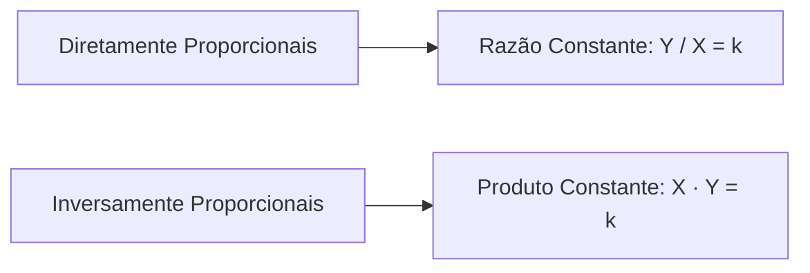
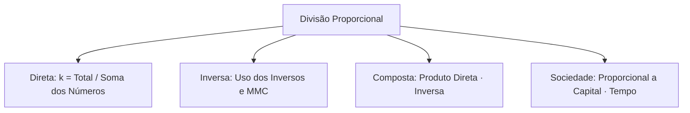

A divisão proporcional é fundamental para repartir recursos e analisar dados em provas de concursos. Quem domina a constante de proporcionalidade k resolve questões extensas em poucas linhas, inclusive casos de sociedade e enunciados com diferença entre partes.

Neste estudo prático, examinamos como identificar grandezas diretas e inversas, aplicar o atalho de duas partes e calcular partilhas compostas.

> [!objetivos]
> - Compreender a distinção entre grandezas diretamente e inversamente proporcionais.
> - Determinar a constante de proporcionalidade k para repartir um total.
> - Operar a divisão inversamente proporcional utilizando os inversos e o mínimo múltiplo comum.
> - Resolver problemas de divisão composta combinando grandezas diretas e inversas.
> - Calcular partilhas em sociedades comerciais pelo produto entre capital e tempo.

## O que este material cobre e como estudar

O estudo da divisão proporcional (item 3.1 do edital) exige atenção à constante k. O total T dividido pela soma dos coeficientes numéricos fornece o valor de cada cota. Para estudar com eficiência:

1. Identifique se a relação é direta ou inversa antes de iniciar as contas.
2. Na partilha direta, cada cota é k vezes o número correspondente.
3. Se os números forem frações, multiplique todos pelo mesmo fator para obter inteiros.

Duas grandezas são diretamente proporcionais quando sua razão é constante: se uma dobra, a outra dobra. São inversamente proporcionais quando seu produto é constante: se uma dobra, a outra cai à metade.

Para repartir um total T em partes proporcionais aos números a, b e c:

a · k + b · k + c · k = T
k = T / (a + b + c)

> [!atencao]
> **Constante de Proporcionalidade k**
> A constante k representa o valor de cada cota unitária:
> k = Total / (Soma dos pesos).
> Cada parte individual resulta de k multiplicado pelo seu respectivo número.

> [!resolvido]
> **Exercício Resolvido: Divisão Diretamente Proporcional**
> Três agentes dividem uma gratificação de R$ 150 em partes diretamente proporcionais aos números 1, 2 e 2. Quanto recebe a menor parte?
>
> **Resolução passo a passo:**
> 1. Soma dos números: 1 + 2 + 2 = 5.
> 2. Constante k: k = 150 / 5 = R$ 30.
> 3. Menor cota: 1 · 30 = R$ 30.
>
> **Conclusão:** A menor parte equivale a R$ 30.

## Divisão inversamente proporcional e o atalho de inversão

Na divisão inversamente proporcional, o participante com menor número recebe a maior quantia financeira. O cálculo utiliza os inversos dos números dados.

Reduzem-se as frações inversas ao mesmo denominador pelo mmc, trabalhando depois apenas com os numeradores inteiros obtidos.

Para exatamente duas partes, vale o atalho de inverter as posições: ser inversamente proporcional a 4 e 6 equivale a ser diretamente proporcional a 6 e 4. Com três ou mais partes, esse atalho não funciona.

> [!bizu]
> **Atalho das Duas Partes na Inversa**
> Dividir inversamente por x e y equivale a dividir diretamente por y e x.
> Exemplo: Inversa a 3 e 5 vira direta a 5 e 3.

> [!pegadinha]
> **Atalho Não Funciona para Três ou Mais Partes**
> Nunca inverta posições quando houver 3 ou mais termos.
> Repartir inversamente a 2, 3 e 6 exige usar os inversos 1/2, 1/3 e 1/6.

> [!resolvido]
> **Exercício Resolvido: Divisão Inversa com Três Partes**
> Divida R$ 360 em partes inversamente proporcionais a 3, 4 e 6.
>
> **Resolução passo a passo:**
> 1. Inversos: 1/3, 1/4 e 1/6.
> 2. Denominador comum (mmc = 12): viram 4/12, 3/12 e 2/12.
> 3. Pesos inteiros: 4, 3 e 2 (soma = 9).
> 4. Constante k: k = 360 / 9 = R$ 40.
> 5. Partes: 4 · 40 = R$ 160; 3 · 40 = R$ 120; 2 · 40 = R$ 80.

## Divisão composta, diferença dada e sociedades

Na divisão composta, a partilha combina critérios diretos e inversos simultaneamente. Cada parte é proporcional ao produto do número direto pelo inverso do número inverso. A constante k resulta da divisão do total pela soma desses produtos.

Quando o enunciado informa apenas a diferença entre duas partes, iguala-se essa diferença à subtração algébrica dos termos com k.

Em sociedades comerciais, o lucro é repartido proporcionalmente ao produto do capital pelo tempo de investimento (Capital · Tempo).

| Modalidade | Regra Operacional | Relação da Constante k |
| :--- | :--- | :--- |
| Direta | Partes proporcionais a p1, p2, p3 | k = Total / (p1 + p2 + p3) |
| Inversa | Partes proporcionais a 1/p1, 1/p2, 1/p3 | k = Total / (Soma dos numeradores no MMC) |
| Composta | Partes proporcionais a (d1 / i1), (d2 / i2) | k = Total / Soma dos produtos diretos · inversos |
| Sociedade | Proporcional a Capital · Tempo | k = Lucro Total / Soma de (C · t) |

> [!resolvido]
> **Exercício Resolvido: Diferença Entre Partes Conhecida**
> Duas seções recebem verbas proporcionais a 7 e 3. A primeira recebeu R$ 80 a mais que a segunda. Determine as partes.
>
> **Resolução passo a passo:**
> 1. Partes: 7k e 3k.
> 2. Diferença: 7k - 3k = 4k = 80 -> k = R$ 20.
> 3. Valores: 7 · 20 = R$ 140 e 3 · 20 = R$ 60.

> [!resolvido]
> **Exercício Resolvido: Partilha de Lucros em Sociedade**
> O sócio A aplicou R$ 3.000 por 2 meses. O sócio B aplicou R$ 1.000 por 6 meses. O lucro foi de R$ 4.000. Quanto cabe a cada um?
>
> **Resolução passo a passo:**
> 1. Produtos: A = 3.000 · 2 = 6.000; B = 1.000 · 6 = 6.000.
> 2. Como os produtos são iguais, cada sócio recebe a metade: R$ 2.000.

> [!esquema]
> **Guia Rápido de Julgamento para Provas**
> - Proporcional a números não significa partes iguais a esses números.
> - Na inversa, o menor número leva a maior cota.
> - Na sociedade, o lucro acompanha o produto capital vezes tempo.

> [!exemplo]
> **Julgamento de Item 1 (Certo ou Errado)**
> *Item:* Dividir inversamente por 4 e 6 equivale a dividir diretamente por 6 e 4.
> *Gabarito:* CERTO. O atalho é válido para exatamente duas partes.

> [!exemplo]
> **Julgamento de Item 2 (Certo ou Errado)**
> *Item:* Inversamente a 2, 3 e 6, o número 2 recebe a menor cota.
> *Gabarito:* ERRADO. O menor número recebe a maior cota (1/2 é a maior fração).

> [!exemplo]
> **Julgamento de Item 3 (Certo ou Errado)**
> *Item:* Quem aplica o dobro do capital recebe sempre o dobro do lucro.
> *Gabarito:* ERRADO. O tempo de aplicação pode alterar o resultado ponderado.

## Mapa do capítulo

Examinamos a constante k na divisão direta, os inversos com mmc na divisão inversa, o cálculo composto e as sociedades. Este resumo para revisão consolida os tópicos essenciais cobrados nas provas policiais.

### Para fixar
- A constante k é o total dividido pela soma dos coeficientes.
- Cada parte direta vale k vezes o seu respectivo número.
- Na divisão inversa com duas partes, pode-se inverter a ordem dos números.
- Na divisão inversa com três ou mais partes, usam-se os inversos e o mmc.
- Na partilha inversa, o menor número recebe a maior quantia.
- Se o texto der a diferença entre partes, iguale essa diferença a k vezes a subtração dos termos.
- Na divisão composta, somam-se os produtos do número direto pelo inverso do indireto.
- Em sociedades, o lucro segue o produto capital vezes tempo de aplicação.
- Capitais diferentes geram lucros iguais se os produtos capital · tempo coincidirem.
- Para simplificar frações, multiplique todos os termos pelo mesmo fator multiplicador.
