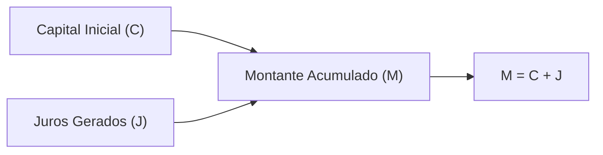
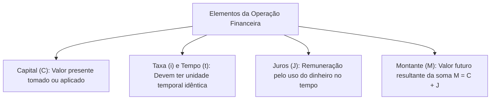

A Matemática Financeira estuda o comportamento do dinheiro ao longo do tempo. Para o gestor público, compreender as variáveis fundamentais de uma operação de crédito ou investimento é indispensável. O gerenciamento de recursos orçamentários e contratos públicos exige rigor no cálculo financeiro.

Nas provas de concurso, as bancas costumam propor questões com afirmativas para julgar cada assertiva como verdadeira ou falsa. O candidato precisa dominar as notações técnicas e as relações entre capital, taxa, prazo e o montante resultante.

> [!objetivos]
> - Identificar e conceituar os elementos fundamentais de uma operação financeira.
> - Compreender o papel do capital inicial tomado ou aplicado como valor presente.
> - Definir os juros como a remuneração pelo uso temporário do capital.
> - Aplicar a regra de compatibilidade entre a unidade da taxa e o período de tempo.
> - Calcular o montante final pela relação fundamental M = C + J.

## Capital inicial e juros em operações financeiras

Qualquer operação financeira, seja um empréstimo bancário ou uma aplicação em títulos públicos, envolve a interação entre grandezas bem definidas.

O **Capital**, comumente representado pela letra C ou pelas notações VP (Valor Presente) e P (Principal), define a quantia monetária disponível ou aplicada no início da transação. Trata-se do recurso financeiro no instante zero. Quando um órgão público contrai um financiamento para viaturas, o valor originalmente tomado emprestado constitui o capital da operação.

Por sua vez, o elemento **Juros** (representado pela letra J) define a remuneração paga pelo uso temporário de um capital alheio. Para a instituição que concede o crédito, os juros representam o ganho financeiro obtido. Para quem toma o recurso emprestado, os juros representam o custo pago pela utilização do dinheiro ao longo do tempo decorrido.

> [!bizu]
> **Notações de Capital em Prova**
> Em enunciados de concursos públicos, as bancas adotam diferentes notações para a mesma grandeza. O capital inicial pode ser denominado Capital (C), Principal (P) ou Valor Presente (VP). Todas essas expressões se referem ao valor no instante inicial da operação.

## Taxa de juros e a variável tempo

A dinâmica financeira depende diretamente da velocidade com que o capital rende juros e da duração da transação:

A **Taxa de Juros** (representada pela letra i) define o coeficiente que expressa a remuneração do capital por unidade de tempo estabelecida. Ela é indicada usualmente sob duas formas:
- *Forma Percentual:* expressa o rendimento por cento associado a um período de tempo (por exemplo, 2% ao mês ou 24% ao ano).
- *Forma Unitária:* obtida pela divisão do percentual por 100, sendo a forma decimal indispensável para a realização de cálculos aritméticos (por exemplo, 2% equivale ao decimal 0,02 e 24% equivale a 0,24).

Já a grandeza **Tempo** (representada por t ou n) refere-se ao prazo ou duração total da operação financeira. Essa variável quantifica o intervalo cronológico decorrido entre a data em que o capital foi tomado e o momento de sua devolução com acréscimos.

> [!atencao]
> **Harmonização Obrigatória de Unidades**
> A taxa de juros (i) e o tempo (t) devem estar expressos obrigatoriamente na mesma unidade temporal. Se a taxa estiver expressa ao mês (a.m.), o tempo deve ser medido em meses. Se a taxa estiver expressa ao ano (a.a.), o tempo deve ser convertido para anos.

> [!pegadinha]
> **Taxa Percentual nas Equações**
> Nunca introduza o valor percentual diretamente nas fórmulas financeiras sem dividi-lo por 100. Inserir a taxa 12% como o número 12, em vez do decimal 0,12, multiplica o resultado incorretamente por cem e anula a resolução da questão.

## Montante resultante e análise de operações

O **Montante** (representado pela letra M ou pela sigla VF, de Valor Futuro) define a quantia total apurada ao término do período contratado. Ele corresponde à soma do capital inicial com os juros acumulados durante a aplicação:

M = C + J

Dessa relação matemática fundamental, decorre que os juros auferidos equivalem à diferença entre o montante final e o capital inicial:

J = M - C

| Elemento Financeiro | Notações Usuais | Significado Técnico | Unidade de Aplicação |
| :--- | :--- | :--- | :--- |
| **Capital Inicial** | C ou VP | Valor monetário tomado ou aplicado no instante zero | Reais (R＄) |
| **Juros** | J | Remuneração gerada pelo uso do capital | Reais (R＄) |
| **Taxa de Juros** | i | Coeficiente de rendimento por unidade temporal | Forma decimal ou unitária |
| **Tempo da Operação** | t ou n | Duração cronológica da transação financeira | Meses, anos ou dias |
| **Montante Final** | M ou VF | Soma resultante do capital com os juros auferidos | Reais (R＄) |

Em certames municipais e estaduais, a banca apresenta afirmativas conceituais para julgamento. É comum encontrar assertivas afirmando que o montante independe do prazo ou que os juros representam o capital inicial. O candidato atento identifica a afirmativa verdadeira lembrando que o montante é a grandeza resultante da soma do capital com os rendimentos do período.

> [!resolvido]
> **Exercício Resolvido: Julgamento de Afirmativas e Harmonização**
> Um órgão público avaliou uma operação financeira na qual um capital de R＄ 10.000,00 foi tomado emprestado à taxa de juros simples de 12% ao ano, pelo prazo de 6 meses. Julgue as afirmativas seguintes:
> 
> Afirmativa I: A taxa de juros expressa na forma unitária equivale a 0,12 ao ano.
> Afirmativa II: O montante resultante ao final do período corresponde a R＄ 10.600,00.
> 
> **Resolução passo a passo:**
> 1. *Análise da Afirmativa I:* dividindo a taxa percentual de 12% por 100, obtém-se exatamente o decimal 0,12 ao ano. Logo, a assertiva I é verdadeira.
> 2. *Análise da Afirmativa II:* harmoniza-se o prazo de 6 meses para anos: t = 6 / 12 = 0,5 ano. Os juros simples gerados valem J = C · i · t = 10.000 · 0,12 · 0,5 = R＄ 600,00. O montante final resultante equivale a M = C + J = 10.000 + 600 = R＄ 10.600,00. Logo, a assertiva II também é verdadeira.
> 
> **Conclusão:** Ambas as afirmativas são verdadeiras e consistentes com os princípios da matemática financeira.

## Mapa do capítulo

Neste capítulo de nivelamento conceitual, estudamos as cinco grandezas de uma operação financeira: capital inicial tomado ou aplicado, taxa de juros, tempo de vigência, juros auferidos e o montante resultante.

### Para fixar
- O Capital (C) representa a quantia tomada emprestada ou aplicada no instante zero.
- As notações VP (Valor Presente) e P (Principal) são sinônimas de capital inicial.
- Os Juros (J) constituem a compensação monetária pelo uso do capital alheio.
- A Taxa de Juros (i) expressa o rendimento por período e deve ser usada na forma decimal.
- A unidade da taxa de juros e a unidade do tempo devem coincidir obrigatoriamente.
- O Montante (M) é a quantia total resultante, calculada pela relação fundamental M = C + J.
- O rendimento em juros pode ser deduzido diretamente pela diferença J = M - C.
- Para converter taxa anual em mensal em juros simples, divide-se o valor por 12.
- O tempo da operação financeira pode ser medido em dias, meses, trimestres ou anos.
- A forma unitária da taxa de 6% ao mês equivale exatamente ao decimal 0,06 ao mês.
