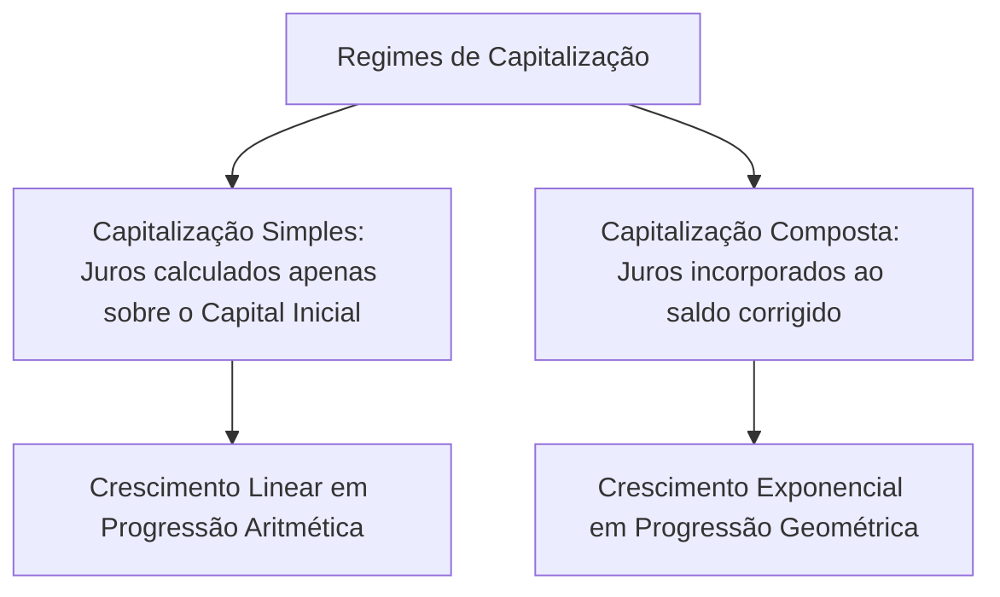
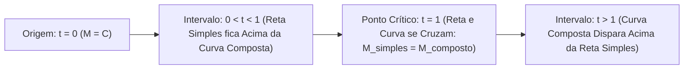
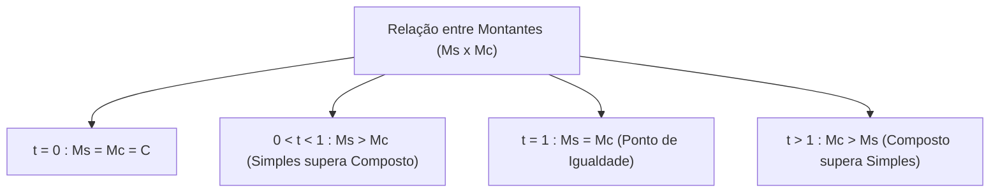
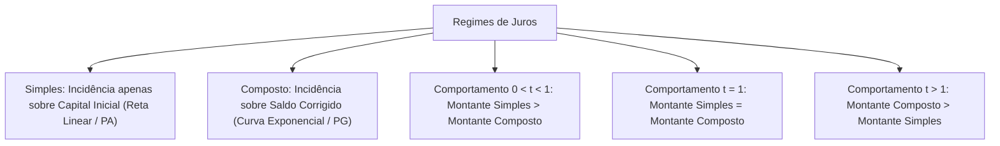

O estudo dos regimes de capitalização define como os juros são calculados e incorporados ao saldo devedor ao longo do tempo. Para o gestor público, compreender essa mecânica é indispensável para analisar contratos públicos, licitações de grande vulto e projeções orçamentárias de longo prazo. A correta precificação financeira assegura a economicidade do erário.

Nas provas de concurso, as bancas organizadoras cobram com grande frequência a comparação conceitual e gráfica entre os regimes simples e composto. As questões exigem identificar em quais intervalos de tempo o montante simples supera, iguala ou perde para o montante composto.

> [!objetivos]
> - Compreender a definição teórica de regime de capitalização financeira.
> - Diferenciar a incidência exclusiva sobre o capital inicial da incidência sobre o saldo corrigido.
> - Analisar o crescimento linear dos juros simples em progressão aritmética.
> - Analisar o crescimento exponencial dos juros compostos em progressão geométrica.
> - Dominar a relação conceitual e gráfica entre montante simples e composto para t menor que um, t igual a um e t maior que um.

## Definição e mecanismos dos regimes de capitalização

Um regime de capitalização consiste no processo matemático e normativo pelo qual os juros são gerados e incorporados periodicamente a um capital inicial. Na prática financeira e jurídica brasileira, coexistem dois grandes regimes de apuração:

1. **Regime de Capitalização Simples (Juros Simples):**
Nesse regime, a taxa de juros incide de forma constante e exclusiva sobre o capital inicial original aplicado no instante zero. Os rendimentos auferidos ao final de cada período não são somados à base de cálculo para a apuração dos juros dos períodos seguintes. Dessa maneira, a quantia de juro gerada em cada intervalo de tempo é rigorosamente constante e invariável. O juro acumulado é uma função puramente linear do tempo decorrido.

2. **Regime de Capitalização Composta (Juros Compostos):**
Nesse modelo, o juro produzido ao término de cada período de capitalização é incorporado ao saldo corrigido anterior. Esse montante corrigido passa a render novos juros no período subsequente. Trata-se do fenômeno conhecido popularmente como juros sobre juros ou anatocismo financeiro. A base de cálculo cresce continuamente a cada período decorrido. O valor agregado ao capital original expande-se de modo acelerado ao longo de horizontes temporais prolongados.

Na matemática comercial, entender essa distinção permite proporcionar uma análise fidedigna da precificação dos contratos administrativos. Em regimes simples, os valores auferidos não se capitalizam. Já no regime composto, o saldo corrigido absorve o juro do ciclo prévio.

> [!bizu]
> **A Base de Cálculo em Prova**
> A diferença conceitual basilar reside exclusivamente na base de cálculo dos juros:
> - Nos juros simples, a base de cálculo é fixa e imutável (apenas o capital inicial C).
> - Nos juros compostos, a base de cálculo é dinâmica e variável (o montante corrigido do período anterior).

## Progressão aritmética versus progressão geométrica

A distinção matemática entre os regimes manifesta-se claramente na velocidade e no padrão de crescimento dos montantes ao longo do tempo:

### O crescimento linear na capitalização simples
Como a parcela de juros em cada período é sempre igual ao produto do capital pela taxa (C · i), o montante ao final de períodos sucessivos cresce somando sempre a mesma quantidade fixa. Esse comportamento caracteriza perfeitamente uma **Progressão Aritmética (PA)** de razão constante R = C · i.

Graficamente, a curva do montante em regime de juros simples é representada por uma **reta linear crescente**. A inclinação dessa reta é dada pelo produto do capital inicial pela taxa de juros. Ao longo dos períodos 1, 2, 3, 4, o montante simples evolui de modo estritamente linear e proporcional.

### O crescimento exponencial na capitalização composta
Na capitalização composta, o saldo de cada período é multiplicado pelo fator constante (1 + i). Assim, os montantes sucessivos ao término de cada intervalo formam uma **Progressão Geométrica (PG)** de razão q = (1 + i).

Graficamente, a curva do montante composto é representada por uma **curva exponencial côncava para cima**. Essa função cresce de maneira moderada nos primeiros instantes. Contudo, ela acelera intensamente em prazos longos, superando com folga a reta linear simples. Os fatores integrados na fórmula exponencial evidenciam o poder multiplicador da capitalização contínua.

| Critério de Análise | Regime Simples | Regime Composto |
| :--- | :--- | :--- |
| **Base de Incidência** | Capital inicial fixo (C) | Saldo corrigido acumulado |
| **Valor dos Juros por Período** | Constante e idêntico em cada mês | Crescente a cada novo período |
| **Comportamento Matemático** | Progressão Aritmética (PA) | Progressão Geométrica (PG) |
| **Representação Gráfica** | Reta linear crescente | Curva exponencial |
| **Aplicação Prática Típica** | Títulos de curtíssimo prazo e duplicatas | Empréstimos bancários e investimentos |

> [!atencao]
> **Juros em Prazos Sucessivos**
> Em juros simples, se o rendimento do primeiro mês for R＄ 200,00, o rendimento do décimo mês será exatamente R＄ 200,00. Em juros compostos, se o primeiro rendimento for R＄ 200,00, os rendimentos seguintes serão obrigatoriamente superiores a R＄ 200,00 em razão da acumulação de juros sobre juros.

## A relação conceitual entre montante simples e composto

Uma das matérias mais exigidas em certames de nível superior para o Corpo de Bombeiros é a comparação entre o montante simples (Ms) e o montante composto (Mc) para um mesmo capital aplicado à mesma taxa de juros.

Logicamente, a relação entre esses montantes subdivide-se em três intervalos temporais rigorosos:

### Primeiro Caso: Instante t = 0 e Ponto de Igualdade t = 1
- No instante zero (t = 0), a operação ainda não gerou rendimentos. O montante em ambos os regimes é rigorosamente igual ao próprio capital inicial aplicado: Ms = Mc = C.
- Ao término do primeiro período inteiro de capitalização (t = 1), os juros gerados incidem exatamente sobre o capital inicial em ambos os regimes. Portanto, para t = 1, o montante simples é exatamente igual ao montante composto: **Ms = Mc**. Esse é o ponto exato em que a reta do regime simples cruza a curva exponencial do regime composto no plano cartesiano.

### Segundo Caso: Período Fracionário (0 < t < 1)
Quando o prazo de aplicação é uma fração do período básico da taxa (por exemplo, meio mês ou meio ano), ocorre um fenômeno contra-intuitivo:
- No intervalo entre 0 e 1, a base de cálculo exponencial gera um fator menor do que o fator linear. Por exemplo, a raiz quadrada de 1,21 é 1,10, enquanto a média linear seria 1,105.
- Em consequência matemática direta, para qualquer tempo entre zero e um, o montante simples é estritamente maior que o montante composto: **Ms > Mc**. A reta gráfica dos juros simples posiciona-se fisicamente acima da curva exponencial nesse trecho inicial.

### Terceiro Caso: Prazos Maiores que a Unidade (t > 1)
A partir do momento em que o tempo ultrapassa o primeiro período completo (t > 1), o efeito multiplicativo da capitalização composta manifesta-se plenamente:
- A geração de juros sobre juros acelera o crescimento do saldo devedor corrigido. O valor agregado ao principal expande-se com rapidez exponencial.
- Para qualquer prazo superior a uma unidade de tempo, o montante composto supera de forma contínua e crescente o montante simples: **Mc > Ms**. A curva exponencial afasta-se para cima da reta linear.

> [!pegadinha]
> **A Armadilha do Intervalo entre Zero e Um**
> Muitas questões de prova afirmam genericamente que os juros compostos produzem sempre um montante maior do que os juros simples. Isso é falso. Para períodos fracionários inferiores a um período da taxa (0 < t < 1), o regime de juros simples gera um montante maior do que o regime composto.

> [!esquema]
> **Síntese Mnemônica das Três Faixas**
> - Se t é menor que 1: Ganha o Simples (Ms > Mc).
> - Se t é igual a 1: Empate perfeito (Ms = Mc).
> - Se t é maior que 1: Ganha o Composto (Mc > Ms).

## Deduções e aplicações na gestão pública de suprimentos

Na administração do Corpo de Bombeiros, o Oficial frequentemente precisa julgar a viabilidade econômica de pagamentos antecipados ou parcelados em compras públicas. Entender a precificação dos juros auferidos e o valor do dinheiro corrigido previne perdas aos cofres do Estado.

Considere uma operação hipotética com capital C = R＄ 1.000,00 e taxa i = 10% ao período (0,10). Podemos construir uma tabela sequencial demonstrativa para ilustrar a evolução dos montantes ao longo de períodos sucessivos (t = 0, t = 0,5, t = 1, t = 2 e t = 3):

| Período (t) | Montante Simples (Ms) | Montante Composto (Mc) | Comparação Direta | Justificativa Teórica |
| :--- | :--- | :--- | :--- | :--- |
| **t = 0** | R＄ 1.000,00 | R＄ 1.000,00 | Ms = Mc | Início da operação sem incidência de rendimento |
| **t = 0,5** | R＄ 1.050,00 | R＄ 1.048,81 | Ms > Mc | Prazo fracionário inferior à unidade de capitalização |
| **t = 1** | R＄ 1.100,00 | R＄ 1.100,00 | Ms = Mc | Término do primeiro período com incidência idêntica |
| **t = 2** | R＄ 1.200,00 | R＄ 1.210,00 | Mc > Ms | Regime composto supera o simples pelo efeito dos juros sobre juros |
| **t = 3** | R＄ 1.300,00 | R＄ 1.331,00 | Mc > Ms | Aceleração exponencial ampliando a vantagem do composto |

Essa comparação lógica evidencia como a curva exponencial ganha velocidade com o passar dos prazos. O gestor público deve ter clareza sobre qual regime está pactuado em cláusulas contratuais para evitar surpresas financeiras em contratos de prestação continuada.

> [!resolvido]
> **Exercício Resolvido: Análise Numérica Comparativa**
> Um gestor de compras do Corpo de Bombeiros analisa duas propostas para aplicar R＄ 10.000,00 à taxa de 10% ao ano. A primeira proposta adota juros simples e a segunda adota juros compostos. Compare os montantes obtidos em três cenários: após 0,5 ano, após 1 ano e após 2 anos.
>
> **Resolução passo a passo:**
> 1. *Cenário 1 (t = 0,5 ano - prazo fracionário menor que 1):*
>    - Juros simples: Ms = C · (1 + i · t) = 10.000 · (1 + 0,10 · 0,5) = 10.000 · 1,05 = R＄ 10.500,00.
>    - Juros compostos: Mc = C · (1 + i)^t = 10.000 · (1 + 0,10)^0,5 = 10.000 · raiz(1,10) = 10.000 · 1,0488 = R＄ 10.488,09.
>    - Comparação: Ms (R＄ 10.500,00) > Mc (R＄ 10.488,09). O regime simples superou o composto.
> 2. *Cenário 2 (t = 1 ano - término do primeiro período):*
>    - Juros simples: Ms = 10.000 · (1 + 0,10 · 1) = R＄ 11.000,00.
>    - Juros compostos: Mc = 10.000 · (1 + 0,10)^1 = R＄ 11.000,00.
>    - Comparação: Ms = Mc = R＄ 11.000,00. Há rigorosa igualdade de montantes.
> 3. *Cenário 3 (t = 2 anos - prazo superior a 1):*
>    - Juros simples: Ms = 10.000 · (1 + 0,10 · 2) = 10.000 · 1,20 = R＄ 12.000,00.
>    - Juros compostos: Mc = 10.000 · (1 + 0,10)^2 = 10.000 · 1,21 = R＄ 12.100,00.
>    - Comparação: Mc (R＄ 12.100,00) > Ms (R＄ 12.000,00). O regime composto superou o simples em R＄ 100,00.
>
> **Conclusão:** O exercício comprova numericamente a teoria: no prazo fracionário o simples foi maior; em um período houve empate; em dois períodos o composto superou o simples.

## Mapa do capítulo

Neste capítulo, estudamos os fundamentos dos regimes de capitalização, contrastando o crescimento linear em progressão aritmética dos juros simples com a expansão exponencial em progressão geométrica dos juros compostos.

### Para fixar
- No regime simples, a taxa incide exclusivamente sobre o capital inicial aplicado.
- No regime composto, a taxa incide sobre o saldo corrigido acumulado ao final do período anterior.
- O montante simples evolui segundo uma Progressão Aritmética de razão C · i.
- O montante composto evolui segundo uma Progressão Geométrica de razão 1 + i.
- A representação gráfica dos juros simples é uma reta linear de inclinação positiva.
- A representação gráfica dos juros compostos é uma curva exponencial com concavidade voltada para cima.
- No primeiro período inteiro (t = 1), os montantes simples e composto são rigorosamente iguais.
- Para qualquer período fracionário entre 0 e 1, o montante simples é superior ao composto.
- Para qualquer período de tempo superior a 1, o montante composto supera o simples.
- A expressão anatocismo refere-se à cobrança de juros sobre juros própria do regime composto.
