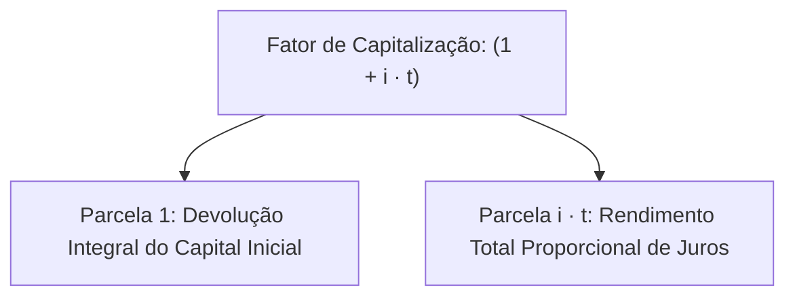
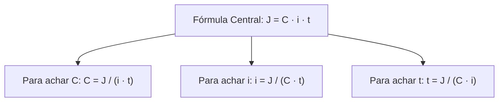
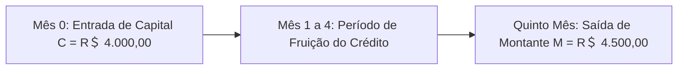
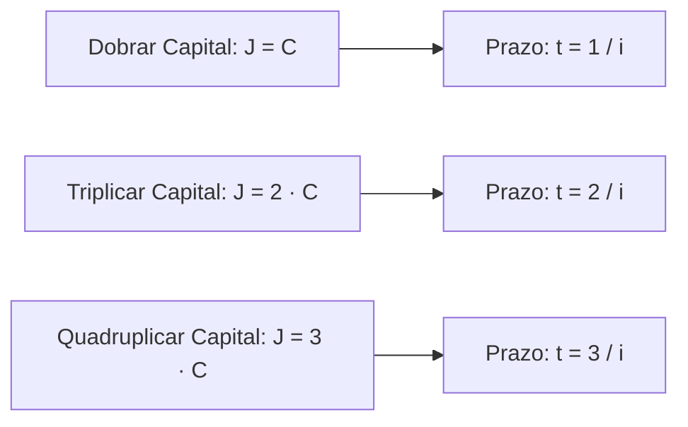
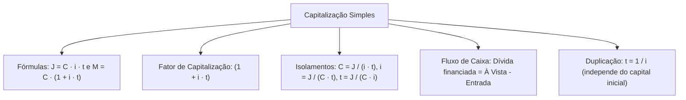

O regime de capitalização simples fundamenta-se na premissa de que os juros auferidos em cada período incidem unicamente sobre o capital inicial original. Para o gestor público, dominar as fórmulas operacionais desse regime é indispensável. O conhecimento permite realizar cálculos rápidos de atualização monetária e auditorias de faturas contratuais.

Nas provas de concurso, as bancas cobram intensamente a dedução das fórmulas fundamentais. Exigem também o isolamento algébrico de cada incógnita e a resolução de problemas práticos de fluxo de caixa que demandam a harmonização entre a taxa e o tempo.

> [!objetivos]
> - Dominar a dedução matemática das fórmulas J = C · i · t e M = C · (1 + i · t).
> - Isolar algebricamente o capital, a taxa e o tempo a partir dos juros ou do montante.
> - Compreender o papel do fator de capitalização simples (1 + i · t).
> - Analisar o fluxo de caixa na quitação de dívida e pagamentos parcelados.
> - Resolver problemas de determinação de taxa implícita e prazo de duplicação de capital.

## Fórmulas fundamentais da capitalização simples

Na capitalização simples, o juro gerado ao término de um único período é calculado diretamente pela multiplicação do capital inicial pela taxa de juros na forma decimal. A fórmula unitária é:

J_1 = C · i

A base de cálculo permanece rigorosamente inalterada ao longo de todos os períodos subsequentes. O rendimento acumulado após t períodos consiste na repetição uniforme dessa mesma parcela de juros. Multiplica-se o juro unitário pelo número total de períodos t decorridos:

J = C · i · t

O montante final (M), por definição universal, corresponde à soma do capital inicial com os juros acumulados da operação. A equação estrutural é:

M = C + J

Substituindo a expressão dos juros na fórmula do montante, temos:

M = C + (C · i · t)

Colocando o capital inicial C em evidência algébrica, obtém-se a consagrada fórmula do montante simples:

M = C · (1 + i · t)

O termo entre parênteses, (1 + i · t), é denominado **Fator de Capitalização Simples** ou Fator de Atualização Financeira. Ele representa o valor acumulado por uma unidade de capital investida à taxa i durante o prazo t.

> [!bizu]
> **O Fator de Capitalização em Cálculos Rápidos**
> Se uma operação rende 3% ao mês durante 5 meses, o fator de capitalização vale:
> 1 + (0,03 · 5) = 1 + 0,15 = 1,15.
> Para achar o montante direto, basta multiplicar o capital inicial por 1,15.

## Isolamento algébrico das variáveis financeiras

Em muitas questões de concurso, o examinador não pede o cálculo direto dos juros ou do montante. Ele fornece o montante final ou o total de juros e exige determinar o capital inicial aplicado, a taxa de juros contratada ou o tempo decorrido.

O candidato deve dominar o isolamento algébrico de cada grandeza a partir da fórmula dos juros (J = C · i · t). As relações isoladas são:

- **Isolamento do Capital Inicial (C):**
C = J / (i · t)

- **Isolamento da Taxa de Juros (i):**
i = J / (C · t)

- **Isolamento do Tempo da Operação (t):**
t = J / (C · i)

Quando o enunciado informa diretamente o montante acumulado (M) em vez dos juros isolados, o capital inicial (Valor Presente) é obtido dividindo-se o montante pelo fator de capitalização:

C = M / (1 + i · t)

Da mesma forma, para isolar a taxa ou o tempo a partir do montante:

(M / C) - 1 = i · t

Logo:
i = [(M / C) - 1] / t
t = [(M / C) - 1] / i

| Variável a Calcular | A partir dos Juros (J) | A partir do Montante (M) |
| :--- | :--- | :--- |
| **Capital Inicial (C)** | C = J / (i · t) | C = M / (1 + i · t) |
| **Taxa de Juros (i)** | i = J / (C · t) | i = [(M / C) - 1] / t |
| **Tempo de Aplicação (t)** | t = J / (C · i) | t = [(M / C) - 1] / i |
| **Juros Totais (J)** | J = C · i · t | J = M - C |

> [!atencao]
> **Compatibilidade nos Cálculos Inversos**
> Ao calcular a taxa de juros com a fórmula i = J / (C · t), a unidade do resultado obtido acompanhará a unidade em que o tempo foi inserido. Se t foi inserido em meses, a taxa resultará ao mês. Se t foi inserido em anos, a taxa resultará ao ano. Multiplique o valor decimal por 100 para expressar em percentual.

## Análise de fluxo de caixa e quitação de dívida

Nas operações cotidianas, a representação gráfica de um **fluxo** de caixa auxilia na visualização das entradas e saídas de recursos ao longo do tempo. As entradas de caixa são desenhadas como setas verticais para cima, e as saídas representam desembolsos apontados para baixo.

Considere a situação prática de João, que contraiu uma dívida bancária para quitar despesas operacionais. A obrigação financeira previa pagamento integral no quinto mês após a contratação. Se a dívida original era de R＄ 4.000,00 e a taxa acertada foi de 2,5% ao mês (taxa unitária 0,025), o montante da dívida paga ao final do quinto período é apurado pela fórmula linear:

M = C · (1 + i · t) = 4.000 · (1 + 0,025 · 5) = 4.000 · (1 + 0,125) = 4.000 · 1,125 = R＄ 4.500,00.

O valor dos juros adicionados totalizou R＄ 500,00. Esse modelo demonstra como o fluxo temporal impacta o saldo devedor até sua liquidação.

Em outro caso clássico, Marlene comprou um equipamento que custava à vista R＄ 2.400,00. Como não possuía o total imediato, ela deu uma entrada de R＄ 800,00 e financiou o restante para quitação em 4 meses com juros simples de 3% ao mês.
- O capital financiado por Marlene não foi o valor total do equipamento, mas o saldo devedor restante: C = 2.400 - 800 = R＄ 1.600,00.
- Os juros gerados foram J = 1.600 · 0,03 · 4 = R＄ 192,00.
- O montante final pago por Marlene no encerramento da dívida correspondeu a M = 1.600 + 192 = R＄ 1.792,00.

Também no comércio de veículos, Josué adquiriu uma motocicleta usada. O veículo custava R＄ 8.000,00 à vista. Josué pagou R＄ 3.000,00 de entrada e assumiu uma promissória com vencimento após 6 meses. O credor aplicou taxa simples de 4,5% ao mês (0,045).
- O saldo financiado por Josué foi C = 8.000 - 3.000 = R＄ 5.000,00.
- Os juros computados valeram J = 5.000 · 0,045 · 6 = R＄ 1.350,00.
- A promissória paga no sexto mês totalizou M = 5.000 + 1.350 = R＄ 6.350,00.

Também no crédito ao servidor público, o empréstimo consignado é contratado para superar dificuldades orçamentárias imediatas. Ao sacar o dinheiro na instituição financeira, os juros fixos incidem sobre o saldo tomado. Se um militar contrai R＄ 4.000,00 consignado à taxa mensal de 0,06 (6%), os encargos continuarão incidindo proporcionalmente até a quitação, gerando parcelas mensais previsíveis. O valor da prestação deduzida em folha reflete a amortização do principal somada ao juro do período.

Em outro caso prático de prova, um militar tomou um capital inicial de R＄ 2.800,00 emprestado. Após 4 meses à taxa simples de 2,4% ao mês, os juros gerados foram J = 2.800 · 0,024 · 4 = R＄ 268,80, e o montante resultante somou R＄ 3.068,80. Se o capital fosse R＄ 2.000,00 à taxa de 3,4% ao mês por 4 meses, os juros seriam J = 2.000 · 0,034 · 4 = R＄ 272,00.

> [!bizu]
> **Dívida Paga com Entrada**
> Toda vez que uma transação envolver pagamento de entrada, deduza imediatamente o valor pago à vista antes de aplicar qualquer fórmula de juros. Os juros incidem exclusivamente sobre a dívida líquida financiada.

## Problemas clássicos: duplicação de capital e taxas implícitas

Determinadas estruturas de problemas repetem-se constantemente nas provas de concurso público. Analisamos a seguir dois modelos clássicos de alta incidência:

### O problema da duplicação ou triplicação de capital
Quando o enunciado pergunta em quanto tempo um capital qualquer dobra ou triplica de valor a determinada taxa de juros simples:
- Para dobrar o capital, o montante deve ser igual ao dobro do capital: M = 2 · C. Isso significa que o juro gerado deve ser igual ao próprio capital inicial: J = C.
Substituindo na fórmula dos juros:
C = C · i · t
Dividindo ambos os membros por C:
1 = i · t
Portanto:
t = 1 / i

- Para triplicar o capital, o montante deve ser M = 3 · C, de modo que os juros valem J = 2 · C.
Logo:
2 · C = C · i · t
t = 2 / i

> [!pegadinha]
> **Independência do Valor Inicial na Duplicação**
> O tempo necessário para duplicar um capital em juros simples independe do valor monetário inicial aplicado. Seja um capital de R＄ 10,00 ou de R＄ 1.000.000,00, o prazo para duplicação à taxa de 5% ao mês será sempre t = 1 / 0,05 = 20 meses.

### Cálculo de taxas implícitas em compras a prazo
Outro modelo recorrente envolve compras comerciais com entrada e parcela futura. Uma mercadoria que custava R＄ 1.000,00 à vista pode ser adquirida com entrada de R＄ 400,00 e uma parcela única de R＄ 700,00 após 30 dias.
- O capital financiado não é o preço total da mercadoria, mas sim a diferença que restou após o pagamento da entrada: C = 1.000 - 400 = R＄ 600,00.
- O valor pago no futuro foi R＄ 700,00, gerando juros de J = 700 - 600 = R＄ 100,00.
- A taxa implícita é calculada sobre o saldo financiado:
i = J / (C · t) = 100 / (600 · 1) = 1 / 6 = 0,1667 = 16,67% ao mês.
Calcular a taxa sobre os R＄ 1.000,00 totais é o erro mais comum cometido pelos candidatos descuidados.

> [!esquema]
> **Passo a Passo na Compra com Entrada**
> 1. Subtraia a entrada do valor à vista para obter o Capital Financiado: C = À Vista - Entrada.
> 2. Subtraia o Capital Financiado do valor da parcela futura para achar os Juros: J = Parcela - C.
> 3. Calcule a taxa dividindo os Juros pelo Capital Financiado: i = J / C.

> [!resolvido]
> **Exercício Resolvido: Aplicação Completa de Juros Simples**
> O comando de um batalhão de bombeiros aplicou uma verba indenizatória de R＄ 50.000,00 em um fundo remunerado à taxa de juros simples de 15% ao ano. Ao final de determinado período, o montante total resgatado foi de R＄ 56.250,00. Determine: (1) o valor dos juros gerados; (2) o prazo da aplicação em meses; e (3) o tempo que seria necessário para que esse mesmo capital dobrasse de valor à mesma taxa anual.
>
> **Resolução passo a passo:**
> 1. *Cálculo dos juros gerados:*
>    J = M - C = 56.250 - 50.000 = R＄ 6.250,00.
> 2. *Cálculo do prazo da aplicação:*
>    Utiliza-se a fórmula do tempo: t = J / (C · i).
>    A taxa unitária anual vale i = 15% / 100 = 0,15 ao ano.
>    t = 6.250 / (50.000 · 0,15) = 6.250 / 7.500 = 0,8333... ano.
>    Para converter o prazo de anos para meses, multiplica-se por 12:
>    t_meses = (6.250 / 7.500) · 12 = (5 / 6) · 12 = 10 meses.
> 3. *Cálculo do tempo para dobrar o capital:*
>    Para duplicar o capital, os juros devem igualar o capital (J = C).
>    t_dobro = 1 / i = 1 / 0,15 = 100 / 15 = 20 / 3 anos = 6,666... anos.
>    Convertendo para meses: t = (20 / 3) · 12 = 20 · 4 = 80 meses (ou 6 anos e 8 meses).
>
> **Conclusão:** Os juros foram de R＄ 6.250,00, a aplicação durou 10 meses e seriam necessários 80 meses para o capital dobrar.

## Mapa do capítulo

Neste capítulo, aprofundamos os aspectos matemáticos da capitalização simples, compreendendo a dedução das fórmulas J = C · i · t e M = C · (1 + i · t), o isolamento de incógnitas e as técnicas para resolver problemas de fluxo de caixa, duplicação e taxas implícitas.

### Para fixar
- Na capitalização simples, os juros são proporcionais ao capital inicial, à taxa e ao tempo.
- A fórmula fundamental dos juros simples é J = C · i · t, onde a taxa deve estar na forma decimal.
- O montante simples calcula-se por M = C + J ou pela fórmula direta M = C · (1 + i · t).
- O fator de capitalização simples é a expressão linear (1 + i · t).
- O capital inicial pode ser recuperado a partir do montante pela relação C = M / (1 + i · t).
- O tempo necessário para um capital duplicar em juros simples é dado por t = 1 / i.
- Para triplicar o capital, o prazo necessário é dado por t = 2 / i.
- Em compras parceladas com entrada, os juros incidem apenas sobre o saldo devedor restante.
- A unidade da taxa e a unidade do tempo devem estar estritamente harmonizadas antes da multiplicação.
- A taxa de juros obtida em cálculos inversos acompanha a unidade de tempo empregada na fórmula.
