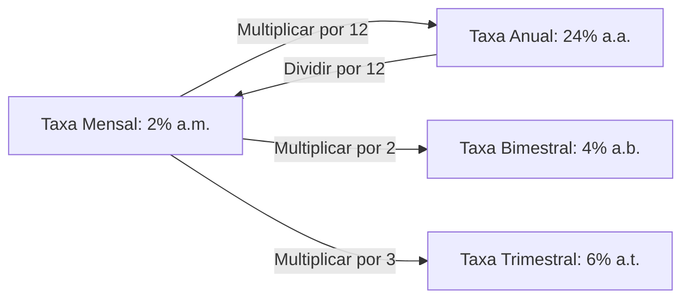
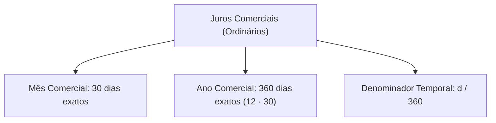
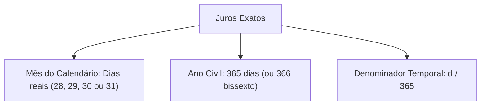
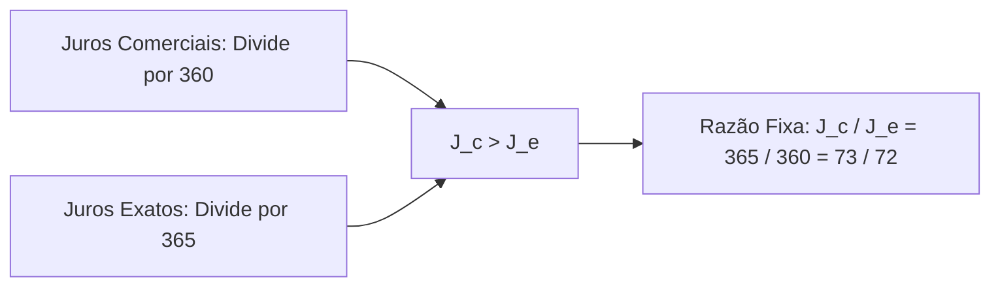
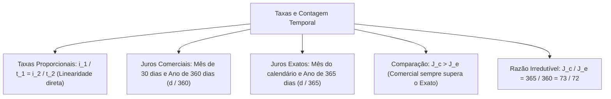

A correta conversão de taxas entre diferentes unidades de tempo e a contagem precisa dos dias constituem pilares operacionais da Matemática Financeira. Para o gestor público, lidar com prazos em dias e meses é rotina na análise de contratos de prestação continuada e termos de ajustamento.

Nas provas de concurso, as bancas examinadoras exigem o cálculo exato de taxas proporcionais lineares e a distinção matemática rigorosa entre juros comerciais e juros exatos.

> [!objetivos]
> - Compreender o conceito de taxas proporcionais lineares no regime de juros simples.
> - Converter taxas anuais, semestrais, trimestrais, mensais e diárias com facilidade.
> - Diferenciar a convenção do ano comercial (360 dias) da contagem do ano exato (365 dias).
> - Analisar por que os juros comerciais superam numericamente os juros exatos.
> - Aplicar a razão matemática de 73 para 72 na conversão entre juros comerciais e exatos.

## O conceito de taxas proporcionais em juros simples

No regime de capitalização simples, duas taxas de juros associadas a unidades de tempo distintas são denominadas **proporcionais** quando a razão entre seus valores numéricos é rigorosamente igual à razão entre os períodos de tempo correspondentes.

Como a capitalização simples opera sob um modelo linear de crescimento, a proporcionalidade é direta. Se multiplicamos o tempo por um determinado fator, a taxa correspondente deve ser multiplicada pelo mesmo fator.

A relação formal de proporcionalidade é expressa pela equação:

i_1 / t_1 = i_2 / t_2

Dessa linearidade direta decorrem as conversões usuais do mercado financeiro e de certames públicos:
- De taxa anual para mensal: divide-se a taxa anual por 12 meses.
- De taxa semestral para mensal: divide-se a taxa semestral por 6 meses.
- De taxa trimestral para mensal: divide-se a taxa trimestral por 3 meses.
- De taxa mensal para diária comercial: divide-se a taxa mensal por 30 dias.
- De taxa anual para diária comercial: divide-se a taxa anual por 360 dias.

| Unidade da Taxa de Origem | Unidade Alvo Desejada | Operação Aritmética | Exemplo Numérico |
| :--- | :--- | :--- | :--- |
| **Ao ano (a.a.)** | Ao mês (a.m.) | Dividir por 12 | 36% a.a. = 3% a.m. |
| **Ao ano (a.a.)** | Ao semestre (a.s.) | Dividir por 2 | 36% a.a. = 18% a.s. |
| **Ao ano (a.a.)** | Ao trimestre (a.t.) | Dividir por 4 | 36% a.a. = 9% a.t. |
| **Ao ano (a.a.)** | Ao dia comercial (a.d.) | Dividir por 360 | 36% a.a. = 0,1% a.d. |
| **Ao mês (a.m.)** | Ao ano (a.a.) | Multiplicar por 12 | 2,5% a.m. = 30% a.a. |

> [!bizu]
> **Taxas Proporcionais são Exclusivas do Regime Simples**
> A proporcionalidade direta e linear de taxas só é válida no regime de juros simples. No regime de juros compostos, a conversão entre períodos diferentes exige o conceito de taxas equivalentes com exponenciação.

## Juros comerciais versus juros exatos

Quando uma operação financeira é contratada por um prazo estipulado em dias, surge a necessidade de compatibilizar a taxa (normalmente anual ou mensal) com a contagem dos dias. Existem duas convenções matemáticas clássicas para tratar o denominador temporal:

### 1. Juros Comerciais ou Ordinários
Na convenção dos **Juros Comerciais**, adota-se uma simplificação padronizada pelo costume mercantil e bancário:
- O mês comercial é considerado tendo sempre **30 dias**, independentemente de ser fevereiro ou março.
- O ano comercial é considerado tendo sempre **360 dias** (12 meses comerciais de 30 dias).
- Ao converter um prazo de d dias para anos sob a ótica comercial, divide-se por 360:
t_anos = d / 360

A fórmula dos juros comerciais (J_c) fica:
J_c = C · i · (d / 360)

### 2. Juros Exatos
Na convenção dos **Juros Exatos**, utiliza-se a contagem real e rigorosa dos dias do calendário civil:
- O número de dias de cada mês segue o calendário astronômico (janeiro com 31 dias, fevereiro com 28 ou 29 dias, etc.).
- O ano civil padrão possui **365 dias** (ou 366 dias se for ano bissexto).
- Ao converter um prazo de d dias para anos sob a ótica dos juros exatos, divide-se por 365:
t_anos = d / 365

A fórmula dos juros exatos (J_e) fica:
J_e = C · i · (d / 365)

> [!atencao]
> **Padrão em Questões Omissas**
> Quando o enunciado da questão mencionar prazo em dias e não explicitar qual convenção adotar, a regra geral e dominante nos concursos públicos é aplicar os **Juros Comerciais** (mês de 30 dias e ano de 360 dias). A convenção exata só deve ser empregada quando expressamente solicitada pela banca examinadora.

## Comparação quantitativa e a razão de 73 para 72

Como o numerador de ambas as fórmulas é idêntico (C · i · d), a diferença entre os juros comerciais e exatos reside unicamente no denominador divisor:
- Nos juros comerciais, divide-se por 360.
- Nos juros exatos, divide-se por 365.

Como 360 é menor que 365, dividir por um número menor gera um quociente maior. Por conseguinte, para um mesmo capital, mesma taxa e mesmo número de dias:
**Os juros comerciais são sempre maiores do que os juros exatos.**

J_c > J_e

Essa superioridade dos juros comerciais explica historicamente por que as instituições bancárias e credores comerciais preferem a convenção comercial. Ela rende uma quantia ligeiramente superior de juros para o credor.

### A razão simplificada entre juros comerciais e exatos
Dividindo a expressão de J_c pela expressão de J_e:

J_c / J_e = [C · i · (d / 360)] / [C · i · (d / 365)] = 365 / 360

Simplificando a fração 365 / 360 dividindo o numerador e o denominador por 5, obtemos a notável fração irredutível:

J_c / J_e = 73 / 72

Dessa proporcionalidade derivam duas fórmulas de conversão direta muito úteis em provas:
- J_c = (73 / 72) · J_e
- J_e = (72 / 73) · J_c

| Parâmetro Comparado | Juros Comerciais (J_c) | Juros Exatos (J_e) | Relação Direta |
| :--- | :--- | :--- | :--- |
| **Duração do Mês** | 30 dias fixos | Dias do calendário (28 a 31) | Comercial padroniza |
| **Duração do Ano** | 360 dias | 365 dias (366 bissexto) | Ano civil é maior |
| **Denominador do Prazo** | d / 360 | d / 365 | 360 < 365 |
| **Magnitude dos Juros** | Maior valor monetário | Menor valor monetário | J_c > J_e |
| **Razão de Proporção** | Numerador 73 | Denominador 72 | J_c / J_e = 73 / 72 |

> [!pegadinha]
> **Inversão da Razão 73 / 72**
> Não inverta a fração na hora da prova. Lembre-se sempre de que os juros comerciais são maiores. Logo, o número maior (73) deve estar associado aos juros comerciais, e o número menor (72) aos juros exatos.

> [!esquema]
> **Conversão Rápida sem Recalcular do Zero**
> Se você calculou os juros exatos e obteve R＄ 720,00, os juros comerciais valem imediatamente:
> J_c = (73 / 72) · 720 = 73 · 10 = R＄ 730,00.
> O cálculo é instantâneo e poupa minutos preciosos de prova.

> [!resolvido]
> **Exercício Resolvido: Comparação Prática de Juros Comerciais e Exatos**
> Uma corporação de bombeiros efetuou a compra de materiais operacionais no valor de R＄ 73.000,00, com pagamento pactuado para 120 dias, à taxa de juros simples de 18% ao ano. Determine: (1) o valor dos juros comerciais gerados; (2) o valor dos juros exatos considerando o ano civil não bissexto de 365 dias; e (3) a diferença em reais entre os dois valores.
>
> **Resolução passo a passo:**
> 1. *Cálculo dos juros comerciais:*
>    A taxa unitária anual vale i = 18% / 100 = 0,18 ao ano.
>    O prazo comercial em anos é t_c = 120 / 360 = 1 / 3 de ano.
>    J_c = C · i · t_c = 73.000 · 0,18 · (120 / 360) = 73.000 · 0,06 = R＄ 4.380,00.
> 2. *Cálculo dos juros exatos:*
>    O prazo exato em anos é t_e = 120 / 365 de ano.
>    J_e = C · i · t_e = 73.000 · 0,18 · (120 / 365) = (73.000 / 365) · 0,18 · 120.
>    Como 73.000 / 365 = 200, temos:
>    J_e = 200 · 0,18 · 120 = 36 · 120 = R＄ 4.320,00.
> 3. *Conferência pela razão teórica:*
>    Verificando a razão: J_c / J_e = 4.380 / 4.320 = 73 / 72. O resultado confirma a teoria com exatidão.
> 4. *Diferença entre os juros:*
>    Diferença = J_c - J_e = 4.380,00 - 4.320,00 = R＄ 60,00.
>
> **Conclusão:** Os juros comerciais totalizam R＄ 4.380,00, os juros exatos somam R＄ 4.320,00, e a diferença em favor do credor comercial é de R＄ 60,00.

## Mapa do capítulo

Neste capítulo, estudamos as propriedades das taxas proporcionais lineares no regime de juros simples, as convenções do mês e ano comercial em contraste com o ano civil exato, e a relação matemática de 73 para 72 entre as grandezas.

### Para fixar
- Taxas proporcionais são aquelas cuja razão entre valores é igual à razão entre os prazos no regime simples.
- Para converter taxa anual em mensal proporcional, divide-se o valor por 12.
- O mês comercial possui sempre 30 dias e o ano comercial é padronizado em 360 dias.
- O ano exato do calendário civil possui 365 dias (ou 366 dias se for ano bissexto).
- Em questões omissas, adota-se compulsoriamente a convenção dos juros comerciais.
- Os juros comerciais são sempre maiores do que os juros exatos para mesmo capital, taxa e prazo.
- A razão irredutível entre juros comerciais e exatos é expressa pela fração 73 / 72.
- O prazo em dias na convenção comercial é transformado em anos pela divisão por 360.
- O prazo em dias na convenção exata é transformado em anos pela divisão por 365.
- Para converter juros exatos em comerciais, multiplica-se o valor por 73 e divide-se por 72.
