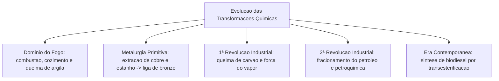
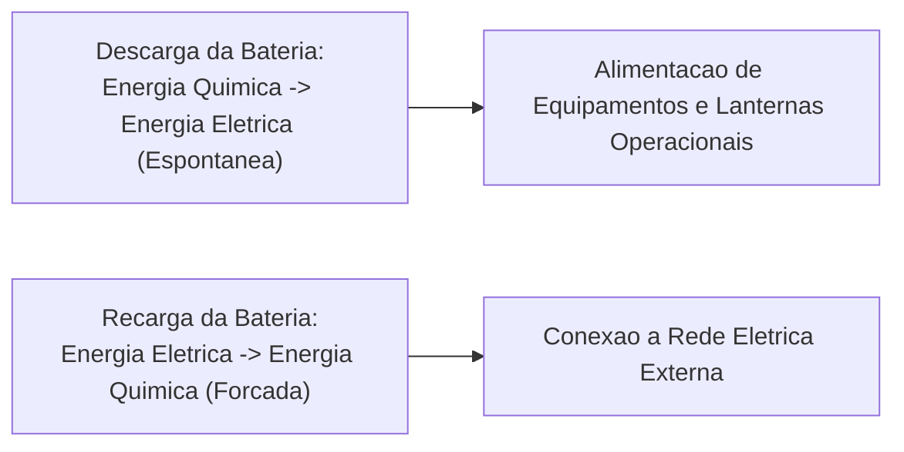
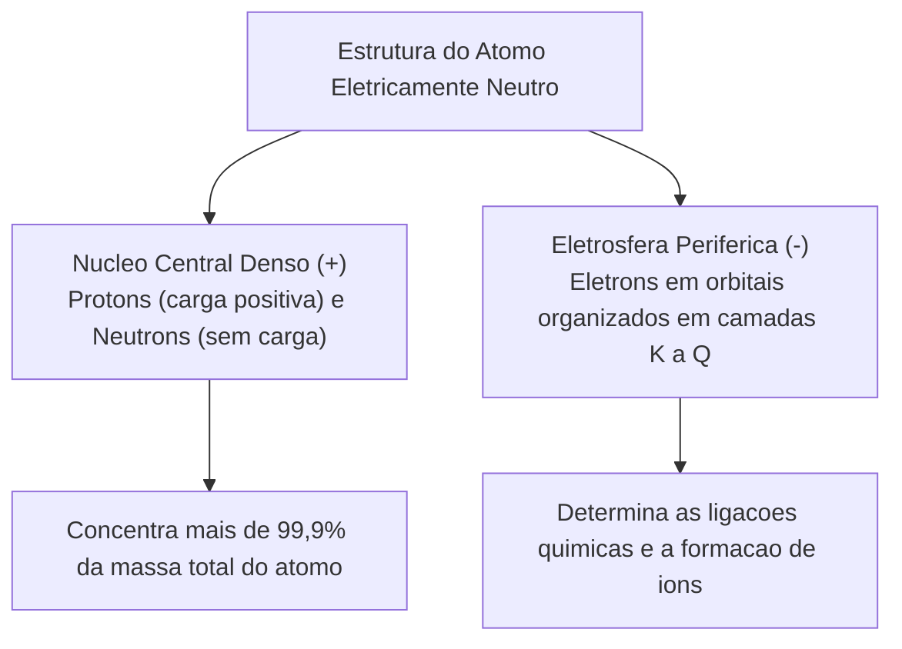
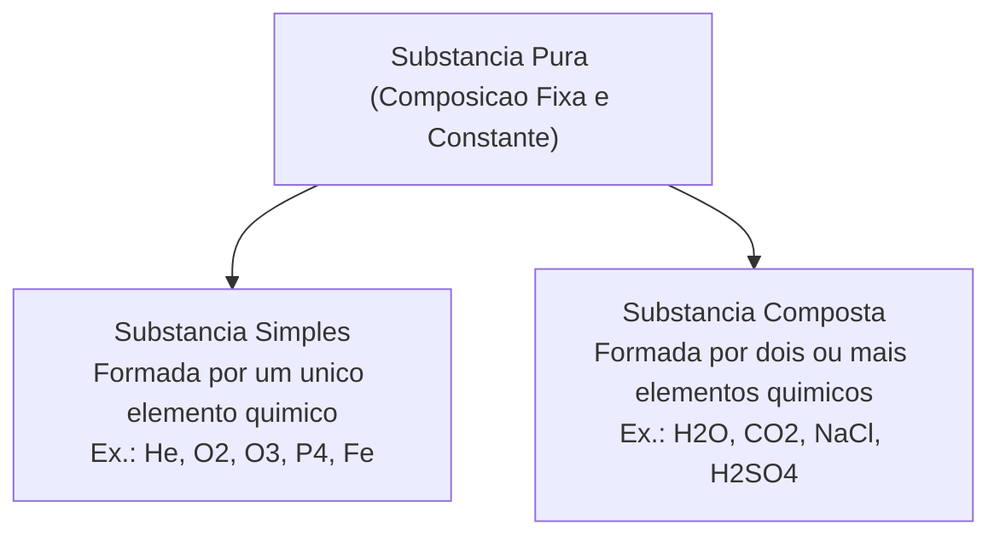
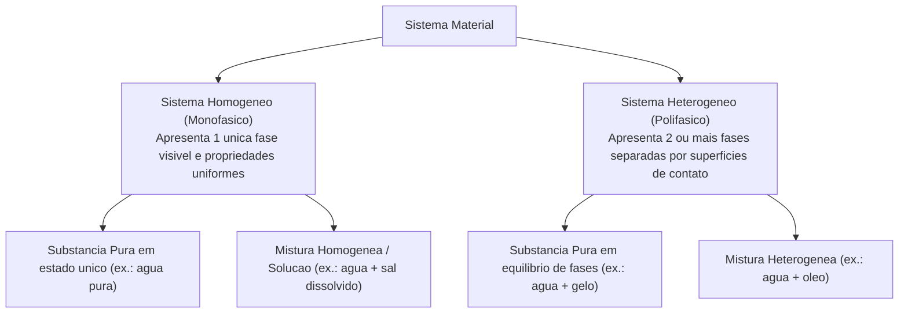
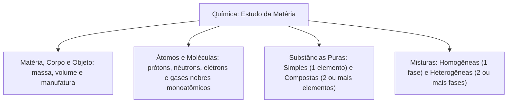

A Química é a ciência da natureza dedicada à investigação sistemática da matéria. Ela estuda sua composição íntima, estrutura atômica, propriedades gerais e específicas, transformações físicas e químicas e as variações de energia associadas a esses processos. Na atividade dos Corpos de Bombeiros Militares, o conhecimento químico é indispensável para prevenir sinistros, controlar reações de combustão e lidar com emergências envolvendo produtos perigosos.

Neste capítulo, estudaremos a evolução histórica da Química e sua presença direta no cotidiano e na indústria moderna. Analisaremos os conceitos fundamentais de matéria, corpo e objeto, a estrutura do átomo e a organização das moléculas. Por fim, examinaremos a classificação das substâncias puras em simples e compostas e caracterizaremos detalhadamente os sistemas homogêneos e heterogêneos.

> [!objetivos]
> - Compreender o objeto de estudo da Química e sua aplicação direta no cotidiano, na indústria e no serviço de bombeiros.
> - Diferenciar matéria, corpo e objeto a partir de suas propriedades físicas e utilidades práticas.
> - Compreender a estrutura atômica básica, identificando prótons, nêutrons, elétrons e a natureza dos elementos químicos.
> - Distinguir moléculas de átomos isolados e reconhecer o comportamento monoatômico dos gases nobres.
> - Classificar substâncias puras em simples e compostas e diferenciar misturas homogêneas de heterogêneas pelo número de fases.

---

## Noções Iniciais sobre Química e Evolução Humana

A história da civilização humana confunde-se com o domínio progressivo das transformações químicas da matéria. Desde os primórdios da humanidade, a manipulação de materiais naturais possibilitou a sobrevivência, a expansão social e o desenvolvimento tecnológico dos povos.

O ponto de inflexão mais relevante ocorreu com o domínio do fogo controlado. A combustão forneceu calor para aquecimento corporal e proteção contra predadores. Ela viabilizou também o cozimento dos alimentos. Esse processo melhora a digestibilidade e elimina microrganismos patogênicos. Além disso, o calor do fogo permitiu a fabricação de peças de cerâmica a partir da argila e inaugurou a metalurgia primitiva. Pela queima controlada de minérios em fornos rudimentares, o homem extraiu cobre e estanho. A fusão desses dois metais originou a primeira liga metálica intencional da história: o bronze.

A evolução industrial consolidou a Química como pilar econômico global. A Primeira Revolução Industrial foi impulsionada pela queima do carvão mineral, que gerava vapor em alta pressão para alimentar locomotivas e teares mecânicos. A Segunda Revolução Industrial substituiu gradativamente o carvão pelo petróleo, permitindo o refino de frações combustíveis e o nascimento da indústria petroquímica. No cenário contemporâneo, a transição para matrizes sustentáveis apoia-se em reações de transesterificação entre óleos vegetais e álcoois para sintetizar biodiesel de alta pureza.

---

## Química no Cotidiano e na Produção de Energia

As transformações químicas estão presentes em atividades rotineiras e em produtos de consumo imediato. Ao acordar, alimentar-se, higienizar ambientes ou utilizar veículos automotores, o cidadão manipula substâncias químicas e desencadeia processos transformadores contínuos.

Na alimentação, processos fermentativos realizados por leveduras e bactérias produzem pães, iogurtes, queijos e cervejas. A fermentação converte açúcares presentes na matéria-prima em gás carbônico, ácido lático ou etanol. Na agricultura moderna, a adubação química repõe nutrientes essenciais do solo por meio de fertilizantes contendo nitrogênio, fósforo e potássio. Em tarefas domésticas de higienização, substâncias com propriedades tensoativas removem sujeiras oleosas. Sabões clássicos são fabricados a partir de óleo residual de cozinha reagido com soda cáustica (hidróxido de sódio) sob aquecimento. Na culinária, o vinagre comercial contém uma solução diluída de ácido acético, e a acetona (propanona) atua como solvente volátil em cosméticos.

No campo energético, pilhas e baterias representam geradores eletroquímicos fundamentais. Durante a descarga da bateria, uma reação de oxirredução espontânea converte energia química armazenada nas ligações interatômicas em energia elétrica utilizável. Quando conectada a uma fonte externa de recarga, o processo inverte-se: a energia elétrica externa força uma reação não espontânea, reconstituindo a energia química inicial.

> [!exemplo]
> **Substâncias Comuns do Cotidiano e Suas Aplicações**:
> - **Cloreto de Sódio (NaCl)**: conhecido popularmente como sal de cozinha, atua na conservação e no tempero de alimentos.
> - **Etanol (C₂H₅OH)**: álcool presente em bebidas destiladas e utilizado amplamente como combustível veicular renovável.
> - **Hidróxido de Sódio (NaOH)**: soda cáustica empregada na saponificação de gorduras e no desentupimento químico de encanamentos.
> - **Ácido Acético (CH₃COOH)**: composto orgânico responsável pelo aroma e pela acidez característica do vinagre comum.
> - **Propanona (CH₃COCH₃)**: solvente orgânico volátil conhecido comercialmente como acetona, utilizado para remoção de esmaltes.

---

## Conceitos Fundamentais: Matéria, Corpo e Objeto

Para organizar o estudo dos materiais, a Química estabelece três conceitos fundamentais que delimitam o alcance da análise física:

### Definições Conceituais
1. **Matéria**: é tudo aquilo que possui massa real e ocupa determinado volume no espaço tridimensional. A matéria pode ser tangível ou invisível aos olhos, manifestando-se nos estados sólido, líquido ou gasoso. Exemplos universais de matéria incluem a água, o ferro, o ar atmosférico e a madeira.
2. **Corpo**: corresponde a qualquer porção limitada e delimitada da matéria. Trata-se de uma fração isolada de material que não possui necessariamente uma utilidade ou destinação prática predeterminada. Exemplos: uma barra bruta de alumínio, um bloco de gelo ou um pedaço de madeira recém-cortado.
3. **Objeto**: é um corpo trabalhado, moldado ou manufaturado pelo ser humano para atender a uma finalidade específica ou prestar uma utilidade prática direta. Exemplos: uma mesa de madeira, uma chave de ferro, uma cadeira de plástico ou um capacete de combate a incêndio.

| Conceito | Definição Básica | Características Distintivas | Exemplos Típicos |
|---|---|---|---|
| **Matéria** | Tudo o que possui massa e ocupa lugar no espaço. | Conceito amplo e ilimitado; compõe o universo físico. | Ouro, ferro, madeira, plástico, ar. |
| **Corpo** | Porção limitada e isolada de matéria. | Fração com limites físicos definidos, sem função específica. | Pepita de ouro, lâmina de ferro, tábua de madeira. |
| **Objeto** | Corpo moldado para uma finalidade humana útil. | Possui forma, desenho industrial e utilidade prática. | Anel de ouro, chave inglesa, cadeira escolar. |

---

## O Átomo, Elementos Químicos e Moléculas

A matéria é constituída em escala microscópica por entidades fundamentais que determinam todas as suas propriedades macroscópicas. A correta compreensão dessas partículas evita confusões conceituais frequentes em provas de concurso:

### A Estrutura Básica do Átomo
O **átomo** é a unidade fundamental da matéria que preserva a identidade química de um elemento. Ele é formado por duas regiões estruturais distintas:
- **Núcleo Atômico**: região central, extremamente pequena, densa e dotada de carga elétrica positiva. O núcleo concentra praticamente toda a massa do átomo e abriga duas partículas subatômicas fundamentais:
  - **Prótons**: partículas carregadas positivamente (+1) cuja massa relativa é padronizada como 1 unidade. O próton é cerca de 1.836 vezes mais massivo que o elétron.
  - **Nêutrons**: partículas desprovidas de carga elétrica líquida (carga zero) com massa ligeiramente superior à do próton.
- **Eletrosfera**: região periférica de volume gigantesco que envolve o núcleo. Nela orbitam os **elétrons**, que são partículas com carga elétrica negativa (-1) e massa desprezível na contagem atômica ordinária. Na eletrosfera, os elétrons organizam-se em camadas principais denominadas K, L, M, N, O, P e Q, divididas em subníveis de energia representados pelas letras s, p, d e f.

No estado fundamental ou fundamental neutro, todo átomo é **eletricamente neutro**, apresentando uma quantidade rigorosamente idêntica de prótons e elétrons. Quando um átomo perde ou ganha elétrons da eletrosfera, o equilíbrio de cargas é desfeito, dando origem a **íons**:
- **Cátion**: íon positivo formado pela perda de um ou mais elétrons (ex.: `Na⁺`, `Fe²⁺`).
- **Ânion**: íon negativo formado pelo ganho de um ou mais elétrons (ex.: `Cl⁻`, `O²⁻`).

### Elemento Químico e Número Atômico
Um **elemento químico** é o conjunto de todos os átomos que possuem exatamente o mesmo número de prótons em seu núcleo. Essa quantidade característica denomina-se **número atômico** e é representada pela letra `Z`. Todo átomo que possui 26 prótons é, por definição, ferro (`Z = 26`). Da mesma forma, qualquer átomo com 29 prótons é cobre (`Z = 29`), e todo átomo com 1 próton é hidrogênio (`Z = 1`). Cada elemento é identificado universalmente por um símbolo químico na Tabela Periódica.

### Conceito de Molécula e Substâncias Monoatômicas
Uma **molécula** é um agrupamento eletricamente neutro de dois ou mais átomos unidos por ligações químicas covalentes. A molécula representa a menor porção de uma substância que ainda conserva suas propriedades químicas características:
- Moléculas podem reunir átomos de um mesmo elemento, como o gás oxigênio (`O₂`), o gás nitrogênio (`N₂`) ou o gás ozônio (`O₃`).
- Moléculas podem reunir átomos de elementos químicos distintos, como a água (`H₂O`), o dióxido de carbono (`CO₂`) ou a glicose (`C₆H₁₂O₆`, composta por 6 átomos de carbono, 12 átomos de hidrogênio e 6 átomos de oxigênio).

Uma particularidade indispensável diz respeito aos **gases nobres** da Tabela Periódica (Hélio `He`, Neônio `Ne`, Argônio `Ar`, Criptônio `Kr`, Xenônio `Xe` e Radônio `Rn`). Esses elementos possuem eletrosferas completas com máxima estabilidade eletrônica no estado natural. Por essa razão, os gases nobres existem na natureza sob a forma de **átomos isolados** monoatômicos. Eles não necessitam ligar-se a outros átomos para constituir uma substância pura em condições ambientes.

---

## Substâncias Puras: Simples e Compostas

Na terminologia científica rigorosa, o vocábulo **substância** refere-se exclusivamente a uma substância pura. Uma substância pura é qualquer material dotado de composição química homogênea, constante e invariável em toda a sua extensão, apresentando um conjunto fixo e exclusivo de propriedades físicas específicas (como temperatura de fusão, temperatura de ebulição e densidade) sob pressão constante:

### Classificação Estrutural das Substâncias
As substâncias puras são classificadas segundo a diversidade dos elementos químicos presentes em suas partículas constituintes:
1. **Substância Pura Simples**: é formada exclusivamente por átomos de um **único elemento químico**. Independentemente da quantidade total de átomos agrupados na molécula ou no retículo, todos pertencem à mesma espécie atômica. Exemplos:
   - Gás hélio (`He`): substância simples monoatômica.
   - Gás oxigênio (`O₂`): substância simples diatômica.
   - Gás ozônio (`O₃`): substância simples triatômica.
   - Fósforo branco (`P₄`): substância simples tetratômica.
   - Enxofre rômbico (`S₈`): substância simples octatômica.
   - Ferro metálico (`Fe`): substância simples metálica formada por cátions de ferro em mar de elétrons.
2. **Substância Pura Composta (ou Composto Químico)**: é constituída por átomos ou íons de **dois ou mais elementos químicos diferentes**, combinados quimicamente em proporções ponderais fixas e invariáveis. Exemplos:
   - Água destilada (`H₂O`): formada por hidrogênio e oxigênio na proporção de dois para um.
   - Dióxido de carbono (`CO₂`): formado por carbono e oxigênio.
   - Cloreto de sódio (`NaCl`): composto iônico formado por sódio e cloro.
   - Ácido sulfúrico (`H₂SO₄`): formado por hidrogênio, enxofre e oxigênio.
   - Glicose (`C₆H₁₂O₆`): composta por carbono, hidrogênio e oxigênio.

> [!bizu]
> **Identificação Rápida em Fórmulas Moleculares**: para classificar uma substância pura em simples ou composta em questões de múltipla escolha, observe a quantidade de letras maiúsculas no símbolo químico. Cada letra maiúscula indica a presença de um elemento químico diferente. Uma fórmula que contém apenas uma letra maiúscula (como `Kr`, `O₂` ou `N₂`) representa necessariamente uma substância simples. Se a fórmula apresentar duas ou mais letras maiúsculas distintas (como `CO₂`, `NaOH` ou `CH₄`), trata-se obrigatoriamente de uma substância composta.

> [!atencao]
> **Alotropia e Formas Distintas de Substâncias Simples**: certos elementos químicos podem formar duas ou mais substâncias simples diferentes, fenômeno denominado alotropia. O elemento oxigênio origina tanto o gás oxigênio vital (`O₂`) quanto o gás ozônio protetor (`O₃`). O carbono apresenta alótropos célebres como o grafite (macio e condutor) e o diamante (extremamente duro e isolante). Apesar de compartilharem o mesmo elemento atômico constituinte, substâncias alótropas possuem fórmulas moleculares ou arranjos espaciais distintos com comportamentos físicos contrastantes.

---

## Misturas Homogêneas e Heterogêneas e Número de Fases

Enquanto uma substância pura é formada por partículas idênticas entre si, uma **mistura** resulta da união física de duas ou mais substâncias puras diferentes. Em uma mistura, os componentes não sofrem reação química, preservando integralmente suas identidades moleculares individuais:

### Características Gerais das Misturas
- A composição de uma mistura é variável e arbitrária (pode-se adicionar mais sal ou mais água livremente).
- As misturas não possuem temperaturas fixas de fusão e ebulição sob pressão constante; suas transições de fase ocorrem ao longo de faixas variáveis de temperatura.
- Os componentes de uma mistura podem ser separados por métodos físicos e mecânicos apropriados, tais como filtração, decantação, destilação simples ou evaporação.

### Critério de Fases e Homogeneidade
Uma **fase** é definida como qualquer porção homogênea de um sistema material que apresenta propriedades físicas e químicas uniformes em toda a sua extensão e é visualmente delimitada por interfaces nítidas. Conforme o número de fases visíveis a olho nu ou ao microscópio óptico, os sistemas classificam-se em:
1. **Mistura Homogênea (Solução)**: apresenta uma **única fase contínua** em toda a sua extensão (`monofásica`). Suas propriedades físicas são idênticas em qualquer ponto amostrado, sendo impossível distinguir visualmente os seus componentes, mesmo com o auxílio de microscópios potentes. Exemplos:
   - Sal de cozinha completamente dissolvido em água pura.
   - Açúcar dissolvido em água abaixo do ponto de saturação.
   - Ar atmosférico filtrado e seco (mistura homogênea de nitrogênio, oxigênio, argônio e traços de outros gases).
   - Ligas metálicas homogêneas, como o bronze (cobre e estanho) e o ouro 18 quilates (75% de ouro combinado com 25% de cobre ou prata).
2. **Mistura Heterogênea**: apresenta **duas ou mais fases distintas** separadas por interfaces (`polifásica`). Seus componentes podem ser distinguidos visualmente ou por meios ópticos comuns:
   - **Bifásica (duas fases)**: mistura imiscível de água líquida e óleo de cozinha vegetal.
   - **Trifásica (três fases)**: mistura contendo areia depositada no fundo, água líquida no meio e óleo sobrenadante.
   - **Polifásica (quatro ou mais fases)**: rochas ígneas como o granito, composto visivelmente por grãos de quartzo, feldspato e mica, além de inclusões minerais acessórias.

| Sistema Material | Classificação de Pureza | Número de Fases | Descrição dos Componentes |
|---|---|---|---|
| **Água destilada líquida** | Substância pura composta | 1 fase (monofásico) | Moléculas idênticas de `H₂O` em estado líquido. |
| **Água pura líquida com pedras de gelo** | Substância pura composta | 2 fases (bifásico) | Mesma molécula `H₂O` coexistindo nos estados sólido e líquido. |
| **Água mineral com gás carbônico** | Mistura heterogênea | 2 fases (bifásico) | Fase líquida aquosa e bolhas de gás `CO₂` visíveis. |
| **Água e sal totalmente dissolvido** | Mistura homogênea | 1 fase (monofásico) | Solução aquosa uniforme de cátions `Na⁺` e ânions `Cl⁻`. |
| **Água, óleo vegetal e areia** | Mistura heterogênea | 3 fases (trifásico) | Sólido insolúvel no fundo, líquido denso e óleo no topo. |
| **Ar atmosférico limpo** | Mistura homogênea | 1 fase (monofásico) | Gases miscíveis (`N₂`, `O₂`, `Ar`, `CO₂`) em fase gasosa única. |

> [!bizu]
> **Misturas Gasosas São Sempre Monofásicas**: todo conjunto de gases confinados que não reajam quimicamente entre si constitui obrigatoriamente uma mistura homogênea monofásica. Como as moléculas gasosas possuem elevado grau de dispersão e movimentação térmica contínua, elas se interpenetram de forma totalmente uniforme. Qualquer sistema composto exclusivamente por gases limpos apresenta sempre uma única fase contínua em toda a sua extensão.

> [!pegadinha]
> **Pegadinhas Clássicas de Fases e Pureza em Concursos**:
> - **O Leite Comercial**: à vista desarmada, o leite parece uniforme e homogêneo. Contudo, sob o microscópio óptico, revela-se como uma **mistura heterogênea** formada por uma emulsão coloidal de minúsculas gotículas de gordura e micelas de proteínas dispersas em soro aquoso.
> - **Água com Gelo**: um copo contendo cubos de gelo flutuando em água pura é formado por uma **única substância pura** (`H₂O`), mas constitui um **sistema físico heterogêneo bifásico**, pois a matéria apresenta duas fases com estados físicos e interfaces distintas.
> - **Ouro 18 Quilates versus Ouro 24 Quilates**: o ouro 24 quilates é substância simples pura (100% de átomos de ouro). Já o ouro 18 quilates é uma **mistura homogênea (liga metálica)** contendo 75% de ouro e 25% de outros metais, possuindo composição química percentual variável conforme o fabricante.

---

## Exercício Resolvido: Análise Estrutural e de Sistemas

> [!resolvido]
> **Exercício Resolvido: Classificação de Sistemas Materiais e Contagem de Fases Passo a Passo**:
> Em um recipiente fechado e transparente, um bombeiro militar reuniu os seguintes componentes: água líquida destilada, cubos de gelo produzidos a partir da mesma água, óleo vegetal de cozinha, sal de cozinha dissolvido em quantidade inferior ao limite de saturação e um prego de ferro metálico limpo no fundo. Analise o sistema resultante e determine:
> a) A quantidade total de fases presentes no sistema.
> b) A quantidade total de substâncias químicas distintas reunidas.
> c) A classificação do prego de ferro e da água quanto à pureza e complexidade.
> 
> **Resolução passo a passo:**
> 1. Análise da fase líquida aquosa e do sal:
>    O sal de cozinha (`NaCl`) encontra-se totalmente dissolvido na água líquida em quantidade abaixo do limite de saturação. Por isso, a água e o sal formam uma única fase líquida homogênea (solução aquosa salina).
> 2. Contagem minuciosa de cada fase presente no sistema:
>    - Fase 1 (sólida no fundo): o prego de ferro metálico (`Fe`).
>    - Fase 2 (líquida intermediária densa): a solução aquosa de água e sal dissolvido.
>    - Fase 3 (sólida flutuante): os cubos de gelo (`H₂O` sólida). Embora seja a mesma substância da água líquida, o gelo possui estado físico próprio e interface visível, constituindo fase à parte.
>    - Fase 4 (líquida superior menos densa): a camada de óleo vegetal imiscível.
>    Portanto, o sistema material apresenta exatamente **4 fases distintas** (sistema tetrafásico).
> 3. Identificação e contagem das substâncias químicas individuais presentes:
>    - Substância 1: Água (`H₂O`), presente simultaneamente nas fases líquida e sólida.
>    - Substância 2: Cloreto de sódio (`NaCl`), dissolvido na solução aquosa.
>    - Substância 3: Triacilglicerol (compostos lipídicos formadores do óleo vegetal).
>    - Substância 4: Ferro metálico (`Fe`), elemento constituinte do prego.
>    Portanto, o sistema reúne **4 substâncias químicas distintas**.
> 4. Classificação das substâncias indicadas:
>    - O prego de ferro metálico é uma **substância pura simples**, formada exclusivamente por átomos do elemento ferro (`Fe`).
>    - A água destilada é uma **substância pura composta**, constituída pela combinação covalente de hidrogênio e oxigênio (`H₂O`).

---

## Mapa do capítulo

### Para fixar
- A Química investiga a matéria, suas transformações e as trocas de energia associadas aos processos.
- Matéria é tudo o que tem massa e ocupa espaço; corpo é uma porção limitada; objeto tem utilidade prática.
- O núcleo atômico concentra prótons e nêutrons; a eletrosfera periférica abriga os elétrons em camadas.
- O número de prótons define o elemento químico; átomos eletricamente neutros possuem número idêntico de elétrons.
- Gases nobres ocorrem na natureza como átomos isolados monoatômicos estáveis.
- Substância simples contém um único elemento químico; substância composta reúne dois ou mais elementos.
- Mistura homogênea apresenta uma única fase visível e propriedades uniformes em toda a extensão.
- Mistura heterogênea possui duas ou mais fases delimitadas por interfaces nítidas.
- O leite é uma mistura heterogênea coloidal; água pura com gelo é substância pura em sistema bifásico.
