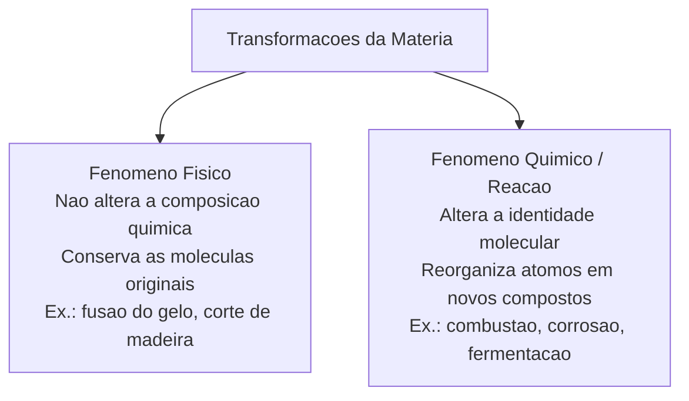
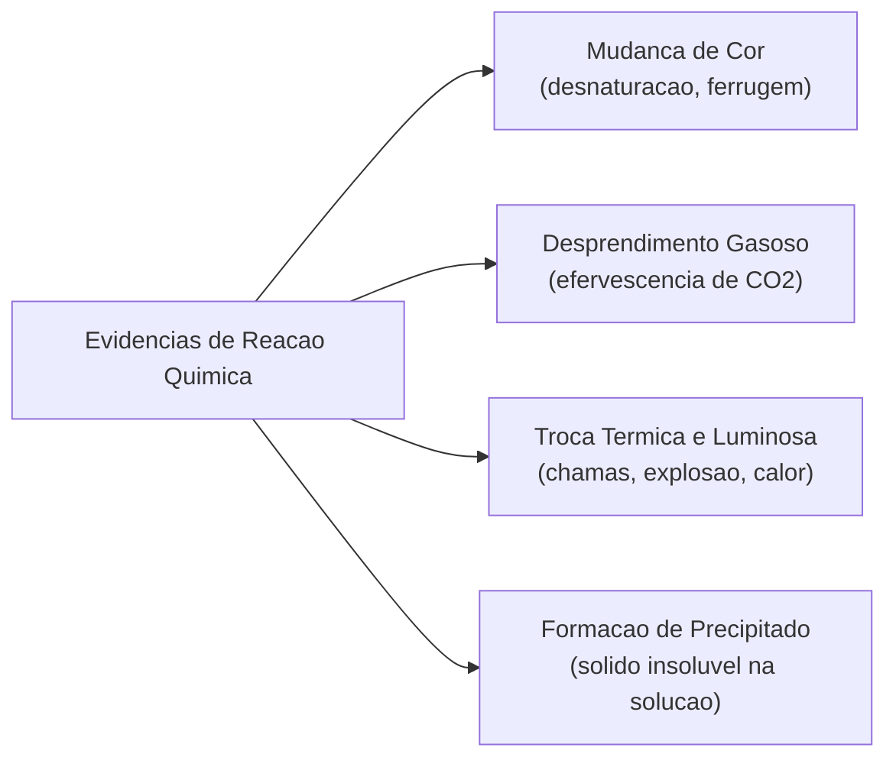
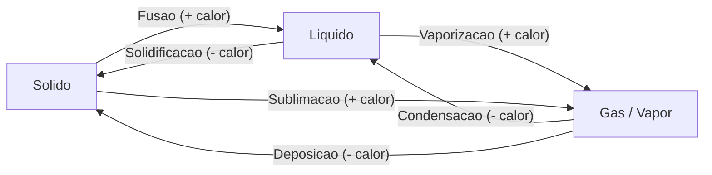
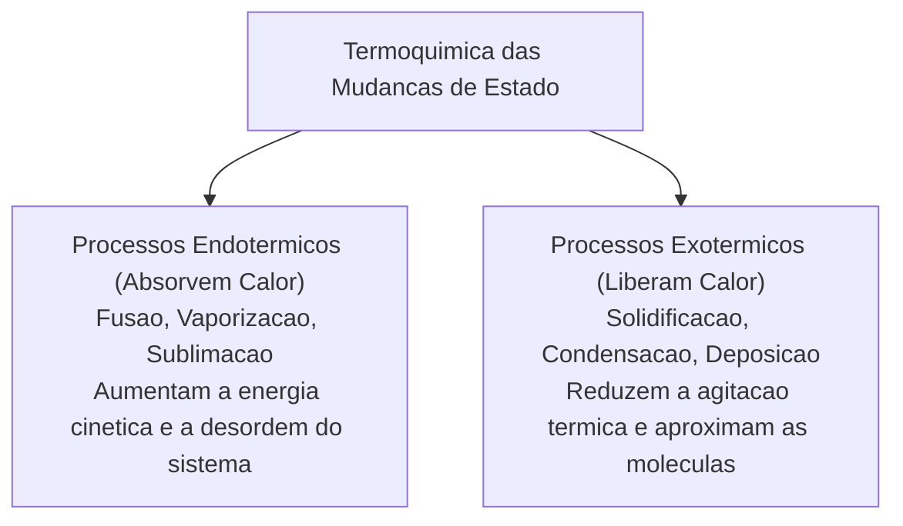
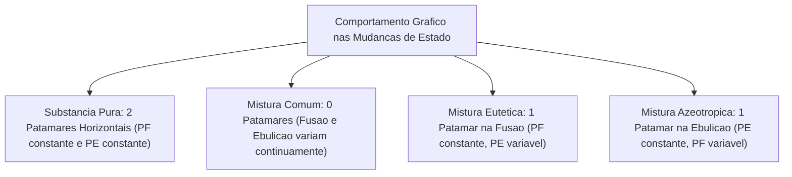
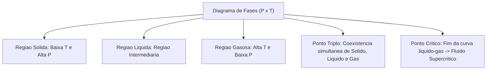
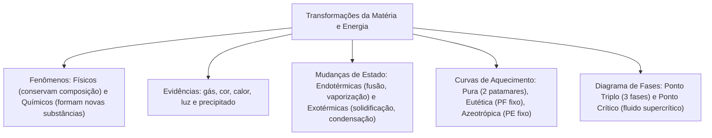

As transformações da matéria constituem o objeto central de estudo da termoquímica e da cinética química. No âmbito operacional dos Corpos de Bombeiros, compreender a distinção entre processos físicos e reações químicas é fundamental para analisar o tetraedro do fogo, prever a velocidade de queima de combustíveis, dimensionar agentes extintores e evitar explosões de vapores inflamáveis.

Neste capítulo, estudaremos a conceituação rigorosa de fenômenos físicos e químicos e as evidências macroscópicas que indicam a ocorrência de reações. Analisaremos as trocas energéticas endotérmicas e exotérmicas associadas a cada transição. Por fim, examinaremos o comportamento gráfico das curvas de aquecimento de substâncias puras e misturas especiais (eutéticas e azeotrópicas) e dominaremos a interpretação técnica do diagrama de fases da matéria.

> [!objetivos]
> - Diferenciar fenômenos físicos de transformações químicas com base na conservação ou alteração da identidade das substâncias.
> - Reconhecer as principais evidências macroscópicas de reações químicas: desprendimento gasoso, mudança de cor, formação de precipitado e trocas térmicas.
> - Classificar as mudanças de estado físico em endotérmicas e exotérmicas e compreender o rearranjo molecular de cada fase.
> - Analisar curvas de aquecimento diferenciando substâncias puras de misturas comuns, eutéticas e azeotrópicas pelos seus patamares.
> - Interpretar diagramas de fases (pressão versus temperatura), identificando o ponto triplo, o ponto crítico e o fluido supercrítico.

---

## Fenômenos Físicos e Químicos da Matéria

Toda e qualquer alteração observada na matéria recebe cientificamente a denominação de **transformação da matéria** ou **fenômeno**. A classificação fundamental desses eventos apoia-se na integridade das ligações químicas e na formação ou não de novas espécies moleculares:

### O Fenômeno Físico
O **fenômeno físico** é aquele que altera unicamente a forma geométrica, o tamanho, a divisão espacial ou o estado físico da matéria, sem produzir qualquer alteração em sua composição química íntima. As moléculas originais permanecem rigorosamente as mesmas antes e depois da transformação:
- **Exemplos cotidianos**: rasgar ou amassar uma folha de papel; quebrar um prato de vidro; triturar pedras de carvão; esticar uma mola elástica; fiação de fibras de algodão para tecidos.
- **Dissolução física simples**: dissolver açúcar ou sal de cozinha em água pura sem que ocorra reação química. O açúcar pode ser recuperado integralmente evaporando a água da solução.
- **Condução de calor ou eletricidade**: a passagem de corrente elétrica através de um fio metálico de cobre ou o aquecimento de uma panela de ferro no fogão conduzem energia sem degradar ou alterar as espécies metálicas.
- **Mudanças de estado físico**: a fusão do gelo ou a ebulição da água líquida são fenômenos puramente físicos. As moléculas de água (`H₂O`) mantêm-se íntegras, alterando exclusivamente a distância média intermolecular e o grau de agitação térmica.

### O Fenômeno Químico (Reação Química)
O **fenômeno químico** (ou **reação química**) é aquele em que as substâncias de partida sofrem quebra de ligações atômicas e recombinação de seus elementos, dando origem a novas substâncias com propriedades físicas e químicas completamente distintas das originais:
- **Exemplos clássicos**: queima ou combustão completa de madeira ou combustíveis; formação de ferrugem em um prego exposto ao ar úmido; azedamento do leite por fermentação bacteriana; cozimento de carnes e ovos; queima de fogos de artifício.
- **Nível submicroscópico**: durante uma reação química genérica representada por `AB + CD → AC + BD`, as ligações interatômicas entre `A` e `B` e entre `C` e `D` nos **reagentes** são desfeitas. Simultaneamente, novas forças de ligação entre `A` e `C` e entre `B` e `D` são estabelecidas, gerando novos **produtos**. Na combustão do etanol (`C₂H₅OH`) com oxigênio comburente (`O₂`), os reagentes são integralmente consumidos para gerar dióxido de carbono (`CO₂`) e vapor de água (`H₂O`), liberando intensa energia térmica.

> [!exemplo]
> **Diferenciação Prática em Ocorrências de Bombeiros**:
> - **Fenômeno Físico**: o resfriamento de materiais pela evaporação da água lançada em combate. A água líquida absorve calor latente do fogo e vaporiza mantendo intacta sua fórmula química molecular `H₂O`.
> - **Fenômeno Químico**: a queima da madeira em chamas vivas. O calor quebra polímeros de celulose, gerando fuligem, cinzas minerais e gases inflamáveis em reação irreversível com o oxigênio do ar.

| Critério de Análise | Fenômeno Físico | Fenômeno Químico |
|---|---|---|
| **Composição química** | Permanece estritamente constante e inalterada. | Altera-se totalmente; formam-se novas substâncias. |
| **Identidade das moléculas** | Preserva as mesmas espécies moleculares. | Rompe ligações antigas e forma novas ligações. |
| **Reversibilidade usual** | Geralmente reversível por métodos físicos simples. | Exige reações químicas específicas para reverter. |
| **Propriedades específicas** | Pontos de fusão e ebulição dos constituintes não mudam. | Produtos possuem propriedades físicas inéditas. |
| **Exemplos típicos** | Dobrar metal, derreter chumbo, sublimar naftalina. | Queima de gasolina, oxidação do ferro, digestão. |

---

## Evidências Macroscópicas de Transformações Químicas

Frequentemente, uma reação química manifesta sinais visíveis ou sensoriais perceptíveis no ambiente laboratorial ou no teatro de operações de emergência. A observação criteriosa dessas evidências permite diagnosticar transformações químicas instantâneas:

### Principais Indícios Experimentais
1. **Mudança Efetiva de Cor**: a alteração cromática resulta da síntese de compostos com níveis de absorção luminosa inéditos. Exemplos: o escurecimento de uma maçã cortada exposta ao oxigênio do ar por ação enzimática; a clara do ovo que se torna branca e opaca no cozimento devido à desnaturação de proteínas; o aparecimento da coloração castanho-avermelhada da ferrugem (`Fe₂O₃`) sobre a superfície metálica do ferro polido.
2. **Liberação ou Absorção Intensa de Energia**: manifesta-se através de calor, emissão de luz brilhante ou geração de corrente elétrica. A combustão de gases inflamáveis libera labaredas luminosas e grande energia térmica para as vizinhanças. Por outro lado, certas reações químicas endotérmicas resfriam acentuadamente o recipiente de contato.
3. **Liberação de Gás (Efervescência)**: formação rápida de bolhas em meio líquido na ausência de aquecimento externo prévio. Exemplo da página 20 da fonte: a dissolução de pastilhas de bicarbonato de sódio (`NaHCO₃`) ou antiácidos em água pura provoca borbulhamento vigoroso decorrente do desprendimento imediato de gás carbônico (`CO₂`).
4. **Formação de Precipitado (Sólido Insolúvel)**: quando duas soluções aquosas límpidas e transparentes são misturadas e formam um sólido insolúvel que turva o líquido e se deposita no fundo do tubo de ensaio.
5. **Emissão de Odor ou Fumaça Própria**: geração de compostos voláteis característicos liberados durante queimas químicas ou degradações moleculares espontâneas.

> [!pegadinha]
> **Evidências Visuais Não São Provas Absolutas**: a presença de bolhas ou de fumaça não comprova isoladamente uma reação química. A água fervendo em uma chaleira borbulha intensamente e emite vapores brancos; trata-se de um fenômeno físico de vaporização em que a água permanece quimicamente intacta. Da mesma forma, a atração de pregos de ferro por um ímã magnético ou o desaparecimento gradual de bolinhas de naftalina sólida no guarda-roupa constituem fenômenos estritamente físicos (magnetismo e sublimação). Para atestar com rigor uma reação na ausência de indícios visuais inequívocos, o químico deve mensurar propriedades intensivas antes e depois do processo, tais como massa molecular, densidade e pontos de fusão.

---

## Mudanças de Estado Físico e Termoquímica Associada

A matéria pode transitar entre os estados sólido, líquido e gasoso mediante fornecimento ou retirada de energia térmica sob determinada pressão externa. O entendimento da dinâmica molecular de cada fase elucida as trocas energéticas subjacentes:

### Características Estruturais dos Estados da Matéria
- **Estado Sólido**: átomos ou moléculas encontram-se organizados em retículos cristalinos compactos. Apresenta forças atrativas intermoleculares intensas. Possui volume constante e forma espacial rígida e própria.
- **Estado Líquido**: partículas possuem liberdade de translação e deslizamento mútuo. As forças de coesão são intermediárias. Apresenta volume fixo e constante, mas assume a forma do recipiente que o contém.
- **Estado Gasoso**: partículas possuem elevado grau de desordem espacial. Movimentam-se com altíssima velocidade em todas as direções. As forças de atração mútua são desprezíveis. O gás não possui forma nem volume constantes, expandindo-se até ocupar totalmente o espaço disponível.

### Nomenclatura das Transições de Fase
1. **Fusão**: passagem da fase sólida para a líquida por absorção de calor (ex.: gelo derretendo a 0 °C).
2. **Solidificação**: passagem da fase líquida para a sólida por perda de calor (ex.: água congelando em freezer).
3. **Vaporização**: passagem do estado líquido para o gasoso por absorção térmica. Pode ocorrer por evaporação lenta, por ebulição rápida e turbulenta em temperatura fixa ou por calefação instantânea.
4. **Condensação (ou Liquefação)**: passagem do vapor ou gás para o estado líquido por resfriamento ou compressão (ex.: orvalho nas folhas pela manhã).
5. **Sublimação**: transição direta da fase sólida para o estado gasoso sem passar pelo estado líquido (ex.: naftalina e gelo seco ao ar livre).
6. **Deposição (ou Ressublimação)**: passagem direta do estado gasoso para a fase sólida (ex.: formação de geada cristalina).

### Balanço Energético: Processos Endotérmicos e Exotérmicos
Toda transição que exige fornecimento de calor do meio para afastar as moléculas classifica-se como **endotérmica** (`ΔH > 0`). São transformações endotérmicas: a fusão, a vaporização e a sublimação. Por outro lado, transições que aproximam as moléculas e liberam calor para as vizinhanças denominam-se **exotérmicas** (`ΔH < 0`). Elas incluem a solidificação, a condensação e a deposição.

---

## As Quatro Curvas de Aquecimento Fundamentais

Uma **curva de aquecimento** representa a variação de temperatura em função do calor ou tempo sob pressão constante. A análise minuciosa desses gráficos revela a pureza de uma amostra material:

### Curva de Aquecimento de Substância Pura
Uma substância pura sob aquecimento a partir do estado sólido apresenta patamares perfeitamente horizontais. Neles, a temperatura permanece constante durante as mudanças de fase:
- **Trechos Inclinados (Fase Única)**: a energia fornecida eleva a temperatura da amostra (aquecimento do sólido puro, líquido puro ou gás puro).
- **Patamares Horizontais (Coexistência de Fases)**: durante a transição, o calor fornecido é consumido para vencer as forças intermoleculares. A temperatura não sobe.
  - No **ponto de fusão (PF)**, sólido e líquido coexistem em equilíbrio estável.
  - No **ponto de ebulição (PE)**, líquido e gás coexistem em equilíbrio estável.

### Curva de Aquecimento de Mistura Comum
Em uma mistura comum ordinária (como água mineral com açúcar), a temperatura varia continuamente ao longo de todo o aquecimento. O gráfico não apresenta patamar horizontal. Fusão e ebulição ocorrem em faixas amplas de temperatura.

### Curva de Aquecimento de Mistura Eutética
A **mistura eutética** é uma mistura homogênea que se comporta como substância pura na fusão. Ela mantém a temperatura constante nesse evento. Contudo, durante a vaporização, a temperatura sofre variação contínua:
- Possui **ponto de fusão (PF) constante**, mas faixa variável de ebulição.
- Exemplos práticos: a liga de solda metálica (estanho e chumbo) e o bronze comercial (cobre e estanho).

### Curva de Aquecimento de Mistura Azeotrópica
A **mistura azeotrópica** comporta-se como substância pura exclusivamente durante a ebulição. Os vapores possuem a mesma composição do líquido original. Ela não pode ser separada por destilação fracionada comum sob a mesma pressão:
- Possui **ponto de ebulição (PE) constante**, mas faixa variável de fusão.
- Exemplos: o álcool hidratado a 96% em volume e a mistura de acetona com metanol.

| Tipo de Amostra Material | Ponto de Fusão (PF) | Ponto de Ebulição (PE) | Exemplo Prático |
|---|---|---|---|
| **Substância Pura** | Rigorosamente constante | Rigorosamente constante | Água pura destilada (`H₂O`), ferro puro. |
| **Mistura Comum** | Faixa variável de temperatura | Faixa variável de temperatura | Água do mar com sais, gasolina comercial. |
| **Mistura Eutética** | Rigorosamente constante | Faixa variável de temperatura | Solda metálica de estanho e chumbo, bronze. |
| **Mistura Azeotrópica** | Faixa variável de temperatura | Rigorosamente constante | Álcool 96% (etanol e água), acetona e metanol. |

> [!bizu]
> **Mnemônico para Eutética e Azeotrópica**: para não confundir qual mistura possui fusão constante em provas, memorize: **Eu Fusão** (Eutética congela e funde em temperatura fixa) e **Azeo Ferve** (Azeotrópica entra em ebulição a temperatura fixa). Essa associação rápida garante acerto imediato em questões técnicas da banca examinadora.

---

## Diagrama de Fases: Equilíbrio e Pontos Notáveis

O **diagrama de fases** é um gráfico bidimensional com eixos ortogonais de Pressão (`P`, no eixo vertical das ordenadas) versus Temperatura (`T`, no eixo horizontal das abscissas). Ele delimita cartograficamente os domínios termodinâmicos de estabilidade dos estados sólido, líquido e gasoso de uma substância pura:

### Regiões de Estabilidade e Curvas de Equilíbrio
- **Regiões de Fase Única**: grandes áreas do plano que representam condições de estabilidade exclusiva de um único estado (sólido em baixas temperaturas e altas pressões; líquido em condições intermediárias; gás/vapor em altas temperaturas e baixas pressões).
- **Linhas ou Fronteiras de Equilíbrio**: indicam combinações de pressão e temperatura sob as quais duas fases coexistem em equilíbrio dinâmico estável. Ao cruzar perpendicularmente uma linha no gráfico, a substância sofre a transição de fase correspondente:
  - **Curva Sólido-Líquido**: representa a linha de fusão e solidificação.
  - **Curva Líquido-Gás**: representa a linha de vaporização e condensação.
  - **Curva Sólido-Gás**: representa a fronteira direta de sublimação e deposição.

### Pontos Especiais do Diagrama
1. **Ponto Triplo (ou Ponto Tríplice)**: é o ponto onde convergem as três curvas de equilíbrio. Nele, sólido, líquido e gás coexistem em perfeito equilíbrio dinâmico a pressão e temperatura fixas. Em pressões abaixo do ponto triplo, **o líquido não pode existir**, ocorrendo apenas passagem direta sólido-gás (sublimação).
2. **Ponto Crítico**: marca o fim da curva de equilíbrio líquido-gás. A temperatura e a pressão desse ponto chamam-se temperatura crítica (`Tc`) e pressão crítica (`Pc`). Acima da temperatura crítica, é impossível liquefazer o gás unicamente por aumento de pressão mecânica.
3. **Fluido Supercrítico**: estado formado em pressões e temperaturas superiores às do ponto crítico. Cessa a distinção física entre líquido e gás: o fluido tem densidade de líquido, mas escoa e ocupa volumes com a viscosidade de um gás.

> [!bizu]
> **Interpretação das Trajetórias no Diagrama P × T**:
> - **Percurso Horizontal**: representa aquecimento ou resfriamento sob pressão constante (processo isobárico).
> - **Percurso Vertical**: indica compressão ou descompressão mecânica em temperatura constante (processo isotérmico). Cruzar uma linha de fronteira significa mudar o estado físico da matéria.

> [!atencao]
> **Diferença Conceitual entre Gás e Vapor**: sob a ótica da termodinâmica, a distinção reside estritamente na temperatura crítica (`Tc`) do material. O **vapor** é o estado gasoso de uma substância que se encontra a uma temperatura inferior à sua temperatura crítica (`T < Tc`); por esse motivo, o vapor pode ser condensado para o estado líquido mediante simples aumento de pressão isotérmica (compressão). Já o **gás** encontra-se a uma temperatura superior à temperatura crítica (`T > Tc`); logo, nenhuma compressão mecânica isolada consegue liquefazê-lo, sendo obrigatório resfriá-lo previamente abaixo de sua `Tc`.

---

## Exercício Resolvido: Análise Gráfica e Termodinâmica

> [!resolvido]
> **Exercício Resolvido: Interpretação de Curvas de Aquecimento e Diagrama de Fases Passo a Passo**:
> Uma amostra sólida homogênea de massa 500 gramas foi aquecida em cadinho laboratorial sob pressão de 1 atmosfera. Durante o processo térmico, os técnicos registraram que a fusão ocorreu a uma temperatura variável entre 180 °C e 195 °C. Em seguida, após a fusão completa, a amostra líquida continuou sendo aquecida até atingir a temperatura de 310 °C, momento em que entrou em ebulição turbulenta, permanecendo rigorosamente a 310 °C até evaporar por completo.
> a) Classifique a amostra material analisada quanto à sua natureza de pureza.
> b) Determine o que ocorreria caso a amostra fosse submetida a uma pressão inferior à de seu ponto triplo.
> 
> **Resolução passo a passo:**
> 1. Análise detalhada dos patamares térmicos de transição de fase:
>    - A fusão da amostra ocorreu em uma faixa variável de temperatura (entre 180 °C e 195 °C), o que descarta imediatamente a hipótese de substância pura e de mistura eutética.
>    - A ebulição ocorreu a uma temperatura estritamente constante de 310 °C, formando um patamar horizontal nítido de temperatura inalterada.
> 2. Classificação fundamentada da amostra:
>    A presença de uma faixa variável durante a fusão associada a um ponto de ebulição perfeitamente constante a pressão fixa caracteriza de forma unívoca uma **mistura azeotrópica**.
> 3. Análise do comportamento em pressão inferior ao ponto triplo:
>    No diagrama de fases, o ponto triplo demarca o limite mínimo de pressão para a existência de qualquer fase líquida estável. Em qualquer pressão inferior a esse limite, a matéria aquecida transita diretamente do estado sólido para o estado gasoso por **sublimação**, sendo impossível a formação de líquido intermediário.

---

## Mapa do capítulo

### Para fixar
- O fenômeno físico preserva a integridade das moléculas; a reação química rearranja átomos e gera novas espécies.
- Evidências como desprendimento gasoso, mudança de cor e calor indicam provável reação, mas exigem confirmação.
- Fusão, vaporização e sublimação são processos endotérmicos que absorvem energia do meio ambiente.
- Solidificação, condensação e deposição são transformações exotérmicas que transferem calor para a vizinhança.
- Substâncias puras apresentam temperaturas fixas e constantes durante as transições de fusão e ebulição.
- Misturas eutéticas possuem temperatura constante na fusão; misturas azeotrópicas mantêm temperatura fixa na ebulição.
- Misturas azeotrópicas não podem ser desmembradas por destilação fracionada convencional sob a mesma pressão.
- O ponto triplo representa a condição exclusiva de equilíbrio simultâneo entre as fases sólida, líquida e gasosa.
- Acima da temperatura crítica, o gás não pode ser liquefeito unicamente por aumento de pressão mecânica.
