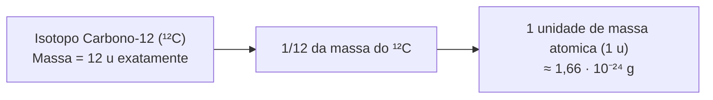
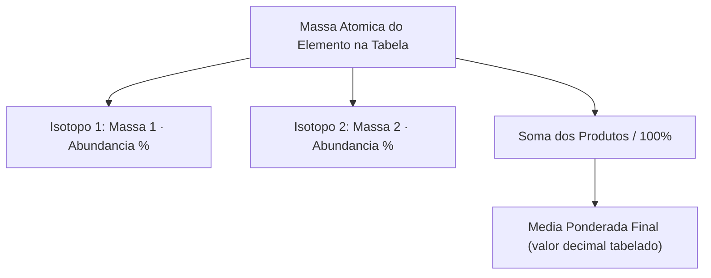
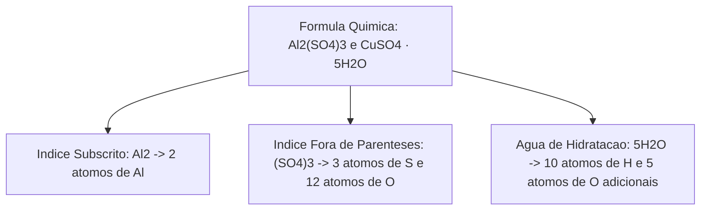
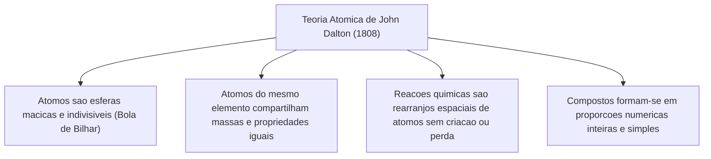
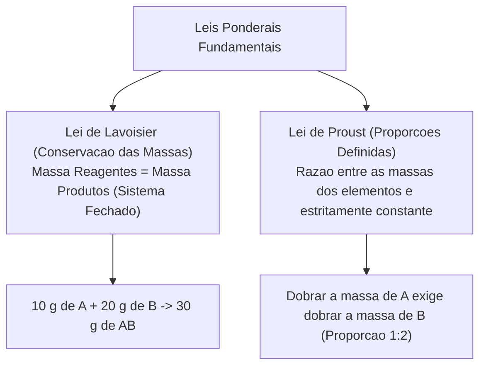
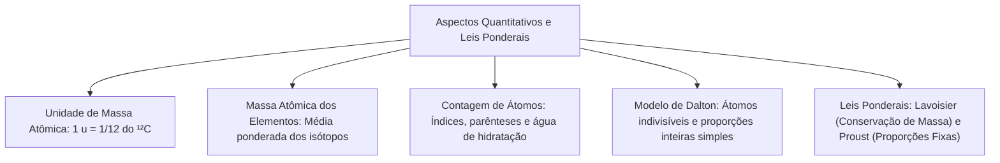

Os aspectos quantitativos conectam a escala atômica às medidas práticas. Nas operações de bombeiros, calcular o oxigênio consumido em incêndios exige estequiometria. Também demanda estimar a produção de fumaça tóxica e dosar agentes químicos neutralizantes.

Neste capítulo, estudaremos a unidade de massa atômica padronizada pelo carbono-12. Veremos o cálculo da massa atômica média dos elementos a partir dos isótopos naturais. Analisaremos as regras de contagem de átomos em fórmulas químicas complexas. Por fim, examinaremos o modelo atômico de Dalton e as leis ponderais clássicas de Lavoisier e Proust.

> [!objetivos]
> - Compreender a unidade de massa atômica (u) baseada no carbono-12 e calcular massas médias por média ponderada.
> - Determinar a massa molecular de substâncias covalentes e a massa fórmula de compostos iônicos.
> - Executar a contagem sistemática de átomos em fórmulas químicas contendo parênteses e águas de hidratação.
> - Compreender os postulados fundamentais do modelo atômico de Dalton e suas aplicações históricas.
> - Aplicar a Lei de Lavoisier e a Lei de Proust em cálculos estequiométricos de reações químicas.

---

## Unidade de Massa Atômica e Massa Atômica dos Elementos

A massa real de um átomo isolado é extremamente pequena. Ela fica na ordem de grandeza de `10⁻²⁴` gramas. Para contornar essa dificuldade prática, os químicos estabeleceram uma escala relativa de massas:

### O Padrão Universal do Carbono-12
A **unidade de massa atômica** (`u`) equivale a **1/12 da massa de um único átomo de carbono-12** (`¹²C`):
- O isótopo `¹²C` foi escolhido por conter 6 prótons e 6 nêutrons no núcleo (12 núcleons).
- No Sistema Internacional, temos `1 u ≈ 1,66 · 10⁻²⁴ g`. O valor corresponde à massa média de um núcleon isolado.
- O próton é cerca de 1.836 vezes mais massivo que o elétron. Por essa razão, a massa dos elétrons é desprezível. Quase toda a massa do átomo concentra-se estritamente em seu núcleo.

### Número de Massa versus Massa Atômica
Não se deve confundir número de massa com massa atômica:
- **Número de Massa (`A`)**: é a soma inteira de prótons (`Z`) e nêutrons (`N`): `A = Z + N`. É um número inteiro adimensional.
- **Massa Atômica de um Isótopo**: é a massa real medida na escala `u`, ligeiramente diferente do número de massa.
- **Isótopos**: átomos com o mesmo número atômico `Z`, mas diferentes quantidades de nêutrons `N` e números de massa `A`.

### Massa Atômica Tabelada: A Média Ponderada dos Isótopos
Na Tabela Periódica, a maioria dos elementos apresenta valores decimais de massa. Isso ocorre porque o valor tabelado expressa a média ponderada das massas de seus isótopos naturais. A ponderação considera as abundâncias relativas na Terra:
- Exemplo do Cloro (página 51 da fonte): o elemento ocorre como dois isótopos estáveis:
  - Cloro-35 (massa ≈ 35 u), com abundância de 75,77% (cerca de 3/4).
  - Cloro-37 (massa ≈ 37 u), com abundância de 24,23% (cerca de 1/4).
  - Cálculo da média ponderada:
    `MA(Cl) = (35 · 75,77 + 37 · 24,23) / 100 ≈ (2651,95 + 896,51) / 100 = 35,48 u` (tabelado como 35,45 u).

> [!bizu]
> **Leitura Correta dos Símbolos Atômicos**: ao lado do símbolo químico de um elemento, a convenção gráfica posiciona o número de massa `A` na parte superior esquerda e o número atômico `Z` na parte inferior esquerda: `ᴬ_Z X`. Exemplo: no flúor `¹⁹₉F`, temos `Z = 9` prótons e `A = 19` núcleons. O número de nêutrons é obtido pela diferença: `N = A - Z = 19 - 9 = 10` nêutrons. Exceto no hidrogênio comum (`¹₁H`), que não possui nêutrons, o número de massa `A` é sempre superior ao número atômico `Z`.

---

## Massa Molecular, Massa Fórmula e Contagem de Átomos

A massa molecular e a massa fórmula quantificam o peso relativo das espécies químicas agregadas, somando as massas atômicas individuais de todos os elementos constituintes multiplicadas por seus respectivos índices estequiométricos:

### Massa Molecular versus Massa Fórmula
- **Massa Molecular (MM)**: aplica-se a substâncias que existem sob a forma de moléculas discretas e covalentes. É obtida somando as massas atômicas de cada átomo constituinte.
  - Água (`H₂O`): `2 · 1 u (H) + 1 · 16 u (O) = 18 u`.
  - Gás oxigênio (`O₂`): `2 · 16 u = 32 u`.
  - Glicose (`C₆H₁₂O₆`): `6 · 12 u + 12 · 1 u + 6 · 16 u = 72 + 12 + 96 = 180 u`.
  - Ureia (`CH₄N₂O`): `1 · 12 u (C) + 4 · 1 u (H) + 2 · 14 u (N) + 1 · 16 u (O) = 12 + 4 + 28 + 16 = 60 u`.
  - Dióxido de carbono (`CO₂`): `1 · 12 u (C) + 2 · 16 u (O) = 12 + 32 = 44 u`.
- **Massa Fórmula (MF)**: aplica-se a compostos iônicos (como o cloreto de sódio `NaCl` e o sulfato de cálcio `CaSO₄`). Compostos iônicos não formam moléculas isoladas, mas sim retículos cristalinos tridimensionais extensos de cátions e ânions. A massa fórmula expressa a soma das massas atômicas da menor proporção estequiométrica que representa o composto:
  - Cloreto de sódio (`NaCl`): `1 · 23 u (Na) + 1 · 35,5 u (Cl) = 58,5 u`.
  - Carbonato de cálcio (`CaCO₃`): `1 · 40 u (Ca) + 1 · 12 u (C) + 3 · 16 u (O) = 40 + 12 + 48 = 100 u`.
  - Hidróxido de magnésio `Mg(OH)₂`: `1 · 24 u (Mg) + 2 · 16 u (O) + 2 · 1 u (H) = 24 + 32 + 2 = 58 u`.

### Regras Sistemáticas de Contagem de Átomos em Fórmulas
Uma interpretação correta de fórmulas químicas exige observar três regras matemáticas fundamentais:
1. **Índice Subscrito Simples**: o índice à direita do símbolo atômico indica a quantidade exclusiva daquele elemento na molécula. Quando não há número escrito, subentende-se o algarismo um. Em `H₂O`, temos 2 átomos de H e 1 átomo de O.
2. **Índices Externos a Parênteses**: quando um grupo de átomos encontra-se encerrado entre parênteses, o índice subscrito do lado de fora multiplica individualmente todos os átomos situados em seu interior:
   - Sulfato de alumínio `Al₂(SO₄)₃`: possui 2 átomos de alumínio (Al), `1 · 3 = 3` átomos de enxofre (S) e `4 · 3 = 12` átomos de oxigênio (O). Total de 17 átomos.
   - Sulfato de amônio `(NH₄)₂SO₄`: possui `1 · 2 = 2` átomos de nitrogênio (N), `4 · 2 = 8` átomos de hidrogênio (H), 1 átomo de enxofre (S) e 4 átomos de oxigênio (O). Total de 15 átomos.
3. **Água de Hidratação (Sais Hidratados)**: um ponto central na fórmula de um sal indica a presença de moléculas de água coordenadas no retículo cristalino sólido. O coeficiente estequiométrico que precede a fórmula da água multiplica integralmente seus átomos:
   - Sulfato de cobre pentahidratado `CuSO₄ · 5H₂O`: contém 1 átomo de cobre (Cu), 1 átomo de enxofre (S), 4 átomos de oxigênio da unidade salina mais 5 átomos de oxigênio das águas (`4 + 5 = 9` átomos de O) e `5 · 2 = 10` átomos de hidrogênio (H). O agregado reúne um total de 21 átomos.

> [!pegadinha]
> **A Massa de uma Molécula Não É Expressa em Gramas**: uma das pegadinhas mais fatais em vestibulares e concursos é a afirmação de que "uma molécula de água pesa 18 gramas". Isso é completamente falso. A massa de uma única molécula microscópica de água é `18 u` (o que equivale a insignificantes `18 · 1,66 · 10⁻²⁴ g ≈ 3 · 10⁻²³ g`). A quantidade que possui massa de 18 gramas inteiros é exatamente **1 mol** de moléculas de água (um conjunto macroscópico colossal contendo cerca de `6,022 · 10²³` moléculas). Jamais confunda a escala atômica (`u`) com a escala molar laboratorial (`g/mol`).

> [!exemplo]
> **Comparação Prática de Massas Moleculares e Densidade Relativa de Gases**:
> Considere as massas molares de substâncias gasosas comuns: gás hidrogênio `H₂` (2 u), gás metano `CH₄` (16 u), vapor de água `H₂O` (18 u), gás nitrogênio `N₂` (28 u) e gás oxigênio `O₂` (32 u). O ar atmosférico possui massa molar média de aproximadamente 29 u. Gases com massa molecular abaixo de 29 u sobem e acumulam-se no topo de ambientes confinados. Gases com massa molecular acima de 29 u (como o gás carbônico `CO₂`, 44 u) decantam e concentram-se junto ao piso.

---

## O Modelo Atômico de Dalton

No início do século XIX, em 1808, John Dalton propôs a primeira teoria atômica de base científica quantitativa. O modelo buscava explicar racionalmente por que os elementos se combinam em proporções fixas:

### Os Postulados Originais de Dalton
1. A matéria é constituída por partículas minúsculas, maciças e indivisíveis chamadas **átomos**. O modelo é comumente comparado a uma bola de bilhar rígida.
2. Todos os átomos de um mesmo elemento químico são rigorosamente idênticos entre si. Eles possuem a mesma massa e as mesmas propriedades químicas.
3. Átomos de elementos diferentes possuem massas e comportamentos químicos distintos.
4. As reações químicas consistem na separação, união e rearranjo de átomos preexistentes. Nenhum átomo é criado ou destruído em transformações ordinárias.
5. Os compostos formam-se pela união de átomos de elementos diferentes em proporções numéricas inteiras, simples e fixas (como 1:1, 1:2 ou 2:3).

### Alcances Históricos e Limitações Modernas
O modelo de Dalton forneceu uma base corpuscular lógica para fundamentar as leis ponderais. Contudo, a física moderna revelou limitações em seus postulados:
- Hoje sabe-se que o átomo é divisível em partículas subatômicas (prótons, nêutrons e elétrons).
- Átomos do mesmo elemento podem ter massas diferentes devido à existência de isótopos naturais.
- Mesmo com tais correções, a ideia central de Dalton sobre rearranjo atômico permanece plenamente válida na estequiometria química.

> [!bizu]
> **Dalton e a Conservação das Espécies Atômicas**: para Dalton, uma reação química não cria nem extingue átomos. Ela apenas desfaz agrupamentos antigos e forma novas uniões espaciais. Essa premissa corpuscular explica perfeitamente por que a massa total dos reagentes precisa ser igual à massa dos produtos em recipientes vedados.

---

## Leis Ponderais: Lavoisier e Proust

As leis ponderais quantificam as relações de massa entre reagentes e produtos nas transformações químicas:

### Lei de Lavoisier e Conservação das Massas
Formulada por Antoine Laurent Lavoisier em 1789 com balanças de alta precisão, a lei estabelece:
> "Em qualquer reação química executada em um **sistema estritamente fechado**, a massa total dos reagentes que se combinam é exatamente igual à massa total dos produtos formados."

- **Fundamento Químico**: nenhuma partícula atômica de matéria surge do nada nem deixa de existir no universo físico; ocorrem unicamente rearranjos ordenados entre as espécies químicas envolvidas.
- **Exemplo Numérico**: na neutralização de ácido clorídrico com hidróxido de sódio em frasco vedado:
  `HCl + NaOH → NaCl + H₂O`
  Se 36,5 gramas de `HCl` reagem com 40,0 gramas de `NaOH`, a massa total de reagentes é `36,5 + 40,0 = 76,5 g`. A massa total dos produtos formados será rigorosamente `76,5 g` (58,5 g de `NaCl` mais 18,0 g de `H₂O`).

### Condição de Validade: Sistema Aberto versus Sistema Fechado
A Lei de Lavoisier possui validade universal absoluta na química clássica. Entretanto, em recipientes **abertos**, pode surgir a falsa impressão de que a massa variou:
- Se a reação libera gases voláteis (como na queima de madeira ou no ataque do ácido sulfúrico `H₂SO₄` ao carbonato de sódio `Na₂CO₃`, desprendendo dióxido de carbono `CO₂`), o gás escapa para a atmosfera, fazendo a balança registrar uma massa final aparentemente menor.
- Se a reação incorpora gases atmosféricos (como na oxidação de uma palha de aço ao ar, absorvendo oxigênio gasoso `O₂`), o sólido ganha massa do ar, fazendo a balança registrar valor maior.
- Em ambos os casos, ao selar o recipiente e operar em **sistema fechado**, a massa inicial e a massa final permanecem rigorosamente idênticas.

### Lei de Proust e Proporções Definidas
Formulada por Joseph Louis Proust em 1799, a lei estabelece:
> "Uma determinada substância pura composta apresenta sempre a mesmíssima proporção ponderal constante entre as massas dos elementos químicos que a constituem, independentemente de sua origem, método de obtenção ou massa total analisada."

- **Exemplo da Síntese da Água**: a água é formada pela combinação de gás hidrogênio (`H₂`) e gás oxigênio (`O₂`):
  - Experimento 1: `2 g` de hidrogênio combinam-se perfeitamente com `16 g` de oxigênio, produzindo `18 g` de água. A razão em massa é `m(H) / m(O) = 2 / 16 = 1 / 8`.
  - Experimento 2: duplicando a massa de hidrogênio para `4 g`, a massa exigida de oxigênio duplica obrigatoriamente para `32 g`, produzindo `36 g` de água. A razão em massa permanece constante: `4 / 32 = 1 / 8`.

| Lei Ponderal | Cientista e Ano | Princípio Central | Exigência Prática |
|---|---|---|---|
| **Conservação das Massas** | Antoine Lavoisier (1789) | A massa total do sistema permanece inalterada antes e depois da reação. | O sistema deve ser estritamente fechado para conter gases. |
| **Proporções Definidas** | Joseph Proust (1799) | Elementos químicos combinam-se em proporções de massa constantes e fixas. | A pureza das substâncias e a estequiometria devem ser mantidas. |

> [!atencao]
> **Presença de Reagente em Excesso Não Viola as Leis Ponderais**: quando reagentes são misturados fora da proporção estequiométrica ideal de Proust, a parcela excedente de material não participa da transformação química e permanece intacta no recipiente ao final do processo. Por exemplo: se 10 g do reagente A reagem perfeitamente com 5 g do reagente B para formar 15 g do composto AB, ao colocarmos 15 g de A em contato com 5 g de B, apenas 10 g de A serão consumidos. Restarão 5 g de reagente A em excesso não reagido e formar-se-ão 15 g de AB. A massa total inicial era `15 + 5 = 20 g`, e a massa total final continua sendo `5 g (excesso) + 15 g (produto) = 20 g`. A conservação das massas de Lavoisier permanece 100% preservada.

---

## Exercício Resolvido Integrado

> [!resolvido]
> **Exercício Resolvido: Aplicação Conjunta das Leis de Lavoisier e Proust com Reagente em Excesso Passo a Passo**:
> Em um ensaio laboratorial realizado em sistema fechado, sabe-se que 12 gramas de carbono reagem exatamente com 32 gramas de gás oxigênio para formar 44 gramas de dióxido de carbono (`CO₂`). Em um segundo experimento, um operador misturou 36 gramas de carbono puro com 100 gramas de gás oxigênio em um reator completamente vedado.
> a) Determine qual dos reagentes foi adicionado em excesso e calcule a massa desse excesso.
> b) Determine a massa de dióxido de carbono (`CO₂`) efetivamente produzida no segundo experimento.
> c) Comprove a validade da Lei da Conservação das Massas no reator após o término da queima.
> 
> **Resolução passo a passo:**
> 1. Determinação da proporção ponderal estequiométrica de Proust:
>    Pelo primeiro experimento, a razão constante entre a massa de carbono e a massa de oxigênio é:
>    `m(C) / m(O) = 12 / 32 = 3 / 8 = 0,375`.
> 2. Verificação do reagente limitante e do reagente em excesso:
>    No segundo experimento dispomos de 36 g de carbono.
>    Aplicamos a proporção de Proust para descobrir a massa de oxigênio estritamente necessária:
>    `36 / m(O) = 12 / 32`
>    `m(O) = (36 · 32) / 12 = 3 · 32 = 96 gramas de O₂`.
>    Como foram adicionados 100 gramas de oxigênio e apenas 96 gramas reagem, o **gás oxigênio está em excesso**, e o carbono é o reagente limitante.
>    Massa em excesso de oxigênio: `100 g - 96 g = 4 gramas de O₂ não reagido`.
> 3. Cálculo da massa de dióxido de carbono (`CO₂`) produzida:
>    Pela Lei de Lavoisier aplicada aos reagentes efetivamente consumidos:
>    `Massa de CO₂ = Massa consumida de C + Massa consumida de O₂`
>    `Massa de CO₂ = 36 g + 96 g = 132 gramas de dióxido de carbono`.
>    (Note que pela Lei de Proust, `3 · 44 g = 132 g`, confirmando a triplicação exata da reação base).
> 4. Comprovação da conservação total das massas de Lavoisier no sistema fechado:
>    - Massa total inicial no reator: `36 g (C) + 100 g (O₂) = 136 gramas`.
>    - Massa total final no reator: `132 g (CO₂ formado) + 4 g (O₂ em excesso) = 136 gramas`.
>    A massa inicial é idêntica à massa final, confirmando a validade irrestrita da Lei de Lavoisier.

---

## Mapa do capítulo

### Para fixar
- A unidade de massa atômica (u) é definida como 1/12 da massa do isótopo estável carbono-12.
- A massa atômica tabelada é a média ponderada das massas isotópicas conforme sua abundância natural.
- A massa molecular soma as massas dos átomos da molécula; compostos iônicos utilizam a massa fórmula.
- Uma molécula de água tem massa de 18 u; 1 mol de água possui massa macroscópica de 18 gramas.
- Índices fora de parênteses multiplicam todos os elementos internos; águas de hidratação somam-se à fórmula salina.
- John Dalton propôs que reações químicas consistem em rearranjos ordenados de átomos sem destruição.
- Lavoisier demonstrou que a massa total permanece constante em sistema fechado; gases desprendidos exigem vedação.
- Proust provou que os elementos combinam-se em proporções de massa estritamente constantes e invariáveis.
- O excesso de reagente não viola a conservação da massa, permanecendo contabilizado intacto no sistema final.
