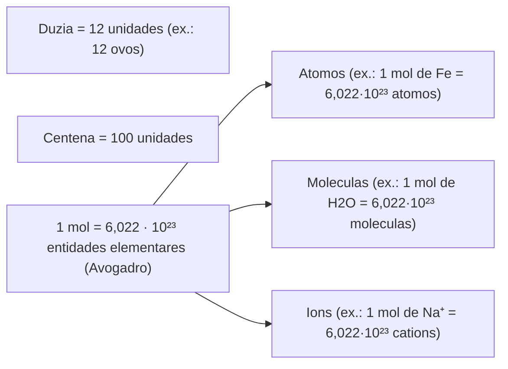
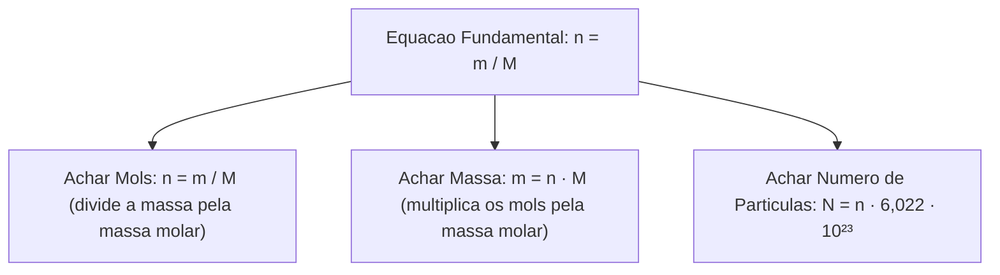
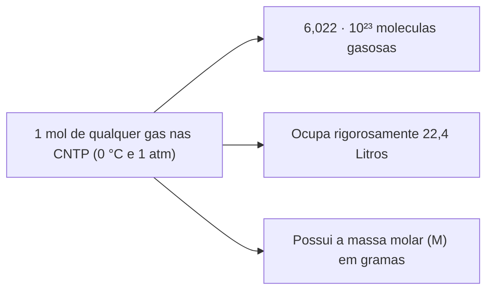
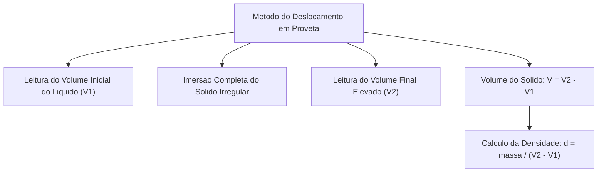
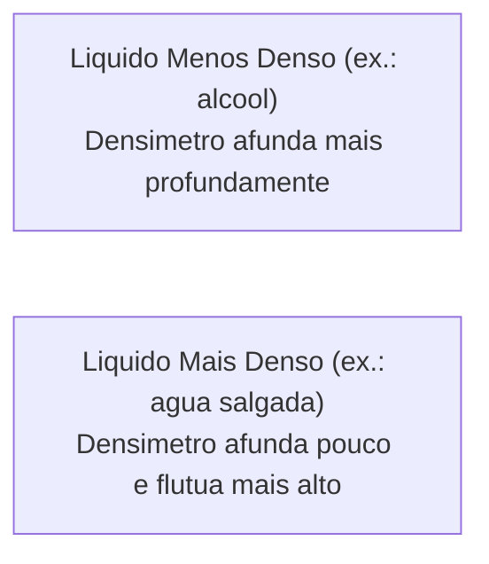
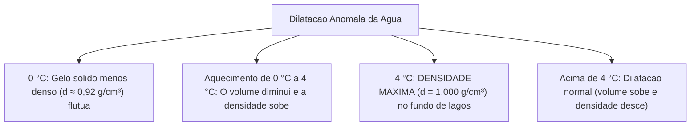
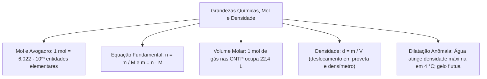

As grandezas químicas quantificam as relações entre o mundo atômico microscópico e as medições laboratoriais e operacionais macroscópicas. No serviço de bombeiros militares, calcular a densidade de vapores inflamáveis permite antecipar se um bolsão de gás se concentrará no solo ou no forro de uma edificação. Da mesma forma, compreender o conceito de mol, o volume molar e a dilatação anômala da água é essencial para resgates aquáticos em lagos congelados e dimensionamento de reservatórios de combate a incêndio.

Neste capítulo, estudaremos o conceito de mol como unidade fundamental de quantidade de matéria associada à constante de Avogadro. Analisaremos a relação entre massa molar e volume molar nas condições normais de temperatura e pressão. Por fim, examinaremos a densidade de sólidos, líquidos e gases, o funcionamento do densímetro e o fenômeno térmico da dilatação anômala da água e de outros elementos químicos.

> [!objetivos]
> - Compreender o mol como unidade de quantidade de matéria e aplicar a constante de Avogadro (`6,022 · 10²³`).
> - Relacionar massa molar (`M`, em g/mol) e massa da amostra pela equação fundamental `n = m / M`.
> - Aplicar o volume molar de gases ideais nas CNTP (`22,4 L/mol`) em cálculos de volume e massa.
> - Calcular a densidade absoluta (`d = m / V`) e determinar o volume de sólidos irregulares por deslocamento de líquido.
> - Compreender a dilatação anômala da água entre 0 °C e 4 °C e reconhecer seu papel biológico e operacional.

---

## O Conceito de Mol e a Constante de Avogadro

Em química, a escala ordinária contém um número imenso de partículas atômicas. Para quantificar essas entidades, o Sistema Internacional adotou o **mol**:

### Analogia e Significado do Mol
O mol funciona como uma unidade de contagem de objetos. Ele equivale à dezena (10 unidades) ou à dúzia (12 unidades). Se pensarmos em ovos, uma dúzia reúne 12 ovos. Do mesmo modo, um mol de ovos teria `6,022 · 10²³` ovos. Um bilhão possui 9 zeros. Já a constante de Avogadro tem 23 zeros após o valor 6,022. O mol é uma coisa gigantesca em termos de contagem numérica:
- **1 mol** contém exatamente **`6,022 · 10²³` entidades elementares**.
- Essa grandeza chama-se **Constante de Avogadro** (`N_A = 6,022 · 10²³ mol⁻¹`).
- O valor foi fixado como o número de átomos em 12 gramas de carbono-12 (`¹²C`).
- As entidades contadas em mols dependem da substância. Podem ser átomos, moléculas, íons ou fórmulas mínimas de compostos iônicos.

---

## Massa Molar e Relação Fundamental da Quantidade de Matéria

A **massa molar** (`M`) é a massa em gramas de 1 mol de substância. Sua unidade usual é o **grama por mol (`g/mol`)**:

### Coincidência Numérica entre u e g/mol
Existe uma ponte direta entre a escala atômica e a escala de laboratório:
- O valor numérico da massa molar em `g/mol` coincide com a massa molecular em `u`.
- Uma molécula de água (`H₂O`) pesa `18 u`. Logo, 1 mol de água pesa exatamente 18 gramas.
- Um átomo de carbono pesa `12 u`. Portanto, 1 mol de carbono pesa 12 gramas.
- Uma molécula de glicose (`C₆H₁₂O₆`) tem `180 u`. Logo, 1 mol de glicose tem 180 gramas.

### A Equação Fundamental da Quantidade de Matéria
A quantidade de matéria em mols (`n`) presente em uma massa `m` em gramas é:
**`n = m / M`**

Dessa fórmula derivam duas relações práticas:
- Para achar a massa: **`m = n · M`**.
- Para achar a massa molar: **`M = m / n`**.

Se pesarmos 100 gramas de dióxido de carbono (`CO₂`, `M = 44,01 g/mol`), obteremos `n = 100 / 44,01 ≈ 2,27 mol` (2,27mol). Ao medir grandezas de laboratório, lembre-se de que 1 kg tem 1000 gramas e 1 metro cúbico tem 1000 litros. As medidas padronizadas evitam erros operacionais.

> [!bizu]
> **Pureza do Ouro e Contagem Atômica em Joias**:
> O ouro puro de 24 quilates possui 99,99% de pureza (mais de 99% de teor de ouro). Em uma joia de 19,2 quilates, a fração mássica vale `19,2 / 24 · 99,99% ≈ 79,99%` de ouro. Se pagamos por uma peça de 10 gramas desse metal, ela contém 8 gramas de ouro puro. Com a massa atômica de `196,9 g/mol`, calculamos `n = 8 / 196,9 ≈ 0,040 mol`. Multiplicando pela constante de Avogadro, obteremos cerca de `0,040 · 6,0 · 10²³ ≈ 2,4 · 10²²` átomos de ouro (1022 átomos). Essa análise quantitativa é clássica em exames da área pericial.
> `1 mol de qualquer substância = Massa Molar (em gramas) = 6,022 · 10²³ partículas`.
> Exemplo: para o gás carbônico (`CO₂`, `M = 44 g/mol`), temos: `1 mol de CO₂ = 44 gramas = 6,022 · 10²³ moléculas`. Se o problema fornecer 88 g de `CO₂`, deduz-se imediatamente que temos `88 / 44 = 2 mols`, contendo `2 · 6,022 · 10²³ = 1,204 · 10²⁴` moléculas.

---

## Volume Molar de Gases nas CNTP

O **volume molar** é o volume ocupado por exatamente 1 mol de qualquer substância no estado gasoso sob condições especificadas de temperatura e pressão:

### As Condições Normais de Temperatura e Pressão (CNTP)
Pela hipótese de Avogadro, volumes iguais de gases quaisquer, submetidos à mesma temperatura e pressão, contêm o mesmo número de moléculas:
- As CNTP clássicas adotadas em concursos definem a temperatura de **0 °C (273,15 K)** e a pressão de **1 atmosfera (1 atm = 760 mmHg = 101.325 Pa)**.
- Nessas condições, **1 mol de qualquer gás ideal ocupa o volume fixo de aproximadamente 22,4 litros**:
  **`V_molar = 22,4 L/mol (nas CNTP)`**

O volume total `V` ocupado por uma quantidade `n` de mols gasosos nas CNTP é calculado por:
**`V = n · 22,4 L`**

---

## Densidade Absoluta e Métodos de Medição

A **densidade** (`d` ou `ρ`) é a grandeza física que expressa a razão entre a massa de uma porção material e o volume espacial por ela ocupado:
**`d = m / V`**

### Relações de Unidades e Equivalências Práticas
- No Sistema Internacional (SI), a unidade padrão de densidade é o **quilograma por metro cúbico (`kg/m³`)**.
- Em laboratórios químicos e na indústria, utilizam-se habitualmente o **grama por centímetro cúbico (`g/cm³`)** e o **grama por mililitro (`g/mL`)**.
- Como `1 cm³` equivale exatamente a `1 mL`, as unidades `g/cm³` e `g/mL` são rigorosamente idênticas em valor numérico.
- Da mesma forma, `1 dm³` equivale a `1 L`, tornando `kg/dm³` e `kg/L` numericamente iguais a `g/cm³`:
  `1 g/cm³ = 1 g/mL = 1 kg/L = 1.000 kg/m³`. A densidade da água líquida a 4 °C é padronizada como `1,00 g/cm³` ou `1.000 kg/m³`.

### Medição de Volume de Sólidos Irregulares por Deslocamento
Quando um sólido não possui formato geométrico regular (como uma pedra, um fragmento metálico ou um projétil pericial), seu volume não pode ser calculado por fórmulas geométricas simples. Utiliza-se então o método do deslocamento de líquido:
1. Adiciona-se água ou outro líquido imiscível em uma proveta graduada e registra-se o volume inicial do líquido (`V_inicial`).
2. Imerge-se completamente o sólido no líquido. O corpo sólido desloca um volume de líquido rigorosamente igual ao seu próprio volume.
3. Faz-se a leitura do novo nível de líquido na proveta (`V_final`).
4. O volume real do sólido é dado pela diferença direta:
   **`V_sólido = V_final - V_inicial`**
5. Conhecendo a massa do sólido obtida em balança, calcula-se sua densidade: `d = m / V_sólido`.

### O Densímetro e o Princípio de Flutuação de Arquimedes
O **densímetro** (ou hidrômetro) é um instrumento de vidro lastreado em sua base inferior por esferas de chumbo e provido de uma haste superior graduada:
- Quando inserido verticalmente em um líquido, o instrumento flutua em equilíbrio estável pelo Princípio de Arquimedes (o peso do densímetro iguala o empuxo do líquido deslocado).
- **Em líquidos muito densos**: o empuxo é intenso; o densímetro afunda pouco e a leitura na haste fica mais alta.
- **Em líquidos pouco densos**: o empuxo é fraco; o densímetro afunda mais profundamente.
- Procedimento de leitura: o líquido é colocado em uma proveta. O densímetro é inserido com cuidado para não quebrar. Aguarda-se a estabilização completa sem que o instrumento encoste nas paredes ou no fundo. Faz-se a leitura da graduação na linha da superfície do líquido.
- Em misturas de água e álcool, como o etanol é menos denso (`d ≈ 0,79 g/cm³`) que a água (`d = 1,00 g/cm³`), uma densidade maior na mistura acusa menor teor alcoólico.

> [!pegadinha]
> **Densidade e Flutuação**: um material não flutua ou afunda por causa de sua massa total absoluta, mas sim devido à sua **densidade relativa**. Um navio de combate a incêndio de 5.000 toneladas de aço flutua com folga porque sua forma oca encerra um gigantesco volume de ar, tornando sua densidade média global inferior à da água. Por outro lado, um prego maciço de ferro pesando insignificantes 5 gramas afunda imediatamente, pois a densidade do ferro maciço (`7,8 g/cm³`) é muito superior à da água (`1,0 g/cm³`).

---

## Dilatação Anômala da Água e de Outros Materiais

A grande maioria dos materiais na natureza sofre dilatação térmica ao ser aquecida (aumento de volume com diminuição de densidade) e sofre contração ao ser resfriada. A água líquida, contudo, exibe um comportamento excepcional de enorme relevância ecológica e física:

### O Comportamento Térmico Peculiar da Água
Entre **0 °C e 4 °C**, a água líquida apresenta o fenômeno denominado **dilatação anômala**:
- Ao ser **aquecida de 0 °C até 4 °C**, o volume da água **diminui** (contração térmica anômala) e sua densidade **aumenta**.
- Ao atingir exatamente **4 °C sob pressão de 1 atm**, a água líquida atinge sua **densidade máxima** (`d = 1,000 g/cm³`).
- Ao ser resfriada de 4 °C até 0 °C (processo inverso), a água se **expande**, tornando-se menos densa.
- Ao congelar a 0 °C, as moléculas de `H₂O` organizam-se em uma rede cristalina hexagonal aberta repleta de espaços vazios. Por essa razão estrutural, o gelo sólido é cerca de 9% menos denso (`d ≈ 0,92 g/cm³`) que a água líquida, flutuando à superfície.

### Consequências Práticas e Ecológicas
Esse fenômeno viabiliza a manutenção da vida aquática em regiões de frio extremo no planeta. No inverno, a camada superficial dos lagos atinge 0 °C e congela, formando uma lâmina sólida de gelo flutuante. O gelo atua como isolante térmico eficaz. Sob essa crosta congelada, a água mais densa a 4 °C acomoda-se no fundo do lago, mantendo-se em estado líquido e assegurando a sobrevida da fauna e flora aquáticas.

Além da água, outros elementos químicos e compostos exibem dilatação anômala em determinadas faixas de temperatura: o **gálio (Ga)**, o **germânio (Ge)**, o **bismuto (Bi)** e o **antimônio (Sb)**. Esses materiais também se expandem durante a solidificação, sendo úteis na fabricação de ligas tipográficas e peças metálicas de alta definição dimensional.

> [!atencao]
> **Rompimento de Tubulações por Congelamento**: bombeiros em regiões de clima frio enfrentam com frequência o rompimento de tubulações de combate a incêndio expostas à geada. Quando a água confina-se em dutos fechados e a temperatura cai de 4 °C para 0 °C e se congela, a expansão volumétrica de 9% exerce pressões hidráulicas colossais contra as paredes de aço ou cobre, fendendo as tubulações. Sistemas prediais preventivos em locais sujeitos a congelamento exigem válvulas de drenagem automática ou circulação de fluidos anticongelantes.

---

## Exercício Resolvido Integrado

> [!resolvido]
> **Exercício Resolvido: Cálculo Integrado de Mols, Massa, Densidade e Volume Molar Passo a Passo**:
> Em uma operação de inspeção de segurança contra incêndio, uma viatura de produtos perigosos apreendeu um cilindro de armazenamento contendo 176 gramas de gás dióxido de carbono (`CO₂`). O gás encontrava-se sob condições normais de temperatura e pressão (CNTP: 0 °C e 1 atm). Dados: massas atômicas `C = 12 u`, `O = 16 u`; `N_A = 6,022 · 10²³ mol⁻¹`; volume molar nas CNTP = `22,4 L/mol`.
> a) Calcule a quantidade de matéria (`n`), em mols, de `CO₂` contida no cilindro.
> b) Determine o número total de moléculas de gás presentes no cilindro.
> c) Calcule o volume total, em litros, ocupado pelo gás nas CNTP.
> d) Determine a densidade absoluta do gás `CO₂` nas CNTP em `g/L`.
> 
> **Resolução passo a passo:**
> 1. Cálculo da massa molar do dióxido de carbono:
>    `M(CO₂) = 1 · 12 + 2 · 16 = 12 + 32 = 44 g/mol`.
> 2. Cálculo da quantidade de matéria em mols (`n`):
>    Aplicamos a equação fundamental:
>    `n = m / M = 176 g / 44 g/mol = 4 mols de CO₂`.
> 3. Cálculo do número de moléculas:
>    Multiplicamos o número de mols pela constante de Avogadro:
>    `N = n · N_A = 4 · (6,022 · 10²³) = 2,4088 · 10²⁴ moléculas de CO₂`.
> 4. Cálculo do volume ocupado nas CNTP:
>    Como cada mol ocupa 22,4 litros nas CNTP:
>    `V = n · 22,4 L = 4 · 22,4 = 89,6 litros de gás CO₂`.
> 5. Cálculo da densidade absoluta do gás nas CNTP:
>    A densidade relaciona a massa total ao volume total:
>    `d = m / V = 176 g / 89,6 L ≈ 1,964 g/L`.
>    (Note que também podemos calcular a densidade de qualquer gás nas CNTP dividindo sua massa molar pelo volume molar: `d = M / 22,4 = 44 / 22,4 ≈ 1,964 g/L`).

---

## Mapa do capítulo

### Para fixar
- O mol é a unidade de contagem de matéria; reúne exatamente 6,022 · 10²³ entidades elementares.
- A massa molar em g/mol possui o mesmo valor numérico da massa molecular em u.
- A relação n = m / M converte diretamente massa de amostra em quantidade de matéria em mols.
- Nas CNTP (0 °C e 1 atm), 1 mol de qualquer gás ideal ocupa o volume de 22,4 litros.
- A densidade expressa a razão d = m / V; 1 g/cm³ equivale exatamente a 1 g/mL e a 1.000 kg/m³.
- O volume de sólidos irregulares é medido pelo deslocamento de líquido em proveta: V = V_final - V_inicial.
- O densímetro afunda mais em líquidos menos densos e flutua mais alto em meios muito densos.
- A água atinge densidade máxima a 4 °C; entre 0 °C e 4 °C ela se contrai ao ser aquecida.
- O gelo é menos denso que a água líquida, flutuando e preservando a vida subaquática em lagos congelados.
