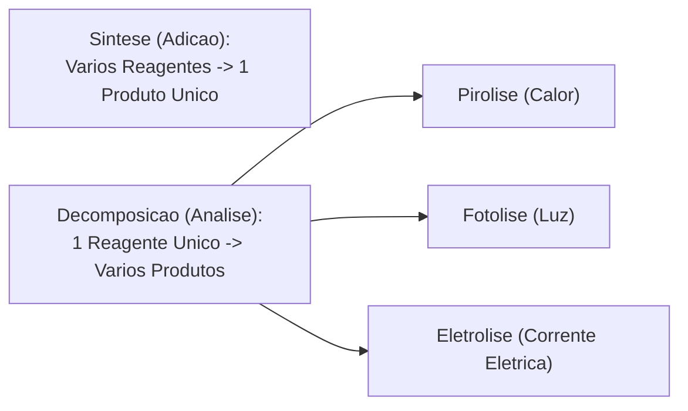
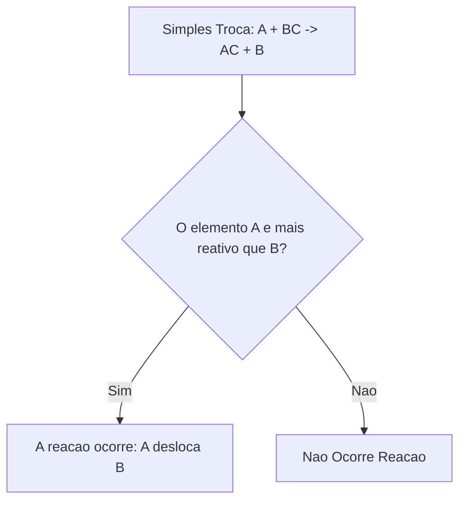
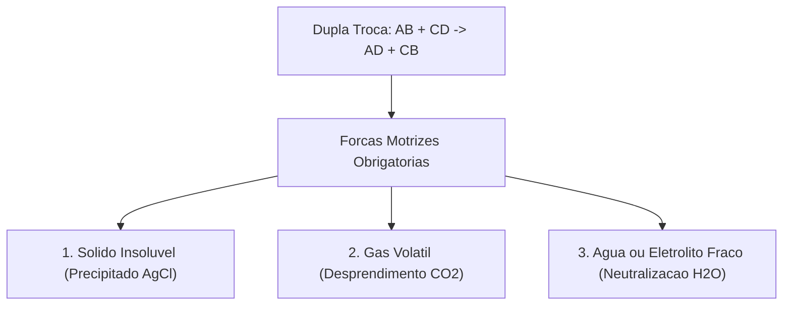
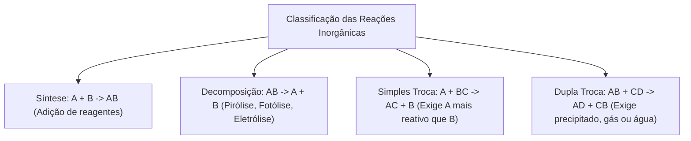

A classificação das reações inorgânicas organiza as transformações pelo número e tipo de reagentes e produtos. No Corpo de Bombeiros, reconhecer o tipo de reação permite prever desprendimento de gases inflamáveis e neutralizar produtos químicos derramados em sinistros.

Neste capítulo, estudaremos os quatro padrões clássicos de reações: síntese, decomposição, simples troca e dupla troca. Analisaremos também a série de reatividade dos metais e as forças motrizes da dupla troca em solução aquosa.

> [!objetivos]
> - Classificar reações inorgânicas em síntese, decomposição, simples troca e dupla troca.
> - Diferenciar pirólise, fotólise e eletrólise nas reações de análise.
> - Prever a ocorrência de simples troca pela série de reatividade dos metais.
> - Identificar as forças motrizes da dupla troca: precipitado, gás ou eletrólito fraco.

---

## Reações de Síntese (Adição) e Reações de Análise (Decomposição)

As transformações inorgânicas fundamentais dividem-se em processos de união e de fragmentação molecular:

### Reação de Síntese ou Adição
Ocorre quando dois ou mais reagentes combinam-se para formar um **produto único**:
**`A + B → AB`**
- **Síntese Total**: reagentes são substâncias simples. Exemplo: queima do hidrogênio: `2 H₂ + O₂ → 2 H₂O`.
- **Síntese Parcial**: ao menos um reagente é substância composta. Exemplo: hidratação da cal viva: `CaO + H₂O → Ca(OH)₂`.

### Reação de Análise ou Decomposição
Ocorre quando um **único reagente composto** é desmembrado em dois ou mais produtos:
**`AB → A + B`**
Conforme a fonte de energia empregada, a decomposição recebe nomes específicos:
- **Pirólise**: decomposição pelo calor. Exemplo da calcinação do carbonato de cálcio: `CaCO₃ (s) + calor → CaO (s) + CO₂ (g)`.
- **Fotólise**: decomposição pela luz. Exemplo da degradação da água oxigenada: `2 H₂O₂ + luz → 2 H₂O + O₂`.
- **Eletrólise**: decomposição por corrente elétrica contínua: `2 H₂O + eletricidade → 2 H₂ + O₂`.

---

## Reações de Deslocamento (Simples Troca) e Reatividade

A reação de **simples troca** ou **deslocamento** ocorre quando uma substância simples reage com uma composta, desalojando um de seus elementos e assumindo seu lugar:
**`A + BC → AC + B`**

### Critério de Espontaneidade: Série de Reatividade
A simples troca só ocorre se o elemento livre (`A`) for **mais reativo** do que o elemento ligado (`B`):
- **Fila de Reatividade dos Metais**:
  `Metais Alcalinos > Alcalino-Terrosos > Al > Zn > Fe > Ni > Pb > [H] > Cu > Hg > Ag > Pt > Au`.
- **Exemplo com Zinco e Cobre**: lâmina de zinco em solução de sulfato de cobre:
  `Zn (s) + CuSO₄ (aq) → ZnSO₄ (aq) + Cu (s)`.
  Como o zinco é mais reativo que o cobre (`Zn > Cu`), o zinco desloca o cobre. A cor azul diminui e forma-se cobre metálico.
- **Caso sem Reação**: lâmina de chumbo em sulfato de zinco:
  `Pb (s) + ZnSO₄ (aq) → Não Ocorre Reação`. O chumbo é menos reativo que o zinco (`Pb < Zn`).

> [!bizu]
> **Ataque a Ácidos**: todo metal posicionado à esquerda do hidrogênio `[H]` na fila (como zinco e ferro) reage com ácidos minerais (`HCl`), liberando gás hidrogênio (`H₂`): `Fe + 2 HCl → FeCl₂ + H₂ ↑`. Metais nobres à direita de `[H]` (como cobre, prata e ouro) não atacam ácidos por deslocamento.

---

## Reações de Dupla Troca (Metátese) e Forças Motrizes

A reação de **dupla troca** ou **metátese** ocorre quando duas substâncias compostas reagem entre si em solução aquosa. Os reagentes permutam seus cátions e ânions, formando dois novos compostos químicos:
**`AB + CD → AD + CB`**

Contudo, a troca de pares iônicos só se concretiza se houver uma **força motriz** que retire íons do meio aquoso. Em solução, se todos os íons permanecerem solúveis, temos apenas uma mistura homogênea sem reação real. A transformação ocorre de forma irreversível quando pelo menos um dos produtos atender a uma das três condições fundamentais:
- **Formação de Precipitado (Sólido Insolúvel)**: quando um dos sais formados é insolúvel em água e se deposita no fundo. Exemplo: mistura aquosa de nitrato de prata com cloreto de sódio: `AgNO₃ (aq) + NaCl (aq) → AgCl (s) ↓ + NaNO₃ (aq)`. O cloreto de prata (`AgCl`) precipita como sólido branco leitoso.
- **Formação de Gás ou Composto Volátil**: liberação imediata de bolhas de gás que escapam da solução. Exemplo: reação do ácido clorídrico com bicarbonato de sódio: `HCl (aq) + NaHCO₃ (aq) → NaCl (aq) + H₂O (l) + CO₂ (g) ↑`.
- **Formação de Água ou Eletrólito Fraco (Neutralização)**: síntese de moléculas pouco ionizadas. A neutralização clássica entre um ácido e uma base forma sal e água: `HCl (aq) + NaOH (aq) → NaCl (aq) + H₂O (l)`.

---

## Exercício Resolvido: Identificação e Ocorrência

> [!resolvido]
> **Exercício Resolvido: Classificação de Reações e Previsão de Ocorrência Passo a Passo**:
> Analise as quatro transformações químicas representadas abaixo e determine a classificação e a viabilidade de cada uma:
> I. `2 Mg (s) + O₂ (g) → 2 MgO (s)`
> II. `Cu (s) + 2 AgNO₃ (aq) → Cu(NO₃)₂ (aq) + 2 Ag (s)`
> III. `2 KClO₃ (s) + calor → 2 KCl (s) + 3 O₂ (g)`
> IV. `H₂SO₄ (aq) + 2 KOH (aq) → K₂SO₄ (aq) + 2 H₂O (l)`
> 
> **Resolução passo a passo:**
> 1. Equação I: dois reagentes geram produto único. Trata-se de **síntese ou adição**.
> 2. Equação II: cobre simples reage com sal de prata. Como `Cu > Ag` na série de reatividade, a reação é espontânea. Classifica-se como **simples troca ou deslocamento**.
> 3. Equação III: reagente único é decomposto por calor em dois produtos. Trata-se de **análise ou decomposição (pirólise)**.
> 4. Equação IV: ácido reage com base formando sal e água líquida. Trata-se de **dupla troca (neutralização ácido-base)**.

---

## Mapa do capítulo

### Para fixar
- Na reação de síntese, vários reagentes reúnem-se para originar um produto composto único.
- A decomposição decompõe um único reagente em dois ou mais produtos mais simples.
- A pirólise utiliza calor, a fotólise emprega luz e a eletrólise utiliza corrente elétrica.
- Em reações de simples troca, o elemento livre só desloca o elemento combinado se for mais reativo.
- O zinco desloca o cobre do sulfato de cobre; o chumbo não desloca o zinco por ser menos reativo.
- Reações de dupla troca exigem força motriz: formação de precipitado sólido, gás volátil ou água líquida.
- A neutralização ácido-base entre ácido clorídrico e hidróxido de sódio exemplifica a dupla troca.
- Metais posicionados antes do hidrogênio atacam ácidos liberando gás hidrogênio combustível.
