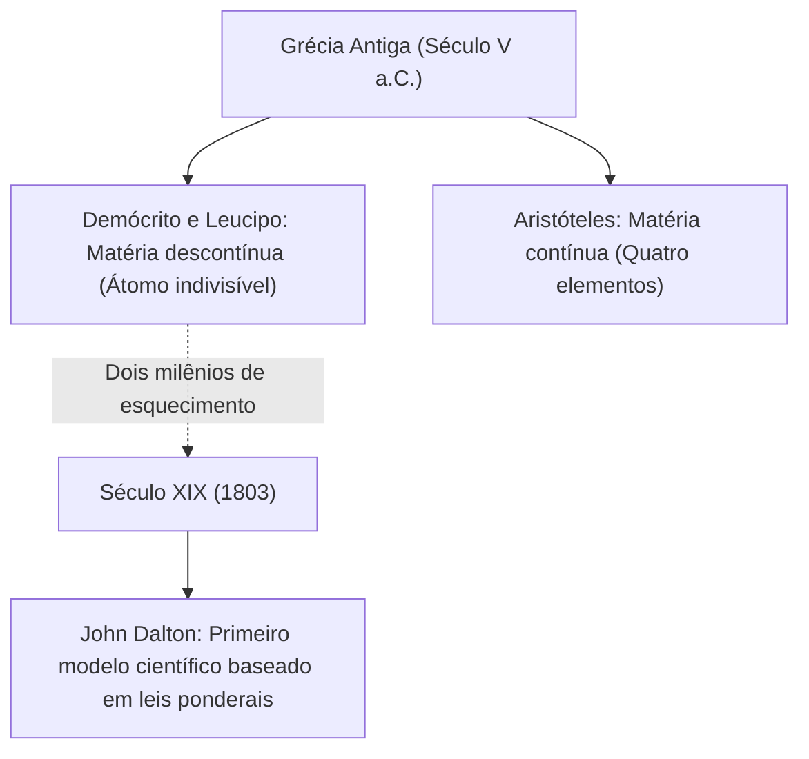
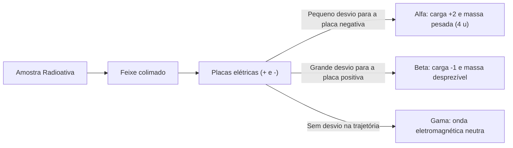
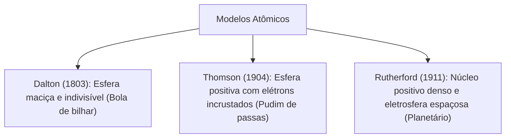
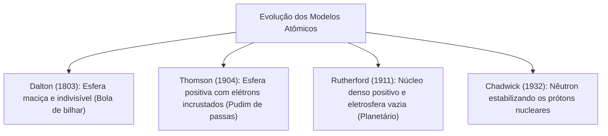

A compreensão da matéria em sua escala mais íntima é uma das conquistas centrais da ciência. O estudo da atomística tem também aplicação prática. No serviço operacional, o bombeiro atua em ocorrências com produtos químicos perigosos, vazamentos radiológicos e incêndios industriais. Avaliar esses riscos exige conhecimento seguro sobre a estrutura atômica e as partículas fundamentais da matéria.

O conceito de átomo foi sendo reconstruído à medida que novas evidências experimentais surgiam nos laboratórios. Cada modelo atômico surgiu para responder a perguntas que o modelo anterior não conseguia explicar. Neste capítulo, estudaremos a evolução dos modelos atômicos desde a Antiguidade grega até o modelo planetário de Rutherford. Examinaremos os experimentos com tubos de raios catódicos, a descoberta do elétron, do próton, do nêutron e os fenômenos da radioatividade.

> [!objetivos]
> - Compreender a transição entre o atomismo filosófico grego e o modelo científico de John Dalton.
> - Associar os postulados de Dalton à explicação das leis ponderais de Lavoisier e Proust.
> - Analisar os experimentos com tubos de descarga de Crookes e o modelo de Thomson.
> - Diferenciar as propriedades das radiações alfa, beta e gama em campos elétricos.
> - Explicar o experimento de espalhamento de partículas alfa e o modelo planetário de Rutherford.

## Das concepções filosóficas gregas ao modelo corpuscular de Dalton

A busca pelo elemento primordial da matéria começou na Grécia Antiga no século V a.C. Os filósofos Leucipo e Demócrito propuseram que a matéria era descontínua. Eles afirmavam que tudo era composto por partículas minúsculas, indivisíveis e eternas. Deram a essas partículas o nome de átomos, que significa indivisível. Para eles, as diferenças entre as substâncias decorriam apenas da forma e do arranjo desses corpúsculos.

Essa ideia foi rejeitada por Aristóteles. Ele defendia que a matéria era contínua e que o vácuo não existia na natureza. Aristóteles propôs que todas as substâncias resultavam da combinação de quatro elementos: terra, água, ar e fogo. Pelo grande prestígio do filósofo, sua visão prevaleceu por mais de dois milênios. Os alquimistas medievais basearam-se nela para tentar transmutar chumbo em ouro. Tanto a proposta atomista quanto a dos quatro elementos eram hipóteses filosóficas sem comprovação experimental.

No início do século XIX, John Dalton resgatou o conceito de átomo com base científica. Dalton apoiou-se nas leis ponderais estabelecidas no final do século XVIII: a Lei da Conservação da Massa, de Lavoisier (1789), e a Lei das Proporções Definidas, de Proust (1799). Seu modelo foi apresentado em 1803. Ele postulou os seguintes pontos fundamentais:

1. A matéria é formada por átomos esféricos, maciços, indivisíveis e indestrutíveis (modelo da "bola de bilhar").
2. Átomos de um mesmo elemento químico são idênticos em massa e em todas as suas propriedades.
3. Átomos de elementos químicos diferentes possuem massas e propriedades químicas distintas.
4. Compostos químicos são formados pela união de átomos de elementos diferentes em proporções numéricas fixas e inteiras (1:1, 1:2, 2:3).
5. Em reações químicas, os átomos não são criados nem destruídos. Eles apenas se recombinam e sofrem novos rearranjos.

| Postulado de Dalton | Fenômeno explicado | Situação na Química Moderna |
| :--- | :--- | :--- |
| Átomos são indivisíveis e maciços | Hipótese corpuscular | Desatualizado: o átomo é divisível em partículas subatômicas |
| Átomos do mesmo elemento têm massas iguais | Identidade elementar | Desatualizado: existem isótopos (mesmo Z e massas diferentes) |
| Proporções inteiras simples em compostos | Lei de Proust | Válido: moléculas apresentam estequiometria inteira definida |
| Átomos se rearranjam em reações químicas | Lei de Lavoisier | Válido: conservação de átomos e massas em reações usuais |

O modelo de Dalton teve grande aceitação porque deu uma base física para as leis ponderais. A Lei de Lavoisier explica-se pelo rearranjo atômico: se os átomos não são criados nem destruídos, a massa final é igual à massa inicial. A Lei de Proust explica-se pela indivisibilidade da proporção: uma molécula de água reúne sempre dois átomos de hidrogênio e um de oxigênio.

## Os raios catódicos e o modelo atômico de Thomson

No final do século XIX, novos experimentos com eletricidade questionaram a indivisibilidade do átomo de Dalton. O físico William Crookes construiu tubos de vidro selados com gases em baixíssima pressão (cerca de 0,01 atm). Ele aplicou uma alta voltagem entre dois eletrodos metálicos no interior do tubo. Sob essa tensão, surgiu um feixe luminoso que partia do polo negativo (cátodo) e viajava até o polo positivo (ânodo). Esse feixe foi chamado de raios catódicos.

Em 1897, Joseph John Thomson investigou as propriedades desse feixe no Laboratório Cavendish:
- *Propagação retilínea:* Ao colocar um obstáculo metálico diante do feixe, projetou-se uma sombra nítida na parede oposta do tubo. Isso provou que os raios catódicos se propagavam em linha reta.
- *Presença de massa mecânica:* Ao posicionar uma pequena roda de palhetas na trajetória do feixe, o impacto dos raios fez a roda girar. Isso comprovou que os raios possuíam massa e momento mecânico.
- *Carga elétrica negativa:* Ao submeter o feixe a campos elétricos e magnéticos, Thomson observou que os raios desviavam-se em direção à placa positiva. Isso confirmou que possuíam carga elétrica negativa.
- *Universalidade:* Thomson trocou o gás do interior do tubo e o metal dos eletrodos. A relação entre carga e massa (e/m) manteve-se idêntica em todos os testes (-1,76 · 10⁸ C/g).

Diante desses resultados, Thomson concluiu que essas partículas negativas faziam parte de todos os átomos. Elas foram chamadas de elétrons. Como a matéria ordinária é neutra, o átomo deveria conter carga positiva para equilibrar a carga dos elétrons.

Em 1904, Thomson propôs o modelo atômico do "pudim de passas". Para ele, o átomo era uma esfera contínua de carga elétrica positiva, não maciça, na qual os elétrons negativos estavam incrustados de forma uniforme. Esse foi o primeiro modelo a incorporar a natureza elétrica da matéria e a divisibilidade atômica.

## Os raios canais e a identificação do próton

A descoberta do elétron comprovou que cargas negativas podiam ser extraídas do átomo. Logo os cientistas buscaram as partículas positivas correspondentes. A primeira evidência experimental surgiu com o físico Eugen Goldstein, em 1886.

Goldstein adaptou o tubo de Crookes usando um cátodo perfurado. Durante a descarga elétrica, ele observou uma luminescência tênue que viajava em sentido contrário aos raios catódicos. Esse feixe atravessava os canais do cátodo e atingia o fundo do tubo. Esses raios foram chamados de raios canais ou raios anódicos.

| Característica | Raios Catódicos (Elétrons) | Raios Canais (Cátions gasosos / Prótons) |
| :--- | :--- | :--- |
| Origem do feixe | Partem do cátodo negativo | Originam-se na região do ânodo positivo |
| Sentido de propagação | Caminham rumo ao ânodo positivo | Caminham rumo ao cátodo negativo |
| Carga elétrica | Negativa (-1) | Positiva (+1) |
| Desvio em campo elétrico | Desviam-se para a placa positiva | Desviam-se para a placa negativa |
| Relação carga/massa | Constante para qualquer gás | Depende do gás residual confinado |
| Partícula constituinte | Elétrons livres universais | Prótons (quando o gás é hidrogênio) |

Ao contrário dos raios catódicos, a relação carga/massa dos raios canais variava com o gás confinado. Esses raios eram cátions formados pela ionização do gás residual do tubo. Quando se utilizou hidrogênio, o gás mais leve, obteve-se a menor massa e a maior relação carga/massa. Essa partícula positiva unitária possuía massa 1.836 vezes maior que a do elétron. Em 1920, Ernest Rutherford denominou essa partícula de próton.

> [!bizu]
> Memorize para a prova: raios catódicos são feixes de elétrons livres e universais. Raios canais são formados por cátions gasosos resultantes da ionização do gás do tubo. Eles só correspondem a prótons isolados quando o gás utilizado for o hidrogênio.

## A radioatividade natural e a natureza das emissões

Em 1896, Henri Becquerel descobriu acidentalmente que sais de urânio emitiam radiações penetrantes de forma espontânea. Mesmo no escuro, o urânio sensibilizava filmes fotográficos envolvidos em papel preto opaco. Esse fenômeno foi batizado de radioatividade por Marie Curie. Junto com Pierre Curie, Marie isolou o polônio e o rádio, demonstrando a instabilidade de certos átomos.

Para entender a natureza dessas emissões, Rutherford submeteu a radiação de uma amostra de rádio a um campo elétrico. As emissões separaram-se em três feixes distintos:

| Radiação | Símbolo | Carga | Massa | Natureza física | Poder penetrante | Poder ionizante |
| :--- | :--- | :--- | :--- | :--- | :--- | :--- |
| Alfa | α (⁴₂He) | +2 | 4 u | Núcleo de hélio (2 prótons e 2 nêutrons) | Baixo (folha de papel retém) | Altíssimo |
| Beta | β (⁰₋₁e) | -1 | 1/1836 u | Elétron emitido pelo núcleo instável | Moderado (placa de alumínio retém) | Médio |
| Gama | γ (⁰₀γ) | 0 | 0 | Onda eletromagnética de alta energia | Altíssimo (exige chumbo espesso) | Baixo |

As partículas alfa sofrem pequeno desvio rumo à placa negativa por causa de sua alta massa (4 u) e inércia. As partículas beta desviam-se intensamente rumo à placa positiva por sua massa quase nula. A radiação gama não se desvia por ser uma onda eletromagnética pura sem carga nem massa.

> [!atencao]
> As partículas beta não saem da eletrosfera do átomo. Elas são formadas e ejetadas do núcleo atômico quando um nêutron instável decai, transformando-se em um próton, um elétron rápido (partícula beta) e um antineutrino.

## O experimento de espalhamento de Rutherford e o modelo planetário

Em 1911, Ernest Rutherford, Hans Geiger e Ernest Marsden realizaram o experimento crucial da folha de ouro. O objetivo era verificar se a carga positiva do átomo era difusa, como afirmava Thomson.

Eles bombardearam uma lâmina finíssima de ouro (espessura de 0,0001 mm) com partículas alfa emitidas por uma fonte de polônio. Ao redor da folha, colocaram uma tela fluorescente de sulfeto de zinco (ZnS). Toda vez que uma partícula alfa atingia a tela, produzia-se uma cintilação visível.

Pelo modelo de Thomson, as partículas alfa deveriam atravessar a lâmina quase em linha reta com desvios insignificantes. No entanto, os resultados observados foram surpreendentes:
1. Mais de 99,9% das partículas alfa atravessaram a folha de ouro em linha reta sem sofrer desvios.
2. Uma fração minúscula de partículas sofreu desvios angulares acentuados.
3. Cerca de uma em cada dez mil partículas foi rebatida para trás na direção da fonte emissora.

Com base nessas observações, Rutherford tirou conclusões revolucionárias:
- O átomo não é maciço; ele é formado predominantemente por grandes espaços vazios. Por isso a imensa maioria das partículas passou livremente.
- O átomo possui uma região central minúscula, densa e com carga positiva, chamada núcleo atômico.
- O ricochete ocorreu quando partículas alfa colidiram diretamente contra esse núcleo denso. Os desvios acentuados decorreram da repulsão eletrostática entre a partícula alfa positiva e o núcleo positivo.
- Os elétrons giram ao redor do núcleo na eletrosfera, equilibrando eletricamente o sistema.

Esse arranjo ficou conhecido como modelo planetário: o núcleo funciona como o Sol e os elétrons orbitam como planetas. Rutherford calculou que o diâmetro do átomo é cerca de 10.000 a 100.000 vezes maior que o diâmetro do núcleo. Se o átomo fosse um estádio de futebol, o núcleo seria uma formiga no centro do gramado.

> [!pegadinha]
> Não confunda a distribuição de massa com o volume do átomo. O volume atômico é definido pelo tamanho da eletrosfera vazia. Já a massa do átomo concentra-se quase integralmente no núcleo central diminuto.

## A descoberta do nêutron por Chadwick e a estabilidade nuclear

O modelo de Rutherford apresentava dois impasses teóricos. O primeiro decorria da eletrodinâmica clássica: elétrons em movimento orbital acelerado deveriam irradiar energia continuamente, colapsando em espiral contra o núcleo. O segundo impasse era a repulsão entre prótons: se o núcleo contém apenas cargas positivas, as forças elétricas de repulsão deveriam desintegrá-lo.

Além disso, as massas atômicas medidas em laboratório eram maiores que a soma das massas dos prótons existentes no núcleo. O núcleo de hélio possui 2 prótons, mas sua massa equivale à de 4 prótons. Isso sugeria a presença de uma partícula neutra no interior do núcleo.

Em 1932, James Chadwick bombardeou átomos de berílio com partículas alfa de polônio. Ele detectou a emissão de uma radiação penetrante e sem carga elétrica. Ao incidir sobre um bloco de parafina rica em hidrogênio, essa radiação arrancou prótons da substância com grande energia mecânica.

Analisando os choques elásticos, Chadwick provou que essa radiação era formada por partículas sem carga elétrica e com massa quase igual à do próton. Essas partículas foram denominadas nêutrons.

| Partícula subatômica | Símbolo | Carga relativa | Massa relativa | Localização no átomo |
| :--- | :--- | :--- | :--- | :--- |
| Próton | p (ou ¹₁p) | +1 | ~1 u | Núcleo atômico |
| Nêutron | n (ou ¹₀n) | 0 | ~1 u | Núcleo atômico |
| Elétron | e⁻ (ou ⁰₋₁e) | -1 | 1/1836 u | Eletrosfera periférica |

A descoberta do nêutron explicou a coesão do núcleo atômico. No núcleo, a repulsão elétrica entre prótons é superada pela Força Nuclear Forte. Essa força atua com grande intensidade a distâncias subatômicas entre prótons e nêutrons, mantendo a coesão do núcleo atômico.

> [!exemplo]
> O núcleo do urânio-238 contém 92 prótons e 146 nêutrons. Esse grande número de nêutrons é indispensável para estabilizar o núcleo contra a repulsão eletrostática gerada pelos 92 prótons concentrados.

## Resolução guiada de problema contextualizado

Examinemos a aplicação desses conceitos em uma questão típica de concurso.

> [!resolvido]
> **Questão contextualizada:** Durante a elaboração de um relatório sobre materiais perigosos, um oficial bombeiro analisou afirmativas sobre a evolução dos modelos atômicos:
>
> I. O modelo de Dalton explicou as leis ponderais de Lavoisier e Proust considerando o átomo esférico, maciço e indivisível.
> II. Thomson concluiu que os raios catódicos tinham carga negativa porque o feixe sofria desvio para a placa negativa de um campo elétrico.
> III. O experimento da folha de ouro de Rutherford provou que o átomo é essencialmente vazio e possui um núcleo central positivo denso.
> IV. Chadwick descobriu o nêutron em 1932 ao bombardear berílio com partículas alfa, demonstrando que essa partícula neutra tem massa similar à do próton.
>
> Estão corretas as afirmativas:
> A) I e II, apenas.
> B) I, III e IV, apenas.
> C) II e III, apenas.
> D) II, III e IV, apenas.
> E) I, II, III e IV.
>
> **Resolução passo a passo:**
> 1. *Item I:* Correto. Dalton justificou a conservação das massas pelo rearranjo atômico e as proporções fixas pela união de átomos inteiros.
> 2. *Item II:* Incorreto. Os raios catódicos desviavam-se em direção à placa positiva, comprovando sua carga negativa.
> 3. *Item III:* Correto. A passagem quase total das partículas alfa comprovou os espaços vazios e o núcleo denso positivo.
> 4. *Item IV:* Correto. Chadwick confirmou o nêutron com massa aproximada de 1 u e carga nula no bombardeio de berílio.
>
> Conclusão: As afirmativas I, III e IV estão corretas.
> Resposta: Alternativa B.

## Mapa do capítulo

Neste capítulo analisamos a evolução histórica do conceito de átomo e os experimentos laboratoriais que revelaram as partículas subatômicas fundamentais.

### Para fixar
- Demócrito propôs o átomo indivisível; Aristóteles defendeu a matéria contínua nos quatro elementos.
- Dalton postulou o átomo como esfera maciça e indivisível, explicando as leis de Lavoisier e Proust.
- Raios catódicos são elétrons que partem do cátodo e desviam para a placa positiva no tubo de Crookes.
- Thomson formulou o modelo do pudim de passas, introduzindo a natureza elétrica da matéria.
- Goldstein descobriu os raios canais positivos; Rutherford batizou de próton a partícula básica do hidrogênio.
- As emissões radioativas dividem-se em alfa (positiva e pesada), beta (negativa e leve) e gama (onda neutra).
- O experimento de Rutherford com a lâmina de ouro comprovou que o átomo é predominantemente vazio com núcleo central positivo.
- Chadwick descobriu o nêutron em 1932, demonstrando sua massa similar à do próton e sua ação na estabilidade do núcleo.
