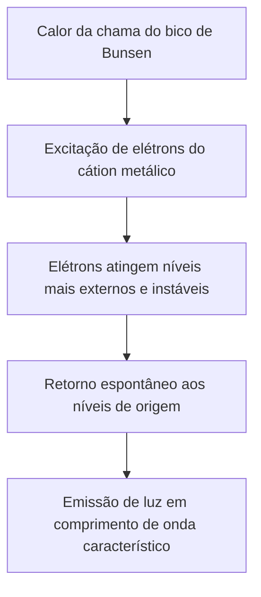
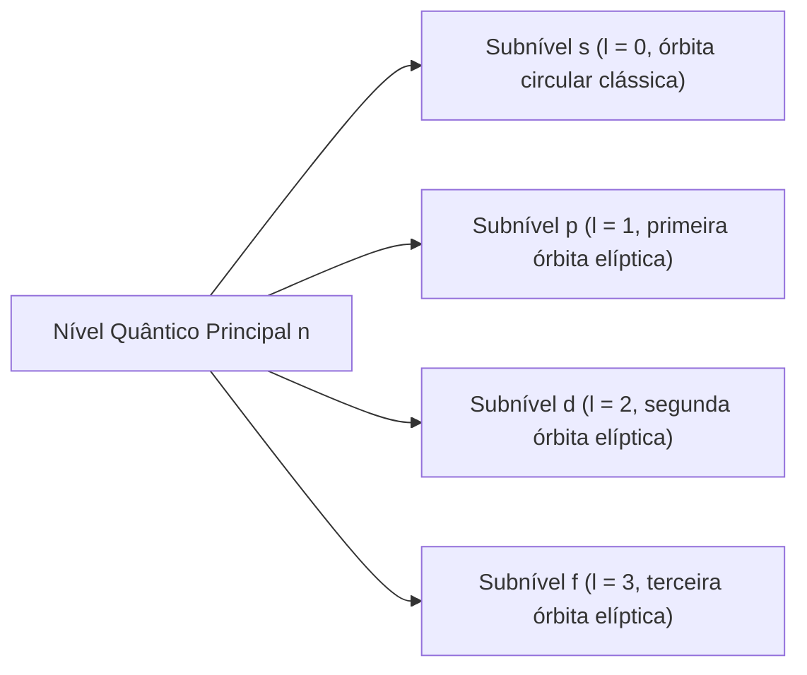
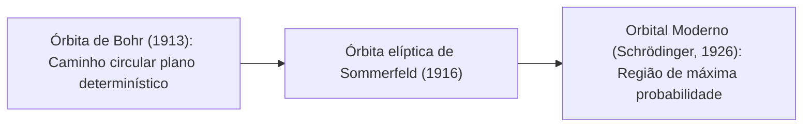
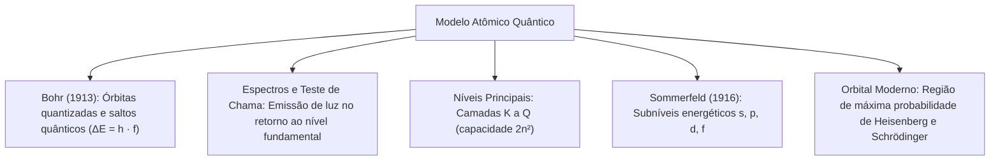

A evolução dos modelos atômicos atingiu um ponto de virada fundamental com a introdução da Teoria Quântica no início do século XX. Compreender o comportamento dos elétrons e a emissão de radiação luminosa tem aplicações práticas diretas. O teste de chama, a pirotecnia de sinalizadores de resgate, a detecção espectrométrica de gases tóxicos e a identificação de resíduos de incêndio apoiam-se diretamente nas transições energéticas dos elétrons na eletrosfera.

O modelo planetário de Rutherford apresentava um grave conflito com a física clássica. Ele não explicava por que os elétrons não colapsavam contra o núcleo nem justificava a emissão de espectros descontínuos pelos elementos químicos. O físico dinamarquês Niels Bohr solucionou esses impasses integrando os conceitos quânticos de Planck e Einstein à estrutura atômica. Neste capítulo, estudaremos a natureza das ondas eletromagnéticas, os postulados de Bohr, as aplicações periciais do teste de chama, os níveis principais e a subdivisão em subníveis energéticos proposta por Arnold Sommerfeld.

> [!objetivos]
> - Compreender os parâmetros fundamentais das ondas eletromagnéticas e o conceito de fóton.
> - Analisar os postulados de Bohr e a mecânica dos saltos quânticos eletrônicos.
> - Diferenciar espectros contínuos de espectros atômicos descontínuos de emissão.
> - Associar as cores do teste de chama à identificação de cátions metálicos em investigações.
> - Explicar a organização da eletrosfera em camadas K a Q e subníveis s, p, d e f de Sommerfeld.

## Radiação eletromagnética, fótons e espectros de emissão

A radiação eletromagnética consiste em ondas transversais formadas por campos elétricos e magnéticos perpendiculares que se propagam no vácuo a 300.000 km/s (c = 3 · 10⁸ m/s). O comprimento de onda (λ) é a distância entre duas cristas sucessivas. A frequência (f) expressa as oscilações completas por segundo em Hertz (Hz). A equação fundamental é c = λ · f, mostrando que comprimento de onda e frequência são inversamente proporcionais.

O espectro eletromagnético reúne desde ondas de rádio até raios gama. A faixa visível ocupa o intervalo entre 400 nm (violeta) e 700 nm (vermelho). Max Planck e Albert Einstein demonstraram que a radiação propaga-se como ondas e é emitida e absorvida como pacotes discretos de energia chamados fótons (E = h · f). A luz branca dispersada por prisma gera espectro contínuo, enquanto gases atômicos excitados emitem espectros descontínuos de raias exclusivos de cada elemento.

## Os postulados de Bohr e a quantização dos níveis energéticos

O modelo planetário de Rutherford era incapaz de justificar por que o elétron não irradiava energia continuamente em órbita até colapsar contra o núcleo. Ele também não conseguia explicar a origem dos espectros de raias descontínuos dos elementos químicos.

Em 1913, Niels Bohr formulou uma nova teoria atômica aplicando a hipótese quântica de Planck ao átomo de hidrogênio. O modelo de Bohr fundamentou-se em postulados clássicos:

1. Os elétrons giram ao redor do núcleo positivo apenas em trajetórias circulares bem determinadas, chamadas órbitas estacionárias.
2. Em cada órbita estacionária permitida, o elétron possui uma quantidade fixa e definida de energia (energia quantizada). Enquanto permanece nessa órbita, o elétron não emite nem absorve energia espontaneamente.
3. As órbitas mais próximas do núcleo possuem menor energia potencial elétrica. À medida que o elétron se afasta do núcleo, a energia da órbita torna-se progressivamente maior.
4. Quando o elétron recebe uma quantidade precisa de energia externa (térmica, elétrica ou luminosa), ele realiza um salto quântico para uma órbita mais externa e energética. Esse estado instável de maior energia é chamado de estado excitado.
5. Ao retornar de uma órbita externa para uma órbita mais interna e estável (estado fundamental), o elétron descarrega o excesso de energia emitindo um único fóton de luz. A energia desse fóton é exatamente igual à diferença de energia entre os dois níveis (ΔE = E_final - E_inicial = h · f).

| Etapa da transição eletrônica | Fenômeno energético envolvido | Consequência física no átomo |
| :--- | :--- | :--- |
| Estado fundamental | Energia mínima do sistema | Elétron gira em sua órbita estável sem emitir radiação |
| Absorção de energia | Fornecimento térmico ou elétrico | Salto quântico para nível de maior raio e energia |
| Estado excitado | Instabilidade eletrostática | O elétron permanece no nível superior por fração de segundo |
| Emissão de radiação | Transição de retorno | Liberação da diferença de energia sob a forma de fóton luminoso |

Como os níveis energéticos de cada átomo são fixos e quantizados, as transições eletrônicas ocorrem apenas entre valores de energia específicos. Isso explica a origem dos espectros atômicos descontínuos: cada linha espectral corresponde à energia de um fóton emitido durante um salto quântico entre dois níveis bem definidos.

## O teste de chama e a identificação de cátions metálicos

Uma das aplicações práticas mais visíveis dos postulados de Bohr é o ensaio pirotécnico conhecido como teste de chama. Trata-se de uma técnica analítica qualitativa tradicional utilizada na identificação expedita de determinados elementos metálicos em amostras desconhecidas.

No teste de chama, uma alça de platina ou níquel-cromo limpa é embebida na amostra salina e introduzida na zona não luminosa e mais quente da chama do bico de Bunsen. A energia térmica fornecida pela combustão excita os elétrons dos cátions metálicos presentes na substância, promovendo-os para níveis superiores de energia.

Ao retornarem espontaneamente para níveis de menor energia, esses elétrons liberam a diferença energética sob a forma de fótons de luz visível. Como a estrutura dos níveis quânticos varia de um elemento químico para outro, o comprimento de onda da luz emitida é característico de cada metal, conferindo uma coloração típica à chama.

| Cátion metálico testado | Símbolo químico | Cor característica observada na chama | Emprego em sinalizadores e pirotecnia |
| :--- | :--- | :--- | :--- |
| Sódio | Na⁺ | Amarelo brilhante e intenso | Lâmpadas de iluminação pública e sinalizadores diurnos |
| Potássio | K⁺ | Violeta claro / Lilás (observado com vidro de cobalto) | Pólvoras pirotécnicas de efeito especial |
| Cálcio | Ca²⁺ | Vermelho-alaranjado / Cor de tijolo | Sinalizadores marítimos de segurança e fogos de artifício |
| Estrôncio | Sr²⁺ | Vermelho carmim vivo e intenso | Fogos de emergência, bengalas de sinalização noturna |
| Bário | Ba²⁺ | Verde maçã claro | Efeitos luminosos verdes em munições traçantes |
| Cobre | Cu²⁺ | Verde-azulado / Azul brilhante | Pirotecnia artística e sinalizadores de localização naval |
| Lítio | Li⁺ | Vermelho carmesim | Baterias e composições pirotécnicas militares |

Esse fenômeno é exatamente o princípio químico que rege o funcionamento dos fogos de artifício e dos sinalizadores de emergência utilizados pelo Corpo de Bombeiros em operações noturnas e salvamentos aquáticos. As diferentes cores observadas no céu noturno decorrem da mistura de pólvora negra com sais específicos desses cátions metálicos.

> [!bizu]
> Limitação importante do teste de chama: a emissão amarela do cátion sódio é extremamente brilhante e persistente. Se houver contaminação por sódio na amostra, a cor amarela mascara completamente as outras emissões. Para observar a cor violeta do potássio na presença de sódio, os peritos utilizam um vidro azul de cobalto, que absorve a luz amarela e permite visualizar a emissão lilás.

## Camadas eletrônicas e níveis quânticos principais

O modelo atômico de Bohr estabeleceu que os elétrons encontram-se distribuídos na eletrosfera em camadas concêntricas de energia bem delimitadas. Essas camadas recebem a denominação de níveis quânticos principais, identificados pelo número quântico principal, simbolizado pela letra n, que assume valores inteiros positivos: n = 1, 2, 3, 4, 5, 6, 7.

Historicamente, Charles Glover Barkla denominou essas camadas eletrônicas pelas letras maiúsculas K, L, M, N, O, P e Q, ordenadas a partir da região mais próxima do núcleo atômico rumo à periferia. O número quântico principal n indica o tamanho da órbita eletrônica e a sua quantidade média de energia: quanto maior o valor de n, mais distante o elétron está do núcleo e maior é a sua energia potencial.

| Nível quântico principal (n) | Letra da camada eletrônica | Capacidade teórica máxima (2n²) | Capacidade prática adotada no diagrama |
| :--- | :--- | :--- | :--- |
| n = 1 | Camada K | 2 · 1² = 2 elétrons | 2 elétrons |
| n = 2 | Camada L | 2 · 2² = 8 elétrons | 8 elétrons |
| n = 3 | Camada M | 2 · 3² = 18 elétrons | 18 elétrons |
| n = 4 | Camada N | 2 · 4² = 32 elétrons | 32 elétrons |
| n = 5 | Camada O | 2 · 5² = 50 elétrons | 32 elétrons (para os elementos conhecidos) |
| n = 6 | Camada P | 2 · 6² = 72 elétrons | 18 elétrons (para os elementos conhecidos) |
| n = 7 | Camada Q | 2 · 7² = 98 elétrons | 8 elétrons (para os elementos conhecidos) |

A fórmula clássica deduzida pelo físico Johannes Rydberg estabelece que a capacidade máxima teórica de elétrons comportada por um nível principal n é dada pela expressão 2n². Contudo, para os elementos químicos estáveis conhecidos atualmente na tabela periódica moderna, os níveis O, P e Q não chegam a atingir seus limites teóricos máximos, estabilizando-se respectivamente com 32, 18 e 8 elétrons.

A camada mais externa ocupada por elétrons em um átomo em seu estado fundamental recebe o nome especial de camada de valência. É a camada de valência que dita o comportamento químico, as ligações químicas e as propriedades de oxirredução do elemento. De acordo com a Teoria do Octeto, a camada de valência comporta no máximo 8 elétrons nos átomos estáveis (com exceção do hélio e hidrogênio, que se estabilizam com 2 elétrons na camada K).

## O modelo de Sommerfeld e os subníveis de energia

Apesar de seu brilhantismo, o modelo atômico de Bohr apresentava restrições severas. Ele funcionava com exatidão matemática apenas para átomos monoeletrônicos (como o hidrogênio ou cátions hidrogenoides He⁺ e Li²⁺). Quando os físicos utilizaram espectroscópios de alta resolução para examinar átomos polieletrônicos, constataram que cada linha espectral de Bohr era, na realidade, um feixe composto por várias linhas muito próximas entre si. Esse fenômeno de desdobramento recebeu o nome de estrutura fina das raias espectrais.

Para justificar essa multiplicidade de raias, o físico alemão Arnold Sommerfeld aprimorou o modelo de Bohr em 1916. Sommerfeld propôs que as órbitas dos elétrons não eram exclusivamente circulares. No interior de um mesmo nível principal de energia n, existia uma órbita circular e n - 1 órbitas elípticas com diferentes graus de achatamento ou excentricidade.

Essa formulação deu origem ao conceito de subníveis de energia, associados ao número quântico secundário ou azimutal (simbolizado por l). Para cada nível principal n, o número quântico l assume valores inteiros que variam de 0 até n - 1.

Os subníveis são designados historicamente pelas letras minúsculas s, p, d e f, derivadas das palavras em inglês utilizadas para descrever as linhas espectrais: sharp (nítida), principal (principal), diffuse (difusa) e fundamental (fundamental).

| Letra do subnível | Valor do número quântico l | Número de orbitais componentes | Capacidade máxima de elétrons | Forma geométrica aproximada |
| :--- | :--- | :--- | :--- | :--- |
| s | l = 0 | 1 orbital | 2 elétrons | Esférica tridimensional |
| p | l = 1 | 3 orbitais (px, py, pz) | 6 elétrons | Halteres (duplo lóbulo) com nó central |
| d | l = 2 | 5 orbitais | 10 elétrons | Quatro lóbulos / Halteres complexos |
| f | l = 3 | 7 orbitais | 14 elétrons | Múltiplos lóbulos tridimensionais complexos |

A distribuição dos subníveis nos níveis energéticos segue uma regra matemática rigorosa:
- O nível 1 (K) possui apenas 1 subnível: 1s² (capacidade total: 2 elétrons).
- O nível 2 (L) possui 2 subníveis: 2s² e 2p⁶ (capacidade total: 8 elétrons).
- O nível 3 (M) possui 3 subníveis: 3s², 3p⁶ e 3d¹⁰ (capacidade total: 18 elétrons).
- O nível 4 (N) possui 4 subníveis: 4s², 4p⁶, 4d¹⁰ e 4f¹⁴ (capacidade total: 32 elétrons).

Dentro de um mesmo subnível, todos os elétrons possuem exatamente a mesma quantidade de energia. Contudo, entre subníveis de um mesmo nível principal, a energia cresce na ordem estrita s < p < d < f.

> [!atencao]
> As órbitas elípticas de Sommerfeld foram um passo intermediário histórico fundamental, mas pertencem à física clássica determinística. A mecânica quântica moderna não adota órbitas elípticas fixas, substituindo-as pela descrição estatística de orbitais atômicos tridimensionais.

## Da órbita clássica ao conceito moderno de orbital atômico

A evolução da física quântica na década de 1920 sepultou em definitivo a ideia de que os elétrons descreviam trajetórias planetárias circulares ou elípticas perfeitamente conhecidas ao redor do núcleo. Duas descobertas teóricas revolucionaram o entendimento da eletrosfera:

1. *Dualidade onda-partícula da matéria (Louis de Broglie, 1924):* De Broglie propôs que o elétron não se comporta apenas como corpúsculo material, mas apresenta propriedades de onda de matéria associada (comprimento de onda de de Broglie dado por λ = h / p).
2. *Princípio da Incerteza (Werner Heisenberg, 1927):* Heisenberg demonstrou matematicamente que é fisicamente impossível determinar de maneira simultânea e com precisão absoluta a posição e o momento linear (velocidade) de uma partícula subatômica como o elétron. Quanto maior a precisão na medida da posição, menor será a precisão na determinação de sua velocidade.

Diante do Princípio da Incerteza, o conceito clássico de órbita (caminho no espaço com posição e tempo definidos) perdeu o sentido físico para entidades subatômicas. Em 1926, Erwin Schrödinger formulou a mecânica ondulatória quântica, descrevendo o comportamento do elétron por meio de uma função de onda matemática (psi, ψ).

O quadrado da função de onda (|ψ|²) representa a densidade de probabilidade de encontrar o elétron em uma determinada região do espaço ao redor do núcleo. Surgiu assim a definição moderna de orbital atômico: o orbital é a região do espaço tridimensional ao redor do núcleo onde é máxima a probabilidade de encontrar o elétron (tipicamente delimitando a região que engloba 90% a 95% de probabilidade estatística).

> [!pegadinha]
> Fique alerta nas questões de concurso para não confundir os termos: órbita é a trajetória geométrica plana e circular descrita no modelo clássico de Bohr. Orbital é a região de probabilidade máxima tridimensional descrita pelo modelo da mecânica quântica moderna de Schrödinger.

> [!exemplo]
> O orbital do tipo s possui geometria esférica tridimensional centrada no núcleo. Isso significa que a chance de encontrar o elétron depende apenas da distância radial em relação ao núcleo, sendo idêntica em qualquer direção espacial ao redor do átomo.

## Resolução guiada de problema contextualizado

Acompanhe a resolução detalhada de um exercício contextualizado de prova sobre os postulados quânticos e a espectroscopia atômica.

> [!resolvido]
> **Questão contextualizada:** Em uma perícia de incêndio deflagrado em galpão de armazenagem pirotécnica, peritos do Corpo de Bombeiros recolheram resíduos salinos metálicos desconhecidos. Submetidas ao ensaio de chama em bico de Bunsen, duas amostras revelaram emissões ópticas distintas: a amostra X produziu coloração amarela brilhante e a amostra Y produziu coloração vermelha intensa (carmim). Com base no modelo de Bohr e na espectroscopia atômica, analise as proposições:
>
> I. A emissão de luz decorre da absorção de energia pelos elétrons no momento em que realizam o salto para órbitas mais externas.
> II. As cores observadas nas amostras X e Y são características, indicando provável presença de cátions de sódio (Na⁺) e estrôncio (Sr²⁺), respectivamente.
> III. O modelo atômico de Bohr estabelece que os elétrons giram em órbitas estacionárias sem emitir radiação continuamente, contrariando a eletrodinâmica clássica.
> IV. O espectro emitido por gases atômicos excitados é descontínuo porque os níveis de energia dos elétrons são quantizados.
>
> Estão corretas as proposições:
> A) I e II, apenas.
> B) I, III e IV, apenas.
> C) II, III e IV, apenas.
> D) I e IV, apenas.
> E) I, II, III e IV.
>
> **Resolução passo a passo:**
> 1. *Análise do item I:* Incorreto. A absorção de energia promove o elétron do estado fundamental para o estado excitado mais energético. A luz visível só é emitida no retorno espontâneo do elétron para o nível inferior de menor energia.
> 2. *Análise do item II:* Correto. A chama amarela brilhante é a marca espectroscópica clássica do cátion sódio (Na⁺), enquanto o vermelho carmim profundo e intenso caracteriza o estrôncio (Sr²⁺), amplamente usado em sinalizadores de emergência.
> 3. *Análise do item III:* Correto. O postulado das órbitas estacionárias de Bohr superou a contradição de Maxwell, assegurando que o elétron não perde energia enquanto permanece em sua órbita quantizada permitida.
> 4. *Análise do item IV:* Correto. O espectro descontínuo de raias é consequência direta da quantização dos níveis de energia. Apenas fótons com frequências correspondentes às diferenças permitidas (ΔE = h · f) podem ser emitidos.
>
> Conclusão: As proposições II, III e IV estão corretas.
> Resposta: Alternativa C.

## Mapa do capítulo

Neste capítulo analisamos a transição dos modelos atômicos clássicos para a teoria quântica. Compreendemos como Niels Bohr solucionou os impasses do modelo de Rutherford, as regras do salto quântico na produção de luz visível e o detalhamento da eletrosfera em camadas e subníveis por Sommerfeld e Schrödinger.

### Para fixar
- Ondas eletromagnéticas combinam campos elétrico e magnético perpendiculares; velocidade no vácuo c = λ · f.
- Fótons são pacotes discretos de energia eletromagnética propostos por Planck e Einstein (E = h · f).
- Espectros atômicos de emissão são descontínuos e formados por linhas luminosas exclusivas de cada elemento químico.
- No modelo de Bohr, elétrons ocupam órbitas estacionárias quantizadas sem perder energia continuamente.
- Salto quântico: o elétron absorve energia para subir de nível e emite um fóton de luz ao retornar a um nível inferior.
- No teste de chama, cátions metálicos emitem cores características: sódio (amarelo), estrôncio (vermelho) e bário (verde).
- As camadas eletrônicas K a Q correspondem aos níveis quânticos principais n = 1 a 7, com capacidade máxima teórica 2n².
- Sommerfeld propôs subníveis energéticos s (2 elétrons), p (6 elétrons), d (10 elétrons) e f (14 elétrons).
- O orbital atômico moderno não é uma trajetória fixa, mas a região de máxima probabilidade de encontrar o elétron.
