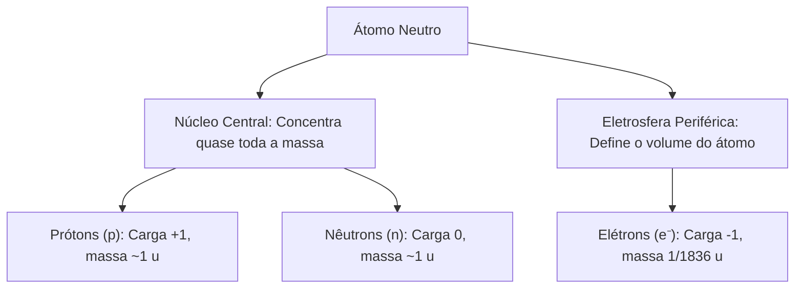
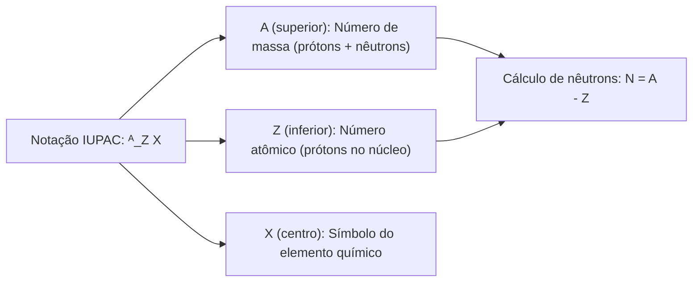
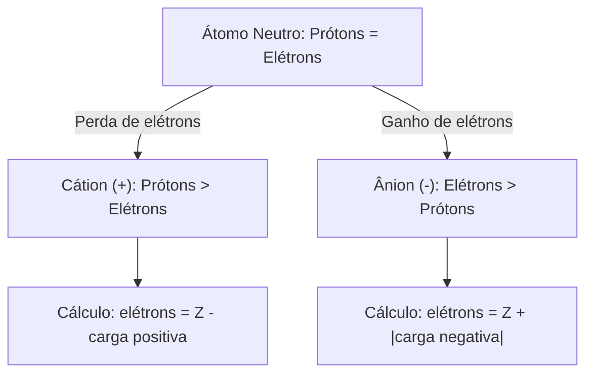
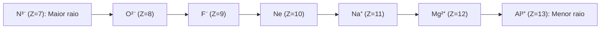
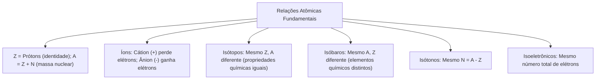

A correta identificação dos parâmetros atômicos e das relações entre diferentes nuclídeos é conhecimento basilar em Química. No teatro de operações, as emergências radiológicas e os incidentes envolvendo materiais perigosos exigem a compreensão exata sobre isótopos radioativos, formação de íons em soluções aquosas e o comportamento de elementos químicos com massas semelhantes.

Compreender o significado de número atômico, número de massa e carga iônica permite prever reações químicas e calcular proporções estequiométricas com exatidão. A distinção conceitual entre isótopos, isóbaros, isótonos e espécies isoeletrônicas é cobrada com frequência sistemática nas provas. Neste capítulo, estudaremos a estrutura nuclear e eletrônica do átomo, as regras de representação gráfica de nuclídeos, o processo de ionização e o cálculo de semelhanças atômicas.

> [!objetivos]
> - Definir número atômico (Z) e número de massa (A), calculando o número de nêutrons (N).
> - Representar nuclídeos e íons segundo os padrões internacionais estabelecidos pela IUPAC.
> - Compreender a formação de cátions e ânions a partir da perda ou ganho exclusivo de elétrons.
> - Calcular a massa atômica média dos elementos a partir da abundância isotópica natural.
> - Classificar espécies químicas em isótopos, isóbaros, isótonos e isoeletrônicos.

## Estrutura do átomo, número atômico e número de massa

No estudo das Características dos Átomos - Teoria, examinamos a estrutura do núcleo e da eletrosfera. O átomo é formado por duas regiões estruturais bem distintas: o núcleo central e a eletrosfera periférica. O núcleo é extremamente pequeno, denso e maciço. Ele abriga os prótons, portadores de carga elétrica positiva (+1), e os nêutrons, que não possuem carga elétrica líquida (carga zero). A eletrosfera é a região ampla e predominantemente vazia que envolve o núcleo. Nela movimentam-se os elétrons, partículas de carga elétrica negativa (-1).

O número atômico, simbolizado pela letra Z, é definido como o número de prótons existentes no núcleo de um átomo (Z = p). O número atômico é a identidade do elemento químico. Em 1913, o físico britânico Henry Moseley provou experimentalmente por difração de raios X que as propriedades dos elementos dependem do número atômico, e não de sua massa. Todos os átomos que possuem o mesmo número de prótons pertencem obrigatoriamente ao mesmo elemento químico.

O número de massa, simbolizado pela letra A, representa a soma do número de prótons (Z) com o número de nêutrons (N) confinados no núcleo: A = Z + N. Como o elétron possui massa aproximadamente 1.836 vezes menor que a do próton, sua contribuição mássica é desprezível no cálculo do número de massa. Conhecendo-se o número de massa A e o número atômico Z, calcula-se o número de nêutrons por subtração: N = A - Z.

| Partícula subatômica | Carga elétrica relativa | Carga absoluta (Coulombs) | Massa relativa (u) | Massa absoluta (gramas) |
| :--- | :--- | :--- | :--- | :--- |
| Próton (p) | +1 | +1,602 · 10⁻¹⁹ C | 1,007 u (~1 u) | 1,673 · 10⁻²⁴ g |
| Nêutron (n) | 0 (neutra) | 0 C | 1,009 u (~1 u) | 1,675 · 10⁻²⁴ g |
| Elétron (e⁻) | -1 | -1,602 · 10⁻¹⁹ C | 0,000549 u (~0 u) | 9,109 · 10⁻²⁸ g |

A unidade de massa atômica (u) é definida como 1/12 da massa de um único átomo de carbono-12 (1 u = 1,66 · 10⁻²⁴ g). O número de massa A é sempre um número inteiro positivo, pois quantifica partículas inteiras (núcleons). Em qualquer átomo da natureza, tem-se obrigatoriamente A > Z, com a única exceção do hidrogênio comum (prótio, ¹₁H), cujo núcleo possui 1 próton e zero nêutron, resultando em A = Z = 1.

## Representação convencional e contagem de partículas

A União Internacional de Química Pura e Aplicada (IUPAC) padroniza a representação gráfica de um nuclídeo pela notação ᴬ_Z X, na qual X é o símbolo químico do elemento, A é o número de massa posicionado no canto superior esquerdo e Z é o número atômico grafado no canto inferior esquerdo. Em publicações técnicas, o número de massa também pode figurar no canto superior direito (como ₁₇Cl³⁵), mas o número atômico permanece sempre na parte inferior.

Em um átomo eletricamente neutro, a quantidade de cargas positivas no núcleo é rigorosamente igual à quantidade de cargas negativas na eletrosfera. Dessa forma, no estado fundamental neutro, tem-se a igualdade: número de prótons = número de elétrons = Z.

Analise a contagem subatômica de nuclídeos representativos neutros:
- *Sódio (²³₁₁Na):* possui Z = 11 prótons e 11 elétrons. Seu número de massa é A = 23. O número de nêutrons resulta de N = 23 - 11 = 12 nêutrons.
- *Ferro (⁵⁶₂₆Fe):* possui Z = 26 prótons e 26 elétrons. Seu número de massa é A = 56. O total de nêutrons é N = 56 - 26 = 30 nêutrons.
- *Urânio (²³⁸₉₂U):* possui Z = 92 prótons e 92 elétrons. Seu número de massa é A = 238. A quantidade de nêutrons confinados no núcleo atômico é N = 238 - 92 = 146 nêutrons.

| Símbolo e representação | Elemento químico | Número atômico (Z) | Número de prótons (p) | Número de elétrons (e⁻) | Número de massa (A) | Número de nêutrons (N) |
| :--- | :--- | :--- | :--- | :--- | :--- | :--- |
| ¹₁H | Hidrogênio (Prótio) | 1 | 1 | 1 | 1 | 0 |
| ¹²₆C | Carbono | 6 | 6 | 6 | 12 | 6 |
| ⁴⁰₂₀Ca | Cálcio | 20 | 20 | 20 | 40 | 20 |
| ¹⁰¹₄₄Ru | Rutênio | 44 | 44 | 44 | 101 | 57 |
| ¹⁷⁵₇₁Lu | Lutécio | 71 | 71 | 71 | 175 | 104 |
| ¹⁹⁷₇₉Au | Ouro | 79 | 79 | 79 | 197 | 118 |
| ²²⁶₈₈Ra | Rádio | 88 | 88 | 88 | 226 | 138 |

Conhecendo-se quaisquer duas grandezas entre A, Z e N, determina-se a terceira por manipulação algébrica direta. Se um átomo neutro desconhecido possui 10 prótons e 12 nêutrons, seu número atômico é Z = 10, sua massa é A = 10 + 12 = 22 e sua eletrosfera conta com exatamente 10 elétrons.

## Íons: formação de cátions e ânions na eletrosfera

Nas transformações químicas ordinárias (como reações de oxirredução, formação de sais e combustões), o núcleo atômico permanece absolutamente inalterado. Os prótons e nêutrons estão fortemente presos no núcleo pela força nuclear forte e não participam dessas reações. Toda perda ou ganho de carga elétrica dá-se exclusivamente na eletrosfera periférica, pela transferência de elétrons.

Um íon é definido como uma espécie química eletricamente carregada, originada quando um átomo neutro (ou grupo de átomos) perde ou ganha elétrons. Como entender a origem dos sinais elétricos positivo e negativo nos íons? A explicação baseia-se na contagem comparativa entre as partículas nucleares e eletrônicas. Os íons classificam-se em duas categorias:

1. *Cátions (íons positivos):* formam-se quando o átomo neutro perde elétrons de sua camada de valência. Como o número de prótons positivos no núcleo passa a superar o número de elétrons restantes na eletrosfera, o íon adquire carga líquida positiva (+). Por exemplo, o átomo neutro de sódio (₁₁Na) possui 11 prótons e 11 elétrons; ao perder 1 elétron, forma o cátion sódio (Na⁺), mantendo 11 prótons e ficando com 10 elétrons.
2. *Ânions (íons negativos):* formam-se quando o átomo neutro recebe elétrons adicionais em sua camada de valência. O número de elétrons na eletrosfera passa a superar o número de prótons no núcleo, gerando carga líquida negativa (-). O átomo de cloro (₁₇Cl) possui 17 prótons e 17 elétrons; ao receber 1 elétron, forma o ânion cloreto (Cl⁻), conservando 17 prótons e totalizando 18 elétrons.

> [!bizu]
> Lembre-se sempre de que o ganho de elétrons (cargas negativas adicionais) torna a carga líquida do íon negativa, constituindo um ânion. Já a perda de elétrons deixa prótons positivos desemparelhados no núcleo, conferindo sinal positivo ao cátion resultante.

A carga de um íon indica a diferença entre o número de prótons e o número de elétrons: Carga = p - e⁻. Para determinar o número de elétrons de qualquer íon, aplica-se a regra prática:
- Para cátions (Xⁿ⁺): Número de elétrons = Z - n.
- Para ânions (Yᵐ⁻): Número de elétrons = Z + m.

| Espécie química | Tipo de espécie | Carga líquida | Prótons (Z) | Nêutrons (N) | Elétrons (e⁻) | Número de massa (A) |
| :--- | :--- | :--- | :--- | :--- | :--- | :--- |
| ₂₄₁₂Mg | Átomo neutro | 0 | 12 | 12 | 12 | 24 |
| ₂₄₁₂Mg²⁺ | Cátion bivalente | +2 | 12 | 12 | 10 (12 - 2) | 24 |
| ²⁷₁₃Al³⁺ | Cátion trivalente | +3 | 13 | 14 | 10 (13 - 3) | 27 |
| ¹⁶₈O | Átomo neutro | 0 | 8 | 8 | 8 | 16 |
| ¹⁶₈O²⁻ | Ânion bivalente | -2 | 8 | 8 | 10 (8 + 2) | 16 |
| ¹⁴₇N³⁻ | Ânion trivalente | -3 | 7 | 7 | 10 (7 + 3) | 14 |
| ³⁵₁₇Cl⁻ | Ânion monovalente | -1 | 17 | 18 | 18 (17 + 1) | 35 |

> [!atencao]
> Erro frequente em concursos: jamais afirme que um cátion é formado porque o átomo "ganhou prótons" ou que um ânion é formado porque "perdeu prótons". O número de prótons Z é fixo e inalterável em processos químicos. A formação de íons envolve exclusivamente a perda ou ganho de elétrons na eletrosfera.

## Isótopos e o cálculo da massa atômica média ponderada

Os átomos podem apresentar semelhanças e diferenças em sua composição nuclear. A semelhança atômica mais relevante para a química é a isotopia. Isótopos são átomos que possuem o mesmo número atômico Z (mesmo número de prótons), mas diferem no número de massa A e no número de nêutrons N.

Por possuírem o mesmo número atômico Z, os isótopos pertencem rigorosamente ao mesmo elemento químico. Eles ocupam a mesma posição na tabela periódica e possuem a mesma quantidade de elétrons no estado neutro, o que lhes confere propriedades químicas praticamente idênticas. Contudo, devido à diferença de nêutrons no núcleo, seus números de massa são distintos, o que lhes confere propriedades físicas ligeiramente diferentes (como ponto de fusão, densidade e velocidade de difusão).

O hidrogênio é o único elemento cujos isótopos recebem nomes e símbolos próprios:
1. *Prótio (ou hidrogênio comum, ¹₁H):* possui 1 próton, zero nêutron e 1 elétron (abundância natural de 99,985%).
2. *Deutério (²₁H ou ²₁D):* possui 1 próton, 1 nêutron e 1 elétron (abundância de 0,015%). É utilizado na produção de água pesada (D₂O) como moderador em reatores nucleares.
3. *Trítio (³₁H ou ³₁T):* possui 1 próton, 2 nêutrons e 1 elétron (abundância residual de 0,0000007%). É um isótopo radioativo emissor beta empregado em sinalizadores e miras ópticas noturnas.

| Isótopo do hidrogênio | Símbolo usual | Prótons (p) | Nêutrons (N) | Massa (A) | Abundância natural | Estabilidade nuclear |
| :--- | :--- | :--- | :--- | :--- | :--- | :--- |
| Prótio | ¹H | 1 | 0 | 1 u | 99,985% | Estável |
| Deutério | ²H (ou D) | 1 | 1 | 2 u | 0,015% | Estável |
| Trítio | ³H (ou T) | 1 | 2 | 3 u | Vestigial (10⁻¹⁵ %) | Radioativo (meia-vida ~12,3 anos) |

Para todos os demais elementos químicos, os isótopos são designados pelo nome do elemento seguido de seu número de massa: carbono-12, carbono-13 e carbono-14; oxigênio-16, oxigênio-17 e oxigênio-18; cloro-35 e cloro-37.

A massa atômica exibida na tabela periódica para cada elemento não é um número inteiro porque resulta da média aritmética ponderada das massas atômicas de todos os seus isótopos estáveis naturais, ponderada pelas respectivas porcentagens de abundância isotópica na crosta terrestre.

A fórmula de cálculo é dada por:
Massa Atômica Média = (A₁ · %₁ + A₂ · %₂ + ... + Aₙ · %ₙ) / 100.

Considere o elemento cloro na natureza, formado por dois isótopos estáveis: cloro-35 (massa 35 u, abundância de 75,4%) e cloro-37 (massa 37 u, abundância de 24,6%). O cálculo de sua massa atômica média ponderada resulta em:
Massa = (35 · 75,4 + 37 · 24,6) / 100 = (2.639 + 910,2) / 100 = 35,49 u (arredondado tabelarmente para 35,45 u).

> [!bizu]
> Guarde o mnemônico para não confundir os conceitos:
> - isóto**P**os: mesmo número de **P**rótons (mesmo Z).
> - isób**A**ros: mesmo número de massa **A**.
> - isóto**N**os: mesmo número de **N**êutrons.
> - isoeletrôn**I**cos: mesmo número de elétrons (**Í**ons e átomos com igual contagem eletrônica).

## Isóbaros e isótonos: semelhanças nucleares entre elementos distintos

Além da isotopia, a atomística define outras duas relações nucleares de semelhança entre espécies químicas: a isobarria e a isotonia. Diferentemente dos isótopos, os isóbaros e os isótonos pertencem obrigatoriamente a elementos químicos diferentes, pois possuem números atômicos Z distintos.

Classificam-se como isóbaros os nuclídeos pertencentes a elementos químicos distintos que compartilham o mesmo total de núcleons A, divergindo no número atômico Z e na contagem de nêutrons N. Como pertencem a elementos distintos, os isóbaros apresentam propriedades químicas totalmente diferentes entre si, embora possuam massas atômicas praticamente idênticas.

Um exemplo clássico de tríade de isóbaros é formado pelos nuclídeos de massa 40:
- Argônio-40 (⁴⁰₁₈Ar): Z = 18, A = 40, N = 40 - 18 = 22 nêutrons (gás nobre inerte).
- Potássio-40 (⁴⁰₁₉K): Z = 19, A = 40, N = 40 - 19 = 21 nêutrons (metal alcalino radioativo reativo).
- Cálcio-40 (⁴⁰₂₀Ca): Z = 20, A = 40, N = 40 - 20 = 20 nêutrons (metal alcalinoterroso).
Os três nuclídeos possuem rigorosamente a mesma massa A = 40, mas comportamentos químicos e números de prótons completamente distintos.

Por sua vez, os isótonos reúnem espécies de elementos químicos distintos que apresentam idêntica quantidade de nêutrons N no núcleo, divergindo no número atômico Z e no número de massa A. Eles são identificados calculando-se a diferença N = A - Z para cada nuclídeo avaliado.

| Comparação de semelhanças | Definição da relação | O que é igual | O que é diferente | Exemplo prático |
| :--- | :--- | :--- | :--- | :--- |
| Isótopos | Átomos do mesmo elemento químico | Z (prótons) | A (massa) e N (nêutrons) | ¹²₆C e ¹⁴₆C; ³⁵₁₇Cl e ³⁷₁₇Cl |
| Isóbaros | Átomos de elementos distintos | A (número de massa) | Z (prótons) e N (nêutrons) | ⁴⁰₁₉K e ⁴⁰₂₀Ca; ¹⁴₆C e ¹⁴₇N |
| Isótonos | Átomos de elementos distintos | N (nêutrons: A - Z) | Z (prótons) e A (massa) | ²⁶₁₂Mg (N=14) e ²⁸₁₄Si (N=14) |
| Isoeletrônicos | Átomos ou íons com mesma carga eletrônica | Número total de elétrons | Z, A e N podem ser desiguais | ₁₀Ne, ₁₁Na⁺ e ₈O²⁻ (10 elétrons) |

Como demonstração de isotonia, considere o magnésio-26 (²⁶₁₂Mg) e o silício-28 (²⁸₁₄Si). Calculando os nêutrons do magnésio: N = 26 - 12 = 14 nêutrons. Calculando os nêutrons do silício: N = 28 - 14 = 14 nêutrons. Como possuem a mesma quantidade de nêutrons (N = 14) e pertencem a elementos diferentes (Z = 12 e Z = 14), são classificados formalmente como isótonos.

## Espécies isoeletrônicas e séries de raio iônico

Diz-se que dois ou mais átomos ou íons são isoeletrônicos quando possuem rigorosamente o mesmo número total de elétrons em suas respectivas eletrosferas. Uma série isoeletrônica é formada tipicamente por um gás nobre neutro cercado por cátions metálicos vizinhos e ânions ametais adjacentes na tabela periódica.

A série isoeletrônica com 10 elétrons (configuração estável do gás nobre neônio, ₁₀Ne: 1s² 2s² 2p⁶) é uma das mais cobradas em provas:
- Nitreto (₇N³⁻): 7 prótons; elétrons = 7 + 3 = 10 elétrons.
- Óxido (₈O²⁻): 8 prótons; elétrons = 8 + 2 = 10 elétrons.
- Fluoreto (₉F⁻): 9 prótons; elétrons = 9 + 1 = 10 elétrons.
- Neônio (₁₀Ne): 10 prótons; átomo neutro = 10 elétrons.
- Sódio (₁₁Na⁺): 11 prótons; elétrons = 11 - 1 = 10 elétrons.
- Magnésio (₁₂Mg²⁺): 12 prótons; elétrons = 12 - 2 = 10 elétrons.
- Alumínio (₁₃Al³⁺): 13 prótons; elétrons = 13 - 3 = 10 elétrons.

Embora todas essas espécies possuam o mesmo número de elétrons (10 e⁻) e ocupem as mesmas camadas K e L, seus raios atômicos e iônicos são expressivamente diferentes. Isso ocorre por causa da atração nuclear exercida pelo núcleo central (número de prótons Z).

Quanto maior for o número de prótons Z no núcleo, maior será a atração eletrostática exercida sobre os 10 elétrons da eletrosfera, contraindo a nuvem eletrônica e reduzindo o raio da espécie. Assim, na série de 10 elétrons, o íon Al³⁺ (com 13 prótons atraindo 10 elétrons) possui o menor raio da série, enquanto o íon N³⁻ (com apenas 7 prótons para reter 10 elétrons) apresenta o maior raio iônico da série.

> [!pegadinha]
> Duas espécies podem ser isóbaras e isoeletrônicas simultaneamente. Analise o par formado pelo cátion cálcio-40 (⁴⁰₂₀Ca²⁺) e o gás argônio-40 (⁴⁰₁₈Ar). Ambos possuem o mesmo número de massa A = 40 (são isóbaros). O cálcio perdeu 2 elétrons (20 - 2 = 18 elétrons) e o argônio neutro possui 18 elétrons (são isoeletrônicos). Fique atento a essa dupla semelhança em enunciados de múltipla escolha.

> [!exemplo]
> O íon potássio (₁₉K⁺) e o íon sulfeto (₁₆S²⁻) são espécies isoeletrônicas com 18 elétrons cada. O íon K⁺ possui 19 prótons atraindo 18 elétrons, enquanto o S²⁻ possui apenas 16 prótons. Em decorrência dessa diferença de carga nuclear, o raio do K⁺ é expressivamente menor que o raio do ânion S²⁻.

## Resolução guiada de problema contextualizado

Acompanhe a aplicação estruturada de semelhanças atômicas em uma questão no padrão das bancas.

> [!resolvido]
> **Questão contextualizada:** Três átomos genericamente designados por X, Y e W pertencem a elementos químicos presentes em resíduos de um incêndio químico. Sabe-se que:
> - O átomo X possui número de massa A = 80 e número de nêutrons N = 40.
> - O átomo Y é isótopo do átomo X e possui 38 nêutrons em seu núcleo.
> - O átomo W é isóbaro do átomo Y e, ao formar o cátion trivalente W³⁺, fica com 35 elétrons em sua eletrosfera.
>
> Com base nessas relações atômicas, determine o número atômico de X, o número de massa de Y e o número de nêutrons do átomo W.
>
> **Resolução passo a passo:**
> 1. *Determinação dos parâmetros do átomo X:*
>    - Conhecem-se A_X = 80 e N_X = 40.
>    - Como A = Z + N, tem-se Z_X = A_X - N_X = 80 - 40 = 40.
>    - Logo, o número atômico de X é Z = 40.
> 2. *Determinação dos parâmetros do átomo Y:*
>    - Y é isótopo de X, o que significa que possui o mesmo número atômico: Z_Y = Z_X = 40.
>    - O enunciado informa que Y possui N_Y = 38 nêutrons.
>    - Seu número de massa será A_Y = Z_Y + N_Y = 40 + 38 = 78.
> 3. *Determinação dos parâmetros do átomo W:*
>    - W é isóbaro de Y, o que significa que possui o mesmo número de massa: A_W = A_Y = 78.
>    - O cátion trivalente W³⁺ possui 35 elétrons. Como um cátion perdeu 3 elétrons, o número de prótons é Z_W = 35 + 3 = 38 prótons.
>    - O número de nêutrons de W resulta da diferença: N_W = A_W - Z_W = 78 - 38 = 40 nêutrons.
>
> Resposta: O número atômico de X é 40, a massa de Y é 78 e o número de nêutrons de W é 40 (sendo W e X isótonos entre si).

## Mapa do capítulo

Neste capítulo examinamos a composição do átomo, as regras de contagem de prótons, elétrons e nêutrons, a formação de cátions e ânions e as relações de isotopia, isobarria, isotonia e isoeletrônica.

### Para fixar
- O número atômico Z indica a quantidade de prótons no núcleo e define o elemento químico.
- O número de massa A representa a soma dos prótons e nêutrons (A = Z + N); nêutrons N = A - Z.
- No átomo neutro, o número de prótons iguala o número de elétrons.
- Cátions originam-se da perda de elétrons (e⁻ = Z - carga positiva); ânions resultam do ganho de elétrons (e⁻ = Z + |carga|).
- Isótopos possuem mesmo número de prótons (mesmo Z) e massas diferentes (A diferente); apresentam propriedades químicas idênticas.
- Os isótopos do hidrogênio são o prótio (¹H), deutério (²H) e trítio (³H).
- Isóbaros possuem mesma massa A e elementos diferentes; isótonos possuem mesma quantidade de nêutrons N.
- Espécies isoeletrônicas possuem a mesma quantidade total de elétrons; quanto maior a carga nuclear Z, menor é o raio na série.
- A massa atômica de um elemento na tabela periódica é a média ponderada das massas de seus isótopos naturais.
