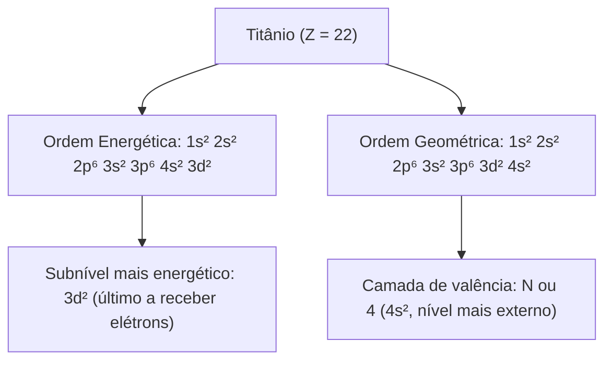
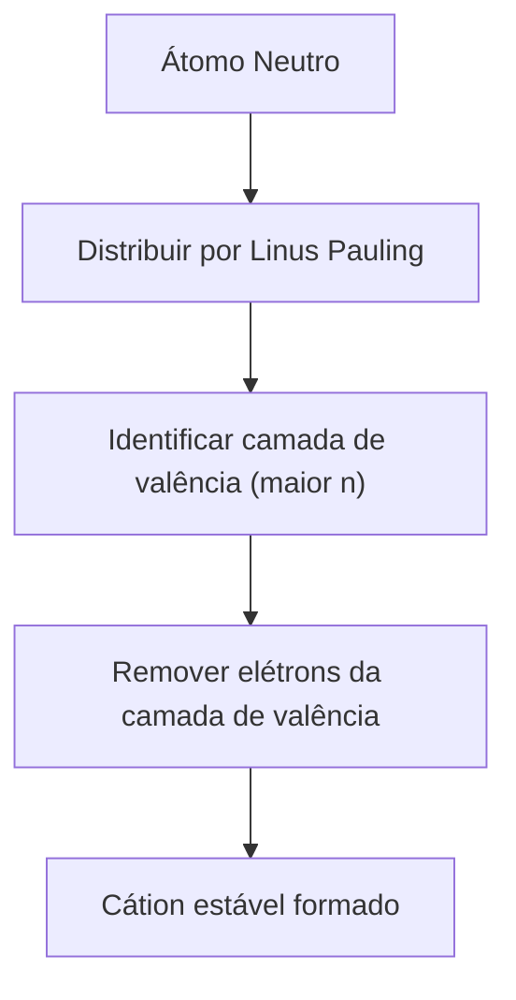
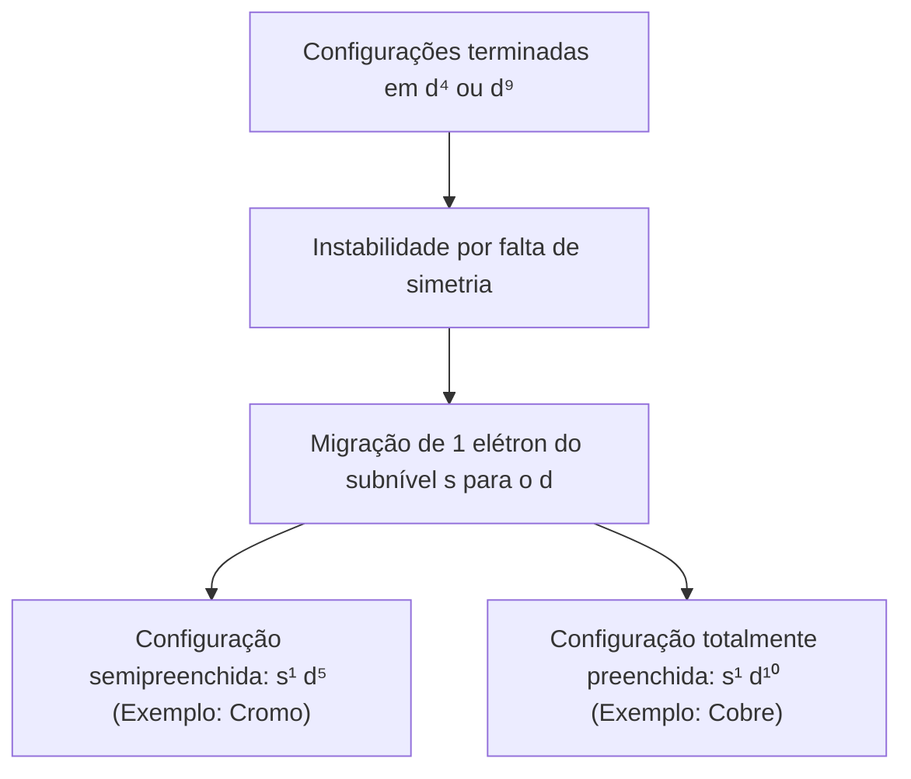
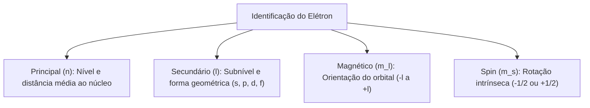
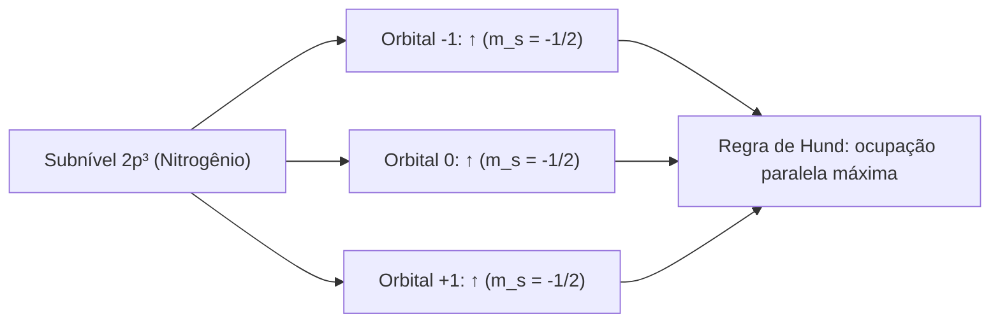
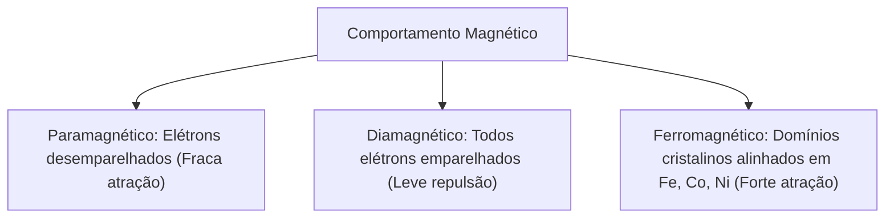
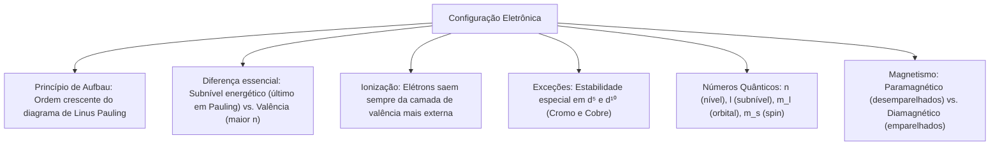

O conhecimento sobre a organização da eletrosfera tem aplicação prática direta. No serviço operacional, a estabilidade de substâncias inflamáveis, o caráter oxidante de compostos químicos e a reatividade de metais alcalinos dependem da configuração eletrônica dos átomos.

Distribuir os elétrons segundo a ordem crescente de energia permite prever a valência, a fórmula de substâncias e o comportamento químico da matéria. A teoria dos números quânticos descreve com rigor o estado energético, a forma geométrica e a orientação de cada elétron. Neste capítulo, estudaremos o diagrama de Linus Pauling, as regras de ionização, as exceções à regra de Pauling, os quatro números quânticos, o princípio de exclusão de Pauli, a regra de Hund e o magnetismo da matéria.

> [!objetivos]
> - Aplicar o diagrama de Linus Pauling para distribuir elétrons em átomos neutros e íons.
> - Diferenciar a ordem energética da ordem geométrica, identificando a camada de valência.
> - Reconhecer as anomalias da distribuição eletrônica do cromo, cobre e elementos de transição.
> - Determinar os quatro números quânticos aplicando o princípio de Pauli e a regra de Hund.

## Diagrama de Linus Pauling e o princípio de Aufbau

A distribuição eletrônica descreve a disposição dos elétrons nos diferentes níveis e subníveis de energia ao redor do núcleo. No estado fundamental, os elétrons ocupam primeiro os subníveis de menor energia disponíveis. Esse princípio de construção progressiva é chamado de Princípio de Aufbau.

Para organizar a ordem crescente de energia, Linus Pauling desenvolveu um esquema gráfico diagonal prático. Os subníveis de energia comportam quantidades máximas definidas de elétrons: o subnível s comporta até 2 elétrons (s²), o subnível p abriga até 6 elétrons (p⁶), o subnível d recebe até 10 elétrons (d¹⁰) e o subnível f comporta até 14 elétrons (f¹⁴).

O preenchimento da eletrosfera ocorre percorrendo as diagonais do diagrama no sentido descendente. A sequência de energia crescente dos subníveis é a seguinte:

1s² < 2s² < 2p⁶ < 3s² < 3p⁶ < 4s² < 3d¹⁰ < 4p⁶ < 5s² < 4d¹⁰ < 5p⁶ < 6s² < 4f¹⁴ < 5d¹⁰ < 6p⁶ < 7s² < 5f¹⁴ < 6d¹⁰ < 7p⁶.

| Nível quântico (n) | Camada eletrônica | Subníveis componentes | Capacidade máxima de elétrons |
| :--- | :--- | :--- | :--- |
| n = 1 | K | 1s | 2 elétrons |
| n = 2 | L | 2s, 2p | 8 elétrons |
| n = 3 | M | 3s, 3p, 3d | 18 elétrons |
| n = 4 | N | 4s, 4p, 4d, 4f | 32 elétrons |
| n = 5 | O | 5s, 5p, 5d, 5f | 32 elétrons |
| n = 6 | P | 6s, 6p, 6d | 18 elétrons |
| n = 7 | Q | 7s, 7p | 8 elétrons |

Em um átomo neutro fundamental, a soma dos expoentes dos subníveis é igual ao número atômico Z. O átomo de titânio (Ti, Z = 22) possui 22 elétrons. Pelo diagrama de Pauling, sua distribuição é: 1s² 2s² 2p⁶ 3s² 3p⁶ 4s² 3d².

Para simplificar a escrita de átomos com muitos elétrons, usa-se o cerne do gás nobre anterior entre colchetes. Como o argônio (₁₈Ar) possui configuração 1s² 2s² 2p⁶ 3s² 3p⁶, a distribuição do titânio é escrita de forma condensada como [Ar] 4s² 3d².

> [!bizu]
> Regra prática de Madelung: a energia de cada subnível depende da soma do número quântico principal com o secundário (n + l). Quando dois subníveis têm a mesma soma (como 3d, onde 3+2=5, e 4p, onde 4+1=5), o subnível com menor valor de n possui menor energia e é preenchido primeiro.

## Ordem energética versus ordem geométrica e camada de valência

Existe uma diferença conceitual importante entre ordem energética e ordem geométrica na eletrosfera.

A ordem energética é obtida diretamente ao seguir as diagonais de Linus Pauling. Ela reflete a ordem real de entrada dos elétrons por energia crescente.

A ordem geométrica consiste em reescrever os subníveis agrupados em ordem crescente de seus níveis quânticos principais n (camadas K, L, M, N...).

Na distribuição do titânio, observe as duas formas:
- Ordem energética: 1s² 2s² 2p⁶ 3s² 3p⁶ 4s² 3d².
- Ordem geométrica: 1s² 2s² 2p⁶ 3s² 3p⁶ 3d² 4s².

Dessa análise surgem dois conceitos fundamentais para a prova:
1. *Subnível mais energético:* é o último subnível a receber elétrons pela ordem de Pauling. No titânio, é o subnível 3d². O último elétron colocado nesse subnível é o elétron diferenciador.
2. *Camada de valência:* é o nível mais externo ocupado por elétrons no átomo (maior valor de n). No titânio, o maior nível é n = 4. Portanto, sua camada de valência é o nível 4 (camada N), com 2 elétrons no subnível 4s².

| Elemento e Z | Ordem energética | Ordem geométrica | Subnível mais energético | Camada de valência |
| :--- | :--- | :--- | :--- | :--- |
| Escândio (₂₁Sc) | [Ar] 4s² 3d¹ | [Ar] 3d¹ 4s² | 3d¹ | 4s² (2 elétrons) |
| Ferro (₂₆Fe) | [Ar] 4s² 3d⁶ | [Ar] 3d⁶ 4s² | 3d⁶ | 4s² (2 elétrons) |
| Gálio (₃₁Ga) | [Ar] 4s² 3d¹⁰ 4p¹ | [Ar] 3d¹⁰ 4s² 4p¹ | 4p¹ | 4s² 4p¹ (3 elétrons) |
| Bromo (₃₅Br) | [Ar] 4s² 3d¹⁰ 4p⁵ | [Ar] 3d¹⁰ 4s² 4p⁵ | 4p⁵ | 4s² 4p⁵ (7 elétrons) |
| Rênio (₇₅Re) | [Xe] 6s² 4f¹⁴ 5d⁵ | [Xe] 4f¹⁴ 5d⁵ 6s² | 5d⁵ | 6s² (2 elétrons) |

> [!bizu]
> O subnível mais energético nem sempre está na camada de valência. Nos metais de transição do bloco d, o subnível mais energético fica na camada interna n - 1 (como 3d), enquanto a camada de valência fica no nível externo n (como 4s).

## Distribuição eletrônica em cátions e ânions

Na distribuição eletrônica de íons, aplica-se uma regra fundamental: os elétrons devem ser retirados sempre da camada de valência (a camada mais externa, de maior valor de n). Eles nunca devem ser retirados do subnível mais energético interno.

Para fazer a distribuição de um cátion corretamente, siga estes passos:
1. Faça a distribuição eletrônica completa do átomo em seu estado neutro.
2. Identifique qual é a camada de valência (maior valor de n).
3. Retire a quantidade necessária de elétrons dessa camada de valência. Se a camada de valência esvaziar, continue retirando do subnível mais externo que sobrou.

Veja o caso do ferro e seus cátions:
- Ferro neutro (₂₆Fe): 1s² 2s² 2p⁶ 3s² 3p⁶ 4s² 3d⁶. A camada de valência é 4s².
- Cátion ferroso (Fe²⁺): perde 2 elétrons da camada de valência 4s. Sua configuração é [Ar] 3d⁶.
- Cátion férrico (Fe³⁺): perde os 2 elétrons de 4s e depois 1 elétron de 3d. Sua configuração é [Ar] 3d⁵.

Na formação de ânions, o átomo ganha elétrons. Basta adicionar os novos elétrons no subnível incompleto de menor energia da camada de valência. O cloro (₁₇Cl) neutro termina em 3s² 3p⁵. Ao receber 1 elétron para formar o ânion cloreto (Cl⁻), fica com 3s² 3p⁶, atingindo a configuração estável do argônio.

| Espécie química | Carga | Total de elétrons | Configuração eletrônica completa | Notação condensada |
| :--- | :--- | :--- | :--- | :--- |
| Sódio (₁₁Na) | 0 | 11 e⁻ | 1s² 2s² 2p⁶ 3s¹ | [Ne] 3s¹ |
| Cátion sódio (Na⁺) | +1 | 10 e⁻ | 1s² 2s² 2p⁶ | [Ne] |
| Oxigênio (₈O) | 0 | 8 e⁻ | 1s² 2s² 2p⁴ | [He] 2s² 2p⁴ |
| Ânion óxido (O²⁻) | -2 | 10 e⁻ | 1s² 2s² 2p⁶ | [Ne] |
| Titânio (₂₂Ti) | 0 | 22 e⁻ | 1s² 2s² 2p⁶ 3s² 3p⁶ 4s² 3d² | [Ar] 4s² 3d² |
| Cátion titânio (Ti²⁺) | +2 | 20 e⁻ | 1s² 2s² 2p⁶ 3s² 3p⁶ 3d² | [Ar] 3d² |

> [!atencao]
> Nunca subtraia elétrons do número atômico antes de distribuir. Fazer 26 - 2 = 24 elétrons e aplicar o diagrama de Pauling produziria [Ar] 4s² 3d⁴, o que é um erro grave. A configuração correta do Fe²⁺ é [Ar] 3d⁶, pois os elétrons saem do subnível 4s.

## Anomalias e exceções à regra de Pauling

Os subníveis d possuem estabilidade especial quando estão semipreenchidos (d⁵, com 5 elétrons paralelos) ou totalmente preenchidos (d¹⁰, com 10 elétrons emparelhados). Essa estabilidade decorre da simetria espacial e da menor repulsão entre os elétrons.

Por causa dessa estabilidade, alguns elementos não seguem a regra teórica de Pauling. Em seus estados fundamentais, um elétron do subnível s mais externo migra espontaneamente para o subnível d interno vizinho.

Os dois exemplos mais cobrados em provas são o cromo e o cobre:
- *Cromo (Cr, Z = 24):* Na teoria de Pauling, terminaria em 4s² 3d⁴. Na prática experimental, um elétron salta de 4s para 3d, formando a configuração real [Ar] 4s¹ 3d⁵. Assim, os subníveis 4s e 3d ficam ambos semipreenchidos e estáveis.
- *Cobre (Cu, Z = 29):* Na teoria terminaria em 4s² 3d⁹. Na realidade, sua configuração estável é [Ar] 4s¹ 3d¹⁰, deixando o subnível 3d completamente preenchido.

Outros metais de transição apresentam comportamentos semelhantes confirmados em laboratório:

| Elemento | Símbolo e Z | Configuração teórica | Configuração experimental real | Razão da estabilidade |
| :--- | :--- | :--- | :--- | :--- |
| Cromo | ₂₄Cr | [Ar] 4s² 3d⁴ | [Ar] 4s¹ 3d⁵ | Subnível 3d semipreenchido estável |
| Cobre | ₂₉Cu | [Ar] 4s² 3d⁹ | [Ar] 4s¹ 3d¹⁰ | Subnível 3d totalmente preenchido estável |
| Nióbio | ₄₁Nb | [Kr] 5s² 4d³ | [Kr] 5s¹ 4d⁴ | Menor repulsão intereletrônica |
| Rutênio | ₄₄Ru | [Kr] 5s² 4d⁶ | [Kr] 5s¹ 4d⁷ | Maior energia de troca quântica |
| Ródio | ₄₅Rh | [Kr] 5s² 4d⁷ | [Kr] 5s¹ 4d⁸ | Estabilização por simetria orbital |
| Paládio | ₄₆Pd | [Kr] 5s² 4d⁸ | [Kr] 5s⁰ 4d¹⁰ | Subnível 4d totalmente preenchido |
| Prata | ₄₇Ag | [Kr] 5s² 4d⁹ | [Kr] 5s¹ 4d¹⁰ | Subnível 4d totalmente preenchido |
| Ouro | ₇₉Au | [Xe] 6s² 4f¹⁴ 5d⁹ | [Xe] 6s¹ 4f¹⁴ 5d¹⁰ | Subnível 5d totalmente preenchido |

Nos lantanídeos e actinídeos (bloco f), ocorrem exceções parecidas. Pela proximidade de energia entre os subníveis (n-2)f e (n-1)d, elementos como lantânio (₅₇La) e cério (₅₈Ce) acomodam elétrons em subníveis d antes de completar o f.

> [!pegadinha]
> O paládio (₄₆Pd) transfere os dois elétrons do subnível 5s para o 4d. Sua configuração real é [Kr] 4d¹⁰, esvaziando totalmente a camada 5. Ele possui zero elétrons na camada de valência teórica original.

## Os quatro números quânticos e a descrição do estado eletrônico

Na mecânica quântica moderna, cada elétron na eletrosfera é identificado por um conjunto de quatro números quânticos: n, l, m_l e m_s.

Eles representam o nível de energia, a forma do orbital, sua orientação espacial e o sentido de rotação do elétron:

1. *Número Quântico Principal (n):* indica o nível de energia e a distância média do elétron ao núcleo. Assume valores inteiros positivos: n = 1, 2, 3, 4, 5, 6, 7 (camadas K a Q).
2. *Número Quântico Secundário ou Azimutal (l):* indica a forma geométrica do orbital e define o subnível. Para cada valor de n, l varia de 0 até n - 1: l = 0 (subnível s), l = 1 (subnível p), l = 2 (subnível d) e l = 3 (subnível f).
3. *Número Quântico Magnético (m_l):* indica a orientação espacial do orbital em um campo magnético. Para cada subnível l, m_l varia de -l até +l (totalizando 2l + 1 orbitais). O subnível s tem 1 orbital (m_l = 0). O subnível p tem 3 orbitais (-1, 0, +1). O subnível d tem 5 orbitais (-2, -1, 0, +1, +2). O subnível f tem 7 orbitais (-3 a +3).
4. *Número Quântico de Spin (m_s):* descreve a rotação intrínseca do elétron em torno do próprio eixo. Os valores possíveis são -1/2 e +1/2. Por convenção comum em concursos, o primeiro elétron colocado no orbital (seta para cima, ↑) recebe spin m_s = -1/2. O segundo elétron emparelhado (seta para baixo, ↓) recebe m_s = +1/2.

| Número Quântico | Símbolo | Valores permitidos | Significado físico |
| :--- | :--- | :--- | :--- |
| Principal | n | Inteiros positivos: 1, 2, 3, 4, 5, 6, 7 | Nível de energia e tamanho da órbita |
| Secundário / Azimutal | l | Inteiros de 0 até n - 1 (s=0, p=1, d=2, f=3) | Subnível de energia e forma do orbital |
| Magnético | m_l | Inteiros de -l a +l (total: 2l + 1) | Orientação espacial do orbital |
| Spin | m_s | Apenas -1/2 ou +1/2 | Sentido de rotação magnética do elétron |

O conjunto (n, l, m_l, m_s) identifica cada elétron de maneira única dentro de um mesmo átomo.

## Princípio da exclusão de Pauli e a regra de Hund

A ocupação dos orbitais atômicos obedece a dois postulados fundamentais:

*Princípio da Exclusão de Pauli (1925):* Em um mesmo átomo, não podem existir dois elétrons com os quatro números quânticos idênticos.

Se dois elétrons estão no mesmo nível (mesmo n), no mesmo subnível (mesmo l) e no mesmo orbital (mesmo m_l), eles precisam ter spins opostos (um com m_s = -1/2 e outro com m_s = +1/2). Por isso, cada orbital atômico comporta no máximo dois elétrons.

*Regra de Hund ou Princípio da Máxima Multiplicidade (1927):* Ao ocupar orbitais de mesma energia em um subnível, os elétrons devem ocupar primeiro os orbitais vazios com spins paralelos. Somente após todos os orbitais conterem um elétron é que se inicia o emparelhamento.

Essa regra minimiza a repulsão elétrica entre elétrons, mantendo-os afastados no espaço.

Veja a distribuição nos elementos do segundo período:
- *Carbono (C, Z = 6):* 1s² 2s² 2p². No subnível 2p (orbitais -1, 0, +1), entram dois elétrons: orbital -1 (↑) e orbital 0 (↑). O carbono possui 2 elétrons desemparelhados. Números quânticos do elétron diferenciador: n = 2, l = 1, m_l = 0, m_s = -1/2.
- *Nitrogênio (N, Z = 7):* 1s² 2s² 2p³. Orbitais: orbital -1 (↑), orbital 0 (↑), orbital +1 (↑). O nitrogênio possui 3 elétrons desemparelhados. Números quânticos do elétron diferenciador: n = 2, l = 1, m_l = +1, m_s = -1/2.
- *Oxigênio (O, Z = 8):* 1s² 2s² 2p⁴. Três elétrons entram paralelos nos orbitais -1, 0, +1; o quarto emparelha o primeiro orbital: orbital -1 (↑↓), orbital 0 (↑), orbital +1 (↑). O oxigênio possui 1 par emparelhado e 2 elétrons desemparelhados. Números quânticos do elétron diferenciador: n = 2, l = 1, m_l = -1, m_s = +1/2.

| Átomo e subnível final | Ocupação dos orbitais (-1, 0, +1) | Elétrons emparelhados | Elétrons desemparelhados | Números quânticos do elétron diferencial |
| :--- | :--- | :--- | :--- | :--- |
| Boro (₂p¹) | [↑ ] [  ] [  ] | 0 | 1 | (2, 1, -1, -1/2) |
| Carbono (₂p²) | [↑ ] [↑ ] [  ] | 0 | 2 | (2, 1, 0, -1/2) |
| Nitrogênio (₂p³) | [↑ ] [↑ ] [↑ ] | 0 | 3 | (2, 1, +1, -1/2) |
| Oxigênio (₂p⁴) | [↑↓] [↑ ] [↑ ] | 2 (1 par) | 2 | (2, 1, -1, +1/2) |
| Flúor (₂p⁵) | [↑↓] [↑↓] [↑ ] | 4 (2 pares) | 1 | (2, 1, 0, +1/2) |
| Neônio (₂p⁶) | [↑↓] [↑↓] [↑↓] | 6 (3 pares) | 0 | (2, 1, +1, +1/2) |

> [!exemplo]
> No bromo (₃₅Br), a configuração termina em 4p⁵. Os elétrons entram paralelos em -1, 0, +1; depois o quarto elétron emparelha em -1 e o quinto emparelha em 0. O elétron diferenciador possui: n = 4, l = 1, m_l = 0, m_s = +1/2.

## Magnetismo atômico e efeito do par inerte

O arranjo dos spins nos orbitais atômicos define o comportamento magnético da substância na presença de campos magnéticos externos.

As substâncias dividem-se em três classes de magnetismo:
1. *Paramagnetismo:* ocorre quando há elétrons desemparelhados na eletrosfera. Esses elétrons alinham seus spins com o campo externo, gerando uma atração fraca. Exemplos: alumínio, magnésio, gás oxigênio (O₂), íons Fe²⁺ e Fe³⁺.
2. *Diamagnetismo:* ocorre quando todos os elétrons estão emparelhados em orbitais cheios. Como os spins opostos se anulam mutuamente, a substância sofre uma leve repulsão na presença de ímãs. Exemplos: água (H₂O), cloreto de sódio (NaCl), cobre metálico (Cu), ouro (Au) e gases nobres.
3. *Ferromagnetismo:* é uma propriedade especial de certos sólidos cristalinos onde os elétrons desemparelhados alinham-se em blocos chamados domínios magnéticos. Sob a ação de um ímã, esses domínios orientam-se fortemente, produzindo atração intensa e imantação permanente. Os únicos elementos puros ferromagnéticos à temperatura ambiente são ferro (Fe), cobalto (Co) e níquel (Ni).

| Classe magnética | Estrutura eletrônica | Resposta ao campo magnético | Exemplos práticos |
| :--- | :--- | :--- | :--- |
| Paramagnetismo | Possui elétrons desemparelhados | Atração fraca pelo campo externo | Alumínio, titânio, O₂, cátions Fe²⁺ |
| Diamagnetismo | Todos os elétrons emparelhados | Repulsão tênue pelo campo externo | Água, sal de cozinha, cobre, ouro |
| Ferromagnetismo | Domínios magnéticos orientados | Atração intensa com magnetização duradoura | Ferro (Fe), cobalto (Co), níquel (Ni) |

Em ocorrências operacionais com aparelhos de ressonância magnética hospitalar, os bombeiros devem ter cuidado extremo com materiais ferromagnéticos (ferro e aço). Esses materiais são atraídos com violência mortal pelo campo magnético do equipamento.

> [!atencao]
> Em salas de ressonância magnética, ferramentas de ferro ou aço transformam-se em projéteis de alta velocidade. Materiais paramagnéticos (alumínio) e diamagnéticos (cobre, plástico) não oferecem esse risco cinético perigoso.

Nos elementos pós-transição pesados (como tálio, chumbo e bismuto), manifesta-se o efeito do par inerte. Por causa da atração nuclear intensa sobre a camada 6s, esses dois elétrons resistem a participar de reações químicas. O tálio (₈₁Tl, 6s² 6p¹) forma preferencialmente o cátion Tl⁺ perdendo apenas o elétron 6p. O chumbo (₈₂Pb, 6s² 6p²) forma compostos de Pb²⁺ muito mais estáveis que os de Pb⁴⁺.

## Resolução guiada de problema contextualizado

Acompanhe a aplicação desses conceitos em uma questão formulada no padrão das bancas.

> [!resolvido]
> **Questão contextualizada:** Em uma perícia sobre falha estrutural de ligas metálicas especiais, o laboratório analisou o elemento rênio (₇₅Re), cujo número atômico é 75. A respeito de sua configuração eletrônica e propriedades atômicas no estado fundamental, analise as proposições:
>
> I. Sua distribuição eletrônica em ordem crescente de energia é 1s² 2s² 2p⁶ 3s² 3p⁶ 4s² 3d¹⁰ 4p⁶ 5s² 4d¹⁰ 5p⁶ 6s² 4f¹⁴ 5d⁵.
> II. O subnível mais energético do átomo de rênio é o 6s², que comporta seus elétrons de valência.
> III. Ao formar o cátion rênio bivalente (Re²⁺), os elétrons são removidos do subnível 6s, resultando na configuração [Xe] 4f¹⁴ 5d⁵.
> IV. O átomo neutro de rênio é paramagnético pela presença de elétrons desemparelhados no subnível 5d.
>
> Estão corretas as proposições:
> A) I e II, apenas.
> B) I, III e IV, apenas.
> C) II e III, apenas.
> D) III e IV, apenas.
> E) I, II, III e IV.
>
> **Resolução passo a passo:**
> 1. *Item I:* Correto. A soma dos elétrons na ordem de Pauling totaliza exatamente 75 elétrons. O cerne corresponde ao gás nobre xenônio ([Xe]₅₄), completado por 6s² 4f¹⁴ 5d⁵.
> 2. *Item II:* Incorreto. O subnível mais energético é o último preenchido por Pauling, que é o 5d⁵. O subnível 6s² pertence à camada de valência (nível 6), mas possui menor energia que 5d⁵.
> 3. *Item III:* Correto. Na formação de cátions, os elétrons saem da camada de valência mais externa (nível 6). O cátion Re²⁺ perde os elétrons de 6s², restando [Xe] 4f¹⁴ 5d⁵.
> 4. *Item IV:* Correto. O subnível 5d possui 5 orbitais. Pela regra de Hund, os 5 elétrons ocupam orbitais separados com spins paralelos desemparelhados, conferindo paramagnetismo ao átomo.
>
> Conclusão: As proposições I, III e IV estão corretas.
> Resposta: Alternativa B.

## Mapa do capítulo

Neste capítulo examinamos as regras que organizam a distribuição eletrônica em átomos e íons, os postulados de Aufbau, Pauli e Hund e a caracterização do estado eletrônico pelos quatro números quânticos.

### Para fixar
- A distribuição de Pauling organiza subníveis por ordem crescente de energia: s² (2), p⁶ (6), d¹⁰ (10), f¹⁴ (14).
- O subnível mais energético é o último preenchido por Pauling; a camada de valência é aquela de maior número quântico n.
- Em cátions, os elétrons são retirados obrigatoriamente da camada de valência, e nunca do subnível energético interno.
- Cromo ([Ar] 4s¹ 3d⁵) e cobre ([Ar] 4s¹ 3d¹⁰) constituem exceções estabilizadas por subníveis d semipreenchidos ou completos.
- O conjunto de quatro números quânticos (n, l, m_l, m_s) define unicamente o estado de cada elétron no átomo.
- Princípio da Exclusão de Pauli: não existem dois elétrons com os mesmos quatro números quânticos no mesmo átomo; cada orbital comporta até 2 elétrons de spins opostos.
- Regra de Hund: os elétrons ocupam primeiro os orbitais vazios com spins paralelos antes de iniciar o emparelhamento.
- Espécies paramagnéticas possuem elétrons desemparelhados e sofrem atração por campos magnéticos; espécies diamagnéticas têm todos os elétrons emparelhados e sofrem leve repulsão.
