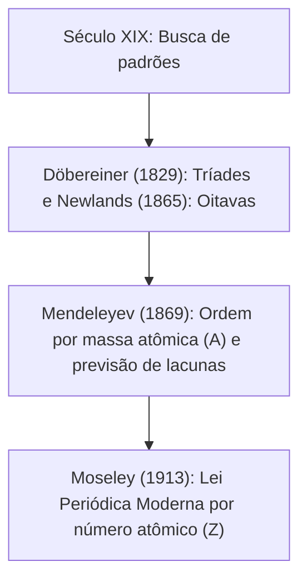
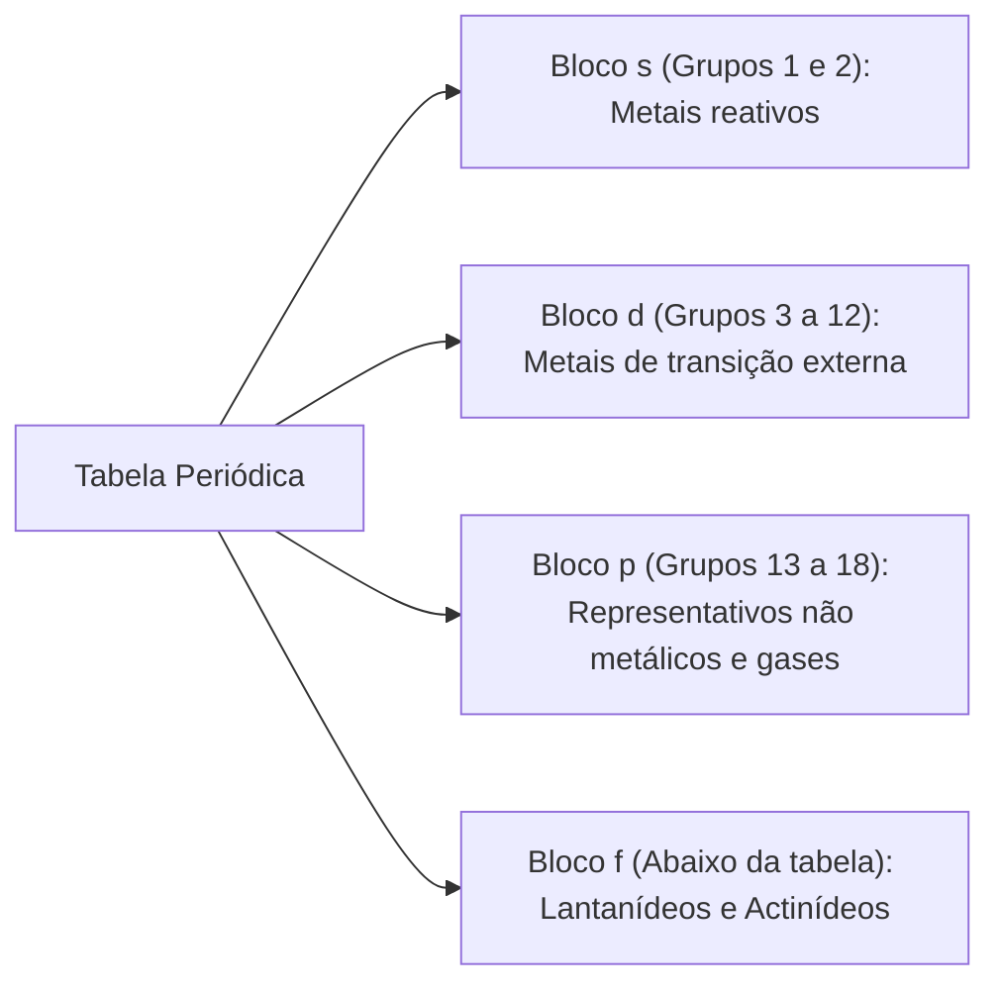
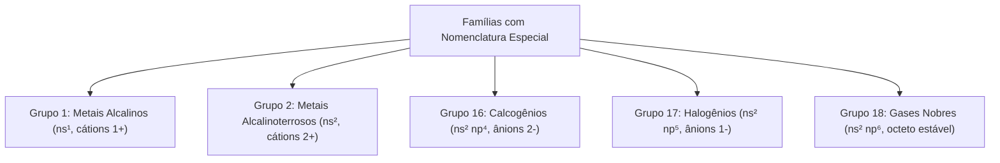
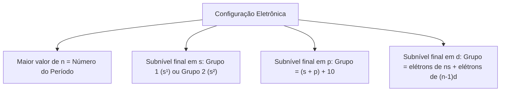
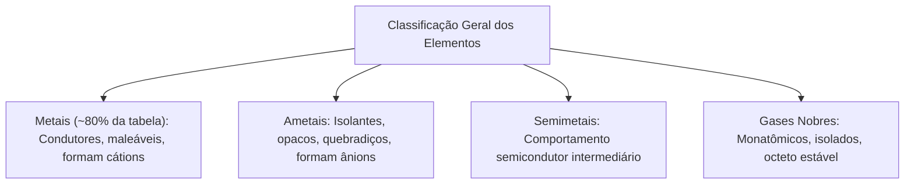
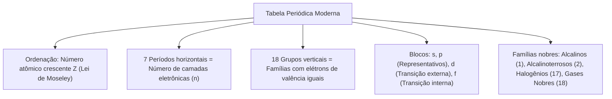

A Tabela Periódica dos Elementos Químicos é a ferramenta mais poderosa e abrangente de toda a ciência moderna. Dominá-la também tem valor operacional. Nas ocorrências com cargas perigosas e produtos químicos industriais, a identificação imediata da família química de uma substância permite prever sua reatividade com água, sua inflamabilidade, seu potencial tóxico e a classe adequada de agente extintor a ser empregada no combate ao fogo.

A tabela periódica não é uma lista arbitrária de elementos. Sua arquitetura reflete diretamente a configuração eletrônica e as semelhanças químicas fundamentais da matéria. Neste capítulo, estudaremos a evolução histórica desde a lei periódica de Mendeleyev até o arranjo moderno de Henry Moseley. Examinaremos a divisão em períodos e grupos, as famílias químicas com nomes especiais, as regras de localização a partir da distribuição eletrônica e a classificação dos elementos em metais, ametais, semimetais e gases nobres.

> [!objetivos]
> - Compreender a transição histórica da tabela por massa de Mendeleyev para a tabela por número atômico de Moseley.
> - Descrever a organização estrutural em 7 períodos horizontais e 18 grupos verticais.
> - Caracterizar as principais famílias químicas: metais alcalinos, alcalinoterrosos, calcogênios, halogênios e gases nobres.
> - Localizar o período e o grupo de qualquer elemento químico a partir de sua configuração eletrônica fundamental.
> - Diferenciar metais, não metais, semimetais e gases nobres quanto às suas propriedades físicas e químicas.

## A evolução histórica da classificação periódica de Mendeleyev a Moseley

No século XIX, com a rápida descoberta de novos elementos químicos, os cientistas buscaram padrões para organizá-los de forma lógica. As primeiras tentativas incluíram as Tríades de Döbereiner (1829), que agrupava elementos de propriedades semelhantes em trios cuja massa do elemento central era a média aritmética dos extremos, e o Parafuso Telúrico de Chancourtois (1862). Em 1865, John Newlands propôs a Lei das Oitavas, comparando a repetição periódica das propriedades dos elementos às notas da escala musical.

O grande salto na sistematização química ocorreu em 1869 com o químico russo Dmitri Ivanovich Mendeleyev e, paralelamente, com o alemão Julius Lothar Meyer. Mendeleyev organizou os 63 elementos químicos então conhecidos em ordem crescente de suas massas atômicas (A). Ele percebeu que as propriedades químicas se repetiam periodicamente em intervalos regulares, formulando a primeira Lei Periódica da história.

A genialidade de Mendeleyev destacou-se por dois fatores históricos marcantes:
1. *Previsão de elementos desconhecidos:* Ao montar sua tabela, Mendeleyev deixou lacunas vazias onde as propriedades não se encaixavam. Ele previu com incrível exatidão a existência e as propriedades de elementos ainda não descobertos, denominando-os de eka-boro (escândio, descoberto em 1879), eka-alumínio (gálio, descoberto em 1875) e eka-silício (germânio, descoberto em 1886).
2. *Inversão de posições:* Para manter juntos elementos de mesma reatividade, Mendeleyev inverteu a ordem de massa de alguns pares, como o telúrio (A = 127,6) posicionado antes do iodo (A = 126,9), e o argônio (A = 39,95) antes do potássio (A = 39,10).

Em 1913, o físico britânico Henry Moseley solucionou em definitivo essas discrepâncias. Bombardeando alvos metálicos com raios catódicos, Moseley mediu a frequência dos raios X característicos emitidos por cada elemento. Ele provou que a verdadeira identidade de um elemento reside na carga positiva de seu núcleo: o número atômico Z.

Moseley enunciou a Lei Periódica Moderna: muitas propriedades físicas e químicas dos elementos químicos são funções periódicas de seus números atômicos Z. A organização por número atômico crescente eliminou todas as inversões de massa de Mendeleyev sem alterar a estrutura das famílias químicas.

| Critério de comparação | Classificação de Mendeleyev (1869) | Classificação Moderna de Moseley (1913) |
| :--- | :--- | :--- |
| Grandeza de ordenação | Massa atômica crescente (A) | Número atômico crescente (Z) |
| Lei periódica adotada | Propriedades variam periodicamente com A | Propriedades variam periodicamente com Z |
| Inversões de posição | Necessárias para preservar famílias químicas | Desnecessárias: a sequência de Z é perfeita |
| Elementos desconhecidos | Deixou lacunas e previu propriedades reais | Confirmou as lacunas pelos valores inteiros de Z |
| Gases nobres | Ausentes no projeto original (descobertos após 1894) | Integrados como grupo estável com octeto completo |

## Estrutura da tabela periódica moderna: períodos, grupos e blocos

A Tabela Periódica Moderna reconhecida pela IUPAC abriga atualmente 118 elementos químicos formalmente catalogados e nomeados. Desses 118 elementos, 92 são elementos naturais encontrados na crosta terrestre e no cosmos (do hidrogênio, Z = 1, ao urânio, Z = 92, com exceções de elementos instáveis como tecnécio e promécio). Os 26 elementos restantes são artificiais (sintéticos), produzidos em reatores nucleares e aceleradores de partículas.

A tabela é organizada espacialmente em uma grade retangular dividida em linhas horizontais e colunas verticais:

1. *Períodos (linhas horizontais):* A tabela possui exatamente 7 períodos numerados de 1 a 7 de cima para baixo. O número do período ao qual um elemento pertence indica exatamente a quantidade de níveis quânticos principais (camadas eletrônicas) que o átomo utiliza para abrigar seus elétrons em seu estado fundamental.
2. *Grupos ou Famílias (colunas verticais):* A tabela reúne 18 colunas verticais numeradas oficialmente pela IUPAC de 1 a 18 (da esquerda para a direita). Os elementos situados no mesmo grupo possuem a mesma configuração eletrônica em sua camada de valência e, por essa razão, apresentam comportamentos e propriedades químicas semelhantes.

A extensão dos períodos varia de acordo com o preenchimento dos subníveis energéticos:
- *1º Período:* contém apenas 2 elementos (H e He), preenchendo o subnível 1s.
- *2º Período:* reúne 8 elementos (Li ao Ne, Z = 3 a 10), preenchendo 2s e 2p.
- *3º Período:* contém 8 elementos (Na ao Ar, Z = 11 a 18), preenchendo 3s e 3p.
- *4º Período:* possui 18 elementos (K ao Kr, Z = 19 a 36), preenchendo 4s, 3d e 4p.
- *5º Período:* possui 18 elementos (Rb ao Xe, Z = 37 a 54), preenchendo 5s, 4d e 5p.
- *6º Período:* compreende 32 elementos (Cs ao Rn, Z = 55 a 86), preenchendo 6s, 4f, 5d e 6p (incluindo a série dos lantanídeos).
- *7º Período:* reúne 32 elementos (Fr ao Og, Z = 87 a 118), preenchendo 7s, 5f, 6d e 7p (incluindo a série dos actinídeos).

| Bloco quântico | Colunas correspondentes | Subnível mais energético | Classificação clássica dos elementos |
| :--- | :--- | :--- | :--- |
| Bloco s | Grupos 1 e 2 (mais o hélio) | Subnível s | Elementos representativos (famílias 1A e 2A) |
| Bloco p | Grupos 13 a 18 | Subnível p | Elementos representativos (famílias 3A a 8A) |
| Bloco d | Grupos 3 a 12 | Subnível d | Elementos de transição externa (famílias B) |
| Bloco f | Séries dos Lantanídeos e Actinídeos | Subnível f | Elementos de transição interna (pertencem ao Grupo 3) |

Na nomenclatura clássica de letras, os elementos representativos eram agrupados sob a letra A (grupos 1A a 8A), enquanto os elementos de transição externa eram designados pela letra B (grupos 1B a 8B). Embora a IUPAC recomende a numeração de 1 a 18, a notação de famílias A e B continua sendo exigida com grande frequência em concursos públicos.

## As famílias químicas e suas propriedades características

As famílias verticais da tabela periódica agrupam elementos com semelhanças químicas marcantes. Algumas dessas famílias possuem nomes consagrados internacionalmente que devem ser memorizados pelos candidatos:

1. *Grupo 1 (Família 1A) - Metais Alcalinos:* Lítio (Li), Sódio (Na), Potássio (K), Rubídio (Rb), Césio (Cs) e Frâncio (Fr). Possuem configuração de valência ns¹. São metais moles, brilhantes, de baixa densidade e baixos pontos de fusão. São extremamente reativos com água e oxigênio, reagindo de forma violenta e exotérmica para formar hidróxidos fortes (bases álcalis) e gás hidrogênio inflamável. Formam sempre cátions monovalentes (+1).
2. *Grupo 2 (Família 2A) - Metais Alcalinoterrosos:* Berílio (Be), Magnésio (Mg), Cálcio (Ca), Estrôncio (Sr), Bário (Ba) e Rádio (Ra). Possuem configuração ns². São metais brilhantes e bons condutores, mais duros e densos que os metais alcalinos. Reagem com água (com menor violência que o grupo 1) formando bases e liberando hidrogênio. Formam cátions bivalentes (+2). O magnésio em chamas não pode ser combatido com água, pois quebra a molécula de água em hidrogênio inflamável.
3. *Grupo 16 (Família 6A) - Calcogênios:* Oxigênio (O), Enxofre (S), Selênio (Se), Telúrio (Te) e Polônio (Po). O nome significa geradores de cobre e minérios. Possuem configuração ns² np⁴ (6 elétrons na valência). Têm tendência a receber 2 elétrons para formar ânions bivalentes (-2). O oxigênio é o comburente universal que sustenta a combustão em incêndios.
4. *Grupo 17 (Família 7A) - Halogênios:* Flúor (F), Cloro (Cl), Bromo (Br), Iodo (I), Astato (At) e Tenesso (Ts). O nome significa formadores de sais. Possuem configuração ns² np⁵ (7 elétrons na valência). São os elementos mais eletronegativos da tabela, reagindo avidamente com metais para formar haletos (como NaCl). Formam ânions monovalentes (-1). O cloro gasoso é um agente asfixiante e tóxico industrial severo.
5. *Grupo 18 (Família 8A ou Grupo Zero) - Gases Nobres:* Hélio (He), Neônio (Ne), Argônio (Ar), Criptônio (Kr), Xenônio (Xe), Radônio (Rn) e Oganessônio (Og). Possuem camada de valência completa com 8 elétrons (ns² np⁶), com exceção do hélio que se estabiliza com 2 elétrons (1s²). Apresentam baixíssima reatividade química. Por muito tempo foram chamados de gases inertes, mas em 1962 o químico Neil Bartlett provou que xenônio e criptônio podem formar compostos fluorados em laboratório.

| Grupo IUPAC | Família clássica | Nome da família | Configuração de valência | Elétrons de valência | Carga iônica mais comum |
| :--- | :--- | :--- | :--- | :--- | :--- |
| Grupo 1 | Família 1A | Metais Alcalinos | ns¹ | 1 elétron | Cátion +1 (Na⁺, K⁺) |
| Grupo 2 | Família 2A | Metais Alcalinoterrosos | ns² | 2 elétrons | Cátion +2 (Mg²⁺, Ca²⁺) |
| Grupo 13 | Família 3A | Família do Boro | ns² np¹ | 3 elétrons | Cátion +3 (Al³⁺) |
| Grupo 14 | Família 4A | Família do Carbono | ns² np² | 4 elétrons | Compartilha 4 elétrons |
| Grupo 15 | Família 5A | Família do Nitrogênio | ns² np³ | 5 elétrons | Ânion -3 (N³⁻) / compartilha |
| Grupo 16 | Família 6A | Calcogênios | ns² np⁴ | 6 elétrons | Ânion -2 (O²⁻, S²⁻) |
| Grupo 17 | Família 7A | Halogênios | ns² np⁵ | 7 elétrons | Ânion -1 (F⁻, Cl⁻, Br⁻) |
| Grupo 18 | Família 8A | Gases Nobres | ns² np⁶ (He: 1s²) | 8 elétrons (He: 2) | Estáveis (raramente reagem) |

> [!bizu]
> O hidrogênio (H) é um elemento atípico e solitário. Embora apareça acima do Grupo 1 em virtude de sua configuração 1s¹, ele NÃO é um metal alcalino. O hidrogênio é um gás não metálico inflamável, com eletronegatividade intermediária (2,20), que pode compartilhar elétrons ou formar o ânion hidreto (H⁻) e o cátion hidrogênio (H⁺).

## Determinação da posição na tabela a partir da distribuição eletrônica

É possível determinar com precisão absoluta o período e o grupo de qualquer elemento químico na tabela periódica a partir de sua distribuição eletrônica fundamental.

Para os elementos representativos (blocos s e p):
- *Determinação do período:* O período é igual ao maior número quântico principal n ocupado na configuração (o número da camada de valência).
- *Determinação do grupo:* Para o bloco s, se a configuração termina em s¹, o elemento pertence ao Grupo 1 (1A); se termina em s², pertence ao Grupo 2 (2A). Para o bloco p, o número do grupo IUPAC é obtido somando o total de elétrons de valência com 10 (Grupo IUPAC = elétrons da valência + 10). Se termina em s² p⁴, possui 6 elétrons de valência; logo, pertence ao Grupo 16 (ou 6A).

Para os metais de transição externa (bloco d):
- *Determinação do período:* É o maior valor de n da camada de valência externa (o coeficiente do subnível ns).
- *Determinação do grupo:* Soma-se a quantidade de elétrons do subnível mais externo ns com a quantidade de elétrons do subnível d mais energético: Grupo IUPAC = elétrons de ns + elétrons de (n-1)d.
Por exemplo, o ferro (₂₆Fe) termina em 4s² 3d⁶:
- Período: maior n é 4 -> 4º Período.
- Grupo IUPAC: 2 elétrons de 4s somados com 6 elétrons de 3d -> 2 + 6 = Grupo 8 (antigo Grupo 8B).

Para os metais de transição interna (bloco f):
- Todos os elementos de transição interna pertencem obrigatoriamente ao Grupo 3 (antigo Grupo 3B).
- Se o subnível mais energético for 4f, o elemento pertence à série dos lantanídeos no 6º Período.
- Se o subnível mais energético for 5f, pertence à série dos actinídeos no 7º Período.
- Regra prática para identificação rápida por número atômico: se 57 ≤ Z ≤ 71, é lantanídeo (6º período); se 89 ≤ Z ≤ 103, é actinídeo (7º período).

| Elemento e Z | Configuração eletrônica no estado fundamental | Subnível final | Período apurado | Grupo IUPAC | Família clássica |
| :--- | :--- | :--- | :--- | :--- | :--- |
| Magnésio (₁₂Mg) | [Ne] 3s² | 3s² | 3º Período | Grupo 2 | Metais Alcalinoterrosos (2A) |
| Fósforo (₁₅P) | [Ne] 3s² 3p³ | 3p³ | 3º Período | Grupo 15 (2+3+10) | Família do Nitrogênio (5A) |
| Titânio (₂₂Ti) | [Ar] 4s² 3d² | 3d² | 4º Período | Grupo 4 (2+2) | Metal de Transição (4B) |
| Manganês (₂₅Mn) | [Ar] 4s² 3d⁵ | 3d⁵ | 4º Período | Grupo 7 (2+5) | Metal de Transição (7B) |
| Selênio (₃₄Se) | [Ar] 4s² 3d¹⁰ 4p⁴ | 4p⁴ | 4º Período | Grupo 16 (2+4+10) | Calcogênios (6A) |
| Cério (₅₈Ce) | [Xe] 6s² 4f¹ 5d¹ | 4f¹ | 6º Período | Grupo 3 | Lantanídeo (Transição Interna) |
| Urânio (₉₂U) | [Rn] 7s² 5f³ 6d¹ | 5f³ | 7º Período | Grupo 3 | Actinídeo (Transição Interna) |

## Classificação geral: metais, ametais, semimetais e gases nobres

A classificação macroscópica mais clássica da tabela periódica agrupa os elementos químicos em quatro grandes categorias de acordo com suas propriedades físico-químicas: metais, ametais (não metais), semimetais e gases nobres.

1. *Metais (cerca de 80% dos elementos):*
   - Ocupam os blocos s, d, f e a porção inferior esquerda do bloco p.
   - Apresentam brilho metálico e são ótimos condutores térmicos e elétricos via elétrons livres.
   - São maleáveis (moldáveis em lâminas) e dúcteis (estiráveis em fios).
   - São sólidos a 25 °C e 1 atm, exceto o mercúrio (Hg), que é líquido.
   - Possuem baixa eletronegatividade, oxidando-se com facilidade para formar cátions.

2. *Ametais ou Não Metais (11 elementos mais o hidrogênio):*
   - Ocupam o bloco p superior direito (C, N, O, F, P, S, Cl, Se, Br, I, At).
   - Apresentam aspecto opaco, sendo isolantes térmicos e elétricos (exceto o carbono grafite).
   - Não são maleáveis nem dúcteis; quando sólidos, fragmentam-se sob impacto mecânico.
   - Apresentam-se gasosos (N₂, O₂, F₂, Cl₂), sólidos (C, P, S, Se, I₂) e líquido (o bromo, Br₂).
   - Possuem alta eletronegatividade, ganhando elétrons para formar ânions ou compartilhando pares eletrônicos.

3. *Semimetais ou Metaloides (7 elementos clássicos):*
   - Faixa diagonal entre metais e ametais: Boro (B), Silício (Si), Germânio (Ge), Arsênio (As), Antimônio (Sb), Telúrio (Te) e Polônio (Po).
   - Apresentam propriedades intermediárias: brilho metálico, porém quebradiços.
   - Comportam-se como semicondutores elétricos, base da microeletrônica moderna.

4. *Gases Nobres (Grupo 18):*
   - Gases monatômicos estáveis com octeto de valência completo (hélio com dueto 1s²).
   - Possuem altíssima energia de ionização e reatividade quase nula em condições normais.

| Propriedade física ou química | Metais típicos | Ametais (Não Metais) | Semimetais (Metaloides) |
| :--- | :--- | :--- | :--- |
| Brilho óptico | Elevado (brilho metálico) | Opaco e fosco | Moderado (brilho intermediário) |
| Condução elétrica e térmica | Altíssima (bons condutores) | Baixíssima (isolantes térmicos) | Intermediária (semicondutores) |
| Maleabilidade e ductilidade | Alta (formam lâminas e fios) | Inexistente (quebradiços) | Inexistente (quebradiços) |
| Estados físicos a 25 °C | Sólidos (exceto Hg, líquido) | Sólidos, gasosos e Br₂ líquido | Sólidos em temperatura ambiente |
| Tendência de oxirredução | Eletropositivos (formam cátions) | Eletronegativos (formam ânions) | Comportamento anfótero / misto |

> [!atencao]
> Atualização IUPAC moderna: A IUPAC recomenda atualmente a abolição do termo semimetal, classificando os elementos em apenas duas grandes classes: metais e não metais. Nessa classificação simplificada mais recente, germânio (Ge), antimônio (Sb) e polônio (Po) foram alocados entre os metais, enquanto boro (B), silício (Si), arsênio (As) e telúrio (Te) foram inseridos entre os ametais. Contudo, em concursos públicos, a divisão clássica em quatro categorias (metais, ametais, semimetais e gases nobres) continua sendo amplamente cobrada.

## Elementos de transição interna: lantanídeos e actinídeos

Na parte inferior da tabela periódica, destacam-se duas séries horizontais contendo 15 elementos cada: a série dos lantanídeos (do lantânio, Z = 57, ao lutécio, Z = 71) e a série dos actinídeos (do actínio, Z = 89, ao laurêncio, Z = 103).

Essas séries recebem a denominação de elementos de transição interna porque o elétron diferenciador é adicionado em um subnível f situado duas camadas abaixo da camada de valência (o subnível (n-2)f). Os lantanídeos preenchem progressivamente o subnível 4f no 6º período, enquanto os actinídeos preenchem o subnível 5f no 7º período.

Todos os 30 elementos de transição interna pertencem formalmente ao Grupo 3 (antigo Grupo 3B) da tabela periódica. Eles são representados em linhas separadas abaixo do corpo principal da tabela unicamente por conveniência gráfica e editorial, evitando que a tabela se tornasse excessivamente larga e desproporcional.

| Série de transição interna | Subnível preenchido | Período de origem | Grupo oficial | Faixa de número atômico (Z) | Destaque operacional e radioativo |
| :--- | :--- | :--- | :--- | :--- | :--- |
| Lantanídeos (Terras Raras) | Subnível 4f | 6º Período | Grupo 3 | Z = 57 (La) a Z = 71 (Lu) | Ímãs de neodímio (Nd) de alta potência |
| Actinídeos | Subnível 5f | 7º Período | Grupo 3 | Z = 89 (Ac) a Z = 103 (Lr) | Urânio (U) e Plutônio (Pu) em acidentes nucleares |

Todos os actinídeos são radioativos e instáveis. Os elementos de número atômico superior ao urânio (Z > 92) são chamados de elementos transurânicos. Eles são inteiramente artificiais e possuem meia-vida curta, exigindo protocolos especializados de proteção radiológica da Defesa Civil e do Corpo de Bombeiros em ocorrências de transporte de radioisótopos.

> [!pegadinha]
> Cuidado em questões de alternativas: afirmar que os lantanídeos e actinídeos não pertencem a nenhum grupo é um erro recorrente. Todos os elementos das séries dos lantanídeos e actinídeos pertencem rigorosamente ao Grupo 3 da tabela periódica.

> [!exemplo]
> O neodímio (₆₀Nd) é um lantanídeo empregado na fabricação de superímãs de neodímio-ferro-boro (NdFeB). Esses ímãs geram campos magnéticos intensos e equipam motores elétricos, sensores de viaturas e geradores portáteis utilizados em resgates veiculares.

## Resolução guiada de problema contextualizado

Acompanhe a aplicação dos conceitos em uma questão formulada no padrão das bancas.

> [!resolvido]
> **Questão contextualizada:** Durante a elaboração de um plano de contingência para sinistros em indústrias químicas, uma comissão do Corpo de Bombeiros Militar classificou diversas substâncias presentes nos parques industriais segundo sua localização na tabela periódica e reatividade química. A respeito da tabela periódica moderna e das propriedades dos elementos, analise as seguintes afirmativas:
>
> I. O elemento estrôncio (Z = 38), utilizado em pirotecnia de sinalização de emergência, pertence ao 5º período e ao Grupo 2 (metais alcalinoterrosos), apresentando configuração terminada em 5s².
> II. O bromo (Z = 35) e o mercúrio (Z = 80) são os dois únicos elementos químicos da tabela periódica que se apresentam no estado físico líquido sob temperatura e pressão ambientes de 25 °C e 1 atm.
> III. Na tabela periódica moderna, os elementos químicos estão dispostos em ordem decrescente de massas atômicas, de acordo com o modelo proposto originalmente por Mendeleyev em 1869.
> IV. O gás argônio (Z = 18) pertence ao Grupo 18 (gases nobres) e apresenta elevada estabilidade química decorrente de sua camada de valência completa com 8 elétrons.
>
> Estão corretas as afirmativas:
> A) I e III, apenas.
> B) I, II e IV, apenas.
> C) II e III, apenas.
> D) III e IV, apenas.
> E) I, II, III e IV.
>
> **Resolução passo a passo:**
> 1. *Análise do item I:* Correto. Distribuindo 38 elétrons: [Kr] 5s². O maior n é 5 (5º período) e o subnível 5s² situa-se no Grupo 2 da tabela periódica (família dos metais alcalinoterrosos).
> 2. *Análise do item II:* Correto. O bromo (não metal) e o mercúrio (metal) são exatamente as duas únicas substâncias elementares puras líquidas a 25 °C e 1 atm na tabela periódica.
> 3. *Análise do item III:* Incorreto. A tabela moderna está organizada em ordem crescente de números atômicos (Z), conforme estabelecido pela Lei Periódica de Moseley em 1913. Mendeleyev usava massas atômicas crescentes, e não decrescentes.
> 4. *Análise do item IV:* Correto. O argônio possui configuração 1s² 2s² 2p⁶ 3s² 3p⁶, pertencendo ao Grupo 18 com octeto estável completo.
>
> Conclusão: As afirmativas I, II e IV estão corretas.
> Resposta: Alternativa B.

## Mapa do capítulo

Neste capítulo analisamos a organização estrutural da Tabela Periódica dos Elementos Químicos, a transição da lei de massas de Mendeleyev para a lei de números atômicos de Moseley e os critérios de localização por períodos e grupos a partir da distribuição eletrônica.

### Para fixar
- Mendeleyev ordenou os elementos por massa atômica (A) e previu lacunas; Moseley estabeleceu a ordem definitiva por número atômico (Z).
- A tabela possui 7 períodos horizontais que indicam o número de camadas eletrônicas (níveis n) do átomo.
- As 18 colunas verticais agrupam elementos com mesma configuração de valência e propriedades semelhantes.
- Metais alcalinos (Grupo 1) formam cátions +1; metais alcalinoterrosos (Grupo 2) formam cátions +2.
- Calcogênios (Grupo 16) formam ânions -2; halogênios (Grupo 17) formam ânions -1.
- Gases nobres (Grupo 18) possuem octeto completo e baixa reatividade química.
- O hidrogênio possui 1 elétron s¹, mas não é metal alcalino.
- O período de um elemento corresponde ao maior valor de n; o grupo nos representativos relaciona-se aos elétrons de valência.
- Bromo e mercúrio são os dois únicos elementos líquidos na tabela periódica a 25 °C e 1 atm.
- Lantanídeos (4f) e actinídeos (5f) pertencem rigorosamente ao Grupo 3 da tabela periódica.
