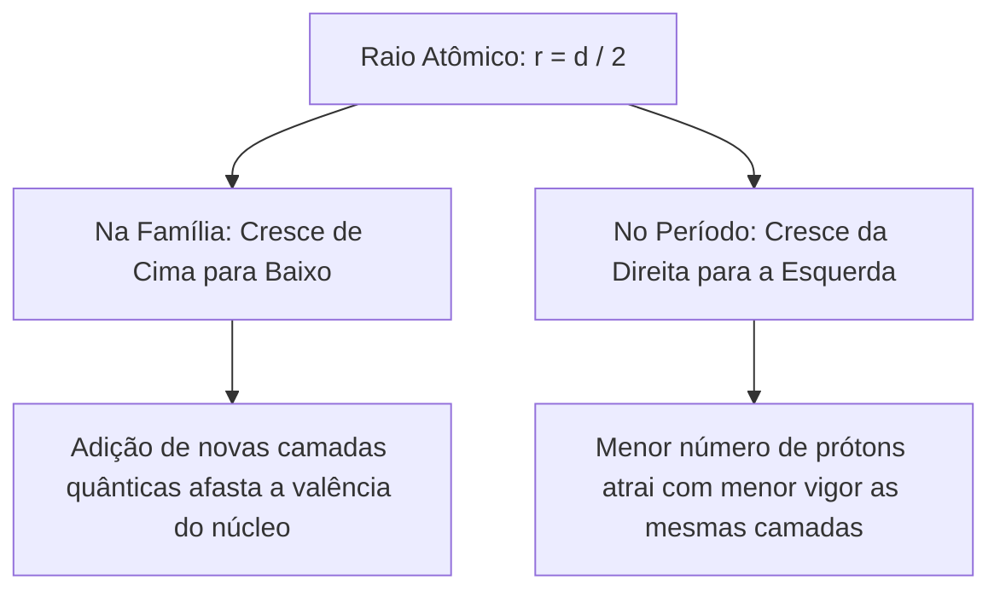
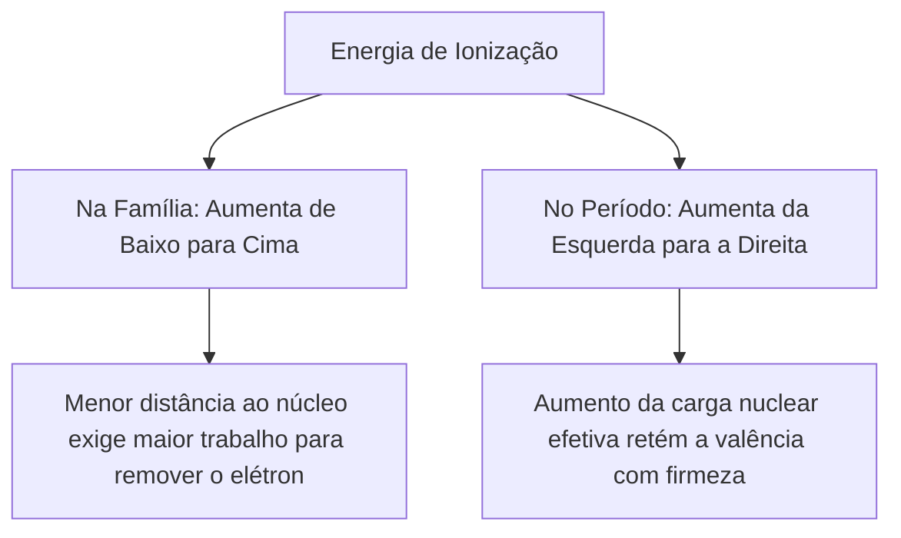
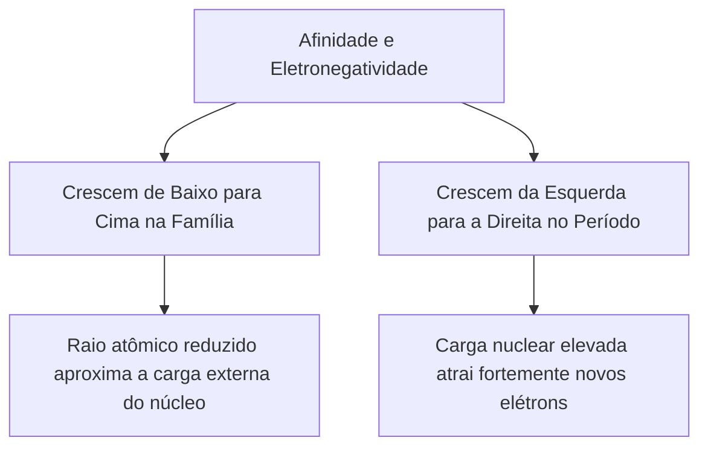
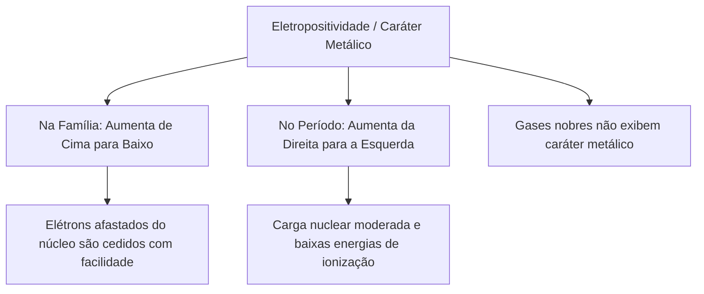
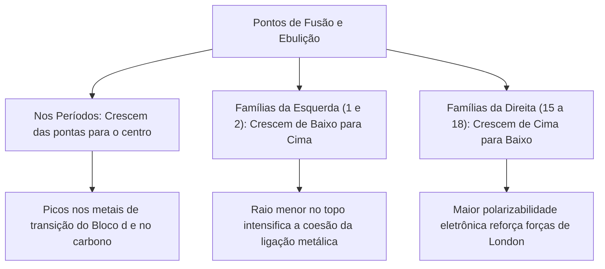
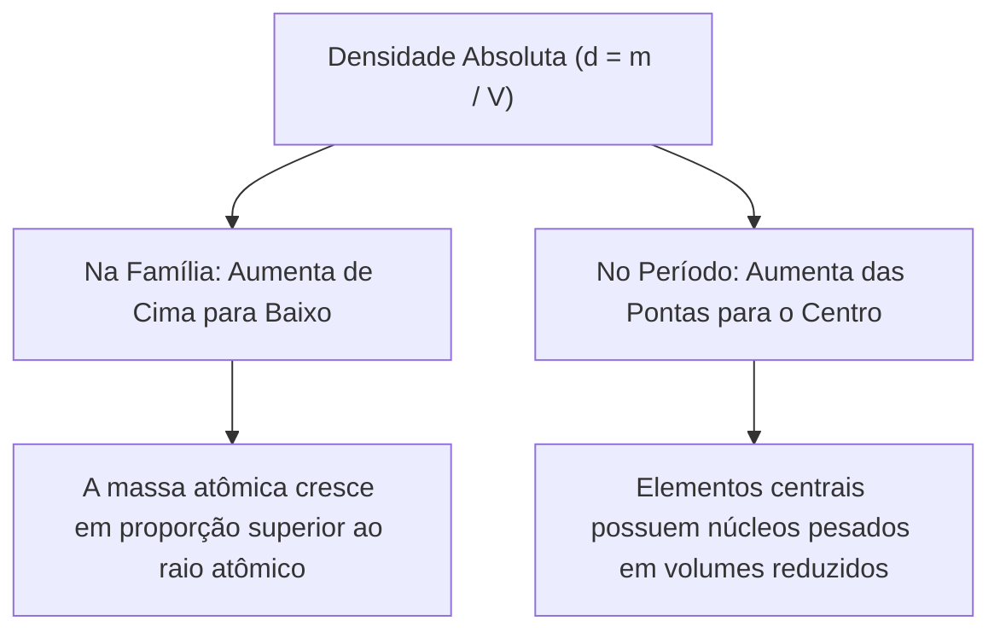
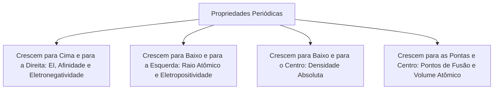

O conhecimento detalhado da periodicidade química é um dos pilares mais decisivos da Química, nas provas e na prática. Em ocorrências com produtos químicos perigosos, prever o comportamento da matéria depende de propriedades periódicas fundamentais. O potencial de ionização, a eletronegatividade, a densidade e os pontos de fusão determinam a reatividade, a corrosividade e os riscos operacionais no combate a sinistros industriais.

As propriedades periódicas são grandezas físicas e químicas cujos valores crescem e decrescem em intervalos regulares à medida que o número atômico aumenta. Elas distinguem-se das propriedades aperiódicas, como a massa atômica, que variam de forma contínua. Neste capítulo, estudaremos a variação periódica do raio atômico e iônico, o potencial de ionização, a afinidade eletrônica, a eletronegatividade, o caráter metálico, os pontos de fusão e ebulição, a densidade absoluta e o volume atômico molar.

> [!objetivos]
> - Compreender a variação periódica do raio atômico e comparar o tamanho relativo de cátions, ânions e espécies isoeletrônicas.
> - Explicar a energia de ionização, as sucessivas perdas de elétrons e as anomalias quânticas entre famílias vizinhas.
> - Caracterizar a afinidade eletrônica, a eletronegatividade de Pauling e o caráter metálico dos elementos.
> - Analisar o comportamento da densidade absoluta, do volume atômico e dos pontos de fusão e ebulição na tabela.

## O raio atômico e sua variação periódica

A eletrosfera atômica não possui um limite geométrico rígido. Por essa razão, é inviável medir o raio de um átomo isolado de modo direto. O raio atômico é mensurado experimentalmente por difração de raios X em cristais. Determina-se a metade da distância internuclear entre dois núcleos idênticos ligados: r = d / 2.

A variação do raio atômico na tabela periódica resulta da interação entre dois fatores estruturais:
1. *Nas famílias (colunas verticais):* Ao descer no grupo, o número quântico principal cresce. Novas camadas de elétrons são acrescentadas ao redor do núcleo. Essa expansão de camadas afasta a periferia do centro atômico. Portanto, na família, o raio atômico cresce continuamente de cima para baixo.
2. *Nos períodos (linhas horizontais):* Todos os elementos de uma mesma linha possuem o mesmo número de camadas eletrônicas. No entanto, o número atômico cresce progressivamente para a direita. Mais prótons no núcleo produzem maior atração eletrostática sobre os mesmos níveis de energia. Isso contrai a eletrosfera. Desse modo, no período, o raio atômico cresce da direita para a esquerda.

Os maiores átomos da tabela concentram-se no canto inferior esquerdo, destacando-se o frâncio e o césio. Já os menores átomos situam-se no canto superior direito, onde se encontram o hélio e o flúor.

| Elemento e símbolo | Posição na tabela | Número atômico (Z) | Camadas (n) | Raio aproximado (pm) | Mecanismo determinante |
| :--- | :--- | :--- | :--- | :--- | :--- |
| Lítio (Li) | Período 2 / Grupo 1 | Z = 3 | 2 camadas | 152 pm | Apenas 3 prótons na mesma camada |
| Berílio (Be) | Período 2 / Grupo 2 | Z = 4 | 2 camadas | 112 pm | Mais prótons atraem o mesmo nível |
| Flúor (F) | Período 2 / Grupo 17 | Z = 9 | 2 camadas | 72 pm | Forte contração nuclear no período 2 |
| Sódio (Na) | Período 3 / Grupo 1 | Z = 11 | 3 camadas | 186 pm | Adição da terceira camada quântica |
| Manganês (Mn) | Período 4 / Grupo 7 | Z = 25 | 4 camadas | 127 pm | 25 prótons atuando na camada 4 |
| Ferro (Fe) | Período 4 / Grupo 8 | Z = 26 | 4 camadas | 126 pm | Z maior contrai a nuvem (Fe < Mn) |
| Césio (Cs) | Período 6 / Grupo 1 | Z = 55 | 6 camadas | 265 pm | Seis níveis quânticos ocupados |

> [!bizu]
> Comparação entre elementos vizinhos no mesmo período: O ferro (₂₆Fe) tem raio menor que o manganês (₂₅Mn). Ambos possuem 4 camadas. Porém, o ferro tem 26 prótons e o manganês tem 25. O núcleo do ferro atrai os elétrons com maior intensidade e encolhe o volume atômico. Em provas, nunca afirme que maior massa implica maior tamanho atômico.

## Raio dos íons e comparação de espécies isoeletrônicas

A perda ou o ganho de elétrons modifica profundamente o volume da eletrosfera. Essa alteração é descrita pela carga nuclear efetiva (Zef). Ela quantifica a força líquida que o núcleo positivo aplica sobre os elétrons periféricos:

Zef = Z - S

Nessa expressão, Z é o número atômico e S representa a constante de blindagem proporcionada pelos elétrons das camadas internas.

Regras para determinar o tamanho dos íons:
1. *Dimensão do cátion:* O raio de qualquer cátion é sempre menor que o raio de seu átomo neutro original. Ao ceder elétrons, a espécie costuma perder a camada mais externa. Além disso, a repulsão entre os elétrons remanescentes diminui de modo acentuado. Como a carga positiva nuclear continua idêntica, a carga nuclear efetiva cresce. O núcleo atrai os elétrons restantes com maior proximidade.
   - Caso do alumínio: O átomo neutro (₁₃Al: 1s² 2s² 2p⁶ 3s² 3p¹) tem 10 elétrons internos. Sua carga efetiva vale Zef = 13 - 10 = +3. No cátion Al³⁺ (1s² 2s² 2p⁶), a terceira camada desaparece. Restam somente 2 elétrons internos no subnível 1s². A carga nuclear efetiva atinge Zef = 13 - 2 = +11. O raio reduz de 143 pm para 53 pm.
2. *Dimensão do ânion:* O raio de qualquer ânion é sempre maior que o raio de seu átomo neutro de origem. Quando o átomo recebe elétrons, a carga nuclear Z não se altera. O número de elétrons internos também segue igual. Todavia, a entrada de novas cargas negativas intensifica a repulsão mútua na camada de valência. Essa repulsão espacial força a nuvem eletrônica a expandir-se.
   - Caso do cloro: O átomo neutro de cloro (₁₇Cl) possui raio covalente de 99 pm. Ao capturar um elétron e transformar-se no ânion cloreto (Cl⁻), seu raio iônico salta para 181 pm.

Espécies isoeletrônicas compartilham o mesmo número total de elétrons e a mesma configuração fundamental.

| Espécie química | Carga nuclear (Z) | Total de elétrons | Configuração eletrônica | Carga líquida | Raio iônico experimental |
| :--- | :--- | :--- | :--- | :--- | :--- |
| Ânion óxido (O²⁻) | Z = 8 | 10 elétrons | 1s² 2s² 2p⁶ | Carga -2 | 140 pm (Maior raio) |
| Ânion fluoreto (F⁻) | Z = 9 | 10 elétrons | 1s² 2s² 2p⁶ | Carga -1 | 133 pm |
| Cátion sódio (Na⁺) | Z = 11 | 10 elétrons | 1s² 2s² 2p⁶ | Carga +1 | 102 pm |
| Cátion magnésio (Mg²⁺) | Z = 12 | 10 elétrons | 1s² 2s² 2p⁶ | Carga +2 | 72 pm |
| Cátion alumínio (Al³⁺) | Z = 13 | 10 elétrons | 1s² 2s² 2p⁶ | Carga +3 | 53 pm (Menor raio) |

Para classificar espécies isoeletrônicas, basta analisar o número de prótons. Quanto maior a carga nuclear Z, mais forte é a atração exercida sobre os mesmos 10 elétrons. Consequentemente, menor será o raio da espécie. A sequência crescente de tamanho é:
Al³⁺ < Mg²⁺ < Na⁺ < F⁻ < O²⁻

> [!atencao]
> Espécies isoeletrônicas não possuem o mesmo tamanho: Embora Mg²⁺, Na⁺, F⁻ e O²⁻ apresentem a mesma configuração eletrônica do neônio, o número de prótons nucleares é diferente em cada uma. Além disso, cada íon possui dimensões distintas de seu respectivo átomo neutro (Na⁺ < Na⁰ e F⁻ > F⁰).

## Energia de ionização e variações sucessivas

A energia de ionização (EI) é a quantidade mínima de energia necessária para retirar um elétron de um átomo neutro e isolado, em fase gasosa e no estado fundamental:

X(g) + EI1 -> X⁺(g) + e⁻

Arrancar um elétron exige superar a atração eletrostática nuclear. Esse processo é sempre endotérmico. Ele absorve calor e apresenta variação de entalpia positiva.

A energia de ionização segue tendência oposta à do raio atômico:
- Na família, a energia cresce de baixo para cima. Nos átomos menores do alto da coluna, os elétrons estão mais perto do núcleo e sob atração mais intensa.
- No período, o potencial ionizante eleva-se progressivamente em direção à direita do período. O raio contrai e a carga efetiva puxa os elétrons com maior firmeza.

Os gases nobres detêm as maiores energias de ionização em cada linha. Sua camada de valência preenchida confere excepcional estabilidade. O hélio é o elemento com maior primeira energia de ionização do universo (2.372 kJ/mol).

| Elemento e grupo | 1ª Ionização (EI1) | 2ª Ionização (EI2) | 3ª Ionização (EI3) | 4ª Ionização (EI4) | Quebra de nível |
| :--- | :--- | :--- | :--- | :--- | :--- |
| Sódio (₁₁Na - Grupo 1) | 496 kJ/mol | 4.562 kJ/mol | 6.910 kJ/mol | 9.543 kJ/mol | Salto brusco de EI1 para EI2 |
| Magnésio (₁₂Mg - Grupo 2) | 738 kJ/mol | 1.451 kJ/mol | 7.733 kJ/mol | 10.542 kJ/mol | Salto brusco de EI2 para EI3 |
| Alumínio (₁₃Al - Grupo 13) | 578 kJ/mol | 1.817 kJ/mol | 2.745 kJ/mol | 11.577 kJ/mol | Salto brusco de EI3 para EI4 |

Para qualquer átomo, as energias de ionização sucessivas são sempre crescentes:
EI1 < EI2 < EI3 < EI4

Após a remoção do primeiro elétron, a carga nuclear passa a atrair menos elétrons. O raio diminui e o elétron seguinte fica mais retido. Quando se atinge uma camada quântica interna completa, ocorre um salto astronômico de energia. No sódio, a segunda ionização consome quase dez vezes mais energia. Isso comprova que ele possui apenas um elétron na camada de valência.

> [!pegadinha]
> Anomalia de ionização entre nitrogênio e oxigênio: Pelo sentido geral do período, o oxigênio deveria exigir mais energia que o nitrogênio. No entanto, o potencial ionizante do nitrogênio supera o do oxigênio (1.402 kJ/mol contra 1.314 kJ/mol).
> A causa reside na configuração 2p. O nitrogênio possui subnível semiocupado com três elétrons desemparelhados (2p¹x 2p¹y 2p¹z), arranjo de máxima estabilidade de acordo com a Regra de Hund. O oxigênio apresenta quatro elétrons em 2p, abrigando um orbital duplamente ocupado. A repulsão eletrostática entre dois elétrons no mesmo orbital desestabiliza a nuvem e facilita a saída do elétron.

## Afinidade eletrônica e eletronegatividade

A afinidade eletrônica expressa a energia envolvida quando um átomo neutro, gasoso e isolado captura um elétron e forma um ânion:

X(g) + e⁻ -> X⁻(g) + energia

Na maioria dos elementos representativos, esse processo é exotérmico e libera energia. O elétron capturado é estabilizado pelo campo atrativo do núcleo. Quanto maior for o calor liberado, maior é a afinidade eletrônica do elemento químico.

Tendência geral na tabela: A afinidade eletrônica cresce de baixo para cima nas famílias e da esquerda para a direita nos períodos. Quanto menor for o volume atômico, mais próximo do núcleo ficará o elétron recebido.

Exceções fundamentais para exames:
1. *Flúor e Cloro:* O cloro possui afinidade eletrônica ligeiramente maior (-349 kJ/mol) que o flúor (-328 kJ/mol). O átomo de flúor é tão diminuto que a densidade de carga em seu subnível 2p é extrema. Essa concentração causa repulsão sobre o elétron entrante. O cloro tem orbitais 3p mais amplos e acomoda a carga adicional com menor repulsão.
2. *Nitrogênio:* Possui afinidade praticamente nula ou endotérmica em razão do subnível 2p³ semiocupado simétrico.
3. *Gases Nobres:* Apresentam afinidade negativa. O elétron suplementar precisaria iniciar uma camada quântica de maior energia.

A eletronegatividade mede a capacidade de um átomo de atrair pares de elétrons em uma ligação covalente. Trata-se de uma escala relativa adimensional formulada por Linus Pauling.

| Elemento e símbolo | Família periódica | Eletronegatividade de Pauling | Afinidade eletrônica | Função química característica |
| :--- | :--- | :--- | :--- | :--- |
| Flúor (F) | Halogênio (Grupo 17) | 4,0 (Máximo da tabela) | -328 kJ/mol | Elemento mais ávido por elétrons |
| Oxigênio (O) | Calcogênio (Grupo 16) | 3,5 | -141 kJ/mol | Forte agente oxidante e comburente |
| Cloro (Cl) | Halogênio (Grupo 17) | 3,0 | -349 kJ/mol | Maior liberação energética da tabela |
| Nitrogênio (N) | Família do N (Grupo 15) | 3,0 | ~0 kJ/mol | Subnível 2p³ estável |
| Bromo (Br) | Halogênio (Grupo 17) | 2,8 | -325 kJ/mol | Líquido oxidante denso |
| Iodo (I) | Halogênio (Grupo 17) | 2,5 | -295 kJ/mol | Sólido volátil sublimável |
| Carbono (C) | Família do C (Grupo 14) | 2,5 | -122 kJ/mol | Estrutura central da química orgânica |
| Hidrogênio (H) | Grupo 1 isolado | 2,1 | -73 kJ/mol | Gás combustível altamente inflamável |
| Sódio (Na) | Metal Alcalino (Grupo 1) | 0,9 | -53 kJ/mol | Metal redutor reativo |
| Césio (Cs) / Frâncio (Fr) | Metal Alcalino (Grupo 1) | 0,7 (Mínimo da tabela) | ~-45 kJ/mol | Metais de menor eletronegatividade |

> [!bizu]
> Ordem decrescente de eletronegatividade entre ametais para memorização:
> F > O > N = Cl > Br > I = S = C > P = H > metais.
> Essa sequência é ferramenta indispensável para definir a polaridade de ligações químicas e a ocorrência de pontes de hidrogênio.

## Eletropositividade e caráter metálico

A eletropositividade, chamada também de caráter metálico, indica a facilidade de um elemento para doar elétrons em reações químicas e formar cátions.

Essa propriedade é exatamente o inverso da eletronegatividade:
- Os elementos com maior caráter metálico situam-se no canto inferior esquerdo da tabela periódica.
- Nas famílias, a eletropositividade cresce de cima para baixo. Camadas adicionais distanciam a valência do núcleo e enfraquecem a retenção dos elétrons.
- Nos períodos, cresce da direita para a esquerda. A menor carga nuclear facilita a perda de elétrons com gasto modesto de energia.

Os metais alcalinos césio e frâncio apresentam a maior eletropositividade conhecida. No contexto dos bombeiros militares, metais com grande caráter metálico, como sódio e magnésio, exigem cautela operacional máxima. Ao entrarem em contato com água, eles reduzem a molécula d'água violentamente, gerando gás hidrogênio que entra em ignição instantânea.

| Propriedade química | Sentido na tabela | Relação com o raio | Destaque máximo |
| :--- | :--- | :--- | :--- |
| Raio Atômico | Baixo e esquerda | Parâmetro referencial | Metais Alcalinos (Cs, Fr) |
| Energia de Ionização | Cima e direita | Oposto ao raio | Gases Nobres (He) e Halogênios |
| Afinidade Eletrônica | Cima e direita | Oposto ao raio | Halogênios (Cl, F) |
| Eletronegatividade | Cima e direita | Oposto ao raio | Halogênios (F) e Oxigênio |
| Eletropositividade | Baixo e esquerda | Mesmo sentido do raio | Metais Alcalinos (Cs, Fr) |

## Pontos de fusão e de ebulição

O ponto de fusão (PF) marca a transição da fase sólida para a líquida. O ponto de ebulição (PE) indica a passagem da fase líquida para o vapor sob pressão definida. Essas variáveis periódicas refletem a intensidade das forças de coesão atômica e molecular presentes em cada substância pura.

Comportamento nas famílias e nos períodos:
1. *Nos Períodos:* As temperaturas de fusão e ebulição aumentam das extremidades em direção ao centro da tabela periódica. Os maiores valores pertencem aos elementos da região central do bloco d e ao carbono (PF > 3.550 °C). O tungstênio (₇₄W) apresenta a maior temperatura de fusão entre todos os metais (3.422 °C), sendo insubstituível em lâmpadas incandescentes e blindagens térmicas industriais.
2. *Nas Famílias:*
   - *Famílias da esquerda (Grupos 1 e 2):* Os valores crescem de baixo para cima. O lítio funde a 180,5 °C, enquanto o césio funde a 28,4 °C. Nos átomos menores do topo da coluna, os núcleos positivos estão mais próximos dos elétrons livres da rede, tornando a ligação metálica mais resistente.
   - *Famílias da direita (Halogênios e Gases Nobres):* Os valores crescem de cima para baixo. Essas substâncias são moleculares apolares e interagem por forças de London. Átomos mais pesados na base da coluna possuem mais elétrons e nuvens facilmente polarizáveis. Isso intensifica as atrações intermoleculares e eleva o ponto de ebulição.

| Família ou região | Sentido de crescimento | Elemento no topo | Ponto de fusão / ebulição | Elemento na base | Ponto de fusão / ebulição |
| :--- | :--- | :--- | :--- | :--- | :--- |
| Grupo 1 (Alcalinos) | De baixo para cima | Lítio (Li) | PF = 180,5 °C | Césio (Cs) | PF = 28,4 °C (funde ao calor corporal) |
| Grupo 2 (Alcalinoterrosos) | De baixo para cima | Berílio (Be) | PF = 1.287 °C | Bário (Ba) | PF = 727 °C |
| Grupo 17 (Halogênios) | De cima para baixo | Flúor (F₂) | PE = -188 °C (Gás) | Iodo (I₂) | PE = 184 °C (Sólido cristalino) |
| Grupo 18 (Gases Nobres) | De cima para baixo | Hélio (He) | PE = -269 °C | Radônio (Rn) | PE = -62 °C |
| Centro da tabela | Máximos absolutos | Cromo (Cr) | PF = 1.907 °C | Tungstênio (W) | PF = 3.422 °C |

Distribuição dos estados físicos a 25 °C e 1 atm:
- *Líquidos:* Mercúrio (Hg, metal) e bromo (Br₂, ametal).
- *Gases:* Hidrogênio (H₂), nitrogênio (N₂), oxigênio (O₂), flúor (F₂), cloro (Cl₂) e os seis gases nobres (He, Ne, Ar, Kr, Xe, Rn).
- *Sólidos:* Todos os demais elementos da tabela periódica.

## Densidade absoluta e volume atômico

A densidade absoluta mede a razão entre a massa de uma substância e o volume geométrico que ela ocupa no estado sólido:

d = m / V

A densidade é determinada pela massa atômica de cada elemento e pela eficiência de empacotamento dos átomos no retículo cristalino.

Regras periódicas para a densidade:
- *Nas famílias:* Aumenta de cima para baixo. Ao descer na coluna, o volume atômico aumenta, mas a massa nuclear cresce muito mais rápido. O resultado líquido é uma substância significativamente mais densa.
- *Nos períodos:* Aumenta das margens em direção ao centro da tabela. Os elementos centrais do 6º período concentram massas elevadas em volumes contraídos.

Os elementos mais densos da natureza estão localizados na base central do bloco d: o ósmio (₇₆Os, d = 22,59 g/cm³) e o irídio (₇₇Ir, d = 22,56 g/cm³). Um decímetro cúbico de ósmio metálico tem massa aproximada de 22,6 quilogramas.

| Elemento e símbolo | Posição periódica | Massa molar | Densidade absoluta a 25 °C | Aplicação operacional prática |
| :--- | :--- | :--- | :--- | :--- |
| Lítio (Li) | Topo do Grupo 1 | 6,94 g/mol | 0,53 g/cm³ | Metal mais leve; flutua sobre hidrocarbonetos |
| Alumínio (Al) | Bloco p / Grupo 13 | 26,98 g/mol | 2,70 g/cm³ | Estruturas leves em viaturas e escadas |
| Ferro (Fe) | Centro Bloco d / Grupo 8 | 55,85 g/mol | 7,87 g/cm³ | Perfis estruturais de edifícios industriais |
| Chumbo (Pb) | Bloco p / Grupo 14 | 207,2 g/mol | 11,34 g/cm³ | Atenuador de radiação ionizante penetrante |
| Mercúrio (Hg) | Bloco d / Grupo 12 | 200,6 g/mol | 13,53 g/cm³ | Líquido denso para instrumentação técnica |
| Ouro (Au) | Bloco d / Grupo 11 | 196,97 g/mol | 19,32 g/cm³ | Metal resistente à degradação oxidativa |
| Irídio (Ir) | Base Bloco d / Grupo 9 | 192,22 g/mol | 22,56 g/cm³ | Segundo elemento mais denso da tabela |
| Ósmio (Os) | Base Bloco d / Grupo 8 | 190,23 g/mol | 22,59 g/cm³ | Elemento de maior densidade conhecida |

O volume atômico molar corresponde ao espaço físico ocupado por 1 mol de átomos (6,02 x 10²³ átomos) do elemento no estado sólido:

Vat = M / d

Nessa fórmula, M é a massa molar e d é a densidade absoluta.
- *Nas famílias:* O volume atômico cresce de cima para baixo com a multiplicação de camadas quânticas.
- *Nos períodos:* O volume atômico cresce do centro para as extremidades laterais. Os elementos das bordas exibem os maiores volumes atômicos de cada linha em decorrência da menor carga nuclear efetiva ou da repulsão entre elétrons externos.

> [!bizu]
> Comportamento cruzado entre densidade e volume: A densidade cresce das pontas para o meio da tabela. O volume atômico cresce do meio para as pontas. Nas colunas verticais, ambas as propriedades crescem de cima para baixo.

## Resolução guiada de problemas no padrão das bancas

Vejamos agora uma aplicação prática detalhada dos temas periódicos no perfil de cobrança das bancas.

> [!resolvido]
> **Questão contextualizada:** Durante uma intervenção técnica de prevenção contra incêndios em depósitos de reagentes laboratoriais, os bombeiros militares organizaram o descarte de materiais com base em suas propriedades periódicas. Analise as seguintes proposições:
>
> I. O cloro (₁₇Cl) apresenta afinidade eletrônica mais favorável e exotérmica que o flúor (₉F), pois o reduzido raio atômico do flúor concentra carga negativa e gera intensa repulsão intereletrônica ao acolher um elétron adicional.
> II. Dentre as espécies isoeletrônicas Al³⁺ (Z = 13), Mg²⁺ (Z = 12), Na⁺ (Z = 11), F⁻ (Z = 9) e O²⁻ (Z = 8), o cátion alumínio possui o menor raio e o ânion óxido apresenta o maior raio.
> III. A energia de ionização mede a quantidade de calor liberada quando um átomo neutro sólido incorpora um elétron em condições normais de temperatura e pressão.
> IV. O ósmio (Os) e o irídio (Ir) estão situados no 6º período do bloco d e possuem as maiores densidades absolutas entre todas as substâncias simples catalogadas.
>
> Estão corretas as afirmativas:
> A) I e III, apenas.
> B) II e III, apenas.
> C) I, II e IV, apenas.
> D) I, II, III e IV.
> E) III e IV, apenas.
>
> **Resolução passo a passo:**
> 1. *Análise da proposição I:* Correta. O cloro possui a maior afinidade eletrônica da tabela periódica (-349 kJ/mol). Seus orbitais 3p são mais dispersos espacialmente, amenizando a repulsão eletrônica que afeta os compactos orbitais 2p do flúor (-328 kJ/mol).
> 2. *Análise da proposição II:* Correta. Tratando-se de espécies isoeletrônicas com 10 elétrons, o raio iônico depende unicamente do número de prótons Z. Mais prótons no núcleo produzem maior contração eletrostática. O alumínio (13 prótons) tem o menor raio, enquanto o oxigênio (8 prótons) tem o maior volume.
> 3. *Análise da proposição III:* Incorreta. A energia de ionização não é liberada nem avaliada no estado sólido. Trata-se de energia absorvida para arrancar um elétron de um átomo isolado, em fase gasosa e no estado fundamental. O ganho de elétrons caracteriza a afinidade eletrônica.
> 4. *Análise da proposição IV:* Correta. A densidade cresce para baixo nas famílias e para o centro nos períodos. O ósmio (22,59 g/cm³) e o irídio (22,56 g/cm³) lideram a massa específica de todos os materiais conhecidos.
>
> Conclusão: As proposições I, II e IV são verdadeiras.
> Resposta correta: Alternativa C.

## Mapa do capítulo

Examinamos a fundamentação da periodicidade química, as relações de tamanho atômico e iônico, os custos energéticos de ionização e o perfil macroscópico da matéria sólida.

### Para fixar
- O raio atômico cresce para baixo nas famílias e para a esquerda nos períodos da tabela.
- O raio do cátion é sempre menor que o do átomo neutro, pois a carga efetiva Zef cresce.
- O raio do ânion é sempre maior que o do átomo neutro devido à repulsão entre elétrons.
- Em espécies isoeletrônicas com 10 elétrons: Al³⁺ < Mg²⁺ < Na⁺ < F⁻ < O²⁻.
- A energia de ionização cresce para cima e para a direita; o nitrogênio supera o oxigênio por estabilidade quântica.
- As ionizações sucessivas são sempre crescentes e sofrem saltos ao quebrar camadas internas completas.
- A afinidade eletrônica do cloro é maior que a do flúor em razão da menor densidade de repulsão no nível 3p.
- Escala de eletronegatividade decrescente: F > O > N = Cl > Br > I = S = C > P = H > metais.
- O ponto de fusão atinge picos no centro da tabela periódica (destaque para o tungstênio e o carbono).
- A densidade cresce para baixo e para o centro; ósmio (22,59 g/cm³) e irídio (22,56 g/cm³) são os mais densos.
