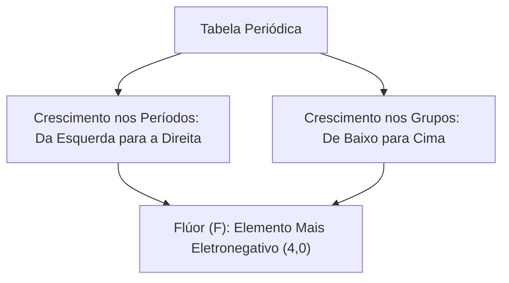
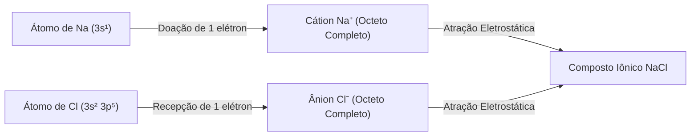
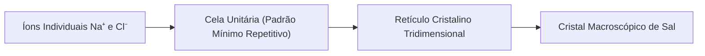
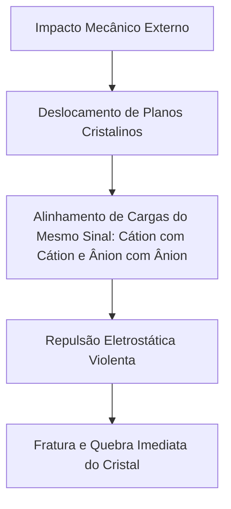
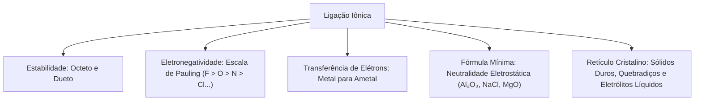

As ligações químicas constituem as forças atrativas que unem átomos e íons na formação de todas as substâncias da natureza. Na atividade profissional de bombeiros, compreender a estrutura dos compostos iônicos é indispensável para avaliar riscos de choque elétrico em combate a incêndios, interpretar a reatividade de produtos químicos perigosos e entender o comportamento de materiais refratários e agentes extintores.

A formação dessas ligações decorre da busca espontânea dos sistemas atômicos por configurações eletrônicas de menor energia e maior estabilidade termodinâmica.

> [!objetivos]
> - Compreender a estabilidade eletrônica fundamentada nas regras do octeto e do dueto.
> - Analisar a variação periódica da eletronegatividade e a escala de Linus Pauling.
> - Identificar o mecanismo de transferência de elétrons na ligação iônica eletrovalente.
> - Formular compostos iônicos binários pelo cruzamento de cargas dos íons constituintes.
> - Descrever a organização do retículo cristalino e correlacionar suas propriedades macroscópicas.

## Por que os átomos se ligam: regras do octeto e do dueto

Na natureza, os átomos raramente são encontrados em estado isolado. A imensa maioria dos elementos químicos combina-se entre si para gerar moléculas discretas ou agregados iônicos e metálicos estendidos. As únicas exceções naturais a essa regra são os gases nobres, pertencentes ao grupo 18 da Tabela Periódica: hélio (He), neônio (Ne), argônio (Ar), criptônio (Kr), xenônio (Xe) e radônio (Rn).

Os gases nobres exibem baixíssima reatividade química sob condições ambientes. A causa dessa inércia reside em sua configuração eletrônica periférica: todos os gases nobres possuem 8 elétrons em sua camada de valência, com exceção do hélio, cuja camada única se completa com exatamente 2 elétrons no orbital 1s.

Para explicar essa tendência natural à estabilidade, Gilbert Lewis e Walter Kossel formularam os modelos fundamentais da estabilidade eletrônica:

1. **Regra do octeto:** os átomos dos elementos representativos tendem a ganhar, perder ou compartilhar elétrons de valência até completarem 8 elétrons na camada externa, adquirindo a configuração eletrônica estável de um gás nobre.
2. **Regra do dueto:** elementos com pequeno número atômico, como hidrogênio e lítio, estabilizam-se com apenas 2 elétrons de valência, reproduzindo a configuração em dueto do gás nobre hélio (1s²).

Embora a regra do octeto ofereça um modelo didático poderoso para a compreensão das ligações químicas, ela não constitui uma lei universal inflexível. Existem diversas moléculas estáveis que apresentam octeto incompleto ou camada de valência expandida.

## Eletronegatividade e tendências periódicas

A eletronegatividade é definida como a capacidade relativa de um átomo atrair para si o par eletrônico de uma ligação química. Linus Pauling desenvolveu uma escala comparativa empírica na qual atribuiu valores adimensionais aos elementos químicos, variando de 0,7 (para metais alcalinos pesados como o césio e o frâncio) até 4,0 (para o flúor).

A eletronegatividade é uma propriedade periódica intimamente correlacionada ao raio atômico e à carga nuclear efetiva. Na Tabela Periódica, a eletronegatividade cresce da esquerda para a direita ao longo dos períodos e de baixo para cima dentro dos grupos.

Esse comportamento decorre de dois fatores atômicos diretos:

- **Efeito do raio atômico:** átomos com menor raio atômico aproximam seus núcleos positivos da camada de valência, exercendo maior atração eletrostática sobre os elétrons periféricos.
- **Blindagem eletrônica:** nos átomos maiores, o elevado número de camadas internas atua como blindagem, enfraquecendo a atração do núcleo sobre elétrons externos.

Os ametais localizados no canto superior direito da tabela exibem as maiores eletronegatividades. Os metais alcalinos e alcalinoterrosos do lado esquerdo apresentam valores reduzidos, sendo denominados eletropositivos. O hidrogênio apresenta eletronegatividade intermediária (2,1).

A ordem decrescente de eletronegatividade dos principais ametais é memorizada pela sequência clássica:

F > O > N > Cl > Br > I > S > C > P > H > Metais

O flúor lidera a escala com 4,0, seguido pelo oxigênio (3,5) e pelo nitrogênio e cloro (3,0). Os metais apresentam valores tipicamente inferiores a 2,0.

| Elemento | Símbolo | Família | Eletronegatividade (Pauling) |
| :--- | :--- | :--- | :--- |
| Flúor | F | 7A (Halogênio) | 4,0 |
| Oxigênio | O | 6A (Calcogênio) | 3,5 |
| Nitrogênio | N | 5A (Pnictogênio) | 3,0 |
| Cloro | Cl | 7A (Halogênio) | 3,0 |
| Bromo | Br | 7A (Halogênio) | 2,8 |
| Iodo | I | 7A (Halogênio) | 2,5 |
| Enxofre | S | 6A (Calcogênio) | 2,5 |
| Carbono | C | 4A | 2,5 |
| Fósforo | P | 5A | 2,1 |
| Hidrogênio | H | Grupo Especial | 2,1 |

> [!bizu]
> **Ordem dos Ametais Mais Eletronegativos**
> A sequência clássica dos principais elementos eletronegativos organiza-se como:
> F > O > N > Cl > Br > I > S > C > P > H.
> Essa ordenação determina a polaridade das ligações químicas e o caráter iônico das substâncias.

## Mecanismo e características da ligação iônica

A ligação iônica, também denominada ligação eletrovalente, resulta da atração eletrostática mútua entre íons de cargas opostas: cátions positivos e ânions negativos. Esse fenômeno ocorre obrigatoriamente quando há transferência definitiva de elétrons de valência de um átomo para outro.

Para que a transferência de elétrons ocorra espontaneamente, é indispensável que os elementos participantes exibam acentuada diferença de eletronegatividade (ΔX geralmente superior a 1,7 na escala de Pauling):

1. **Espécie doadora (Metal):** átomo de baixa energia de ionização e baixa eletronegatividade que perde facilmente seus elétrons de valência, transformando-se em um cátion estável.
2. **Espécie receptora (Ametal):** átomo de alta afinidade eletrônica e elevada eletronegatividade que atrai e incorpora elétrons em sua camada externa, convertendo-se em um ânion estável.

O exemplo clássico é a formação do cloreto de sódio (NaCl). O sódio metálico possui número atômico 11, com distribuição eletrônica 1s² 2s² 2p⁶ 3s¹. Ele apresenta 1 elétron em sua camada de valência. Ao perder esse único elétron, forma o cátion sódio Na⁺ com 8 elétrons na nova camada externa (2s² 2p⁶), assumindo a estrutura do gás nobre neônio.

O átomo de cloro apresenta número atômico 17, com distribuição 1s² 2s² 2p⁶ 3s² 3p⁵, possuindo 7 elétrons de valência. Ao receber o elétron cedido pelo sódio, o cloro atinge a configuração 3s² 3p⁶, formando o ânion cloreto Cl⁻ com a estrutura do gás nobre argônio.

Uma vez formados os íons Na⁺ e Cl⁻, estabelece-se entre eles uma intensa força de atração coulombiana que os une no estado sólido.

> [!atencao]
> **Natureza da Ligação Iônica**
> Não existem moléculas isoladas em um composto iônico verdadeiro.
> A ligação iônica é não direcional e estende-se em três dimensões pelo espaço, formando aglomerados ordenados infinitos de cátions e ânions.

## Fórmula química dos compostos iônicos

A fórmula de uma substância iônica não representa uma molécula independente, mas a fórmula mínima ou proporção estequiométrica mais simples entre os íons necessária para assegurar a neutralidade elétrica do cristal.

Em todo composto iônico estável, a soma total das cargas positivas dos cátions deve igualar rigorosamente a soma total das cargas negativas dos ânions:

Carga positiva total + Carga negativa total = 0

Para deduzir a fórmula mínima de um composto binário formado por um metal M de carga +x e um ametal A de carga -y, empregamos a regra prática do cruzamento de valências:

M^(+x) + A^(-y) -> M_y A_x

Nesse procedimento, o módulo da carga do cátion converte-se no índice do ânion, e o módulo da carga do ânion converte-se no índice do cátion. Caso os índices apresentem um divisor comum diferente de 1, realiza-se a simplificação obrigatória.

Vejamos a determinação das cargas fundamentais dos elementos representativos:

- **Metais alcalinos (Grupo 1):** perdem 1 elétron, gerando cátions monovalentes (Na⁺, K⁺, Li⁺).
- **Metais alcalinoterrosos (Grupo 2):** perdem 2 elétrons, gerando cátions bivalentes (Mg²⁺, Ca²⁺, Ba²⁺).
- **Grupo do boro/alumínio (Grupo 13):** perdem 3 elétrons, gerando cátions trivalentes (Al³⁺).
- **Halogênios (Grupo 17):** ganham 1 elétron para fechar o octeto com oito elétrons, formando ânions monovalentes (F⁻, Cl⁻, Br⁻, I⁻).
- **Calcogênios (Grupo 16):** ganham 2 elétrons para atingir oito elétrons na última camada, formando ânions bivalentes (O²⁻, S²⁻).
- **Pnictogênios (Grupo 15):** ganham 3 elétrons na última camada de valência, formando ânions trivalentes (N³⁻, P³⁻).

| Cátion | Ânion | Cruzamento de Cargas | Fórmula Bruta | Fórmula Mínima Final | Nome do Composto |
| :--- | :--- | :--- | :--- | :--- | :--- |
| Ca²⁺ | Cl⁻ | Ca₁Cl₂ | CaCl₂ | CaCl₂ | Cloreto de cálcio |
| Fe³⁺ | Cl⁻ | Fe₁Cl₃ | FeCl₃ | FeCl₃ | Cloreto de ferro(III) |
| Al³⁺ | O²⁻ | Al₂O₃ | Al₂O₃ | Al₂O₃ | Óxido de alumínio |
| Al³⁺ | Br⁻ | Al₁Br₃ | AlBr₃ | AlBr₃ | Brometo de alumínio |
| Mg²⁺ | O²⁻ | Mg₂O₂ | Mg₂O₂ | MgO (simplificado) | Óxido de magnésio |
| Na⁺ | S²⁻ | Na₂S₁ | Na₂S | Na₂S | Sulfeto de sódio |

> [!pegadinha]
> **Simplificação de Índices e Cargas de Transição**
> Nunca mantenha fórmulas iônicas com fatores multiplicativos redutíveis.
> O óxido formado por Mg²⁺ e O²⁻ resulta na fórmula MgO, e não Mg₂O₂.
> Nos metais de transição com multiplicidade de estados de oxidação, como ferro (Fe²⁺ ou Fe³⁺), o enunciado deve indicar o estado de oxidação por algarismo romano ou nome específico.

> [!resolvido]
> **Exercício Resolvido: Dedução de Fórmulas Iônicas**
> Determine a fórmula mínima e o nome do composto iônico formado pela combinação entre o elemento alumínio (Z = 13) e o elemento oxigênio (Z = 8).
>
> **Resolução passo a passo:**
> 1. *Distribuição eletrônica do alumínio (Z = 13):*
>    1s² 2s² 2p⁶ 3s² 3p¹ -> 3 elétrons na camada de valência.
>    O alumínio tende a perder 3 elétrons, formando o cátion Al³⁺.
>
> 2. *Distribuição eletrônica do oxigênio (Z = 8):*
>    1s² 2s² 2p⁴ -> 6 elétrons na camada de valência.
>    O oxigênio necessita de 2 elétrons para atingir o octeto, formando o ânion óxido O²⁻.
>
> 3. *Cruzamento de cargas para neutralidade eletrostática:*
>    2 cátions Al³⁺ fornecem 2 · (+3) = +6 de carga positiva.
>    3 ânions O²⁻ fornecem 3 · (-2) = -6 de carga negativa.
>    Carga total = (+6) + (-6) = 0.
>
> **Conclusão:** A fórmula estequiométrica mínima é Al₂O₃, denominada óxido de alumínio (constituinte principal do mineral bauxita).

## Arranjo estrutural e retículo cristalino

No estado sólido, os compostos iônicos não formam pares isolados. Os cátions e ânions organizam-se espontaneamente em uma rede geométrica tridimensional altamente ordenada denominada retículo cristalino iônico.

Essa estrutura tridimensional é mantida pela maximização das forças atrativas entre íons de sinais contrários e pela minimização das forças repulsivas entre íons de mesma carga.

A menor unidade geométrica repetitiva que descreve a simetria completa e a composição estequiométrica do cristal é denominada cela unitária (ou célula unitária). O empilhamento sistemático e contínuo de milhares de celas unitárias no espaço gera o macrocristal visível.

No cloreto de sódio (NaCl), a rede adota o sistema cúbico de faces centradas:

- Cada cátion Na⁺ encontra-se rodeado por 6 ânions Cl⁻ equidistantes dispostos nos vértices de um octaedro regular.
- Cada ânion Cl⁻ encontra-se igualmente envolvido por 6 cátions Na⁺ imediatos.

O número de íons vizinhos de carga contrária que cercam diretamente um determinado íon no cristal recebe o nome de número de coordenação. No cristal de NaCl, o número de coordenação para ambos os íons é igual a 6.

A geometria exata da cela unitária e o número de coordenação dependem fundamentalmente de dois fatores:

1. A estequiometria do composto (razão entre cátions e ânions na fórmula).
2. A razão entre os raios iônicos (raio do cátion / raio do ânion).

A cristalografia classifica os retículos em 7 sistemas cristalinos fundamentais: cúbico, tetragonal, ortorrômbico, monoclínico, triclínico, hexagonal e romboédrico.

## Propriedades físicas e químicas dos compostos iônicos

A rigidez e a intensidade das atrações eletrostáticas omnidirecionais que estruturam o retículo cristalino conferem aos compostos iônicos um conjunto marcante de propriedades físicas e químicas.

Entre os compostos iônicos de relevância prática e operacional, destacam-se:

- Cloreto de sódio (NaCl): conhecido como sal de cozinha e precursor de eletrólitos. A energia necessária para liquefazer o sal exige mais de 800 °C, tornando o composto líquido um ótimo condutor de eletricidade.
- Hidróxido de sódio (NaOH): soda cáustica, base forte de alta corrosividade utilizada em desincrustações industriais.
- Óxido de cálcio (CaO): cal virgem, empregada na fabricação de argamassa e no tratamento alcalino de águas.
- Bauxita: minério que contém óxidos e hidróxidos de alumínio e ferro (Al(OH)₃ e Fe₂O₃), submetido a eletrólise ígnea industrial para produção de alumínio metálico.

| Propriedade Física | Comportamento Observado | Explicação Microscópica |
| :--- | :--- | :--- |
| Estado físico a 25 °C e 1 atm | Sólidos rígidos | As forças de atração eletrostática entre íons de sinais opostos mantêm a estrutura fixa. |
| Pontos de fusão e ebulição | Extremamente elevados (NaCl funde a 801 °C) | Romper o retículo cristalino exige fornecer imensa energia térmica aos íons. |
| Dureza superficial | Elevada resistência a riscos | Íons fortemente ancorados no retículo dificultam o desgaste superficial. |
| Tenacidade mecânica | Muito baixa (quebradiços sob impacto) | Um choque mecânico provoca o cisalhamento de planos cristalinos, aproximando íons de mesma carga. |
| Solubilidade | Em geral alta em solventes polares (água) | A água hidrata os íons, superando a energia reticular por atração íon-dipolo. |
| Condutividade elétrica no sólido | Nula (isolantes elétricos) | Os íons estão rigidamente presos nos vértices do retículo, sem mobilidade de carga. |
| Condutividade elétrica fundido | Elevada (condutores iônicos) | Com a fusão térmica, o retículo rompe-se e os íons adquirem ampla mobilidade de translação. |
| Condutividade em solução aquosa | Elevada (eletrólitos) | Na água ocorre dissociação iônica, liberando cátions e ânions hidratados móveis. |

A fragilidade mecânica dos sólidos iônicos é uma das questões conceituais prediletas das bancas de concurso. Embora o cristal iônico seja duro (difícil de ser riscado por outros materiais), ele não suporta deformações plásticas sob tensão de cisalhamento.

Quando o cristal recebe uma pancada mecânica, uma camada de íons desliza sobre a camada adjacente. Esse deslocamento faz com que cátions fiquem posicionados diretamente ao lado de outros cátions, e ânions ao lado de outros ânions. A súbita repulsão eletrostática entre cargas homônimas provoca a fratura imediata do cristal ao longo do plano de deslizamento.

> [!atencao]
> **Condutividade Elétrica: Sólido versus Líquido e Solução**
> O cloreto de sódio sólido nunca conduz corrente elétrica, pois seus íons encontram-se imobilizados no retículo.
> A passagem de eletricidade em compostos iônicos ocorre exclusivamente em dois estados:
> 1. No estado líquido (fundido), mediante rompimento térmico do retículo.
> 2. Em solução aquosa, por meio do processo de dissociação iônica que libera íons hidratados móveis.

No contexto operacional dos bombeiros militares, esse conhecimento é crítico: o lançamento de água sobre equipamentos elétricos energizados acarreta risco severo de eletrocussão devido à presença de sais dissolvidos que transformam a água comum em condutora eletrolítica.

## Mapa do capítulo

Examinamos a fundamentação teórica das ligações químicas, a escala periódica de eletronegatividade, a mecânica da ligação iônica, as fórmulas mínimas e o retículo cristalino com suas propriedades macroscópicas.

### Para fixar
- Os gases nobres possuem 8 elétrons de valência (hélio possui 2) e constituem o referencial de estabilidade química.
- A eletronegatividade mede a capacidade de atrair pares eletrônicos em uma ligação e cresce para a direita e para cima.
- A ordem decrescente de eletronegatividade dos ametais é F > O > N > Cl > Br > I > S > C > P > H.
- A ligação iônica é formada pela transferência definitiva de elétrons de um metal para um ametal.
- A fórmula de um composto iônico é deduzida pelo cruzamento das cargas dos íons constituintes, simplificando os índices quando couber.
- No óxido de magnésio, a fórmula mínima é MgO e não Mg₂O₂, mantendo a menor razão inteira de neutralidade.
- O retículo cristalino do NaCl adota simetria cúbica, com número de coordenação 6 para ambos os íons.
- Os sólidos iônicos são duros, porém quebradiços, porque o impacto mecânico alinha cargas homônimas que se repelem.
- Compostos iônicos não conduzem eletricidade no estado sólido, conduzindo apenas no estado fundido ou em solução aquosa.
- A dissociação iônica na água libera cátions e ânions hidratados, transformando o meio líquido em condutor eletrolítico.
