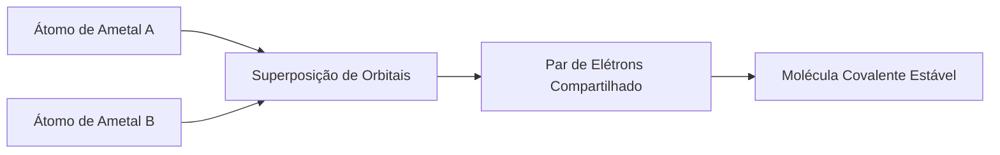
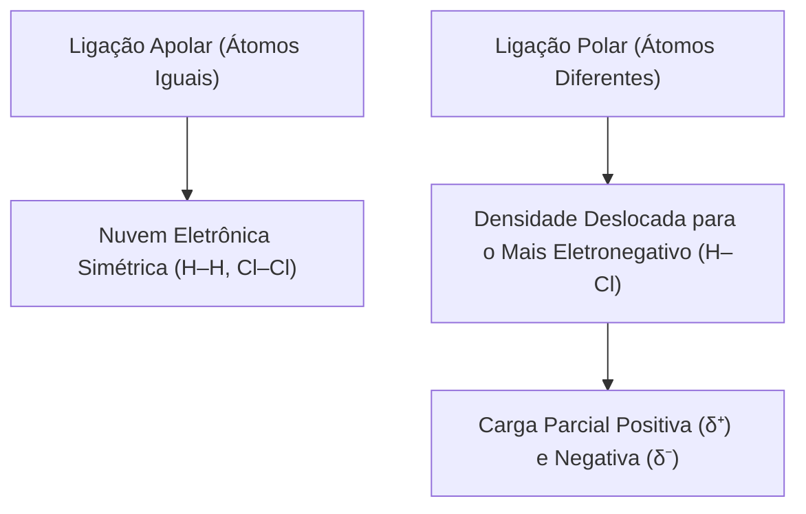
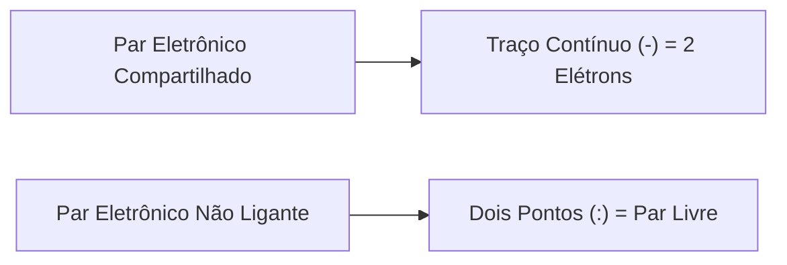
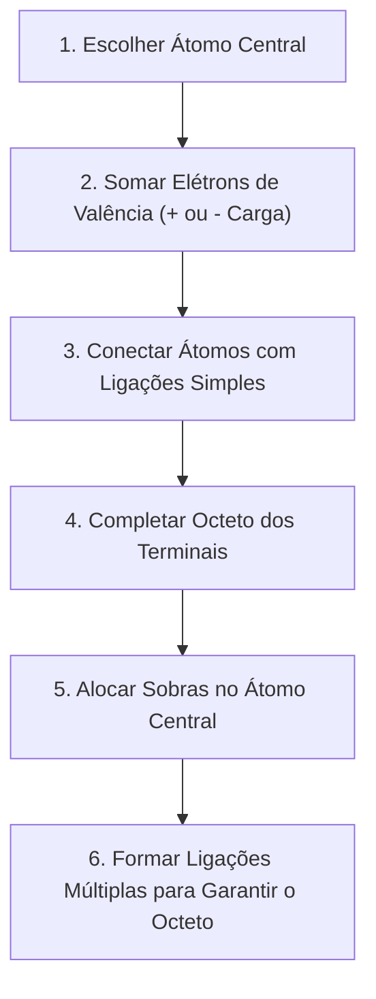
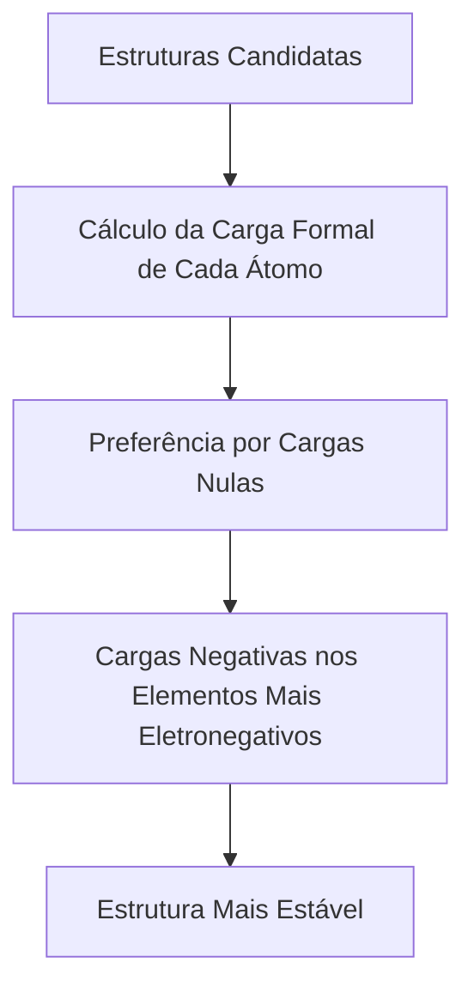
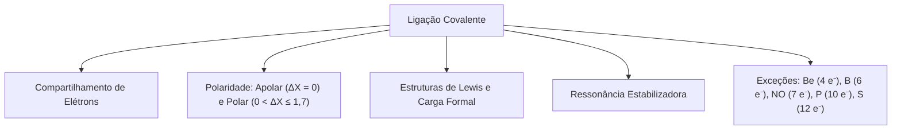

A ligação covalente rege a química dos gases atmosféricos, combustíveis e materiais poliméricos enfrentados pelo Corpo de Bombeiros. Desde a combustão do metano e do propano (CH₃CH₂CH₃) até a emissão de gases tóxicos e asfixiantes como monóxido de carbono e cianeto de hidrogênio, as propriedades moleculares decorrem do compartilhamento de elétrons. Nenhum fenômeno de queima ou decomposição de materiais orgânicos pode ser compreendido sem o domínio da estrutura eletrônica.

Diferente dos compostos iônicos, aqui não ocorre transferência definitiva de elétrons nem formação primária de íons isolados. Há o compartilhamento de pares de elétrons de valência entre os núcleos participantes, gerando espécies moleculares neutras e estáveis.

> [!objetivos]
> - Compreender o princípio do compartilhamento de pares eletrônicos entre ametais.
> - Diferenciar ligações simples, duplas e triplas quanto à ordem e rigidez.
> - Classificar ligações covalentes em polares e apolares pela eletronegatividade.
> - Aplicar o método sistemático de construção de estruturas de Lewis.
> - Calcular cargas formais e identificar exceções consolidadas à regra do octeto.

## Natureza da ligação covalente e compartilhamento de elétrons

A ligação covalente ocorre entre átomos com valores próximos e elevados de eletronegatividade. Como ambos exercem forte atração sobre elétrons periféricos, a estabilização energética decorre da atração mútua dos núcleos sobre os pares compartilhados. Podemos visualizar essa interação como um cabo de guerra equilibrado no qual nenhum átomo cede seus elétrons com facilidade.

Essa união ocorre tipicamente nas seguintes combinações:

- Ametal com ametal (como em O₂, N₂, SO₂ e CO₂).
- Ametal com hidrogênio (como em H₂O, CH₄, CH₃CH₂CH₃ e NH₃).
- Hidrogênio com hidrogênio (como na molécula H₂).

Cada elétron do par compartilhado é contado na camada de valência de ambos os átomos. Ao verificarmos dois átomos de cloro, cada qual possui 7 elétrons na família 17. Eles compartilham 1 elétron mútuo:

1. Cada átomo entra com 1 elétron desemparelhado.
2. O par compartilhado pertence simultaneamente a ambos os núcleos.
3. Ambos completam 8 elétrons periféricos, fechando o octeto na última camada de valência.

Conforme o número de pares compartilhados entre dois núcleos, a ligação classifica-se em:

- **Ligação simples (ordem 1):** compartilhamento de 1 par de elétrons (2 elétrons). Apresenta maior comprimento e menor energia de dissociação. Exemplo: H–H, Cl–Cl.
- **Ligação dupla (ordem 2):** compartilhamento de 2 pares de elétrons (4 elétrons). Apresenta comprimento intermediário e maior rigidez mecânica. Exemplo: O=O no gás oxigênio.
- **Ligação tripla (ordem 3):** compartilhamento de 3 pares de elétrons (6 elétrons). É a união mais curta, rígida e estável entre dois átomos. Exemplo: N≡N no gás nitrogênio. A inércia química do N₂ atmosférico decorre diretamente da altíssima energia exigida para romper essa tripla união.

## Polaridade da ligação covalente e a escala de Linus Pauling

A distribuição espacial da nuvem eletrônica depende da diferença de eletronegatividade (ΔX) entre os núcleos ligados.

Quando os átomos ligados possuem eletronegatividades idênticas, a atração sobre o par compartilhado é simétrica. O par permanece equidistante de ambos os núcleos. Não há concentração de cargas parciais em nenhuma extremidade. Essa união é denominada ligação covalente apolar.

São exemplos todas as moléculas diatômicas homonucleares: H₂, N₂, O₂, F₂, Cl₂, Br₂ e I₂.

Quando os átomos ligados apresentam eletronegatividades distintas, o elemento mais eletronegativo atrai a nuvem com maior intensidade. Essa assimetria cria polos parciais permanentes:

- O átomo mais eletronegativo ganha densidade e fica com carga parcial negativa (δ⁻).
- O átomo menos eletronegativo perde densidade e fica com carga parcial positiva (δ⁺).

Essa separação permanente forma um dipolo elétrico de ligação, caracterizando a ligação polar. Quanto maior a diferença de eletronegatividade, maior será a polaridade resultante.

No ensino da química, adota-se uma classificação didática comparativa:

| Diferença de Eletronegatividade (ΔX) | Caráter Predominante da Ligação | Exemplos Típicos |
| :--- | :--- | :--- |
| ΔX = 0 | Covalente apolar pura | H₂ (0,0), O₂ (0,0), Cl₂ (0,0) |
| 0 < ΔX ≤ 1,7 | Covalente polar | C–H (0,4), N–H (0,9), H–Cl (0,9), O–H (1,4) |
| ΔX > 1,7 | Predominantemente iônica | Na–Cl (2,1), K–F (3,2), Ca–O (2,5) |

Essa fronteira de 1,7 é uma convenção aproximada. Certos compostos binários metálicos com haletos de transição (como ferro e prata) exibem nítido caráter covalente mesmo com diferenças consideráveis. O estudante atento não deve tomar essa regra como um limite rígido da natureza.

> [!bizu]
> **Classificação de Compostos em Provas**
> - Substâncias puramente covalentes: moléculas formadas por ametais e hidrogênio, como CH₄, CH₃CH₂CH₃, O₂, CO₂, H₂O e SO₂.
> - Substâncias com ligação iônica: compostos com metal e ametal, ou metal com ânions poliatômicos, como NaCl, KBr, CaO, NaOH e CaCO₃.
> O CaCO₃ possui atração iônica entre Ca²⁺ e CO₃²⁻, mas abriga ligações covalentes polares dentro do ânion carbonato.

## Representação de Lewis para moléculas simples

Gilbert Newton Lewis idealizou uma notação gráfica para descrever a camada de valência e as ligações químicas:

- Elétrons de valência são grafados como pequenos pontos ao redor do símbolo químico do elemento.
- Cada par de elétrons compartilhado é representado por um traço contínuo (vulgo tracinho).
- Pares de elétrons isolados permanecem como pontos livres não ligantes na última camada.

Vejamos as estruturas de Lewis para espécies clássicas da química geral:

1. **Gás hidrogênio (H₂):** cada H possui 1 elétron na camada 1s. Compartilham o par único em ligação simples H–H, estabilizando o dueto eletrônico.
2. **Gás cloro (Cl₂):** cada átomo de cloro possui 7 elétrons. Ao ligarmos os dois cloros, compartilham 1 par mútuo, restando 3 pares livres em cada um dos cloros: :Cl–Cl:.
3. **Água (H₂O):** o oxigênio central possui 6 elétrons na camada externa. Forma duas ligações simples com dois átomos de hidrogênio (H–O–H). Restam 2 pares isolados no oxigênio, totalizando 8 elétrons ao redor do núcleo central.
4. **Amônia (NH₃):** o nitrogênio central possui 5 elétrons. Estabelece três ligações simples com três átomos de hidrogênio. Permanece 1 par livre no nitrogênio, assegurando o octeto estável.
5. **Gás metano (CH₄):** o carbono central possui 4 elétrons de valência. Faz quatro ligações simples com quatro hidrogênios, sem pares livres remanescentes.
6. **Propano (CH₃CH₂CH₃):** cada carbono estabelece 4 ligações covalentes simples, completando o octeto estável de forma encadeada.

| Molécula | Átomo Central | Elétrons de Valência Totais | Ligações Formadas | Pares Livres no Centro | Estrutura de Lewis |
| :--- | :--- | :--- | :--- | :--- | :--- |
| H₂ | Não há | 2 | 1 simples | 0 | H–H |
| Cl₂ | Não há | 14 | 1 simples | 3 em cada Cl | :Cl–Cl: |
| O₂ | Não há | 12 | 1 dupla | 2 em cada O | :O=O: |
| N₂ | Não há | 10 | 1 tripla | 1 em cada N | :N≡N: |
| H₂O | Oxigênio | 8 | 2 simples | 2 pares | H–O–H |
| NH₃ | Nitrogênio | 8 | 3 simples | 1 par | NH₃ com 1 par no N |
| CH₄ | Carbono | 8 | 4 simples | 0 par | CH₄ |
| CO₂ | Carbono | 16 | 2 duplas | 0 par | O=C=O |

## Método sistemático para desenhar estruturas de Lewis em espécies maiores

Para desenhar espécies poliatômicas com exatidão, aplicamos um procedimento sistemático de 6 etapas que permite contar e distribuir cada elétron sem omissões:

### Escolha do átomo central

O átomo central é o elemento de menor eletronegatividade presente na fórmula química, exceto o hidrogênio. O hidrogênio nunca ocupa o centro porque só admite uma única ligação simples.

Em empates de eletronegatividade ou em oxiácidos oxigenados (como SO₃ ou SO₄²⁻), escolhe-se o elemento com maior número de camadas eletrônicas. Ele possui maior raio atômico e capacidade de expandir o octeto.

### Contagem dos elétrons de valência

Para iniciar a montagem, é indispensável contar rigorosamente todos os elétrons de valência da espécie:

- Em moléculas neutras: soma-se o número de elétrons de valência de cada átomo conforme seu grupo periódico.
- Em ânions poliatômicos: adicionamos elétrons ao total em quantidade igual à magnitude da carga negativa do íon.
- Em cátions poliatômicos: subtraímos elétrons do total em quantidade igual à magnitude da carga positiva do íon.

### Conexão por ligações simples

Posiciona-se o átomo central e ligam-se todos os átomos terminais a ele por ligações simples. Cada ligação consome 2 elétrons do total calculado, usando um traço contínuo (tracinho).

### Fechamento do octeto dos terminais

Distribuem-se os elétrons restantes em pares isolados nos átomos periféricos até que todos alcancem 8 elétrons na última camada (o hidrogênio completa 2 elétrons no dueto).

### Alocação de sobras no átomo central

Se ainda sobrarem elétrons após estabilizar os átomos terminais, alocamos todo o excedente como pares livres sobre o átomo central, totalizando a contagem prevista.

### Formação de ligações múltiplas

Se o centro continuar com menos de 8 elétrons e for um elemento do 2º período, convertem-se pares isolados dos vizinhos em novas ligações duplas ou triplas, garantindo a estabilidade exigida.

> [!resolvido]
> **Exercício Resolvido: Estrutura de Lewis do Fosgênio (COCl₂)**
> O fosgênio (COCl₂) é um gás asfixiante extremamente tóxico. Construa a estrutura de Lewis dessa molécula seguindo o método sistemático.
>
> **Resolução passo a passo:**
> 1. *Átomo central:* C = 2,5; Cl = 3,0; O = 3,5. O carbono é o menos eletronegativo e ocupa o centro da molécula.
> 2. *Contagem de valência:* C (4) + O (6) + 2·Cl (14) = 24 elétrons de valência no total.
> 3. *Ligações simples iniciais:* ligamos o carbono central aos dois cloros e ao oxigênio por ligações simples. Consomem-se 3 · 2 = 6 elétrons. Restam 18 elétrons.
> 4. *Octeto dos periféricos:* adicionamos 6 elétrons em cada um dos cloros (12 elétrons) e 6 elétrons no oxigênio, totalizando o consumo exato dos 18 elétrons remanescentes.
> 5. *Avaliação do centro:* ao verificarmos o carbono, ele possui apenas 6 elétrons (3 ligações simples).
> 6. *Ligação múltipla:* converte-se 1 par isolado do oxigênio em dupla ligação C=O.
>
> **Conclusão:** A molécula exibe uma ligação dupla C=O e duas simples C–Cl, com octeto pleno e estável em todos os átomos.

## Cálculo de carga formal e híbridos de ressonância

Para avaliar estruturas concorrentes e explorar a estabilidade molecular, calculamos a carga formal (CF) de cada átomo. A fórmula contábil é dada por:

CF = V - (L + C / 2)

Onde:
- **V:** número de elétrons de valência do átomo livre no estado neutro.
- **L:** número de elétrons não compartilhados situados nos pares livres do átomo.
- **C:** número de elétrons compartilhados em ligações (C / 2 equivale diretamente ao número de traços ligados ao átomo).

A validade da análise apoia-se em uma regra estrita: a soma das cargas formais de todos os átomos deve reproduzir a carga líquida da espécie. Em moléculas neutras, a soma deve ser zero. Em íons poliatômicos, deve igualar a carga iônica.

Aplicam-se três critérios de estabilidade termodinâmica:

1. Prefere-se a estrutura que exibe o maior número de átomos com carga formal zero.
2. Evitam-se cargas formais elevadas (+2, -2) em átomos vizinhos.
3. Cargas negativas devem residir nos átomos de maior eletronegatividade (como oxigênio ou flúor).

No trióxido de enxofre (SO₃), que totaliza 24 elétrons de valência, a estrutura montada com octeto estrito possui uma dupla S=O e duas simples S–O. Nela, o enxofre apresenta CF = +2 e dois oxigênios apresentam CF = -1. Expandindo a camada do enxofre para três duplas S=O, todos os átomos passam a ter carga formal rigorosamente nula, tornando essa estrutura a mais estável.

Quando várias formas equivalentes existem, a molécula real não alterna entre elas no tempo. A espécie existe permanentemente como um híbrido de ressonância com deslocalização de elétrons pi.

> [!esquema]
> **Resumo Prático de Carga Formal**
> - Átomo neutro ideal busca carga formal zero.
> - Se houver carga negativa, deve ficar no átomo mais eletronegativo da fórmula.
> - Se houver carga positiva, deve ficar no átomo menos eletronegativo.

> [!atencao]
> **Elementos que Não Expandem o Octeto**
> Elementos do 2º período (C, N, O, F) nunca expandem o octeto. Eles não possuem orbitais d na camada de valência. Somente elementos do 3º período em diante realizam expansão de camada.

## Exceções à regra do octeto

A regra do octeto possui três categorias consolidadas de exceções na química:

### Contração do octeto (octeto incompleto)

Determinados átomos alcançam estabilidade termodinâmica com menos de 8 elétrons na camada de valência. Esse fenômeno é comum com berílio e boro:

- **Berílio em BeCl₂:** possui 2 elétrons de valência e faz duas ligações simples com os cloros, estabilizando-se com apenas 4 elétrons periféricos.
- **Boro em BF₃:** possui 3 elétrons e estabelece três ligações simples com três átomos de flúor, completando 6 elétrons na camada externa. Ele retém um orbital p vazio reativo, atuando como ácido de Lewis.
- **Tricloreto de alumínio (AlCl₃):** em fase gasosa monomérica estabiliza-se com 6 elétrons periféricos.

### Espécies com número ímpar de elétrons (radicais livres)

Algumas moléculas possuem quantidade ímpar de elétrons de valência, tornando impossível emparelhar todos os elétrons em octetos fechados:

- **Monóxido de nitrogênio (NO):** possui 5 + 6 = 11 elétrons de valência. O nitrogênio completa 7 elétrons e retém 1 elétron desemparelhado.
- **Dióxido de nitrogênio (NO₂):** poluente tóxico de fumaça marrom-avermelhada que possui 17 elétrons de valência e forte caráter radicalar.

### Expansão do octeto (hipervalência)

Elementos do 3º período em diante possuem orbitais d vazios de baixa energia que acomodam mais de 8 elétrons na camada periférica:

- **Pentafluoreto de fósforo (PCl₅ ou PF₅):** o fósforo central abriga 10 elétrons em 5 ligações simples.
- **Hexafluoreto de enxofre (SF₆):** o enxofre central abriga 12 elétrons em 6 ligações simples, formando um gás inerte isolante elétrico de alta densidade.
- **Tetrafluoreto de xenônio (XeF₄):** o xenônio acomoda 12 elétrons na camada externa, combinando 4 pares ligantes e 2 pares isolados.

| Exceção | Mecanismo | Exemplo | Elétrons Centrais |
| :--- | :--- | :--- | :--- |
| Contração | Estabilização com 4 elétrons | BeCl₂ | 4 |
| Contração | Estabilização com 6 elétrons | BF₃ | 6 |
| Ímpar | Radical livre com elétron desemparelhado | NO | 7 |
| Ímpar | Poluente de queima incompleta | NO₂ | 7 |
| Expansão | Uso de orbitais d vazios | PCl₅ | 10 |
| Expansão | Isolante elétrico gasoso | SF₆ | 12 |

> [!pegadinha]
> **NF₅ Inexistente versus PF₅ Estável**
> O nitrogênio pertence ao 2º período e não possui orbitais d vazios em sua camada 2. Por isso, a molécula NF₅ não pode existir.
> Já o fósforo pertence ao 3º período e forma PF₅ e PCl₅ com grande facilidade por expansão da valência.

## Propriedades comparativas entre substâncias moleculares e iônicas

Para consolidar a distinção entre os modelos de ligação, convém comparar diretamente as propriedades das substâncias formadas por ligações covalentes com as substâncias de retículo iônico.

As substâncias moleculares mantêm-se coesas por forças intermoleculares mais fracas que as atrações eletrostáticas do cristal iônico. Isso responde por que substâncias covalentes como água, metano e propano exibem pontos de fusão e ebulição sensivelmente menores.

| Propriedade Macroscópica | Compostos Covalentes / Moleculares | Compostos Iônicos |
| :--- | :--- | :--- |
| Unidade fundamental | Moléculas discretas | Retículo cristalino de íons |
| Estado físico a 25 °C | Gases (O₂, CO₂), líquidos (H₂O) e sólidos macios | Sólidos cristalinos rígidos |
| Ponto de fusão e ebulição | Baixos a moderados | Muito elevados |
| Condutividade elétrica no estado sólido | Isolantes elétricos | Isolantes elétricos |
| Condutividade no estado líquido | Isolantes elétricos | Ótimos condutores de eletricidade |
| Condutividade em solução aquosa | Não conduzem (exceto ácidos que se ionizam) | Conduzem amplamente por dissociação |
| Forças estruturais | Ligações intramoleculares fortes e interações intermoleculares fracas | Atração eletrostática iônica em todo o cristal |

Esse quadro comparativo responde às principais pegadinhas de provas de concursos, permitindo ao candidato reconhecer instantaneamente o tipo de ligação a partir dos dados macroscópicos de uma amostra desconhecida.

## Mapa do capítulo

Examinamos a ligação covalente, a escala de polaridade, as regras de Lewis, o cálculo de cargas formais e as exceções ao octeto.

### Para fixar
- Ligação covalente compartilha pares de elétrons entre ametais e hidrogênio.
- Ligações simples, duplas e triplas compartilham respectivamente 2, 4 e 6 elétrons.
- Ligações apolares ocorrem entre átomos de mesma eletronegatividade; polares envolvem diferença de atração.
- Na estrutura de Lewis, traços representam pares ligantes e pontos indicam pares isolados.
- O átomo central é o de menor eletronegatividade, excluindo o hidrogênio.
- A carga formal é calculada por CF = V - (L + C / 2) e deve somar a carga da espécie.
- Estruturas de maior estabilidade minimizam cargas formais e situam cargas negativas nos átomos mais eletronegativos.
- No SO₃, três duplas ligações zeram as cargas formais por expansão de valência do enxofre.
- BeCl₂ (4 elétrons) e BF₃ (6 elétrons) são exceções clássicas por contração do octeto.
- Elementos do 3º período em diante expandem o octeto usando orbitais d vazios, formando PCl₅ e SF₆.
