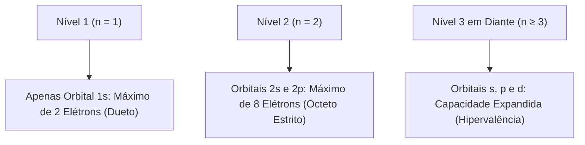
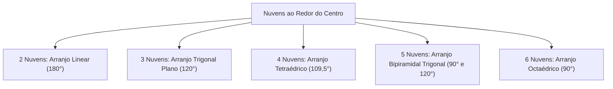
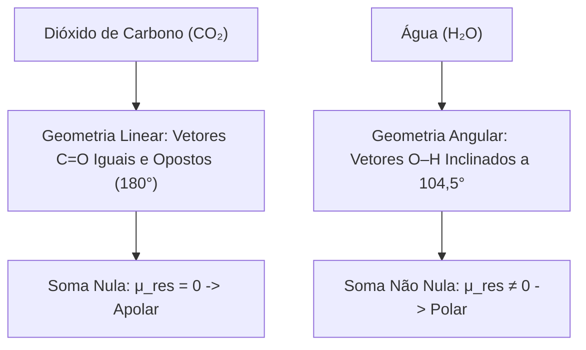
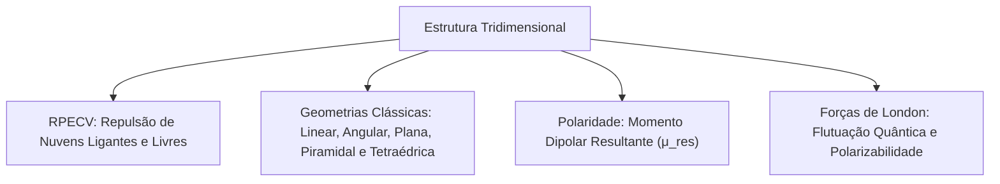

A forma espacial das moléculas dita como as substâncias interagem, se dissolvem e reagem. Na prática, a geometria e a polaridade explicam a ação de extintores gasosos, a solubilidade em resfriamentos e a dispersão de gases tóxicos. O comportamento microscópico da matéria define as decisões táticas em emergências químicas e no combate a incêndios estruturais.

A regra do octeto ajuda a desenhar fórmulas de Lewis. Porém, ela não basta para prever a disposição espacial dos átomos no espaço tridimensional. O arranjo geométrico depende de repulsões eletrostáticas entre regiões de alta densidade eletrônica.

> [!objetivos]
> - Compreender os limites teóricos e as exceções à regra do octeto.
> - Aplicar o modelo RPECV de repulsão dos pares de elétrons da valência.
> - Diferenciar a geometria eletrônica da geometria molecular real.
> - Determinar a polaridade molecular pela resultante dos momentos dipolares.
> - Analisar a origem quântica e a intensidade das forças de London.

## Limites da teoria do octeto e a mecânica quântica

A teoria do octeto baseou-se na estabilidade dos gases nobres. Porém, pela mecânica quântica, a estabilização não depende só do número 8 na camada externa. A organização dos orbitais atômicos e a energia dos elétrons determinam a estabilidade real das espécies.

O primeiro nível de energia (n = 1) tem apenas o orbital 1s. Ele comporta no máximo 2 elétrons. Por isso, elementos leves como hidrogênio e hélio se estabilizam com dueto eletrônico. Não há espaço físico para 8 elétrons nessa camada primitiva.

Nos elementos do segundo período (como carbono, nitrogênio, oxigênio e flúor), a camada externa é o nível n = 2. Esse nível abriga um orbital 2s e três orbitais 2p, totalizando 8 elétrons. Para eles, o octeto funciona com grande rigor, sendo impossível acomodar mais elétrons por falta de subníveis adicionais.

Do terceiro período em diante (n ≥ 3), os átomos contam com subníveis d energeticamente acessíveis. Esses orbitais podem participar ativamente de ligações covalentes. Isso permite acomodar 10 ou 12 elétrons na camada de valência, gerando o fenômeno da hipervalência ou octeto expandido (como em PCl₅ e SF₆).

Além disso, átomos com poucos elétrons e raio pequeno formam espécies estáveis com octeto incompleto (BeCl₂ com 4 elétrons e BF₃ com 6). Já moléculas com número ímpar de elétrons (como NO e NO₂) retêm elétrons desemparelhados estáveis no estado fundamental.

## O modelo de repulsão de pares eletrônicos da camada de valência (RPECV)

Para deduzir a forma tridimensional das moléculas, a química adota o modelo RPECV (conhecido pela sigla em inglês VSEPR). Esse modelo correlaciona a repulsão eletrostática à minimização energética da molécula.

O princípio básico afirma que os pares de elétrons ao redor do centro funcionam como regiões de densidade negativa. Pela repulsão entre cargas de mesmo sinal, essas nuvens se afastam ao máximo no espaço. Essa orientação reduz a energia do sistema e define a simetria molecular.

Aplicam-se três regras práticas diretas para a interpretação das estruturas:

1. **Definição de nuvem:** cada ligação (seja simples, dupla ou tripla) conta como uma única nuvem eletrônica de densidade negativa.
2. **Pares livres como nuvens:** cada par isolado no átomo central conta como uma nuvem independente de elétrons.
3. **Repulsão assimétrica:** pares livres ocupam maior volume espacial que pares ligantes. Por isso, exercem repulsão mais forte sobre os elétrons vizinhos:
   Par livre – Par livre > Par livre – Par ligante > Par ligante – Par ligante.

Pares isolados no átomo central empurram as ligações adjacentes e comprimem os ângulos entre elas.

> [!atencao]
> **Geometria Eletrônica versus Molecular**
> A geometria eletrônica considera todas as nuvens de elétrons (ligações e pares isolados).
> A geometria molecular descreve apenas a posição dos núcleos dos átomos no espaço.
> Os pares isolados comprimem os ângulos, mas não contam como vértices na forma geométrica da molécula.

## Classificação sistemática das geometrias moleculares

Pela IUPAC, usamos a notação geral AX_m E_n para descrever as espécies químicas:
- **A:** átomo central da molécula.
- **X:** átomos terminais ligados ao centro (quantidade m de ligantes).
- **E:** pares de elétrons livres no centro (quantidade n de pares não ligantes).

A soma m + n dá o total de nuvens ao redor do núcleo central, determinando o arranjo eletrônico básico.

Examinemos as geometrias resultantes de cada arranjo estrutural:

### Espécies com duas nuvens eletrônicas (m + n = 2)

O afastamento máximo entre duas nuvens ocorre no ângulo de 180°:

- **Notação AX₂E₀ (Geometria Linear):** sem pares livres no centro. Os átomos formam uma reta com ângulo de 180°. Exemplos clássicos: BeCl₂, CO₂ e HCN. Moléculas diatômicas (como H₂, O₂, N₂ e CO) são sempre lineares, pois dois pontos definem uma única reta no espaço.

### Espécies com três nuvens eletrônicas (m + n = 3)

Três nuvens apontam para os vértices de um triângulo plano com ângulos de 120°:

- **Notação AX₃E₀ (Geometria Trigonal Plana):** todos os pares são ligantes. Os átomos ficam no mesmo plano com ângulos de 120°. Exemplos: BF₃, SO₃ e formaldeído.
- **Notação AX₂E₁ (Geometria Angular):** o centro tem 2 ligantes e 1 par livre. A repulsão do par isolado fecha o ângulo para cerca de 119°. Exemplos: SO₂ e O₃.

### Espécies com quatro nuvens eletrônicas (m + n = 4)

Quatro nuvens apontam para os vértices de um tetraedro regular com ângulo ideal de 109,5°:

- **Notação AX₄E₀ (Geometria Tetraédrica):** 4 ligantes e nenhum par livre. Os ligantes ocupam os quatro vértices com ângulos de 109,5°. Exemplos: CH₄, CCl₄, SiH₄ e NH₄⁺.
- **Notação AX₃E₁ (Geometria Piramidal Trigonal):** 3 ligantes e 1 par livre no topo. A repulsão do par comprime os ângulos para cerca de 107°. O centro fica acima da base triangular. Exemplos: NH₃ e PCl₃.
- **Notação AX₂E₂ (Geometria Angular):** 2 ligantes e 2 pares livres. Dois pares exercem forte repulsão sobre as ligações, fechando o ângulo para 104,5°. O exemplo clássico é a água (H₂O) e o sulfeto de hidrogênio (H₂S).

### Espécies com cinco nuvens eletrônicas (m + n = 5 - Octeto expandido)

Cinco nuvens formam uma bipirâmide trigonal com posições equatoriais (120°) e axiais (90°):

- **Notação AX₅E₀ (Bipiramidal Trigonal):** 5 ligantes e 0 par livre. Exemplo: PCl₅.
- **Notação AX₄E₁ (Gangorra ou Seesaw):** 4 ligantes e 1 par livre equatorial. Exemplo: SF₄.
- **Notação AX₃E₂ (Forma de T):** 3 ligantes e 2 pares livres equatoriais. Exemplo: ClF₃.
- **Notação AX₂E₃ (Linear):** 2 ligantes axiais e 3 pares livres equatoriais a 180°. Exemplo: XeF₂ e o ânion I₃⁻.

### Espécies com seis nuvens eletrônicas (m + n = 6 - Octeto expandido)

Seis nuvens formam um octaedro com ângulos mútuos de 90° e 180°:

- **Notação AX₆E₀ (Octaédrica):** 6 ligantes e 0 par livre. Exemplo: SF₆.
- **Notação AX₅E₁ (Piramidal de Base Quadrada):** 5 ligantes e 1 par livre. Exemplo: BrF₅.
- **Notação AX₄E₂ (Quadrado Planar):** 4 ligantes e 2 pares livres axiais opostos. Exemplo: XeF₄.

| Nuvens | Ligantes (m) | Livres (n) | Notação | Geometria Eletrônica | Geometria Molecular | Ângulo | Exemplos |
| :--- | :--- | :--- | :--- | :--- | :--- | :--- | :--- |
| 2 | 2 | 0 | AX₂E₀ | Linear | Linear | 180° | BeCl₂, CO₂ |
| 3 | 3 | 0 | AX₃E₀ | Trigonal plana | Trigonal plana | 120° | BF₃, SO₃ |
| 3 | 2 | 1 | AX₂E₁ | Trigonal plana | Angular | ~119° | SO₂, O₃ |
| 4 | 4 | 0 | AX₄E₀ | Tetraédrica | Tetraédrica | 109,5° | CH₄, CCl₄ |
| 4 | 3 | 1 | AX₃E₁ | Tetraédrica | Piramidal trigonal | ~107° | NH₃, PCl₃ |
| 4 | 2 | 2 | AX₂E₂ | Tetraédrica | Angular | 104,5° | H₂O, H₂S |
| 5 | 5 | 0 | AX₅E₀ | Bipiramidal trigonal | Bipiramidal trigonal | 90° e 120° | PCl₅ |
| 5 | 4 | 1 | AX₄E₁ | Bipiramidal trigonal | Gangorra (Seesaw) | < 90°, < 120° | SF₄ |
| 5 | 3 | 2 | AX₃E₂ | Bipiramidal trigonal | Forma de T | ~90°, 180° | ClF₃ |
| 5 | 2 | 3 | AX₂E₃ | Bipiramidal trigonal | Linear | 180° | XeF₂ |
| 6 | 6 | 0 | AX₆E₀ | Octaédrica | Octaédrica | 90° | SF₆ |
| 6 | 5 | 1 | AX₅E₁ | Octaédrica | Piramidal quadrada | ~90° | BrF₅ |
| 6 | 4 | 2 | AX₄E₂ | Octaédrica | Quadrado planar | 90° e 180° | XeF₄ |

> [!resolvido]
> **Exercício Resolvido: Geometria de CO₂ e H₂O**
> Explique por que CO₂ e H₂O têm geometrias diferentes, embora ambas tenham fórmula do tipo AB₂.
>
> **Resolução passo a passo:**
> 1. *CO₂:* O carbono forma duas duplas ligações (O=C=O) e não tem pares livres no centro. São 2 nuvens (AX₂E₀). A geometria molecular é linear (180°).
> 2. *H₂O:* O oxigênio forma duas simples (H–O–H) e tem 2 pares livres. São 4 nuvens (AX₂E₂). Os pares livres comprimem as ligações para 104,5°, gerando geometria angular.
>
> **Conclusão:** O CO₂ é linear por não ter pares livres no centro. A água é angular porque os 2 pares isolados dobram a molécula.

## Polaridade molecular e momento dipolar resultante

A polaridade de uma molécula depende da polaridade de cada ligação e de sua geometria espacial. A análise exige combinar eletronegatividade e disposição tridimensional.

Cada ligação polar funciona como um vetor chamado momento dipolar (μ). O módulo depende da diferença de eletronegatividade. Seu sentido aponta para o átomo mais eletronegativo da ligação.

O momento dipolar resultante (vetor μ_res) é a soma vetorial de todos os momentos individuais da molécula:

- **Molécula apolar:** soma vetorial nula (μ_res = 0). Ocorre quando a molécula é altamente simétrica com ligantes iguais, anulando os dipolos no espaço.
- **Molécula polar:** soma vetorial não nula (μ_res ≠ 0). Ocorre quando a geometria é assimétrica ou os ligantes são diferentes, criando um polo elétrico permanente.

Casos comparativos frequentes em provas:

1. **CO₂ versus H₂O:** no CO₂ linear, dois vetores C=O iguais e opostos se anulam (μ_res = 0; apolar). Na H₂O angular, os dois vetores O–H somam-se na direção do oxigênio (μ_res ≠ 0; polar).
2. **BF₃ versus NH₃:** no BF₃ trigonal plano (120°), três vetores iguais a 120° se anulam (apolar). Na NH₃ piramidal, os três vetores N–H somam-se na direção do topo (polar).
3. **CH₄ versus CHCl₃:** no CH₄ tetraédrico simétrico, os dipolos se anulam (apolar). No CHCl₃, a troca de um ligante quebra a simetria, tornando a molécula polar.

> [!esquema]
> **Guia Rápido de Julgamento de Polaridade**
> - Átomo central sem pares livres com ligantes iguais: apolar (ex.: CO₂, BF₃, CH₄, CCl₄, SF₆).
> - Átomo central com pares livres: em geral polar (ex.: H₂O, NH₃, SO₂).
> - Exceções de pares livres simétricos apolares: XeF₂ (linear) e XeF₄ (quadrado planar).

> [!pegadinha]
> **Ligação Polar Não Garante Molécula Polar**
> CO₂, BF₃, CCl₄ e SF₆ possuem ligações polares fortes. Porém, são todas moléculas apolares por causa da simetria geométrica que anula a resultante vetorial.

## A água: propriedades físico-químicas e tratamento para consumo

A geometria angular e a forte polaridade da molécula de água conferem propriedades físico-químicas singulares. Essas características são determinantes para a saúde pública e para o serviço operacional de bombeiros.

O momento dipolar acentuado e a capacidade de formar ligações intermoleculares explicam por que a água é o solvente universal. Ela dissolve sais minerais, compostos polares e gases atmosféricos essenciais à vida.

Nas estações de tratamento de água para consumo humano (ETA), o controle físico-químico fundamenta-se na polaridade e na densidade da água em cada etapa:

1. **Coagulação e floculação:** a adição de sulfato de alumínio ou cloreto férrico desestabiliza coloides em suspensão, agregando impurezas em flocos densos.
2. **Decantação:** pela diferença de densidade, os flocos sedimentam no fundo dos tanques de decantação.
3. **Filtração em leito granular:** a água passa por camadas de areia e carvão ativado, retendo partículas microscópicas.
4. **Desinfecção e fluoretação:** aplicação de cloro ou hipoclorito para destruição de patógenos e adição de flúor para prevenção dental.

Além disso, a água exibe calor específico excepcionalmente alto (1 cal/g·°C) e elevado calor latente de vaporização (cerca de 540 cal/g). Ela absorve grandes quantidades de calor sem elevar bruscamente a sua temperatura. No combate a incêndios estruturais, o lançamento de água líquida em jato neblinado remove calor por resfriamento contínuo da zona de queima. Ao se transformar em vapor de água a 100 °C, a água expande cerca de 1.700 vezes o seu volume líquido original. Essa enorme expansão volumétrica reduz a concentração local de oxigênio abaixo de 14%, abafando as chamas de forma rápida e segura. A compreensão da solubilidade e dos padrões de turbidez, pH e desinfecção microbiológica é indispensável para a vigilância da qualidade da água distribuída à população.

## Forças de London (dipolo induzido)

A interação intermolecular mais universal é a força de dispersão de London (dipolo induzido ou instantâneo).

Fritz London explicou sua base quântica:

1. Os elétrons movem-se de forma contínua ao redor dos núcleos.
2. Em um dado instante, flutuações estatísticas criam uma concentração desigual de carga na nuvem.
3. Essa assimetria temporária cria um dipolo instantâneo transitório.
4. O dipolo instantâneo polariza a molécula vizinha, criando um dipolo induzido.
5. Estabelece-se uma atração fraca temporária entre os dipolos: a força de London.

As forças de London existem em todas as substâncias da natureza. Porém, são a única força atrativa entre moléculas apolares (O₂, N₂, CH₄, CO₂) e gases nobres isolados.

Sua intensidade cresce com a polarizabilidade da nuvem eletrônica. Nuvens maiores e mais difusas distorcem-se com facilidade diante de campos elétricos vizinhos.

Isso explica a variação física nos halogênios:

| Halogênio | Fórmula | Massa Molar (g/mol) | Total de Elétrons | Estado a 25 °C | Ponto de Ebulição (°C) |
| :--- | :--- | :--- | :--- | :--- | :--- |
| Flúor | F₂ | 38 | 18 | Gasoso | -188,1 |
| Cloro | Cl₂ | 71 | 34 | Gasoso | -34,0 |
| Bromo | Br₂ | 160 | 70 | Líquido | +58,8 |
| Iodo | I₂ | 254 | 106 | Sólido | +184,3 |

No flúor e cloro, a nuvem é pequena e as forças de London são fracas (gases). No bromo e iodo, o alto número de elétrons amplia a atração, tornando o bromo líquido e o iodo sólido.

> [!bizu]
> **Sublimação de Sólidos Apolares**
> Cristais de iodo (I₂) e gelo seco (CO₂) são mantidos por forças de London.
> Como essas atrações são fracas, eles sublimam com facilidade à pressão ambiente, passando direto de sólido a gás.

## Mapa do capítulo

Revisamos os limites do octeto, a dedução de geometrias pelo modelo RPECV, a análise vetorial de polaridade, as propriedades da água e as forças de London.

### Para fixar
- Elementos leves completam-se com 2 elétrons no orbital 1s; a partir do 3º período pode ocorrer expansão com orbitais d.
- No modelo RPECV, cada ligação ou par isolado conta como uma nuvem de elétrons.
- Pares livres exercem maior repulsão que pares ligantes, comprimindo os ângulos de ligação.
- A água (H₂O) possui 4 nuvens e 2 pares livres, gerando geometria angular de 104,5°.
- A amônia (NH₃) possui 4 nuvens e 1 par livre, resultando em geometria piramidal trigonal de 107°.
- O metano (CH₄) possui 4 nuvens e 0 par livre, formando geometria tetraédrica de 109,5°.
- O dióxido de carbono (CO₂) possui 2 nuvens e geometria linear de 180°.
- Ter ligações polares não implica molécula polar; no CO₂ e no BF₃ os dipolos anulam-se por simetria geométrica (μ_res = 0).
- As forças de London decorrem de dipolos instantâneos que induzem dipolos transitórios em partículas vizinhas.
- A intensidade das forças de London cresce com o aumento da nuvem eletrônica e da massa molar (F₂ < Cl₂ < Br₂ < I₂).
