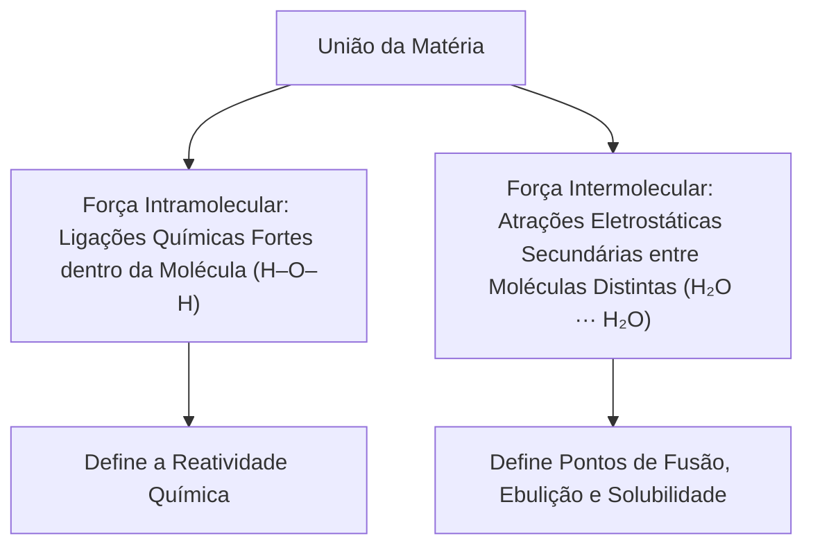
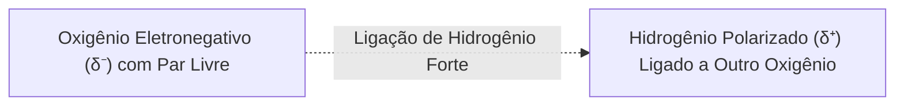
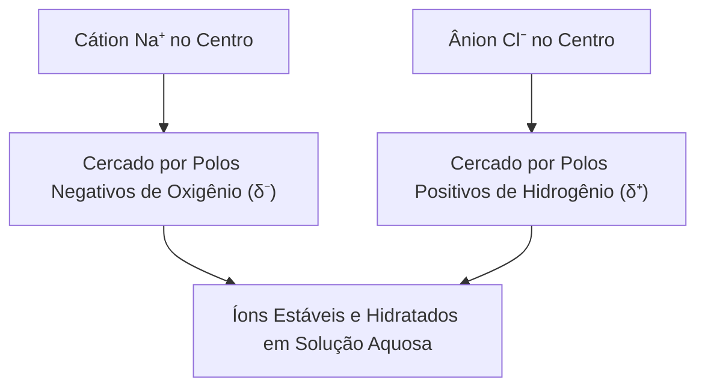
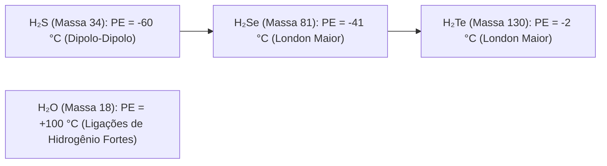
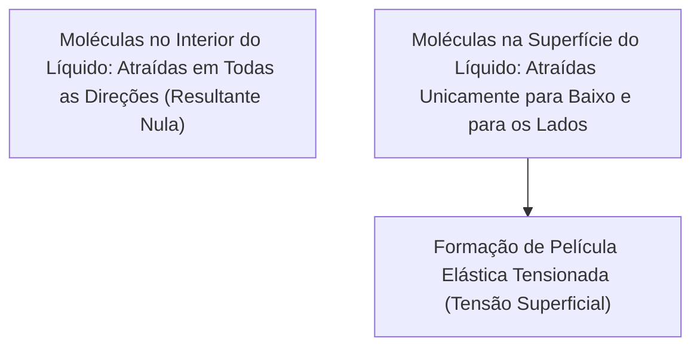
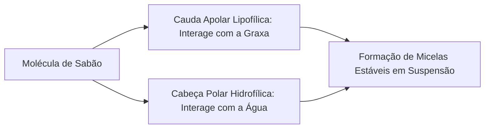
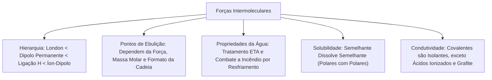

As forças intermoleculares governam o estado físico da matéria, os pontos de ebulição dos combustíveis, a solubilidade de substâncias químicas e a condutividade elétrica de soluções. No serviço de bombeiros, dominar essas forças é essencial para compreender a volatilidade de hidrocarbonetos líquidos, o comportamento de espumas de combate a incêndios e os mecanismos de solvatação e lavagem química em emergências com produtos perigosos.

Enquanto as ligações intramoleculares (iônica, covalente e metálica) mantêm os átomos unidos no interior de cada partícula, as forças intermoleculares atuam entre moléculas vizinhas, determinando suas propriedades macroscópicas.

> [!objetivos]
> - Diferenciar forças intramoleculares fortes de atrações intermoleculares secundárias.
> - Compreender a mecânica do dipolo permanente, da ligação de hidrogênio e da atração íon-dipolo.
> - Estabelecer a ordem hierárquica de intensidade entre as interações intermoleculares.
> - Correlacionar forças intermoleculares, massa molar e forma molecular aos pontos de fusão e ebulição.
> - Analisar a viscosidade, a tensão superficial, a regra de solubilidade e a condutividade elétrica.

## Natureza e classificação das forças intermoleculares

Para compreender o comportamento físico dos líquidos e sólidos moleculares, é necessário distinguir com precisão dois níveis de união química:

1. **Forças intramoleculares:** são as ligações químicas verdadeiras (covalente, iônica e metálica). Elas ocorrem dentro da própria molécula ou rede atômica, envolvendo o compartilhamento ou a transferência de elétrons de valência. Romper ligações intramoleculares exige grande aporte de energia (centenas de quilojoules por mol) e acarreta transformação química da matéria.
2. **Forças intermoleculares:** são atrações eletrostáticas de menor magnitude que ocorrem entre moléculas independentes já formadas. Elas são responsáveis por manter as moléculas unidas nos estados líquido e sólido. O rompimento de forças intermoleculares durante a fusão ou ebulição exige energia muito menor (de 2 a 40 quilojoules por mol) e constitui um fenômeno estritamente físico, preservando a identidade da substância.

Classificam-se as forças intermoleculares em quatro categorias fundamentais:

- Forças de dispersão de London (dipolo induzido ou instantâneo).
- Interações dipolo permanente (dipolo-dipolo).
- Ligações de hidrogênio.
- Interações íon-dipolo.

## Interações dipolo permanente (dipolo-dipolo)

As interações por dipolo permanente ocorrem obrigatoriamente entre moléculas polares que não possuem átomos de hidrogênio ligados diretamente a flúor, oxigênio ou nitrogênio.

Em uma molécula polar assimétrica (como cloreto de hidrogênio HCl, brometo de hidrogênio HBr, sulfeto de hidrogênio H₂S ou dióxido de enxofre SO₂), a diferença de eletronegatividade cria uma separação permanente de cargas:

- O polo parcial negativo (δ⁻) concentra maior densidade de elétrons.
- O polo parcial positivo (δ⁺) apresenta carência eletrônica.

Quando várias moléculas polares se aproximam no estado líquido ou sólido, elas orientam-se espontaneamente no espaço: o polo positivo de uma molécula atrai o polo negativo da molécula vizinha.

Como os polos elétricos já existem de modo permanente na molécula, a atração dipolo-dipolo é consideravelmente mais intensa que a força de London para moléculas de tamanho e massa comparáveis.

## Ligação de hidrogênio: características e mecanismo

A ligação de hidrogênio constitui um caso especial e extraordinariamente intenso de atração dipolo permanente. Ela ocorre quando um átomo de hidrogênio encontra-se ligado covalentemente a um elemento de raio muito reduzido e altíssima eletronegatividade: flúor (F), oxigênio (O) ou nitrogênio (N).

A combinação de três fatores atômicos singulares torna essa interação muito forte:

1. A elevada diferença de eletronegatividade entre o H (2,1) e os elementos F (4,0), O (3,5) e N (3,0) drena quase toda a densidade eletrônica da ligação para o ametal.
2. O hidrogênio fica praticamente despido de sua nuvem eletrônica, adquirindo uma densidade de carga positiva (δ⁺) excepcionalmente concentrada.
3. Como o hidrogênio possui raio atômico mínimo e não tem camadas eletrônicas internas de blindagem, o polo negativo de uma molécula vizinha pode se aproximar a distâncias muito curtas desse núcleo positivo.

A ligação de hidrogênio estabelece-se entre esse próton parcialmente desprovido de elétrons (H com δ⁺) e um par de elétrons não ligante (par livre) localizado sobre o átomo de F, O ou N de uma molécula vizinha.

A IUPAC recomenda oficialmente o termo ligação de hidrogênio, devendo-se evitar a denominação antiga ponte de hidrogênio.

São exemplos clássicos de substâncias com ligações de hidrogênio intermoleculares: água (H₂O), fluoreto de hidrogênio (HF), gás amônia (NH₃), peróxido de hidrogênio (H₂O₂), álcoois (como etanol e metanol) e ácidos carboxílicos (como ácido acético).

> [!pegadinha]
> **Interação com a Água sem H Ligado a FON**
> A formação de ligação de hidrogênio não exige que ambas as moléculas tenham hidrogênios ligados a F, O ou N.
> Basta que uma das moléculas forneça o H polarizado (como a água) e a outra ofereça um par livre de elétrons em átomo de O ou N.
> Por essa razão, a propanona (acetona) e o éter dimetílico formam fortes ligações de hidrogênio com a água líquida, dissolvendo-se amplamente nela. Todavia, entre suas próprias moléculas puras, a acetona faz apenas dipolo permanente, pois seus hidrogênios estão ligados a carbonos.

## Interações íon-dipolo e processo de solvatação

A interação íon-dipolo ocorre entre um íon livre (seja ele um cátion ou um ânion) e as moléculas de um solvente polar.

Essa atração eletrostática é a força responsável pela dissolução e estabilização de compostos iônicos em meio líquido, como o cloreto de sódio em água:

- Os cátions sódio (Na⁺) atraem os polos parciais negativos dos átomos de oxigênio das moléculas de água circundantes.
- Os ânions cloreto (Cl⁻) atraem os polos parciais positivos dos átomos de hidrogênio das moléculas de água.

Esse processo de confinamento e envolvimento ordenado dos íons por moléculas de água recebe o nome de hidratação ou solvatação iônica.

Como os íons possuem cargas elétricas completas (+1, +2, -1, -2) e não apenas frações parciais de carga, a interação íon-dipolo é a mais forte de todas as forças intermoleculares.

## Hierarquia de intensidade das forças intermoleculares

A intensidade relativa das interações intermoleculares segue uma ordem crescente bem definida para partículas de dimensões atômicas semelhantes:

Forças de London (dipolo induzido) < Dipolo permanente < Ligação de hidrogênio < Íon-dipolo

| Tipo de Interação | Espécies Participantes | Origem da Atração | Intensidade Relativa | Exemplos Típicos |
| :--- | :--- | :--- | :--- | :--- |
| Dipolo induzido (London) | Moléculas apolares e gases nobres | Dipolos instantâneos transitórios por flutuação quântica | Fraca (2 a 10 kJ/mol) | O₂···O₂, N₂···N₂, CO₂···CO₂, CH₄···CH₄ |
| Dipolo permanente | Moléculas polares sem H-FON | Polos elétricos parciais permanentes (δ⁺ e δ⁻) | Moderada (5 a 25 kJ/mol) | HCl···HCl, HBr···HBr, SO₂···SO₂ |
| Ligação de hidrogênio | H ligado a F, O ou N com par livre de F, O ou N | Dipolo extremo com próton desblindado e par livre | Forte (10 a 40 kJ/mol) | H₂O···H₂O, NH₃···NH₃, HF···HF |
| Íon-dipolo | Íon com carga real e molécula polar | Atração eletrostática entre carga completa e polo parcial | Muito forte (40 a 600 kJ/mol) | Na⁺···H₂O, Cl⁻···H₂O |

> [!bizu]
> **Roteiro Rápido para Identificar a Interação Intermolecular**
> 1. A molécula é apolar? Interação por dipolo induzido (London).
> 2. A molécula é polar e possui H ligado diretamente a F, O ou N? Ligação de hidrogênio.
> 3. A molécula é polar sem H ligado a F, O ou N? Dipolo permanente (dipolo-dipolo).
> 4. Há íon misturado a líquido polar? Interação íon-dipolo.

## Influência nas propriedades físicas: ponto de fusão e ebulição

A temperatura de mudança de estado físico de uma substância molecular reflete a quantidade de energia térmica necessária para afastar suas moléculas contra a atração intermolecular mútua.

Dois fatores determinam o ponto de fusão (PF) e o ponto de ebulição (PE):

1. **Tipo de força intermolecular:** substâncias unidas por forças mais intensas exigem maior energia térmica para vaporizar, apresentando pontos de ebulição mais elevados.
2. **Massa molar e volume eletrônico:** entre substâncias que apresentam o mesmo tipo de força intermolecular, a substância de maior massa molar possui nuvem eletrônica mais volumosa e polarizável, resultando em forças de London mais intensas e maior ponto de ebulição.

Observe a comparação de pontos de ebulição entre substâncias com diferentes interações:

| Substância | Fórmula | Massa Molar (g/mol) | Tipo de Força Intermolecular | Ponto de Ebulição (°C) |
| :--- | :--- | :--- | :--- | :--- |
| Pentano | C₅H₁₂ | 72 | Dipolo induzido (London) | 36,3 |
| Hexano | C₆H₁₄ | 86 | Dipolo induzido (London) | 68,7 |
| Propanona (acetona) | C₃H₆O | 58 | Dipolo permanente | 56,0 |
| Butan-1-ol | C₄H₁₀O | 74 | Ligação de hidrogênio | 117,7 |
| Ácido etanoico (acético) | C₂H₄O₂ | 60 | Ligação de hidrogênio (dímeros) | 118,1 |

A análise desses dados revela lições valiosas:

- A propanona é mais leve que o pentano (massa 58 contra 72). Porém, ferve a 56 °C, bem acima dos 36,3 °C do pentano. A causa é o tipo de força: dipolo permanente na propanona supera dipolo induzido no pentano.
- O hexano ferve a 68,7 °C, acima do pentano (36,3 °C). Ambos são apolares e fazem forças de London, mas o hexano possui maior massa molar e nuvem eletrônica mais extensa.
- O ácido etanoico possui massa de apenas 60 g/mol, mas ferve a 118,1 °C. Suas moléculas associam-se em pares estáveis (dímeros) unidos por duas ligações de hidrogênio simultâneas.

### Anomalia dos hidretos com ligações de hidrogênio

Ao analisarmos os hidretos dos grupos 14, 15, 16 e 17 da Tabela Periódica, constata-se um comportamento singular.

No grupo 14 (CH₄, SiH₄, GeH₄, SnH₄), todos são tetraédricos apolares. O ponto de ebulição cresce monotonicamente com o aumento da massa molar e das forças de London: CH₄ (-161 °C) < SiH₄ (-112 °C) < GeH₄ (-88 °C) < SnH₄ (-52 °C).

Contudo, nos grupos 15, 16 e 17, os primeiros membros da família (NH₃, H₂O e HF) exibem pontos de ebulição anormalmente altos, quebrando a tendência regular. A água ferve a 100 °C, enquanto o H₂S ferve a -60 °C; o HF ferve a 19,5 °C e o HCl a -85 °C; o NH₃ ferve a -33 °C e o PH₃ a -88 °C. Essa anomalia térmica é a comprovação experimental da extraordinária força das ligações de hidrogênio.

### Influência da geometria molecular e isomeria de cadeia

Quando duas substâncias possuem a mesma fórmula molecular e mesma massa molar (isômeros), a geometria da cadeia carbônica dita a área de contato e a intensidade das atrações de London:

- **Cadeias lineares:** apresentam conformação esticada com ampla área de superfície de contato. As moléculas aproximam-se intimamente, maximizando as forças de London.
- **Cadeias ramificadas:** adquirem conformação globular compacta com menor superfície exposta. O impedimento estéreo afasta os centros moleculares, enfraquecendo as atrações.

Considere o butano e o metilpropano (isobutano), ambos com fórmula C₄H₁₀:

- Butano (linear): ponto de ebulição de -0,5 °C.
- Metilpropano (ramificado): ponto de ebulição de -11,7 °C.

O isômero linear ferve em temperatura mais elevada porque sua superfície de contato facilita interações de dispersão mais numerosas.

> [!resolvido]
> **Exercício Resolvido: Comparação de Pontos de Ebulição**
> Três substâncias puras de massas molares muito próximas encontram-se em frascos não identificados: propano (C₃H₈, massa 44 g/mol), metoximetano (éter dimetílico, C₂H₆O, massa 46 g/mol) e etanol (C₂H₆O, massa 46 g/mol). Ordene essas substâncias em ordem crescente de ponto de ebulição e justifique com base nas forças intermoleculares.
>
> **Resolução passo a passo:**
> 1. *Análise do propano (C₃H₈):* é um hidrocarboneto apolar. Suas moléculas unem-se exclusivamente pelas fracas forças de dispersão de London (dipolo induzido). Seu ponto de ebulição é o mais baixo dos três (-42,1 °C).
> 2. *Análise do metoximetano (éter dimetílico, H₃C–O–CH₃):* é uma molécula polar angular. Seus hidrogênios estão ligados a carbonos, não a oxigênio. As moléculas unem-se por dipolo permanente (dipolo-dipolo), que é mais forte que London. Seu ponto de ebulição é intermediário (-24,8 °C).
> 3. *Análise do etanol (H₃C–CH₂–OH):* possui o grupo hidroxila com H ligado diretamente ao átomo de oxigênio (H–FON). Suas moléculas estabelecem fortes ligações de hidrogênio intermoleculares. Seu ponto de ebulição é o mais elevado (+78,3 °C).
>
> **Conclusão:** A ordem crescente de ponto de ebulição é propano < metoximetano < etanol.

## Viscosidade e tensão superficial dos líquidos

A viscosidade e a tensão superficial são duas propriedades macroscópicas que decorrem da atração entre as moléculas no estado líquido:

### Viscosidade

Viscosidade é a medida da resistência interna de um líquido ao escoamento. Quanto mais intensas forem as atrações intermoleculares e mais entrelaçadas forem as cadeias moleculares, mais difícil será o deslizamento relativo entre as camadas de líquido.

A água possui viscosidade moderada devido às ligações de hidrogênio. A glicerina (propano-1,2,3-triol) contém três grupos hidroxila (-OH) por molécula, estabelecendo uma rede tridimensional contínua de ligações de hidrogênio que a torna extremamente viscosa e espessa.

Óleos lubrificantes minerais e hidrocarbonetos pesados também são viscosos, mesmo sendo apolares. Nesse caso, a resistência decorre do tamanho de suas cadeias moleculares longas que se enroscam mecanicamente.

### Tensão superficial

As moléculas localizadas no interior de um líquido são atraídas simetricamente em todas as direções pelas moléculas vizinhas, resultando em força líquida nula.

Todavia, as moléculas situadas na superfície livre do líquido não possuem vizinhas acima delas. Elas experimentam uma atração resultante direcionada para o interior do líquido. Essa atração contrai a superfície, fazendo-a comportar-se como uma membrana elástica esticada.

A tensão superficial é a energia necessária para expandir a área da superfície de um líquido:

- A água possui uma das mais altas tensões superficiais entre os líquidos comuns (72,8 mN/m a 20 °C), decorrente das ligações de hidrogênio.
- Essa membrana elástica permite que pequenos insetos caminhem sobre a água sem afundar e faz com que pequenas gotas de água adotem forma esférica espontânea no ar.

Tanto a viscosidade quanto a tensão superficial diminuem com o aumento da temperatura. Quando aquecemos um líquido, a agitação térmica afasta as moléculas e enfraquece as atrações intermoleculares, tornando o fluido mais móvel e menos tensionado.

## Regra de solubilidade: semelhante dissolve semelhante

A solubilidade de uma substância em outra obedece à consagrada regra química: semelhante dissolve semelhante.

Substâncias com forças intermoleculares do mesmo tipo e intensidade tendem a ser mutuamente solúveis:

- **Solventes polares dissolvem solutos polares e iônicos:** a água (polar) dissolve o cloreto de sódio por interação íon-dipolo e dissolve o etanol e a sacarose por ligações de hidrogênio. Espécies com afinidade pela água são denominadas hidrofílicas.
- **Solventes apolares dissolvem solutos apolares:** gasolina, hexano e tetracloreto de carbono dissolvem óleos, graxas, gorduras e ceras mediante forças de London. Espécies com afinidade por óleos são denominadas lipofílicas ou hidrofóbicas.

Quando misturamos água e óleo vegetal, os dois líquidos não se misturam, formando um sistema heterogêneo bifásico. A água atrai fortemente suas próprias moléculas por ligações de hidrogênio, expulsando as moléculas apolares de óleo. Como o óleo possui menor densidade que a água, ele flutua na camada superior.

Na atuação dos bombeiros, os incêndios envolvendo líquidos inflamáveis apolares (classe B, como gasolina e querosene) não podem ser extintos com jato direto de água. A gasolina não se mistura com a água e flutua sobre ela enquanto queima, espalhando as chamas. O controle exige o uso de espumas mecânicas (AFFF), que flutuam sobre o combustível e formam uma barreira que impede o contato com o oxigênio atmosférico.

## A água: propriedades físico-químicas e tratamento para consumo humano

A molécula de água (H₂O) exibe propriedades físico-químicas singulares que sustentam os ciclos biogeoquímicos e a infraestrutura de saneamento público. Essas características decorrem diretamente de sua geometria angular (104,5°) e da sua elevada densidade de ligações de hidrogênio intermoleculares.

O momento dipolar acentuado e a capacidade de solvatação tornam a água o solvente universal por excelência. Em ambiente urbano, a água bruta captada em mananciais contém partículas coloidais, microrganismos e íons em suspensão, exigindo tratamento em Estações de Tratamento de Água (ETA) estruturado em etapas físico-químicas padronizadas:

1. **Coagulação:** adição dos agentes coagulantes sulfato de alumínio ou cloreto férrico. Esses sais liberam cátions polivalentes (Al³⁺ ou Fe³⁺) que neutralizam as cargas elétricas negativas das partículas coloidais de argila e matéria orgânica, permitindo sua aproximação.
2. **Floculação:** agitação mecânica suave e controlada da água, permitindo que os coloides desestabilizados colidam e aglutinem-se em agregados maiores denominados flocos.
3. **Decantação:** passagem da água por tanques de fluxo lento onde os flocos densos sedimentam por ação da gravidade, acumulando-se no fundo.
4. **Filtração:** escoamento da água decantada através de leitos porosos granulares compostos por camadas de areia, cascalho e carvão ativado antropogênico. Essa etapa retém partículas residuais que escaparam da decantação e adsorve compostos orgânicos causadores de odor e sabor.
5. **Desinfecção (Cloração):** aplicação controlada de cloro gasoso (Cl₂) ou hipoclorito de sódio (NaClO). O cloro reage com a água formando ácido hipocloroso (HClO), um poderoso agente oxidante bactericida que destrói patógenos bacterianos e vírus.
6. **Fluoretação e correção de pH:** adição de ácido fluossilícico ou fluossilicato de sódio para prevenção de cáries dentárias na população e dosagem de cal hidratada (hidróxido de cálcio) para elevar o pH e evitar corrosão ou incrustação na rede de distribuição.

Na atividade de combate a incêndios, a água é o agente extintor mais empregado pelo Corpo de Bombeiros devido ao seu altíssimo calor específico (1 cal/g·°C) e calor latente de vaporização (540 cal/g). O lançamento de água sob a forma neblinada resfria violentamente os materiais combustíveis, retirando o calor do triângulo do fogo. Ao vaporizar a 100 °C, cada litro de água líquida expande aproximadamente 1.700 litros de vapor, expulsando o ar atmosférico e promovendo a extinção complementar por abafamento da chama.

## Condutividade elétrica em compostos moleculares

A corrente elétrica através de um meio material exige a presença de portadores de carga livres dotados de mobilidade física (elétrons livres ou íons móveis).

As substâncias moleculares puras são formadas por moléculas neutras que compartilham elétrons de valência localizados. Por não possuírem íons livres nem elétrons deslocalizados, as substâncias covalentes são isolantes elétricas em quaisquer dos três estados físicos (sólido, líquido ou gasoso).

Água pura destilada, glicose sólida, etanol líquido e dióxido de carbono não conduzem corrente elétrica apreciável.

Contudo, há duas exceções de alta relevância que caem com frequência em provas:

1. **Ionização de ácidos em água:** ácidos são substâncias moleculares covalentes (como HCl, HBr, HNO₃ e H₂SO₄). Em estado puro, são isolantes. Porém, ao serem dissolvidos em água, reagem quimicamente com o solvente sofrendo ionização:
   HCl + H₂O -> H₃O⁺ + Cl⁻
   A geração de cátions hidrônio e ânions em meio aquoso transforma a solução em condutor eletrolítico de alta eficiência.
2. **Formas alotrópicas do carbono (grafite):** o diamante é formado por carbonos com orbitais sp³ em arranjo tetraédrico tridimensional rígido, sendo isolante elétrico perfeito. Já o grafite é constituído por anéis hexagonais planos nos quais cada carbono realiza três ligações sp² e retém um elétron no orbital p puro. Esses elétrons formam uma nuvem pi deslocalizada que se move livremente entre as camadas, conferindo ao grafite excelente condutividade elétrica no estado sólido.

> [!atencao]
> **Diferença entre Dissociação Iônica e Ionização Covalente**
> - Dissociação iônica: separação física de íons pré-existentes quando um composto iônico se funde ou se dissolve (ex.: NaCl -> Na⁺ + Cl⁻).
> - Ionização: reação química em que uma molécula covalente neutra é quebrada pela água gerando íons que não existiam antes (ex.: HCl + H₂O -> H₃O⁺ + Cl⁻).

> [!exemplo]
> **Condutividade da Água em Combate a Incêndio**
> A água destilada é má condutora elétrica. Todavia, a água encanada e a água de rios e reservatórios utilizada pelos caminhões de combate a incêndio contém cátions (Ca²⁺, Mg²⁺, Na⁺) e ânions (Cl⁻, SO₄²⁻) dissolvidos que a tornam fortemente condutora.
> Por esse motivo, as equipes de bombeiros nunca aplicam jato compacto de água sobre equipamentos elétricos energizados antes do corte da alimentação elétrica do prédio, evitando acidentes fatais por choque elétrico.

## Mapa do capítulo

Examinamos a natureza das atrações intermoleculares, a hierarquia de forças, os efeitos sobre fusão, ebulição, viscosidade e tensão superficial, o tratamento da água para consumo e as regras de condutividade elétrica.

### Para fixar
- Forças intramoleculares unem átomos na molécula; forças intermoleculares atuam entre moléculas distintas.
- A intensidade cresce na ordem: dipolo induzido < dipolo permanente < ligação de hidrogênio < íon-dipolo.
- O dipolo permanente ocorre em moléculas polares sem H ligado a F, O ou N (como HCl e SO₂).
- A ligação de hidrogênio requer H ligado a F, O ou N interagindo com par livre de F, O ou N vizinho.
- A interação íon-dipolo ocorre na hidratação de íons por solventes polares, como Na⁺ e Cl⁻ em água.
- Pontos de fusão e ebulição sobem com forças intermoleculares mais intensas e com maior massa molar.
- Cadeias lineares têm maior superfície de contato e fervem acima de isômeros ramificados (butano > metilpropano).
- A viscosidade e a tensão superficial aumentam com forças intermoleculares fortes e caem com o aquecimento.
- Semelhante dissolve semelhante: água polar não se mistura com óleo apolar; sabões agem por micelas.
- O tratamento de água na ETA envolve coagulação, floculação, decantação, filtração, cloração e fluoretação.
