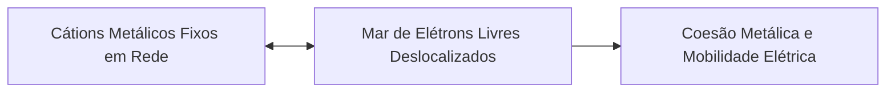
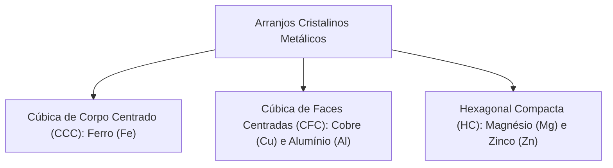
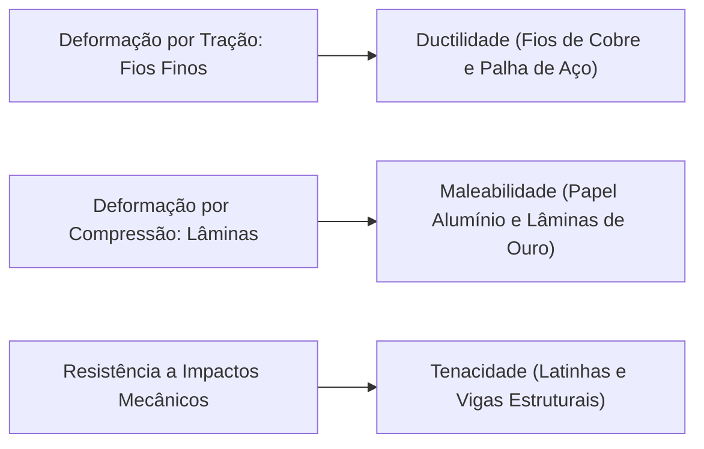
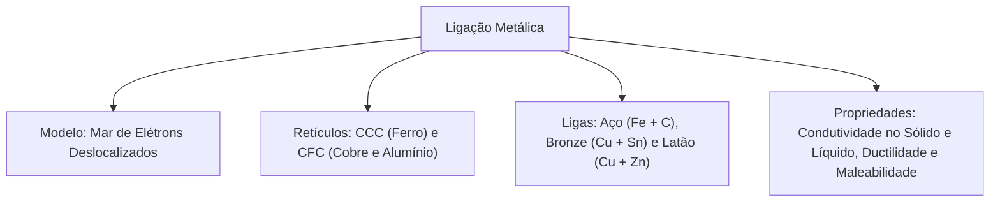

Os metais constituem a maioria absoluta dos elementos químicos conhecidos e formam a base estrutural de viaturas, ferramentas de desencarceramento, condutores elétricos e edificações urbanas. Na atuação de bombeiros, o conhecimento da ligação metálica é essencial para avaliar a resistência térmica de estruturas em incêndios e compreender o risco de choque elétrico em redes energizadas.

Diferente das ligações iônicas e covalentes, a ligação metálica baseia-se na deslocalização ampla de elétrons livres entre cátions organizados em uma rede ordenada.

> [!objetivos]
> - Compreender a baixa eletronegatividade dos metais e o modelo do mar de elétrons.
> - Diferenciar substâncias metálicas simples de ligas metálicas homogêneas.
> - Identificar as estruturas cristalinas de empacotamento cúbico de corpo centrado e de faces centradas.
> - Distinguir com precisão as propriedades mecânicas de ductilidade, maleabilidade, dureza e tenacidade.
> - Explicar a condutividade térmica e elétrica dos metais nos estados sólido e líquido.

## Revisando a natureza atômica e o modelo do mar de elétrons

Revisando os conceitos periódicos fundamentais, constatamos que os metais ocupam o lado esquerdo e o centro da Tabela Periódica. Eles possuem baixa eletronegatividade e alta eletropositividade, apresentando facilidade acentuada para ceder elétrons de valência. Em contraposição aos ametais que atraem elétrons e formam ligações covalentes ou ânions, os metais tendem a perder parcialmente seus elétrons mais externos.

No modelo da ligação metálica, conhecido didaticamente como mar de elétrons ou nuvem eletrônica deslocalizada, os átomos metálicos liberam seus elétrons de valência. Os centros atômicos positivos resultantes (cátions) organizam-se em uma rede tridimensional regular e compacta.

Os elétrons de valência liberados não pertencem a nenhum átomo específico. Eles transitam livremente por todo o cristal, formando um mar deslocalizado de cargas negativas móveis. A intensa atração eletrostática entre os cátions fixos e o mar de elétrons circundante mantém toda a estrutura coesa e estável, conferindo alta integridade mecânica ao material sólido.

## Arranjo cristalino dos compostos metálicos

Os cátions metálicos empacotam-se no estado sólido de forma geométrica compacta e eficiente, minimizando os espaços vazios entre as esferas atômicas. A menor unidade repetitiva que define essa organização espacial é a célula unitária.

Dentre os principais retículos cristalinos metálicos, destacam-se:

- **Cúbica de corpo centrado (CCC):** apresenta átomos nos oito vértices do cubo e um átomo no centro geométrico. Apresenta número de coordenação 8 e empacotamento de 68%. O ferro (Fe) em temperatura ambiente e os metais alcalinos adotam essa conformação.
- **Cúbica de faces centradas (CFC):** apresenta átomos nos vértices e no centro de cada uma das seis faces do cubo. Possui número de coordenação 12 e atinge empacotamento máximo de 74%. O cobre (Cu), o alumínio (Al), o ouro (Au) e a prata (Ag) cristalizam nessa rede.
- **Hexagonal compacta (HC):** possui número de coordenação 12 e geometria de prisma hexagonal, observada no magnésio (Mg) e no zinco (Zn).

## Substâncias metálicas simples versus ligas metálicas

É fundamental distinguir uma amostra elementar pura de uma liga metálica:

1. **Substância metálica simples:** material composto exclusivamente por átomos de um único elemento químico metálico, como uma barra de ferro puro, fios de cobre refinado ou ouro 24 quilates.
2. **Liga metálica:** mistura homogênea de dois ou mais elementos na qual o componente majoritário é obrigatoriamente um metal. A liga pode conter ametais em sua formulação, como ocorre no aço.

As ligas são preparadas em duas etapas principais: fusão térmica dos componentes até a homogeneização líquida, seguida de resfriamento controlado até a solidificação total.

| Liga Metálica | Componente Principal | Outros Componentes | Propriedades Destacadas | Aplicações Típicas |
| :--- | :--- | :--- | :--- | :--- |
| Aço comum | Ferro (Fe) | Carbono (C: 0,1% a 1,5%) | Alta tenacidade e resistência mecânica | Vigas estruturais e cascos |
| Aço inoxidável | Ferro (Fe) | Carbono (C), Cromo (Cr) e Níquel (Ni) | Alta resistência à corrosão química | Ferramentas médicas e tesouras |
| Bronze | Cobre (Cu) | Estanho (Sn) | Resistência ao atrito e à oxidação | Sinos, engrenagens e medalhas |
| Latão | Cobre (Cu) | Zinco (Zn) | Maleabilidade e sonoridade acústica | Conexões de mangueiras e instrumentos |
| Ouro 18 quilates | Ouro (Au: 75%) | Prata (Ag: 12,5%) e Cobre (Cu: 12,5%) | Dureza superior ao ouro puro | Joalheria fina resistente a riscos |
| Amálgama | Prata e estanho | Mercúrio líquido (Hg) | Plasticidade inicial e rápida presa | Restaurações dentárias antigas |

> [!atencao]
> **Presença de Ametal no Aço**
> Muitas bancas afirmam incorretamente que toda liga metálica é formada exclusivamente por metais.
> O aço é o contraexemplo definitivo: é uma liga formada por ferro (metal) e carbono (ametal). A presença do carbono distorce o retículo do ferro, bloqueando o deslizamento de planos cristalinos e aumentando a resistência mecânica.

## Propriedades fundamentais dos metais e aplicações operacionais

O mar de elétrons deslocalizados confere aos metais um conjunto específico de propriedades físicas e mecânicas:

1. **Condutividade elétrica no sólido e no líquido:** portadores de carga móveis (elétrons livres) deslocam-se instantaneamente sob uma diferença de potencial. Os metais conduzem eletricidade tanto no estado sólido quanto fundidos.
2. **Condutividade térmica:** os elétrons livres transportam energia cinética de forma rápida pelas vibrações do retículo, tornando os metais excelentes condutores de calor (como panelas e dissipadores).
3. **Brilho metálico:** a nuvem de elétrons livres absorve e reflete quase toda a radiação eletromagnética visível que incide na superfície.
4. **Ductilidade:** capacidade do material sofrer deformação plástica por tração, transformando-se em fios finos sem se romper. Exemplo: fios de cobre para fiação e palha de aço.
5. **Maleabilidade:** capacidade de ser conformado sob compressão mecânica em lâminas e folhas extremamente finas. Exemplo: papel alumínio de cozinha e folhas de ouro.
6. **Tenacidade:** capacidade de absorver grandes quantidades de energia mecânica sob impacto sem se fraturar. Quando martelado, o retículo metálico deforma-se plasticamente sem quebrar.
7. **Dureza variável:** facilidade com que a superfície do metal é riscada por outro corpo. Metais alcalinos (como sódio e potássio) são moles e cortados com faca, enquanto cromo e tungstênio são duros.
8. **Altos pontos de fusão e ebulição:** a forte atração do mar de elétrons exige temperaturas elevadas para a fusão (o ferro funde a 1.538 °C e o tungstênio a 3.422 °C). A grande exceção é o mercúrio (Hg), que é líquido a 25 °C (funde a -38,8 °C).
9. **Elevada densidade:** o empacotamento compacto dos núcleos gera substâncias pesadas, como chumbo (11,3 g/cm³) e ouro (19,3 g/cm³).
10. **Insolubilidade:** metais não se dissolvem em água nem em solventes orgânicos.

> [!bizu]
> **Ductilidade versus Maleabilidade**
> Não confunda as propriedades mecânicas em provas de concurso:
> - Fio fino: ductilidade (ex.: fios elétricos de cobre e palha de aço).
> - Lâmina ou folha fina: maleabilidade (ex.: folhas de alumínio e lâminas de ouro).
> - Resistência ao choque mecânico: tenacidade.

> [!resolvido]
> **Exercício Resolvido: Identificação do Modelo de Ligação em Concursos**
> Uma amostra sólida cinzenta apresenta excelente condutividade térmica e elétrica no estado sólido, alta maleabilidade ao ser martelada e ponto de fusão superior a 1.000 °C. Ao ser aquecida até o estado líquido, a substância preserva a capacidade de conduzir corrente elétrica. Qual é a ligação química predominante nessa amostra?
>
> **Resolução passo a passo:**
> 1. *Condutividade no estado sólido:* compostos moleculares e iônicos são isolantes elétricos no estado sólido. Apenas metais e grafite conduzem no estado sólido.
> 2. *Condutividade no estado líquido:* tanto compostos iônicos fundidos quanto metais líquidos conduzem eletricidade.
> 3. *Maleabilidade mecânica:* compostos iônicos são frágeis e quebradiços sob impacto mecânico (cisalhamento de cargas homônimas). Substâncias moleculares sólidas também quebram facilmente.
> 4. *Conclusão estrutural:* a combinação de condução elétrica no sólido e líquido com alta maleabilidade plástica sob compressão é exclusiva da **ligação metálica**, mantida pelo mar de elétrons deslocalizados.

## Mapa do capítulo

Examinamos a fundamentação da ligação metálica pelo mar de elétrons, as células unitárias CCC e CFC, as ligas metálicas com aço e bronze, e a distinção entre ductilidade, maleabilidade e condutividade.

### Para fixar
- Metais têm baixa eletronegatividade e alta eletropositividade, cedendo elétrons com facilidade.
- A ligação metálica é formada por cátions imersos em um mar de elétrons deslocalizados.
- O ferro em temperatura ambiente cristaliza em CCC; cobre e alumínio cristalizam em CFC.
- Uma substância metálica simples contém um único elemento; uma liga é mistura com base metálica.
- O aço comum é uma liga formada por ferro metálico e carbono ametálico.
- Metais conduzem corrente elétrica tanto no estado sólido quanto no estado fundido (líquido).
- Ductilidade é a capacidade de produzir fios finos (como fios elétricos e palha de aço).
- Maleabilidade é a capacidade de conformar lâminas finas (como papel alumínio).
- Tenacidade é a resistência mecânica ao impacto sem sofrer fratura.
- O mercúrio (Hg) é o único metal comum que se apresenta em estado líquido a 25 °C e 1 atm.
