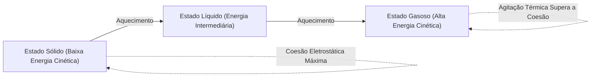
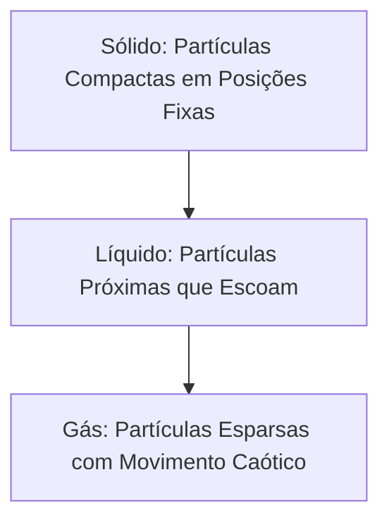
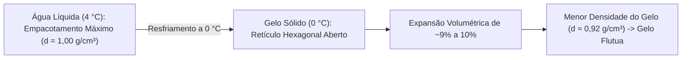
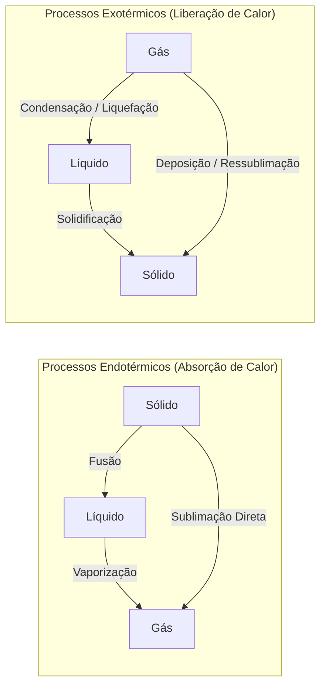
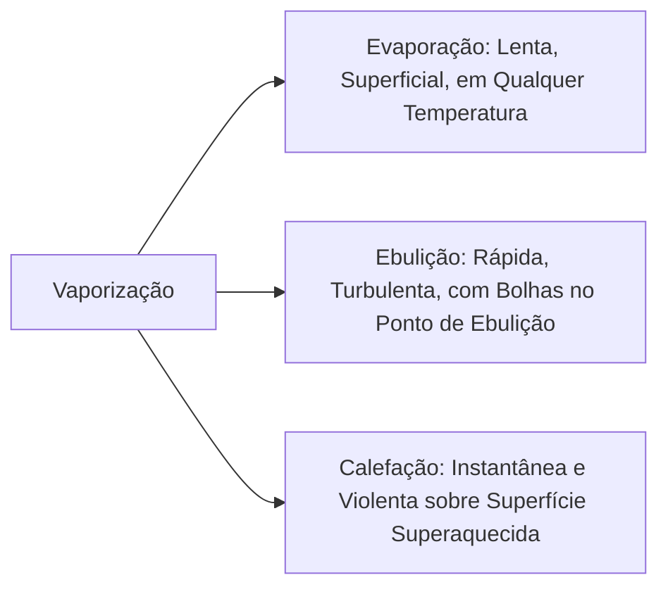
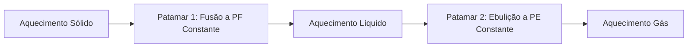
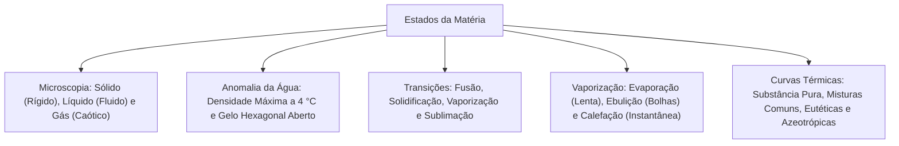

O estudo dos estados físicos e de suas mudanças é basilar em Química. Nos incêndios, o calor intenso transforma materiais sólidos em gases inflamáveis por pirólise. Ele também vaporiza a água de combate para abafar o fogo. Na atividade operacional dos bombeiros militares, o fenômeno BLEVE representa um dos maiores riscos em acidentes com carretas-tanque de GLP (gás liquefeito de petróleo). Quando as chamas externas aquecem o costado do tanque, o líquido interno atinge ebulição violenta e a pressão de vapor dispara. Se a válvula de alívio não suportar a vazão e o aço do tanque perder resistência térmica, ocorre a ruptura catastrófica da carcaça com expansão explosiva de vapor e formação de bola de fogo gigantesca.

Compreender o comportamento microscópico permite prever o estado físico sob qualquer condição de temperatura e pressão. Esse domínio separa transformações físicas de alterações químicas. Podemos imaginar as partículas em movimento contínuo em cada fase da matéria.

> [!objetivos]
> - Caracterizar os estados sólido, líquido e gasoso quanto à forma, volume e energia.
> - Compreender a distinção física rigorosa entre calor, temperatura e energia interna.
> - Explicar a dilatação anômala da água e suas consequências estruturais e ecológicas.
> - Classificar as mudanças de estado físico em endotérmicas e exotérmicas.
> - Diferenciar evaporação, ebulição e calefação, interpretando curvas térmicas.

## Os estados físicos fundamentais da matéria

A matéria é tudo aquilo que possui massa e ocupa lugar no espaço. O estado de agregação resulta do balanço entre duas forças opostas:

1. **Forças de coesão atrativa:** decorrem das interações intermoleculares. Elas aproximam as partículas e mantêm o arranjo ordenado.
2. **Energia cinética de agitação térmica:** decorre da velocidade das partículas. Ela é proporcional à temperatura absoluta e tende a dispersar a matéria.

A matéria manifesta-se convencionalmente em três estados: sólido, líquido e gasoso. Sob temperaturas extremas, surge o plasma como quarto estado da matéria, caracterizado por elétrons livres e íons gasosos em alta energia.

Examinemos as características de cada estado físico:

### Estado sólido

No estado sólido, as forças atrativas intermoleculares predominam sobre a agitação térmica.

- **Organização microscópica:** as partículas ficam muito próximas. Elas formam retículos cristalinos rígidos com distâncias mínimas.
- **Movimento:** as partículas não possuem translação livre. Elas realizam apenas vibrações ao redor de posições fixas de equilíbrio.
- **Forma e volume:** o sólido tem forma própria e volume fixo. Ele independe do formato do recipiente em que seja colocado.
- **Compressibilidade:** praticamente nula. Não existem espaços vazios apreciáveis entre as partículas no retículo.

### Estado líquido

No estado líquido, forças de atração e energia cinética encontram-se em equilíbrio dinâmico aproximado.

- **Organização microscópica:** as partículas continuam muito próximas. Porém, não há ordem rígida de longo alcance.
- **Movimento:** as partículas têm energia para deslizar e rolar umas sobre as outras de forma contínua. Isso confere fluidez ao líquido.
- **Forma e volume:** o líquido tem volume próprio e constante. Sua forma é variável, tendo a capacidade de assumir o formato de qualquer recipiente, frasco ou copo.
- **Compressibilidade:** muito baixa. O líquido resiste fortemente a reduções forçadas de volume sob pressão externa.

### Estado gasoso

No estado gasoso, a energia cinética supera amplamente as forças atrativas de coesão intermoleculares.

- **Organização microscópica:** as partículas ficam muito afastadas no espaço. As distâncias mútuas superam dezenas de vezes as dimensões atômicas.
- **Movimento:** as partículas movem-se com total liberdade e alta velocidade. O movimento é retilíneo, caótico e desordenado.
- **Forma e volume:** os gases possuem forma e volume variáveis. Eles expandem-se até ocupar todo o espaço volumétrico disponível.
- **Compressibilidade:** altíssima. Pelo grande espaço vazio entre as partículas, grandes volumes de gás cabem em cilindros pequenos. Isso ocorre nos cilindros de ar respirável dos bombeiros e botijões de GLP.

| Característica | Estado Sólido | Estado Líquido | Estado Gasoso |
| :--- | :--- | :--- | :--- |
| Distância média entre partículas | Mínima (muito próximas) | Intermediária (próximas) | Máxima (muito afastadas) |
| Organização estrutural | Rígida e ordenada | Desordenada com mobilidade | Totalmente caótica |
| Liberdade de movimento | Apenas vibração | Translação e deslizamento | Movimento caótico livre |
| Forma | Própria e fixa | Variável (adota o frasco ou copo) | Variável (ocupa o ambiente) |
| Volume | Próprio e constante | Próprio e constante | Variável (expansível) |
| Compressibilidade | Quase nula | Muito baixa | Muito elevada |
| Energia cinética média | Menor | Intermediária | Maior |

## Distinção conceitual: temperatura, calor e energia interna

Para resolver questões de concurso, o candidato deve dominar a distinção entre três conceitos físicos fundamentais:

1. **Temperatura:** mede a energia cinética média de agitação das partículas constituintes. Quanto maior a velocidade média das moléculas, maior a temperatura registrada no termômetro.
2. **Calor:** é a energia térmica em trânsito motivada exclusivamente por uma diferença de temperatura entre sistemas. O calor flui espontaneamente do corpo mais quente para o mais frio até o equilíbrio térmico. Um corpo não possui calor; ele recebe ou transfere calor.
3. **Energia interna:** é a soma de todas as energias microscópicas do sistema. Ela inclui a energia cinética de translação, rotação e vibração, somada à energia potencial das ligações químicas e interações intermoleculares.

> [!atencao]
> **Constância Térmica na Mudança de Fase**
> Durante a mudança de estado de uma substância pura a pressão constante, a temperatura permanece perfeitamente fixa do início ao fim da transformação.
> Todo o calor fornecido é consumido para romper ou rearranjar interações intermoleculares (calor latente). A energia cinética média das partículas não muda durante essa etapa.

## O comportamento anômalo da água e a dilatação no congelamento

A maioria das substâncias presentes na natureza contrai-se ao resfriar e solidificar. Pela relação d = m / V, a redução de volume para uma mesma massa eleva a densidade da fase sólida, fazendo o sólido afundar no próprio líquido.

A água apresenta um comportamento inverso, denominado anomalia térmica da água:

- Entre 0 °C e 4 °C, ao ser aquecida sob pressão normal de 1 atm, a água sofre contração volumétrica em vez de dilatação.
- A água atinge volume mínimo e densidade máxima a exatamente 4 °C, onde sua densidade atinge 1,000 g/cm³ (ou 1.000 kg/m³).

Ao resfriar de 4 °C para 0 °C, ocorre uma profunda reorganização molecular:

1. Na água líquida, as moléculas movem-se com relativa desordem. Elas agrupam-se com grande proximidade espacial.
2. Ao congelar a 0 °C, cada molécula fixa-se em um arranjo tetraédrico rígido sustentado por 4 ligações de hidrogênio.
3. Essa estrutura cria um retículo hexagonal aberto com amplos espaços vazios no interior do cristal de gelo.

Por causa dessa estrutura aberta, a mesma massa expande de 9% a 10% ao virar gelo:

- Para conter 100 litros de água líquida a 4 °C, são necessários aproximadamente 100 quilos de massa.
- Para conter os mesmos 100 litros com gelo a 0 °C, bastam cerca de 91,2 quilos de gelo.

Como o gelo tem densidade menor (cerca de 0,92 g/cm³) que a água líquida (1,00 g/cm³), ele flutua na água líquida. É por essa razão que pedras de gelo flutuam em um copo com água, suco ou drinques servidos em casa.

### Repercussões operacionais e ecológicas da anomalia da água

Essa propriedade singular gera impactos práticos importantes:

- **Ruptura de recipientes:** ao voltar da rua para casa e tentar resfriar bebidas de modo rápido, colocar uma garrafa de vidro lacrada cheia no congelador provoca seu rompimento. O congelamento expande a água contra as paredes rígidas, estourando a garrafa lacrada. Em locais frios, tubulações prediais rompem pelo mesmo motivo.
- **Preservação de vida aquática:** no inverno rigoroso, a superfície de lagos atinge 0 °C e congela primeiro, formando uma camada de gelo flutuante. Como o gelo é um ótimo isolante térmico, ele retém o calor no fundo. No leito do lago, a água permanece líquida na temperatura de densidade máxima (4 °C), mantendo peixes e plantas vivos.

> [!pegadinha]
> **Densidade da Água a 4 °C versus Gelo a 0 °C**
> A água líquida atinge sua densidade máxima a 4 °C.
> Ao congelar a 0 °C, ela expande e fica menos densa. Por isso, os blocos de gelo e icebergs flutuam com cerca de 90% do volume submerso e 10% emerso.

## Mudanças de estado físico: processos endotérmicos e exotérmicos

As mudanças de estado físico são fenômenos puramente físicos. A identidade molecular da substância química permanece intacta. Modificam-se apenas o espaçamento, o movimento e a energia das partículas.

As transições de fase dividem-se conforme o fluxo de calor:

1. **Processos endotérmicos:** ocorrem com absorção líquida de calor do meio externo (fusão, vaporização e sublimação).
2. **Processos exotérmicos:** ocorrem com liberação líquida de calor para o meio externo (solidificação, condensação e deposição).

Examinemos cada uma das transições de fase:

- **Fusão:** passagem do estado sólido para o líquido com absorção de calor. Ocorre no ponto de fusão (PF). Para a água a 1 atm, PF = 0 °C.
- **Solidificação:** passagem do líquido para o sólido com liberação de calor. Ocorre na mesma temperatura do ponto de fusão.
- **Vaporização:** passagem do líquido para o gasoso com absorção de calor. Ocorre no ponto de ebulição (PE). Para a água a 1 atm, PE = 100 °C.
- **Condensação ou liquefação:** passagem do gasoso para o líquido com liberação de calor. Usa-se condensação para vapores e liquefação para gases permanentes.
- **Sublimação:** passagem direta do sólido para o gasoso sem fase líquida intermediária. Exemplos: gelo seco (CO₂ sólido), naftalina e iodo.
- **Deposição ou ressublimação:** passagem direta do gasoso para o sólido com liberação de calor. Exemplo: formação de geada nas manhãs frias de inverno.

| Mudança de Fase | Estado Inicial | Estado Final | Sentido Energético | Temperatura (Água a 1 atm) |
| :--- | :--- | :--- | :--- | :--- |
| Fusão | Sólido | Líquido | Endotérmico (ganha calor) | 0 °C (PF) |
| Solidificação | Líquido | Sólido | Exotérmico (perde calor) | 0 °C (PF) |
| Vaporização | Líquido | Gás | Endotérmico (ganha calor) | 100 °C (PE) |
| Condensação / Liquefação | Gás | Líquido | Exotérmico (perde calor) | 100 °C (PE) |
| Sublimação | Sólido | Gás | Endotérmico (ganha calor) | À temperatura ambiente no CO₂ |
| Deposição / Ressublimação | Gás | Sólido | Exotérmico (perde calor) | Geada no inverno |

## As três modalidades de vaporização

A vaporização pode ocorrer por três mecanismos operacionais distintos que variam em velocidade e dinâmica térmica:

### Evaporação

É uma vaporização lenta, espontânea e suave. Ela ocorre exclusivamente na superfície livre do líquido.

- Acontece em qualquer temperatura na qual a substância permaneça líquida, abaixo do ponto de ebulição.
- Decorre do fato estatístico de que certas moléculas superficiais possuem energia cinética suficiente para escapar da atração das vizinhas.
- Exemplos: secagem de roupas no varal, poças de chuva secando no asfalto e suor corporal que resfria a pele ao evaporar.

### Ebulição

É uma vaporização rápida, turbulenta e vigorosa que envolve todo o volume líquido.

- Ocorre em temperatura fixa e determinada para dada pressão ambiente (ponto de ebulição).
- Inicia-se quando a pressão máxima de vapor do líquido iguala a pressão atmosférica circundante.
- Apresenta formação intensa de bolhas de vapor no interior do líquido, que sobem e se rompem na superfície. Exemplo: água em uma panela no fogão aquecida pela chama até 100 °C sob 1 atm.

### Calefação

É um processo de vaporização muito rápido, quase instantâneo e violento.

- Ocorre quando gotas de líquido tocam uma superfície sólida aquecida a temperatura muito superior ao ponto de ebulição do líquido.
- Uma camada delgada de vapor forma-se sob a gota, funcionando como colchão térmico que faz a gota deslizar e chiar enquanto evapora em frações de segundo. Exemplo: gotas de água espirradas sobre uma chapa metálica de fogão muito quente ou frigideira em brasa.

> [!bizu]
> **Pressão Atmosférica e Ebulição**
> O ponto de ebulição depende diretamente da pressão externa exercida sobre o líquido:
> - Ao nível do mar (1 atm): a água ferve a exatamente 100 °C.
> - Em altitudes elevadas (menor pressão, como La Paz): a água ferve abaixo de 100 °C (cerca de 87 °C), tornando o cozimento mais demorado.
> - Na panela de pressão (cerca de 2 atm): a água ferve a cerca de 120 °C, acelerando expressivamente o cozimento de alimentos.

## Determinação do estado físico a partir dos pontos de fusão e ebulição

Para descobrir o estado físico de uma amostra em dada temperatura, usamos a régua térmica definida por PF e PE:

1. Se T < PF: a substância encontra-se no **estado sólido**.
2. Se PF < T < PE: a substância encontra-se no **estado líquido**.
3. Se T > PE: a substância encontra-se no **estado gasoso**.

Observe os dados de substâncias representativas sob pressão de 1 atm:

| Substância Química | Ponto de Fusão (°C) | Ponto de Ebulição (°C) | Estado a 25 °C (1 atm) | Estado a -4 °C (Freezer) |
| :--- | :--- | :--- | :--- | :--- |
| Ferro metálico | 1.538 | 2.862 | Sólido | Sólido |
| Cobre metálico | 1.085 | 2.562 | Sólido | Sólido |
| Água pura | 0 | 100 | Líquido | Sólido |
| Nitrogênio | -210 | -195,8 | Gasoso | Gasoso |
| Metanol | -97,6 | 64,7 | Líquido | Líquido |
| Etanol | -114,1 | 78,3 | Líquido | Líquido |
| Octano (gasolina) | -56,8 | 125,7 | Líquido | Líquido |
| Butano (gás) | -138,4 | -0,5 | Gasoso | Líquido |
| Metano | -182,5 | -161,6 | Gasoso | Gasoso |

> [!resolvido]
> **Exercício Resolvido: Predição de Estados Físicos**
> Três substâncias puras apresentam os seguintes pontos sob 1 atm:
> - Amostra A: PF = 10 °C; PE = 110 °C.
> - Amostra B: PF = -37 °C; PE = 128 °C.
> - Amostra C: PF = 55 °C; PE = 179 °C.
> Determine o estado físico de cada uma a 25 °C e no freezer a -4 °C.
>
> **Resolução passo a passo:**
> 1. *A 25 °C:* A (líquido, pois 10 < 25 < 110); B (líquido, pois -37 < 25 < 128); C (sólido, pois 25 < 55).
> 2. *A -4 °C:* A (sólido, pois -4 < 10); B (líquido, pois -37 < -4 < 128); C (sólido, pois -4 < 55).
>
> **Conclusão:** A 25 °C, A e B são líquidas e C é sólida. A -4 °C, a substância A solidifica, B continua líquida e C continua sólida.

## Curvas de aquecimento: substâncias puras versus misturas

O comportamento térmico nas transições diferencia substâncias puras de misturas. Ao aquecer uma amostra sob taxa de calor constante, traçamos a curva de aquecimento de temperatura versus tempo:

### Substância pura

Exibe dois patamares horizontais com temperatura rigorosamente constante:

1. Primeiro patamar (Fusão): sólido e líquido coexistem com temperatura constante (PF fixo).
2. Segundo patamar (Ebulição): líquido e vapor coexistem com temperatura constante (PE fixo).

### Misturas comuns

Em misturas comuns (como água e sal de cozinha), as mudanças ocorrem em faixas variáveis de temperatura. Não existem patamares horizontais fixos durante o aquecimento.

### Misturas especiais: azeotrópicas e eutéticas

Duas misturas especiais simulam substâncias puras em uma das transições térmicas:

- **Mistura eutética:** possui ponto de fusão constante e ponto de ebulição variável. Exemplo: solda metálica (62% estanho e 38% chumbo, funde a 183 °C).
- **Mistura azeotrópica:** possui ponto de ebulição constante e ponto de fusão variável. Exemplo: álcool 96 ºGL (96% etanol e 4% água, ferve a 78,1 °C). Por isso, a destilação fracionada comum não produz etanol 100% puro.

| Tipo de Amostra | Comportamento na Fusão | Comportamento na Ebulição | Exemplo Típico |
| :--- | :--- | :--- | :--- |
| Substância pura | Temperatura constante (PF fixo) | Temperatura constante (PE fixo) | Água pura destilada |
| Mistura comum | Faixa de temperatura variável | Faixa de temperatura variável | Água com sal de cozinha |
| Mistura eutética | Temperatura constante (PF fixo) | Faixa de temperatura variável | Solda de chumbo e estanho |
| Mistura azeotrópica | Faixa de temperatura variável | Temperatura constante (PE fixo) | Álcool 96 ºGL (96% etanol) |

> [!esquema]
> **Resumo de Curvas de Aquecimento**
> - Dois patamares horizontais: substância pura.
> - Nenhum patamar horizontal: mistura comum.
> - Apenas o primeiro patamar constante (fusão): mistura eutética.
> - Apenas o segundo patamar constante (ebulição): mistura azeotrópica.

> [!exemplo]
> **Destilação Fracionada e o Azeótropo**
> O azeótropo etanol-água ferve a 78,1 °C, abaixo do etanol puro (78,3 °C) e da água (100 °C).
> O vapor tem a mesma proporção de 96% de álcool e 4% de água do líquido. A separação total exige agentes desidratantes ou destilação azeotrópica especial.

## Mapa do capítulo

Examinamos os estados físicos, a anomalia da água, as mudanças de fase endotérmicas e exotérmicas, as modalidades de vaporização e as curvas térmicas.

### Para fixar
- Sólidos têm forma e volume próprios; líquidos têm volume próprio e forma variável; gases têm forma e volume variáveis.
- Durante a mudança de fase de substância pura a pressão constante, a temperatura permanece constante.
- Calor é energia em trânsito por diferença de temperatura; temperatura mede a agitação cinética média.
- A água atinge densidade máxima a 4 °C; ao congelar a 0 °C, sua rede hexagonal expande o volume e o gelo flutua.
- Fusão, vaporização e sublimação são processos endotérmicos; solidificação, condensação e deposição são exotérmicos.
- Evaporação ocorre na superfície em qualquer temperatura; ebulição é turbulenta no PE; calefação é instantânea ao contato térmico.
- Se a temperatura for menor que o PF, o estado é sólido; entre PF e PE, líquido; acima do PE, gasoso.
- Substâncias puras exibem patamares horizontais fixos tanto na fusão quanto na ebulição.
- Misturas eutéticas possuem fusão constante e ebulição variável (ex.: solda de estanho e chumbo).
- Misturas azeotrópicas possuem ebulição constante e fusão variável (ex.: etanol 96% e água 4%).
