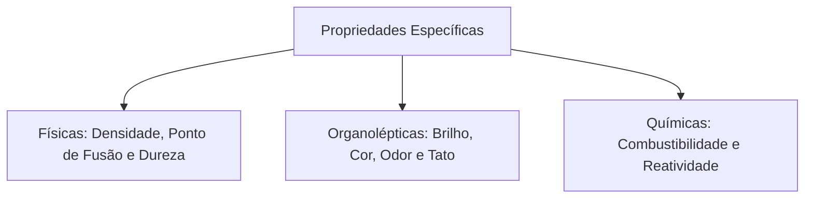
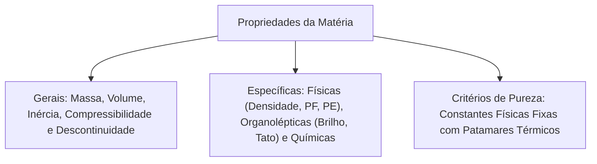

O conhecimento das propriedades da matéria e dos critérios de pureza tem aplicação prática direta. Na análise pericial pós-incêndio, na identificação de derramamento de produtos químicos e no controle de agentes extintores, o profissional precisa distinguir características gerais de propriedades específicas que individualizam cada substância.

As propriedades da matéria dividem-se em dois grandes grupos: gerais, que pertencem a qualquer corpo, e específicas, que permitem identificar substâncias puras.

> [!objetivos]
> - Diferenciar propriedades gerais e específicas da matéria.
> - Compreender conceitos como compressibilidade, descontinuidade, densidade e brilho.
> - Calcular o volume de sólidos irregulares pelo método do deslocamento de líquidos.
> - Distinguir propriedades físicas, químicas e organolépticas.
> - Aplicar critérios de pureza fundamentados em constantes termodinâmicas fixas.

## Propriedades gerais da matéria e fenômenos associados

Propriedades gerais são características compartilhadas por qualquer porção de matéria, independentemente de sua composição química. Por serem universais, elas não bastam para identificar uma substância desconhecida.

O estudo cotidiano e a experiência diária ilustram essas propriedades com clareza:
1. **Massa:** quantifica a inércia e a quantidade de matéria de um corpo.
2. **Extensão (Volume):** espaço tridimensional ocupado pela matéria.
3. **Inércia:** tendência natural de manter o estado de repouso ou movimento retilíneo uniforme. Quando um passageiro está em pé em um ônibus e o veículo freia bruscamente, ele é projetado para a frente em virtude de sua própria inércia.
4. **Impenetrabilidade:** dois corpos não podem ocupar simultaneamente o mesmo lugar no espaço físico.
5. **Compressibilidade:** capacidade de reduzir o volume quando submetido a uma pressão externa. Essa propriedade é notória nos gases; por exemplo, uma grande massa de gás de cozinha é comprimida no interior de um botijão sob alta pressão.
6. **Elasticidade:** capacidade de retornar à forma e ao volume primitivos após cessar a ação da força deformadora.
7. **Divisibilidade:** possibilidade de fracionar uma amostra em porções menores sem alterar sua identidade química original.
8. **Descontinuidade:** existência de espaços vazios microscópicos entre as partículas que formam a matéria. A matéria macroscópica aparente não consiste em um bloco maciço contínuo.

> [!resolvido]
> **Exercício Resolvido: Volume de Sólido por Deslocamento**
> Uma proveta graduada contém 62 mL de água destilada. Um perito dos bombeiros mergulha uma peça metálica irregular no líquido. O nível da água sobe para 77 mL. Sabendo que a peça possui massa de 135 gramas, determine o volume e a densidade do metal.
>
> **Resolução passo a passo:**
> 1. *Volume deslocado:* V = V_final - V_inicial = 77 mL - 62 mL = 15 mL. Como 1 mL equivale a 1 cm³, temos V = 15 cm³.
> 2. *Densidade:* d = m / V = 135 g / 15 cm³ = 9,0 g/cm³.
>
> **Conclusão:** O volume é 15 cm³ e a densidade é 9,0 g/cm³, compatível com ligas de cobre e bronze.

## Propriedades específicas: físicas, químicas e organolépticas

As propriedades específicas são próprias de cada substância pura, permitindo sua identificação inequívoca no laboratório ou em ocorrências periciais. Elas consistem em três categorias fundamentais:

- **Propriedades Físicas:** observadas e medidas sem transformar a composição química da substância. Destacam-se a densidade (d = m / V), o ponto de fusão, o ponto de ebulição, a solubilidade e a dureza mecânica. A dureza expressa a resistência ao desgaste superficial; na escala mineralógica, um corpo com menor dureza acaba riscado por outro material mais duro (como o diamante, que risca o vidro).
- **Propriedades Organolépticas:** percebidas diretamente pelos sentidos humanos sem instrumentos. Pelo tato, o observador sentirá a maciez ao tocar uma fibra de algodão, enquanto notará aspereza em uma lixa. Pelo paladar, notará o sabor característico e azedo do suco de limão. O brilho também se enquadra aqui, correspondendo à capacidade da superfície de refletir a luz incidente.
- **Propriedades Químicas:** manifestadas quando a matéria sofre transformação em sua constituição molecular íntima, como a combustibilidade, o potencial de oxidação e a reatividade perante ácidos e bases.

> [!bizu]
> **Dureza versus Tenacidade**
> Não confunda essas propriedades mecânicas em provas da banca:
> - Dureza: resistência de um material ao risco superficial por outro corpo.
> - Tenacidade: resistência a choques mecânicos e impactos sem sofrer fratura.

## Critérios de pureza e comportamento de substâncias puras

Para certificar se determinado produto químico é puro ou impuro, os químicos utilizam critérios fundamentados em grandezas físicas intensivas invariáveis sob pressão controlada.

Uma substância pura simples ou composta apresenta constantes termodinâmicas fixas e bem delineadas:
- Densidade constante a uma temperatura padrão.
- Ponto de fusão rigorosamente constante (patamar isotérmico durante toda a fusão).
- Ponto de ebulição rigorosamente constante (patamar isotérmico durante a vaporização).

Quando há presença de impurezas dissolvidas, o sistema passa a se comportar como uma mistura. Isso acarreta alteração nas temperaturas de transição e o desaparecimento dos patamares térmicos fixos, gerando intervalos ou faixas variáveis de temperatura. A análise desse comportamento em laboratório consiste no método mais confiável de verificação de pureza.

| Categoria | Propriedade | Descrição | Exemplo Prático |
| :--- | :--- | :--- | :--- |
| Geral | Compressibilidade | Redução de volume sob pressão externa | Gás contido sob pressão em botijão metálico |
| Geral | Descontinuidade | Existência de espaços vazios entre partículas | Difusão de vapores inflamáveis pelo ar |
| Específica Física | Densidade | Razão invariável entre massa e volume | Chumbo afunda na água, enquanto o óleo sobrenada |
| Específica Física | Dureza | Resistência apresentada contra o risco | Quartzo deixa o gesso riscado na amostra |
| Específica Organoléptica | Tato e Textura | Percepção sensorial de consistência | Suavidade ao toque macio de mecha de algodão |
| Específica Organoléptica | Brilho | Capacidade de refletir a luz incidente | Superfície metálica polida de latão ou prata |
| Específica Química | Combustibilidade | Reação exotérmica vigorosa com oxigênio | Queima de álcool etílico em motor a combustão |

## Mapa do capítulo

Examinamos a distinção entre propriedades gerais e específicas, os conceitos de compressibilidade e descontinuidade, a medição de densidade e os critérios termodinâmicos de pureza.

### Para fixar
- Propriedades gerais são universais e não servem para identificar substâncias isoladas.
- Inércia mantém o estado de movimento ou repouso até ação de força resultante.
- Compressibilidade é a redução volumétrica sob pressão externa, expressiva nos gases.
- Descontinuidade evidencia a presença de espaços vazios microscópicos na matéria.
- O volume de sólidos irregulares afere-se pelo deslocamento de líquido na proveta.
- Densidade calcula-se pela razão d = m / V e independe da extensão da amostra.
- Dureza afere a resistência ao risco superficial; tenacidade resiste ao impacto mecânico.
- Brilho e tato são propriedades organolépticas avaliadas pela percepção sensorial humana.
- Combustibilidade é propriedade química que envolve reação com alteração molecular íntima.
- Substâncias puras apresentam pontos de fusão e de ebulição rigorosamente constantes.
