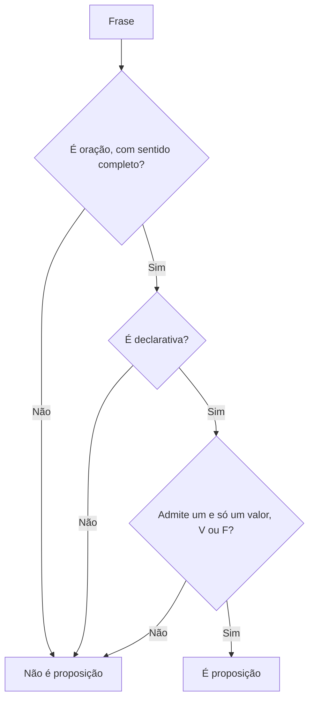

A lógica proposicional é a base de todo o raciocínio lógico cobrado em concursos. Antes de combinar frases com conectivos, montar tabelas-verdade ou avaliar argumentos, é preciso saber o que é uma frase "logicamente tratável". Essa frase tem nome: **proposição**. Quase toda questão do assunto começa por aí, e muitas se resolvem apenas com a definição. Este capítulo mostra o que uma proposição é, quais características ela precisa ter e como separar, com segurança, o que é proposição do que não é.

> [!objetivos]
> - Definir proposição lógica e enumerar seus três requisitos.
> - Distinguir sentenças declarativas, interrogativas, exclamativas, imperativas e optativas.
> - Reconhecer sentenças abertas, paradoxos e frases subjetivas, que não são proposições.
> - Explicar valor lógico e por que não é preciso saber se a frase é verdadeira para saber se é proposição.

## A definição

Uma **proposição lógica** é uma oração declarativa à qual se pode atribuir um, e apenas um, entre dois valores lógicos: **verdadeiro (V)** ou **falso (F)**.

A definição tem três partes, e cada uma funciona como um filtro. Uma frase só é proposição se passar pelos três:

1. ela é uma **oração**, isto é, tem sentido completo, normalmente indicado por um verbo;
2. ela é **declarativa**, ou seja, afirma ou nega algo;
3. ela admite **um e apenas um** dos dois valores lógicos, V ou F.

> [!bizu] Três filtros em sequência
> Quando a banca pedir "qual das frases é uma proposição", aplique os filtros na ordem: oração, declarativa, um só valor. A maior parte das frases cai no segundo filtro, porque as bancas adoram exclamações, perguntas e ordens.

## Requisito 1: ser uma oração

A oração é a frase com sentido completo, em que há um verbo. "Salvador é a capital da Bahia" é oração. Já "dois mil mais vinte mais dois" não é: é um grupo de palavras sem verbo, que não diz nada sobre nada. Esse tipo de enunciado é uma **expressão**, e não uma proposição.

Esse requisito vale também na matemática. A igualdade "3 + 5 = 8" funciona como oração, porque o sinal de igual faz o papel do verbo ("três mais cinco é igual a oito"). Ela é, portanto, uma proposição verdadeira. Em contrapartida, "3 + 5" sozinho é apenas uma expressão numérica. E "7 > 10" é uma proposição falsa, o que mostra que **proposição falsa continua sendo proposição**.

| Frase | É oração? | Observação |
| --- | --- | --- |
| A Terra gira em torno do Sol. | Sim | Tem verbo e sentido completo |
| Dois mil mais vinte mais dois | Não | Expressão sem verbo |
| 3 + 5 = 8 | Sim | O sinal de igual faz o papel do verbo |
| 3 + 5 | Não | Expressão numérica |
| 7 > 10 | Sim | Proposição, ainda que falsa |

## Requisito 2: ser declarativa

Uma sentença **declarativa** declara, isto é, afirma ou nega alguma coisa a respeito de algo. Ela pode ser **afirmativa** ("Taubaté fica em São Paulo") ou **negativa** ("João não é nordestino"). As duas formas são proposições.

Não são proposições as sentenças que, mesmo com verbo, não declaram nada:

| Tipo de sentença | Função | Exemplo |
| --- | --- | --- |
| Declarativa | Afirma ou nega | O curso começa em março. |
| Interrogativa | Pergunta | Que horas o curso começa? |
| Exclamativa | Exprime emoção | Que dia lindo! |
| Imperativa | Ordena, pede, aconselha | Feche a porta. |
| Optativa | Exprime desejo | Que Deus o abençoe. |

Repare que "Feche a porta" tem verbo e sentido completo, e mesmo assim não é proposição. **Ter verbo não basta**: a frase precisa ser declarativa. Uma ordem não é verdadeira nem falsa; ela é cumprida ou descumprida.

> [!pegadinha] "Proposição exclamativa" não existe
> Afirmações que classificam uma exclamação como "proposição exclamativa" estão erradas por inventarem um tipo que não existe. Exclamativa é um tipo de **sentença**, e proposição, por definição, é declarativa. Se a questão chamar uma exclamação de proposição, marque como erro. Cuidado também com o ponto de exclamação: "Pelé é o maior jogador de todos os tempos!" é exclamativa na forma. Para o gabarito, o que decide é o tipo de sentença.

> [!atencao] Pergunta retórica continua sendo pergunta
> Uma frase como "É justo que toda a população pague pelos erros de seus dirigentes?" pode até insinuar uma opinião, mas é interrogativa. Não é proposição, nem simples nem composta. O erro típico é tentar classificá-la antes de perceber que ela nem chega a ser proposição.

## Requisito 3: um, e apenas um, valor lógico

O valor lógico é a conclusão a que se chega ao julgar uma proposição. Na lógica clássica, adotada nas provas, só há duas conclusões possíveis, verdadeiro ou falso, e nunca as duas ao mesmo tempo. Portanto, para ser proposição, a frase precisa ter condições de ser julgada como V ou como F, mas apenas uma das duas coisas.

Note o que isso significa: **não é preciso saber qual é o valor lógico da frase**. Basta que ela tenha a capacidade de ser verdadeira ou falsa. "Existe vida em outros planetas" é proposição, ainda que ninguém hoje saiba dizer se é V ou F. A questão é apenas se faz sentido julgá-la, e faz. Da mesma forma, "choverá em Fortaleza no dia 1º de janeiro de 2040" é proposição: será V ou será F, e ninguém precisa saber hoje qual.

Há três grupos de frases que não admitem um e apenas um valor lógico: as sentenças abertas, os paradoxos e as frases de alta subjetividade.

### Sentenças abertas

Uma **sentença aberta** contém uma variável ou um termo indefinido, de modo que não é possível julgá-la sem saber a quem ela se refere. "x + 3 = 8" é aberta: se x vale 5, é verdadeira; se x vale 2, é falsa. "Ele correu 100 metros em menos de dez segundos" também é aberta, porque o pronome "ele" não está definido. Como a verdade depende do valor da variável, a frase isolada não é proposição.

As sentenças abertas podem virar proposição de duas maneiras:

- **Atribuindo-se um valor** à variável: "5 + 3 = 8" é verdadeira.
- **Usando um quantificador**, termo que indica a quantos casos a frase se aplica. Os mais comuns são "todo" e suas variantes, "nenhum", "algum", "pelo menos um" e "existe". Por exemplo, "para todo x, x + 3 = 8" é uma proposição (falsa, porque nem todo x serve), e "existe x tal que x + 3 = 8" é uma proposição (verdadeira, pois x = 5 serve).

> [!exemplo] Aberta ou fechada?
> "Ele é engenheiro" é aberta, porque "ele" não está definido. "Carlos é engenheiro" é proposição. "Alguém é engenheiro" também é proposição, pois o quantificador "alguém" ("existe pelo menos uma pessoa") fecha a frase: será V se existir algum engenheiro e F se não existir nenhum.

### Paradoxos

Um **paradoxo** é uma frase que leva a uma contradição quando se tenta julgá-la. O exemplo clássico é "Esta frase é falsa". Se ela for verdadeira, então o que ela diz se confirma e ela é falsa; se for falsa, então ela diz a verdade e é verdadeira. Em nenhum caso a frase tem um valor lógico estável, e por isso não é proposição.

### Frases de alta subjetividade

Quando a verdade depende do gosto de cada um, não há critério objetivo para atribuir V ou F. "Maria é formosíssima", "este filme é um tédio", "o melhor sabor de sorvete é o de limão" são juízos de valor. Embora possam ser discutidos, não se enquadram como proposições na lógica das provas.

A fronteira exige atenção. "Maria mede 1,80 metro" é proposição, porque se pode medir. "Maria é alta" pode ser levada a duas leituras, e a banca costuma indicar no enunciado o que considerar. Na dúvida, avalie se há um critério objetivo para decidir.

## Sentenças do dia a dia sob o filtro da lógica

Para treinar o olhar, vale observar como frases comuns se comportam diante dos três filtros. O objetivo não é decorar exemplos, mas perceber o padrão.

**Frases sobre fatos conhecidos ou desconhecidos.** "Os tubarões são mamíferos" é proposição falsa. "O Ceará faz fronteira com o Piauí" é proposição verdadeira. "Há exatamente 58 espécies de aves em um parque que ninguém contou" é proposição, ainda que a resposta seja desconhecida: existe um número real de espécies, logo a frase é V ou é F.

**Frases sobre o futuro.** "Amanhã fará calor" e "o time ganhará o campeonato em 2030" falam de eventos que ainda não ocorreram. Elas são proposições, porque no momento em que o futuro chegar, estarão confirmadas ou desmentidas. Não confunda isso com uma previsão incerta, como "talvez chova amanhã": a palavra "talvez" retira a afirmação e torna a frase de difícil classificação. Em geral, a banca não a cobra como proposição.

**Frases sobre o passado.** "Em 2009, um atleta correu cem metros em menos de dez segundos" é proposição. Nada impede de confirmar o fato, e por isso a frase tem valor lógico definido, ainda que você não o conheça.

**Frases com pronomes e tempo.** "Hoje é segunda-feira" e "ele já saiu" dependem de quando e de quem. Em lógica rigorosa, são sentenças abertas até que o dia e a pessoa sejam definidos. Em prova, quando o enunciado fixa o contexto, a frase passa a ser tratada como proposição. Quando o contexto falta e a banca pergunta o que é proposição, o gabarito costuma considerar "ele" e "isto" como termos indefinidos.

**Frases que parecem declarativas, mas são pedidos ou conselhos.** "Seria bom que você mandasse a mensagem ainda hoje" tem forma declarativa, porém expressa uma sugestão. A banca costuma usar esse tipo para testar se o candidato reconhece o sentido da frase, e não apenas a forma. Se o conteúdo é uma sugestão ou um pedido, não há valor lógico a atribuir.

> [!atencao] Forma e sentido
> A pontuação ajuda, mas não decide. Uma frase terminada em ponto pode ser imperativa ("Entregue o trabalho cedo."), e uma frase com ponto de interrogação pode, em linguagem informal, esconder uma afirmação. Leia o sentido: a frase afirma algo verificável, ou pergunta, ordena, deseja, exclama?

### O papel do quantificador na prática

Os quantificadores são o ponto em que as sentenças abertas se transformam em proposições, e por isso merecem atenção. Eles se dividem em dois grandes grupos.

| Grupo | Palavras típicas | Efeito |
| --- | --- | --- |
| Universal | todo, qualquer, cada, para todo, qualquer que seja, nenhum | A frase vale para todos os elementos (ou para nenhum) |
| Existencial | algum, existe, pelo menos um, há, existe um único | A frase vale para ao menos um elemento |

Com um quantificador, a frase "x é par" vira "todo número inteiro é par" (falsa) ou "existe número inteiro par" (verdadeira). Perceba que a primeira só será verdadeira se não houver nenhuma exceção, e a segunda será verdadeira se houver ao menos um caso. Essa assimetria será importante quando você estudar a negação de proposições com "todo" e "algum", que aparece em volumes posteriores.

> [!bizu] Pronome sem referência é pista
> Quando uma frase de prova começa com "ele", "ela", "isto", "aquilo" ou usa letras como x e n sem dizer quem são, desconfie de sentença aberta. Se o enunciado trouxer logo antes quem é o "ele", a leitura muda, e a frase passa a ser proposição.

## Dez frases para classificar

Para consolidar, classifique as frases e confira a explicação.

1. "Quantos votos o candidato recebeu?" — interrogativa: **não** é proposição.
2. "O candidato recebeu mais de mil votos." — declarativa, V ou F: **é** proposição.
3. "Que apuração tranquila!" — exclamativa: **não** é proposição.
4. "Confira a apuração." — imperativa: **não** é proposição.
5. "x² = 49" — aberta: **não** é proposição (vira proposição com x = 7, ou com um quantificador).
6. "Existe número real x tal que x² = 49." — existencial, verdadeira (x = 7 e x = -7): **é** proposição.
7. "Esta afirmação é falsa." — paradoxo: **não** é proposição.
8. "Todo triângulo tem três lados." — universal, verdadeira: **é** proposição.
9. "A cidade do Recife é lindíssima." — subjetiva: **não** é proposição.
10. "O Recife é a capital de Pernambuco." — declarativa, V: **é** proposição.

> [!pegadinha] Verdade provável não é verdade
> Há frases que a maioria das pessoas considera verdadeiras, como "a música é a mais bela forma de arte". Elas continuam sendo subjetivas. Não confunda o que é amplamente aceito com o que é objetivamente verificável.

## Reunindo os requisitos

A tabela a seguir classifica frases comuns de prova. Leia a coluna do motivo, porque é o raciocínio que se repete.

| Frase | Proposição? | Motivo |
| --- | --- | --- |
| Brasília é a capital do Brasil. | Sim | Declarativa, V |
| O Sol gira em torno da Terra. | Sim | Declarativa, F |
| 12 é um número primo. | Sim | Declarativa matemática, F |
| Qual é o seu nome? | Não | Interrogativa |
| Que susto! | Não | Exclamativa |
| Entregue o relatório hoje. | Não | Imperativa |
| Que ele seja feliz. | Não | Optativa |
| x - 4 = 10 | Não | Sentença aberta |
| Esta frase é falsa. | Não | Paradoxo |
| Esta sobremesa é deliciosa. | Não | Subjetiva |
| Todo número par é divisível por 2. | Sim | Quantificador; V |

> [!resolvido] Questão comentada: estrelas e habitantes
> Julgue como certo ou errado: "O número de estrelas da Via Láctea é maior que o número de habitantes do planeta" é uma proposição.
>
> **Resolução.** Certo. A frase é uma oração (há o verbo "ser"), é declarativa (compara duas quantidades) e admite um e só um valor lógico: ou o número de estrelas é maior, ou não é. Ninguém precisa contar as estrelas para reconhecer que a frase pode ser julgada, e isso basta para que seja proposição.

> [!resolvido] Questão comentada: ordem com verbo
> Julgue: a frase "Saia daqui!" é uma proposição simples.
>
> **Resolução.** Errado. A frase é imperativa (e também exclamativa pela pontuação). Embora tenha verbo, não declara nada, não é verdadeira nem falsa. Logo, não é proposição.

## Proposições e a prova: padrões de cobrança

As bancas variam pouco o formato. Seguem os padrões mais frequentes:

1. **A frase com verbo que não declara.** Ordens e perguntas têm verbo. A pegadinha é fazer o candidato achar que "tem verbo, então é proposição".
2. **A frase verdadeira só em tese.** Uma afirmação sobre o futuro ou sobre fatos desconhecidos continua sendo proposição.
3. **A expressão matemática.** "2 + 3 = 5" é proposição. "2 + 3" não é.
4. **A sentença aberta disfarçada.** Pronomes sem referência ("ele", "ela", "isto") e variáveis ("x", "n") escondem sentenças abertas.
5. **O quantificador que fecha a frase.** "Todo", "nenhum", "algum" e "existe" transformam a aberta em proposição, e o candidato precisa perceber.
6. **O rótulo inventado.** "Proposição exclamativa", "proposição interrogativa". Esses tipos não existem.

> [!atencao] Falsa também é proposição
> Um erro comum é achar que só é proposição aquilo que é verdadeiro. A definição fala em "verdadeiro ou falso". "A baleia é um peixe" é uma proposição falsa. A utilidade dessa observação é grande, porque nos capítulos seguintes você vai trabalhar justamente com proposições falsas, como parte do raciocínio.

> [!exemplo] Treino rápido
> Classifique: (a) "Quantos alunos faltaram?"; (b) "Faltaram quatro alunos."; (c) "Ele faltou."; (d) "Todos faltaram."; (e) "Que bom que ninguém faltou!".
>
> (a) interrogativa, não é proposição. (b) declarativa, é proposição. (c) aberta, porque "ele" não está definido. (d) declarativa com quantificador, é proposição. (e) exclamativa, não é proposição.

## Por que isso importa no restante do volume

Tudo o que vem a seguir depende desta base. As **proposições simples** são as peças elementares: frases declarativas que não podem ser divididas em outras proposições. As **proposições compostas** são formadas ligando proposições simples por conectivos. Se o aluno não souber identificar uma proposição, não saberá em que lugar entra o conectivo, nem que valores V ou F atribuir. Por isso, a prática desta etapa é treinar o olhar: toda frase que aparecer nas questões deve passar pelos três filtros antes de qualquer outra análise.

Um bom hábito é o de reescrever a frase em sua forma mais simples, retirando enfeites e pontuação, e perguntar: "isto afirma ou nega alguma coisa que eu poderia, em princípio, verificar?". Se a resposta for sim, provavelmente é proposição. Se a frase pede, pergunta, exclama, deseja ou depende de um termo indefinido, provavelmente não é.

## Proposições na linguagem matemática

Muitas questões usam igualdades, desigualdades e equações para disfarçar a pergunta. Vale ter regras claras para esse terreno.

| Enunciado matemático | Classificação | Por quê |
| --- | --- | --- |
| 9 - 4 = 5 | Proposição verdadeira | Igualdade sem variável |
| 6 + 2 > 11 | Proposição falsa | Desigualdade sem variável |
| 2x + 1 = 7 | Sentença aberta | Depende do valor de x |
| 2x + 1 = 7, com x = 3 | Proposição verdadeira | O valor de x foi atribuído |
| Para todo x real, x + 0 = x | Proposição verdadeira | Quantificador universal |
| 5 + 8 | Expressão | Não afirma nada |

A regra de ouro: **igualdade ou desigualdade sem variável livre é proposição**; com variável livre, é sentença aberta; sem sinal de igualdade ou de comparação, é só expressão. Os problemas de prova costumam explorar a transição entre as três situações no mesmo enunciado.

## Vocabulário do capítulo

Quatro palavras vizinhas causam confusão, e conhecer cada uma evita erros de leitura.

| Termo | Sentido | Exemplo |
| --- | --- | --- |
| Expressão | Conjunto de palavras ou símbolos sem sentido completo | "a capital do país" |
| Sentença | Pensamento com sentido completo, de qualquer tipo | "Quem chegou?" |
| Proposição | Sentença declarativa com um só valor lógico | "Brasília é a capital do país." |
| Valor lógico | Resultado do julgamento: V ou F | "V" para a frase anterior |

Em provas, é comum a palavra **expressão** aparecer com o sentido de sentença, e a banca costuma aceitar essa troca como sinônimo. O que não se aceita é chamar toda sentença de proposição, porque a proposição é um tipo especial de sentença.

> [!exemplo] Julgando três afirmações
> Considere: (I) "Toda proposição é uma sentença." (II) "Toda sentença é uma proposição." (III) "Uma proposição pode ser falsa." Apenas (I) e (III) estão certas. Em (I), proposição é um tipo de sentença, a declarativa de valor lógico único. Em (II), a afirmação é falsa, porque há sentenças interrogativas e imperativas que não são proposições. Em (III), proposição falsa é proposição.

## Como treinar

A habilidade de reconhecer proposições se constrói com repetição curta e atenta. Um método simples é pegar manchetes, avisos e frases de um texto qualquer e passá-los pelos três filtros: oração, declarativa, um só valor. Em dois minutos por dia, o aluno percebe padrões, como o uso de interrogações retóricas em títulos de reportagem e de verbos no imperativo em avisos. Esse hábito reduz erros em questões de aparência simples.

Outra técnica é a **tentativa de teste**: tente responder "verdadeiro ou falso?" à frase. Se a resposta natural for "isso depende de quem", "não sei do que se trata", "é uma pergunta" ou "é uma ordem", a frase provavelmente não é proposição. Se a resposta for "pode ser verdadeiro ou falso, a depender dos fatos", ela é proposição, mesmo que você não conheça os fatos.

### Um exercício de leitura em três passos

Para fixar o método, tome qualquer frase e responda, nesta ordem: (1) "isto é oração?", (2) "isto afirma ou nega algo?", (3) "dá para dizer, em princípio, V ou F?". Aplique à frase "Ninguém admitiu o erro cometido ontem". Passo 1: há verbo, "admitiu", e sentido completo. Passo 2: nega que alguém tenha admitido algo, logo é declarativa negativa. Passo 3: o quantificador "ninguém" fecha a frase e permite julgá-la como V ou F. Conclusão: é proposição.

Agora aplique à frase "Lembre-se de entregar o formulário". Passo 1: há verbo, "lembrar". Passo 2: a frase é um pedido, e não afirma nem nega nada. Conclusão: não é proposição, já no segundo passo.

Quanto mais cedo a frase é barrada, mais rápido é o raciocínio. Com a prática, o filtro da declarativa elimina quase todos os enunciados que não são proposições, e a análise do valor lógico fica reservada para os casos de sentença aberta, paradoxo e subjetividade.

## Mapa do capítulo

| Tema | Ideia central | Armadilha |
| --- | --- | --- |
| Definição | Oração declarativa com um e só um valor lógico | Achar que ter verbo basta |
| Oração | Sentido completo, com verbo (ou sinal de igual) | Tratar "2 + 3" como proposição |
| Declarativa | Afirma ou nega | Aceitar ordens e perguntas |
| Tipos de sentença | Declarativa, interrogativa, exclamativa, imperativa, optativa | Falar em "proposição exclamativa" |
| Valor lógico | V ou F, nunca ambos | Exigir que se conheça o valor |
| Sentença aberta | Variável ou termo indefinido | Esquecer o efeito dos quantificadores |
| Paradoxo | Contradição ao julgar | Aceitar "esta frase é falsa" |
| Subjetividade | Opinião sem critério objetivo | Misturar gosto e fato |

### Para fixar

1. Proposição é oração declarativa que admite um, e apenas um, dos dois valores lógicos, verdadeiro ou falso.
2. Três filtros: ser oração, ser declarativa e ter um só valor lógico.
3. Expressões sem verbo, como "dois mais três", não são proposições.
4. Sentenças interrogativas, exclamativas, imperativas e optativas não são proposições.
5. Ter verbo não basta: "Feche a porta" tem verbo e não é proposição.
6. Para ser proposição, não é preciso saber se a frase é verdadeira ou falsa; basta que possa ser julgada.
7. Proposição falsa continua sendo proposição.
8. Sentenças abertas (com variável ou termo indefinido) não são proposições, mas quantificadores ou valores atribuídos as transformam em proposições.
9. Paradoxos, como "esta frase é falsa", e frases de alta subjetividade não são proposições.
10. "Proposição exclamativa" ou "proposição interrogativa" são rótulos que não existem.
