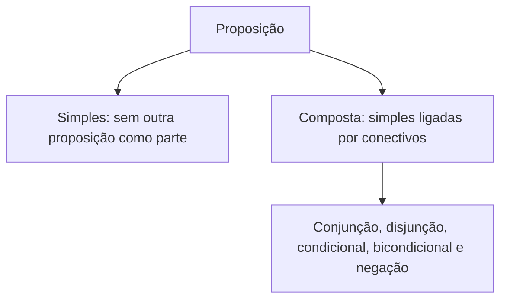

Entendido o que é uma proposição, o passo seguinte é compreender como as proposições se comportam. O capítulo anterior terminou com uma pergunta natural: as proposições podem ser combinadas? A resposta é sim, e é aí que a lógica ganha poder. Mas, antes de combinar, é preciso fixar três bases: as leis que regem a lógica clássica, a noção de proposição simples e a operação mais elementar, a **negação**. Só então se apresentam as proposições compostas e os conectivos que as formam.

> [!objetivos]
> - Enunciar os três princípios da lógica bivalente: identidade, não contradição e terceiro excluído.
> - Reconhecer uma proposição simples e representá-la por uma letra.
> - Negar proposições corretamente, evitando os erros dos antônimos e das subordinadas.
> - Aplicar a regra da dupla negação, inclusive com várias negações em sequência.
> - Identificar proposições compostas e os cinco conectivos lógicos.

## Proposição, sentença e expressão

Uma revisão rápida ajuda a organizar o vocabulário. **Sentença** é qualquer enunciado com sentido completo: pode ser uma pergunta, uma ordem, um desejo ou uma afirmação. **Proposição** é a sentença declarativa que pode ser julgada como verdadeira ou falsa. **Expressão** é um conjunto de termos que, sozinho, não forma pensamento completo. Em concursos, a palavra "expressão" costuma aparecer como sinônimo de sentença, e as bancas toleram essa troca. O que se mantém é que toda proposição é sentença, mas nem toda sentença é proposição.

| Texto | Classificação | Motivo |
| --- | --- | --- |
| O canguru é um marsupial. | Proposição | Declarativa, com valor V |
| Quem administra a empresa? | Sentença, mas não proposição | Interrogativa |
| Pare o veículo agora! | Sentença, mas não proposição | Imperativa e exclamativa |
| O cargo de gerente | Expressão | Sem verbo nem sentido completo |

Todo texto que aparece em uma questão pode ser testado com essa pergunta: é declarativo e admite V ou F? Só então vale a pena analisar se é simples ou composta.

## A lógica bivalente e as leis do pensamento

A lógica estudada nos concursos recebe vários nomes: **lógica bivalente**, **lógica clássica**, **lógica proposicional** e **lógica aristotélica**. É bivalente porque admite apenas dois valores para uma proposição, verdadeiro e falso. Ela se apoia em três princípios, conhecidos como leis do pensamento:

| Princípio | Enunciado | Exemplo |
| --- | --- | --- |
| Identidade | Uma proposição verdadeira é sempre verdadeira, e uma falsa é sempre falsa | "7 é primo" é verdadeira em qualquer contexto |
| Não contradição | Uma proposição não pode ser verdadeira e falsa ao mesmo tempo | "A porta está aberta" não pode ser V e F no mesmo instante |
| Terceiro excluído | Uma proposição é verdadeira ou falsa; não há um terceiro valor | Não existe "talvez" como valor lógico |

Esses princípios parecem óbvios, mas são o que permite raciocinar: se um valor puder mudar ou for duplo, nenhuma conclusão é segura. A todo momento, nos próximos capítulos, você vai usá-los de forma implícita, ao dizer que, se uma proposição não é verdadeira, então é falsa.

> [!bizu] Memorize pela ordem
> Identidade, não contradição, terceiro excluído. Para lembrar: o valor **se mantém** (identidade), **não é dois** (não contradição) e **não há terceiro** (terceiro excluído). Se a banca perguntar qual princípio impede o valor "talvez", a resposta é o terceiro excluído.

## Proposição simples

**Proposição simples** é aquela que não contém outra proposição como parte. É a unidade mínima da lógica proposicional. Representa-se por letras minúsculas, em geral p, q, r e s. Exemplos:

- p: "A reunião começa às 9 horas."
- q: "Carlos é bombeiro."
- r: "O número 12 é divisível por 4."

Cuidado com frases que parecem compostas por terem "e", mas são simples. "João e Maria são irmãos" expressa uma relação entre os dois, e não pode ser desmembrada em "João é irmão" e "Maria é irmã" sem perder o sentido: é simples. Já "João e Maria são médicos" equivale a "João é médico e Maria é médica": é composta.

> [!atencao] "E" não é sempre conectivo
> Antes de decidir que uma frase é composta, tente desmembrá-la em duas proposições completas que, juntas, mantenham o mesmo sentido. Se for possível, é composta. Se perder o sentido, é simples.

## Negação

A negação é a operação que inverte o valor lógico de uma proposição. Se p é verdadeira, a negação de p é falsa, e vice-versa. A negação de p se escreve **~p** ou **¬p** e se lê "não p".

| p | ~p |
| --- | --- |
| V | F |
| F | V |

Em linguagem natural, as formas mais comuns são acrescentar "não" ao verbo, ou iniciar com "não é verdade que" ou "é falso que". A negação de "A reunião começa às 9 horas" é "A reunião não começa às 9 horas", ou "Não é verdade que a reunião começa às 9 horas".

### Negar uma declarativa negativa

Quando a proposição já é negativa, negá-la significa retirar a negação. A negação de "João não é nordestino" é "João é nordestino". Essa situação é a base da dupla negação, vista adiante.

### Negação não é antônimo

O erro mais frequente em negação é trocar uma palavra pelo seu antônimo. **Negar não é dizer o oposto.** O oposto é uma afirmação mais forte que a simples negação.

| Proposição | Negação correta | Negação errada |
| --- | --- | --- |
| A sala está cheia. | A sala não está cheia. | A sala está vazia. |
| O café está quente. | O café não está quente. | O café está frio. |
| Ana é alta. | Ana não é alta. | Ana é baixa. |
| O caminho é longo. | O caminho não é longo. | O caminho é curto. |

A razão é lógica. Se a sala não está cheia, ela pode estar pela metade: a negação cobre todos os casos em que "cheia" é falso. Já "vazia" cobre só um deles. Quando duas proposições podem ser ambas falsas, como "cheia" e "vazia", uma não é a negação da outra.

> [!pegadinha] Antônimo é pegadinha clássica
> Se a alternativa traz a negação de "O dia está ensolarado" como "O dia está nublado", marque como errada. A negação é "O dia não está ensolarado". Outros estados são possíveis, como chuva ou noite.

### Negação em períodos subordinados

Quando a frase tem uma oração principal e uma subordinada, como "Sei que Ana viajou", a negação incide sobre a **principal**: "Não sei que Ana viajou". Não se nega a subordinada ("Sei que Ana não viajou") nem se inverte o sentido do verbo principal por antônimo. A ideia é que a proposição completa é "alguém sabe de algo", e a negação da proposição é "não é verdade que esse alguém sabe disso".

| Proposição | Negação correta | Negação errada |
| --- | --- | --- |
| Penso que a chuva passou. | Não penso que a chuva passou. | Penso que a chuva não passou. |
| Carlos disse que chegaria cedo. | Carlos não disse que chegaria cedo. | Carlos disse que não chegaria cedo. |
| O gerente acredita que o prazo é viável. | O gerente não acredita que o prazo é viável. | O gerente acredita que o prazo é inviável. |

A forma mais segura de negar qualquer proposição é iniciá-la por "Não é verdade que", seguida da proposição inteira. Ela nunca erra, e depois pode ser reescrita na forma natural.

## Dupla negação

Negar uma negação devolve a proposição original. Em símbolos: **~(~p) ≡ p**, em que o sinal ≡ indica equivalência (mesmo valor lógico). Por exemplo, a negação de "Não é verdade que a prova é fácil" é "A prova é fácil".

A regra se generaliza: com **várias negações em sequência**, o que importa é a paridade do número delas.

| Número de negações | Resultado |
| --- | --- |
| 1 | ~p, a negação de p |
| 2 | p |
| 3 | ~p |
| 4 | p |
| 5 | ~p |

Regra prática: número **par** de negações equivale à proposição sem negação; número **ímpar** equivale a uma negação só.

> [!exemplo] Três negações
> Considere a frase "Não é falso que não seja verdade que o prazo termine hoje". Conte as negações: o "não" de "não é falso" (1), a palavra "falso", que equivale a "não é verdade" (2), e o "não" de "não seja verdade" (3). Como três é ímpar, a frase equivale a uma única negação: "O prazo não termina hoje".

## Negações na prática: casos resolvidos

A negação é simples na teoria, mas cobrada com variações. Veja casos que reúnem os erros típicos.

> [!resolvido] Caso 1: negar uma afirmação de capital
> Proposição: "Recife é a capital de Pernambuco." Qual é a negação?
>
> **Resolução.** Basta inverter o valor lógico, sem trocar nomes. A negação é "Recife não é a capital de Pernambuco". Dizer "Olinda é a capital de Pernambuco" seria outra proposição, que só por acaso também seria falsa. Perceba que, se a original é verdadeira, a negação é falsa. Esse é o teste final: **a negação tem sempre o valor oposto ao da original**.

> [!resolvido] Caso 2: negar uma frase com "votos"
> Proposição: "O candidato obteve mais de mil votos." Qual é a negação?
>
> **Resolução.** A negação de "mais de mil" não é "menos de mil", porque ela também inclui o caso "exatamente mil". A negação correta é "O candidato não obteve mais de mil votos", que equivale a "O candidato obteve mil votos ou menos". A palavra que costuma escapar é o "ou menos", e é por ela que muitas alternativas ficam erradas.

> [!resolvido] Caso 3: negar uma subordinada
> Proposição: "Heitor afirmou que o motorista dirige a moto com cuidado." Qual é a negação?
>
> **Resolução.** O verbo principal é "afirmou". A negação incide nele: "Heitor não afirmou que o motorista dirige a moto com cuidado". Não é correto dizer "Heitor afirmou que o motorista não dirige com cuidado", porque isso também seria uma afirmação de Heitor, e não a negação de que ele tenha afirmado algo.

> [!resolvido] Caso 4: contar negações em sequência
> Proposição: "Não é verdade que não é falso que a culpa seja do mato." Simplifique.
>
> **Resolução.** Chame de p a proposição "a culpa é do mato". O trecho "não é falso que p" é duas negações sobre p, portanto equivale a p. A frase fica "Não é verdade que p", ou seja, ~p. Em conclusão, ela diz que a culpa não é do mato. Conferindo pela paridade: contamos três negações (o "não" de "não é verdade", o "falso" e o "não" de "não é falso"), número ímpar, que resulta em uma negação só.

## Quando uma frase parece composta, mas não é

A confusão entre simples e composta decorre de duas fontes: palavras que parecem conectivos e sujeitos ou objetos compostos. Algumas diretrizes ajudam.

- **Sujeito composto.** "Os votos e as abstenções foram contados" pode ser separado em "os votos foram contados" e "as abstenções foram contadas": composta, ligada por "e".
- **Relação recíproca.** "Gremio e Inter se enfrentaram" não se separa: cada time, sozinho, não "se enfrentou". Simples.
- **Complemento composto.** "Ana comprou pão e leite" equivale a "Ana comprou pão e Ana comprou leite": composta.
- **Adjetivos acumulados.** "A sala é ampla e clara" equivale a "A sala é ampla e a sala é clara": composta.
- **Verbos ligados.** "Marta chegou e saiu" equivale a duas proposições: composta.

Em cada caso, o teste do desmembramento resolve: se os pedaços mantêm o sentido original, a frase é composta.

> [!atencao] Cuidado com a conjunção que não soma
> A palavra "e" também pode indicar sequência, como em "Entrei em casa e liguei a luz". Para a lógica do concurso, essa frase é tratada como uma conjunção de duas proposições. O sentido de ordem no tempo não altera a análise. O mesmo vale para "mas", "porém" e "contudo", que acrescentam ideia de contraste, sem mudar o valor lógico.

## Proposição composta

**Proposição composta** é a formada por duas ou mais proposições simples ligadas por conectivos, ou por uma proposição simples e a negação. O valor lógico da composta depende dos valores das simples que a formam e do conectivo usado. Exemplos:

- "A prova é difícil **e** o tempo é curto." (duas simples ligadas por "e")
- "**Se** chover, o evento será cancelado." (duas simples ligadas por "se..., então...")
- "A porta **não** está aberta." (uma simples com negação)

Para identificar uma composta, procure no texto palavras que ligam ideias completas: "e", "ou", "se... então", "se e somente se", e partículas de negação.

## Os conectivos lógicos

Os **conectivos lógicos** são os elementos que ligam proposições simples e formam as compostas. São cinco os estudados, contando a negação:

| Conectivo | Símbolo | Leitura | Exemplo |
| --- | --- | --- | --- |
| Negação | ~ ou ¬ | não p | ~p: "Não chove" |
| Conjunção | ∧ | p e q | p ∧ q: "Chove e faz frio" |
| Disjunção inclusiva | ∨ | p ou q | p ∨ q: "Chove ou faz frio" |
| Condicional | → | se p, então q | p → q: "Se chove, faz frio" |
| Bicondicional | ⟷ | p se e somente se q | p ⟷ q: "Chove se e somente se faz frio" |

Há ainda a **disjunção exclusiva**, que se escreve com o símbolo ⊻ ou como ∨ com traço, e que se lê "ou p ou q" (no sentido de uma coisa ou outra, mas não ambas). Cada conectivo tem uma regra própria para calcular o valor lógico da composta, e os próximos capítulos tratam de cada uma.

> [!atencao] Valor lógico da composta
> O valor lógico de uma proposição composta é determinado pelo valor lógico de suas proposições simples e pela regra de cada conectivo. Quando todos os valores das simples são conhecidos, o da composta é calculável.

### Como reconhecer o conectivo no texto

Na linguagem do dia a dia, o mesmo conectivo aparece com palavras diferentes, e a prova explora essas variações. Esta tabela reúne as formas mais frequentes.

| Conectivo | Palavras e formas que o indicam |
| --- | --- |
| Negação | não, nunca, jamais, é falso que, não é verdade que, nem |
| Conjunção | e, mas, porém, contudo, todavia, embora, além disso, tanto... quanto |
| Disjunção inclusiva | ou, ou então, a menos que (em algumas leituras) |
| Disjunção exclusiva | ou... ou, ou então... ou então, uma coisa ou outra, mas não ambas |
| Condicional | se... então, quando, sempre que, caso, logo, p implica q, p é suficiente para q |
| Bicondicional | se e somente se, quando e só quando, p é necessário e suficiente para q |

A leitura de cada palavra será refinada nos capítulos seguintes. Por ora, guarde que o sentido lógico depende do papel da palavra, e não da palavra isolada: "quando" aparece no condicional e também no bicondicional, a depender da frase.

## Pegadinhas de leitura e de cobrança

1. **A negação com antônimo.** "Não gosta" é a negação de "gosta"; "detesta" não é.
2. **A negação da subordinada.** Negar "acho que..." exige negar a oração principal.
3. **O número de negações.** "Não é falso" não significa "é falso"; conte as negações.
4. **O "e" que não liga proposições.** "João e Maria são irmãos" é proposição simples.
5. **O "ou" sem esclarecimento.** Na prova, o "ou" costuma ser inclusivo, a menos que o enunciado diga "ou... ou".
6. **A palavra "mas".** "Estudei, mas não passei" é uma conjunção (a mesma "e"), com ideia de contraste.

## Mapa do capítulo

| Tema | Ideia central | Armadilha |
| --- | --- | --- |
| Bivalência | Só V e F; três leis do pensamento | Aceitar "talvez" como valor |
| Proposição simples | Sem outra proposição como parte | Tratar todo "e" como conectivo |
| Negação | Inverte o valor; ~p | Usar antônimo |
| Subordinada | Negar a oração principal | Negar a subordinada |
| Dupla negação | ~~p equivale a p | Contar errado as negações |
| Composta | Simples ligadas por conectivos | Confundir com simples |
| Conectivos | ~, ∧, ∨, →, ⟷ | Trocar símbolo e leitura |

### Para fixar

1. A lógica clássica é bivalente e obedece às leis da identidade, da não contradição e do terceiro excluído.
2. Proposição simples é a que não contém outra proposição como parte; representa-se por letras como p e q.
3. A negação de p, escrita ~p, inverte o valor lógico de p.
4. Negar não é trocar por antônimo: a negação de "está cheia" é "não está cheia".
5. Em períodos com oração subordinada, nega-se a oração principal.
6. A dupla negação devolve a proposição original: ~(~p) equivale a p.
7. Número par de negações equivale à proposição afirmada; número ímpar, a uma negação.
8. Proposição composta é formada por proposições simples ligadas por conectivos.
9. Os conectivos estudados são negação, conjunção (∧), disjunção (∨), condicional (→) e bicondicional (⟷), além da disjunção exclusiva.
10. O valor lógico da composta depende dos valores das simples e da regra de cada conectivo.
