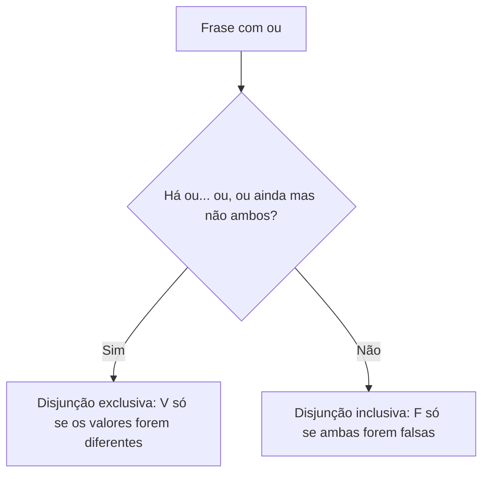

Cada conectivo lógico é uma regra de cálculo: dado o valor das proposições simples, a regra diz qual é o valor da composta. Dominar essas regras é o coração do assunto, porque quase toda questão de lógica proposicional, direta ou indiretamente, passa por elas. Em vez de decorar tabelas inteiras, o caminho mais seguro é fixar o **caso típico** de cada conectivo, aquele que o distingue dos demais. Este capítulo trata de três: a conjunção ("e"), a disjunção inclusiva ("ou") e a disjunção exclusiva ("ou... ou"). O condicional é apresentado ao final, em versão básica, e é aprofundado no capítulo seguinte, junto com o bicondicional.

> [!objetivos]
> - Calcular o valor lógico de uma conjunção, de uma disjunção inclusiva e de uma disjunção exclusiva.
> - Memorizar o caso típico de cada conectivo e construir sua tabela-verdade.
> - Reconhecer, na linguagem natural, as palavras que indicam cada conectivo.
> - Distinguir "ou" inclusivo de "ou... ou" exclusivo.
> - Calcular o valor de um condicional e identificar o único caso em que ele é falso.

## O que a tabela-verdade faz

Uma **tabela-verdade** lista todas as combinações possíveis de valores lógicos das proposições simples e mostra o valor da composta em cada uma. Para duas proposições, p e q, há quatro combinações: VV, VF, FV e FF. A tabela de cada conectivo registra, nessas quatro linhas, o resultado. A construção completa da tabela, para proposições mais complexas, é assunto de outro capítulo; aqui basta ler as de dois componentes.

## Conjunção: p ∧ q

A **conjunção** liga duas proposições com o "e". Escreve-se **p ∧ q** e lê-se "p e q". Exemplo: "O soldado é pontual **e** o soldado é disciplinado". Para que a frase como um todo seja verdadeira, é preciso que **as duas** partes sejam verdadeiras. Se uma delas falhar, a conjunção é falsa.

| p | q | p ∧ q |
| --- | --- | --- |
| V | V | V |
| V | F | F |
| F | V | F |
| F | F | F |

**Caso típico:** a conjunção só é verdadeira quando as duas componentes são verdadeiras. Em todos os outros casos, é falsa.

A conjunção vale para mais de duas proposições. Em "p ∧ q ∧ r", o resultado é verdadeiro apenas se **todas** forem verdadeiras. Basta uma falsa para que o resultado seja falso. É a lógica de uma lista de exigências: para ser aprovado em todas, é preciso cumprir todas.

> [!bizu] Conjunção é teimosa
> A conjunção é o conectivo "exigente". Uma única componente falsa derruba o conjunto. Quando a questão fornece um valor falso e pergunta o valor de uma conjunção, a resposta é imediata: falso.

### Palavras que indicam conjunção

Além do "e", expressam conjunção:

- **mas**, **porém**, **contudo**, **todavia**: ligam ideias com contraste ("Estudei, mas não passei");
- **embora** e **ainda que**, em frases como "Choveu, embora o dia estivesse claro";
- **tanto... quanto**: "Tanto o gerente quanto o diretor assinaram";
- vírgula, ponto e vírgula e justaposição de duas orações afirmativas.

Todas essas formas são tratadas, na lógica, como "e". A ideia de contraste que "mas" traz é só de redação, e não altera o valor lógico. "Estudei, mas não passei" é verdadeira quando é verdade que estudei e é verdade que não passei.

> [!exemplo] Conjunção no cotidiano
> "Flávia pediu um milkshake de morango e Thiago comeu carne no parque." Para a frase ser verdadeira, as duas coisas precisam ter acontecido. Se Flávia pediu milkshake, mas Thiago almoçou em outro lugar, a conjunção é falsa, mesmo que metade da frase esteja certa. A lógica não admite "meio verdadeira": cada composta é V ou F.

> [!exemplo] Calculando uma conjunção
> Sejam p: "5 é ímpar" (V) e q: "10 é múltiplo de 3" (F). A conjunção "5 é ímpar e 10 é múltiplo de 3" tem valor V ∧ F = F. Se trocarmos q por "10 é múltiplo de 5" (V), a conjunção passa a V ∧ V = V.

## Disjunção inclusiva: p ∨ q

A **disjunção inclusiva** liga duas proposições com o "ou". Escreve-se **p ∨ q** e lê-se "p ou q". Exemplo: "O candidato fala inglês **ou** fala espanhol". A frase é verdadeira se **pelo menos uma** das partes for verdadeira. É falsa apenas quando as duas são falsas.

| p | q | p ∨ q |
| --- | --- | --- |
| V | V | V |
| V | F | V |
| F | V | V |
| F | F | F |

**Caso típico:** a disjunção inclusiva só é falsa quando as duas componentes são falsas. Em todos os outros casos, é verdadeira.

O "inclusiva" indica que a primeira linha, em que ambas são verdadeiras, também torna a disjunção verdadeira. O candidato que fala inglês e espanhol atende à exigência "fala inglês ou espanhol". Com três ou mais componentes, vale a mesma ideia: "p ∨ q ∨ r" é falsa apenas quando todas são falsas.

> [!atencao] Disjunção é generosa
> Ao contrário da conjunção, a disjunção inclusiva é o conectivo "generoso": basta uma componente verdadeira para tornar a frase verdadeira. Por isso, quando o enunciado diz que uma das partes é verdadeira, a disjunção inteira já está resolvida: é V.

> [!exemplo] Disjunção no cotidiano
> "A Austrália é um país, ou o Instituto Federal do Maranhão fica em Pernambuco." A primeira parte é verdadeira, a segunda é falsa. Pela regra da disjunção inclusiva, basta uma verdadeira: a frase toda é V. Perceba que as duas partes não precisam ter relação entre si, porque a lógica só olha os valores, e não o assunto.

> [!exemplo] Calculando uma disjunção
> Com p: "Recife fica no Nordeste" (V) e q: "7 é par" (F), a disjunção "Recife fica no Nordeste ou 7 é par" vale V ∨ F = V. Se ambas fossem falsas, como em "7 é par ou 9 é par", a disjunção seria F ∨ F = F.

## Disjunção exclusiva: p ⊻ q

A **disjunção exclusiva** também usa o "ou", mas com sentido de escolha: uma coisa **ou** outra, **não as duas**. Escreve-se **p ⊻ q** e, na linguagem natural, costuma aparecer como "ou p, ou q" ou "p ou q, mas não ambos". Exemplo: "Ou o soldado está no posto, ou está em folga". As duas coisas não podem acontecer juntas.

| p | q | p ⊻ q |
| --- | --- | --- |
| V | V | F |
| V | F | V |
| F | V | V |
| F | F | F |

**Caso típico:** a disjunção exclusiva é verdadeira quando as componentes têm valores lógicos **diferentes**, e falsa quando têm valores **iguais** (ambas V ou ambas F).

Compare com a inclusiva. A diferença está na primeira linha: quando ambas são verdadeiras, a inclusiva é V e a exclusiva é F. Nas demais linhas, coincidem.

| p | q | p ∨ q | p ⊻ q |
| --- | --- | --- | --- |
| V | V | V | F |
| V | F | V | V |
| F | V | V | V |
| F | F | F | F |

> [!pegadinha] "Ou" sem esclarecimento é inclusivo
> Em provas, uma frase com um único "ou" é tratada como disjunção inclusiva, a menos que haja sinal claro de exclusão: "ou... ou", "ou então... ou então" ou "mas não ambos". Quando a banca quer a exclusiva, ela costuma deixar isso explícito. Se a questão não esclarece, não presuma a exclusiva.

### Escolhendo entre inclusiva e exclusiva

Observe dois exemplos da vida real:

- "Para se inscrever, é preciso ter diploma de nível médio ou superior." Quem tem diploma superior também tem médio, e ninguém é barrado por ter os dois. É inclusivo.
- "Em cada pergunta do teste, ou você responde verdadeiro, ou responde falso." A resposta não pode ser as duas ao mesmo tempo. É exclusivo.

O teste prático é perguntar: "se as duas coisas acontecerem, a frase continua verdadeira?" Se sim, é inclusiva. Se não, exclusiva.

## Resumo dos três conectivos

| Conectivo | Símbolo | Leitura | Falso quando... | Verdadeiro quando... |
| --- | --- | --- | --- | --- |
| Conjunção | ∧ | p e q | pelo menos uma é falsa | as duas são verdadeiras |
| Disjunção inclusiva | ∨ | p ou q | as duas são falsas | pelo menos uma é verdadeira |
| Disjunção exclusiva | ⊻ | ou p ou q | os valores são iguais | os valores são diferentes |

Uma forma de fixar: a conjunção "exige", a disjunção inclusiva "tolera", a exclusiva "escolhe".

## Calculando compostas com vários conectivos

Quando uma composta mistura conectivos, o cálculo segue de dentro para fora, resolvendo primeiro o que está entre parênteses. Veja alguns casos.

> [!resolvido] Caso 1: conjunção e disjunção juntas
> Sejam p verdadeira, q falsa e r verdadeira. Calcule o valor de (p ∧ q) ∨ r.
>
> **Resolução.** Primeiro, p ∧ q = V ∧ F = F. Depois, F ∨ r = F ∨ V = V. O valor da composta é V.

> [!resolvido] Caso 2: negação dentro da conjunção
> Sejam p verdadeira e q falsa. Calcule o valor de p ∧ ~q.
>
> **Resolução.** ~q = ~F = V. Então p ∧ ~q = V ∧ V = V.

> [!resolvido] Caso 3: exclusiva com negação
> Sejam p verdadeira e q verdadeira. Calcule o valor de p ⊻ ~q.
>
> **Resolução.** ~q = F. Então p ⊻ ~q = V ⊻ F. Como os valores são diferentes, o resultado é V.

> [!resolvido] Caso 4: encontrando valores a partir do resultado
> Sabe-se que a conjunção p ∧ q é verdadeira. O que se pode afirmar sobre p e sobre q?
>
> **Resolução.** A conjunção só é verdadeira quando as duas componentes são verdadeiras. Portanto, p é V e q é V, necessariamente. Essa é uma das informações mais "fortes" que um enunciado pode dar, e por isso é o ponto de partida de muitos problemas.

> [!resolvido] Caso 5: o que se pode concluir de uma disjunção falsa
> Sabe-se que p ∨ q é falsa. O que se pode afirmar?
>
> **Resolução.** A disjunção só é falsa quando as duas componentes são falsas. Logo, p é F e q é F.

Os casos 4 e 5 mostram a **informação forte** de cada conectivo: conjunção verdadeira e disjunção falsa fixam os valores das duas componentes. Já conjunção falsa e disjunção verdadeira deixam dúvida: na primeira, ao menos uma é falsa; na segunda, ao menos uma é verdadeira. Em questões que pedem um valor específico, procure sempre a informação forte.

| Informação | Quanto se sabe de p e de q |
| --- | --- |
| p ∧ q é V | Tudo: p é V e q é V |
| p ∧ q é F | Pouco: ao menos uma é F |
| p ∨ q é V | Pouco: ao menos uma é V |
| p ∨ q é F | Tudo: p é F e q é F |

## Condicional: p → q

O **condicional** liga duas proposições pela estrutura "**se** p, **então** q". Escreve-se **p → q**. A primeira parte, p, chama-se **antecedente** (ou hipótese); a segunda, q, **consequente** (ou tese). Exemplo: "Se Jonathan não tomou café, então ele está com fome". O antecedente é "Jonathan não tomou café", e o consequente, "ele está com fome".

A tabela-verdade do condicional tem uma peculiaridade: só uma linha é falsa.

| p | q | p → q |
| --- | --- | --- |
| V | V | V |
| V | F | F |
| F | V | V |
| F | F | V |

**Caso típico:** o condicional só é falso quando o antecedente é verdadeiro e o consequente é falso (V → F). Em todas as demais combinações, é verdadeiro.

### Por que só uma linha é falsa?

Pense no condicional como uma **promessa**. "Se você passar no concurso, eu lhe dou um relógio." A promessa só é quebrada em um caso: você passa (antecedente V) e eu não dou o relógio (consequente F). Nos demais casos, não houve quebra:

- você passou e ganhou o relógio (V → V): promessa cumprida;
- você não passou e não ganhou o relógio (F → F): a promessa não foi testada, não foi quebrada;
- você não passou e ganhou o relógio (F → V): também não foi quebrada, apenas fui generoso.

Quando o antecedente é falso, o condicional é verdadeiro por uma razão simples: ele nada afirma sobre o que ocorreria se o antecedente fosse verdadeiro. Essa ideia, chamada de verdade vazia, costuma surpreender, mas é consequência da definição.

> [!pegadinha] Condicional com antecedente falso é verdadeiro
> "Se a Lua é feita de queijo, então 2 + 2 = 5." O antecedente é falso, logo o condicional todo é verdadeiro, independentemente do consequente. Muita gente erra por achar que "uma frase absurda deve ser falsa". Em lógica, a frase é julgada pela regra do conectivo, e não pelo bom senso.

### Calculando um condicional

> [!resolvido] Caso 1: antecedente falso
> Sejam r falsa e p verdadeira. Calcule o valor de r → p.
>
> **Resolução.** F → V é verdadeiro, porque o condicional só é falso em V → F.

> [!resolvido] Caso 2: condicional com negação
> Sejam a verdadeira e p falsa. Calcule ~a → p.
>
> **Resolução.** ~a = F. Então ~a → p = F → F = V.

> [!resolvido] Caso 3: informação forte do condicional
> Sabe-se que (p ∧ q) → r é falso. Que valores têm p, q e r?
>
> **Resolução.** O condicional só é falso quando o antecedente é verdadeiro e o consequente é falso. Logo, p ∧ q é V (portanto p é V e q é V) e r é F.

A informação forte do condicional é a sua **falsidade**: se p → q é falso, fica determinado que p é V e q é F. Já um condicional verdadeiro dá pouca informação: pode ser F → V, F → F ou V → V.

| Informação | Quanto se sabe |
| --- | --- |
| p → q é F | Tudo: p é V e q é F |
| p → q é V | Pouco: p e q não ficam determinados |
| p → q é V e p é V | Algo: q é V |
| p → q é V e q é F | Algo: p é F |

> [!bizu] Duas leituras úteis do condicional verdadeiro
> Se o condicional é verdadeiro e o antecedente é verdadeiro, o consequente tem de ser verdadeiro. Se o condicional é verdadeiro e o consequente é falso, o antecedente tem de ser falso. Essas duas conclusões resolvem muitos problemas.

### Formas de dizer "se... então"

As bancas gostam de esconder o condicional sob outras palavras. As formas mais comuns são "p implica q", "quando p, q", "sempre que p, q", "caso p, q", "p é condição suficiente para q" e "q é condição necessária para p". Esse repertório de variações, e o raciocínio das condições necessária e suficiente, é detalhado no capítulo seguinte.

## Treino com frases do cotidiano

Para consolidar as regras, calcule o valor de cada composta a partir dos valores atribuídos às simples. Os valores estão entre parênteses.

| Frase | Forma | Valores | Resultado |
| --- | --- | --- | --- |
| Sydney está localizada na Oceania e cachorros sabem voar. | p ∧ q | p (V), q (F) | F |
| Sydney está localizada na Oceania ou cachorros sabem voar. | p ∨ q | p (V), q (F) | V |
| Ou Paulo foi à feira, ou Paulo foi ao cinema. | p ⊻ q | p (V), q (V) | F |
| Ou Paulo foi à feira, ou Paulo foi ao cinema. | p ⊻ q | p (V), q (F) | V |
| Se Frederico sabe somar, então Frederico almoçou. | p → q | p (V), q (F) | F |
| Se Frederico sabe somar, então Frederico almoçou. | p → q | p (F), q (F) | V |
| O carioca gosta de praia e não gosta de feira. | p ∧ ~q | p (V), q (F) | V |
| Roseana trabalha isoladamente ou participa de equipe. | p ∨ q | p (F), q (F) | F |

Mais três frases para exercitar com o mesmo método. "Poliana é psicóloga e sua neta é inteligente": conjunção, que só é V se as duas afirmações valerem. "Rodolfo é paranaense ou matemático": disjunção inclusiva, V se ele for ao menos um dos dois, inclusive se for ambos. "Pedro tomou sorvete sozinho no domingo, mas estou certo de que ele não foi ao cinema": conjunção, com o "mas" apenas marcando o contraste, e cujo valor exige que as duas partes sejam verdadeiras.

Dois cuidados na leitura. Primeiro, as componentes de uma composta não precisam ter relação de assunto entre si: "Sydney está localizada na Oceania ou cachorros sabem voar" é uma disjunção legítima, e o valor depende só de V e F. Segundo, é comum que a negação apareça dentro de uma das componentes ("não gosta de feira"), e então é preciso calcular a negação antes do conectivo.

## Como a banca cobra este assunto

As questões sobre conjunção e disjunção seguem alguns padrões. O primeiro é a **atribuição direta**: dão os valores das simples e pedem o valor da composta. O segundo é a **pista de valor**: dizem que uma composta é V ou F e perguntam o que decorre disso sobre as componentes. O terceiro é a **ambiguidade do "ou"**: perguntam se uma frase se enquadra como inclusiva ou exclusiva. O quarto é a **tradução**: pedem a forma simbólica de uma frase, com "mas" ou "porém". O quinto é a **contagem**: perguntam em quantas linhas da tabela a composta é verdadeira.

## Mapa do capítulo

| Tema | Ideia central | Armadilha |
| --- | --- | --- |
| Tabela-verdade | Lista todas as combinações de valores | Esquecer uma linha |
| Conjunção | V só se todas V | Confundir com disjunção |
| Palavras da conjunção | e, mas, porém, embora | Achar que "mas" muda o valor |
| Disjunção inclusiva | F só se todas F | Tratar ambas V como F |
| Disjunção exclusiva | V se os valores forem diferentes | Presumir exclusiva sem sinal |
| Informação forte | ∧ verdadeira e ∨ falsa fixam os valores | Tentar concluir de ∧ falsa |
| Condicional | F só se V → F | Achar que antecedente falso torna a frase falsa |
| Resolução | De dentro para fora, nos parênteses | Pular a negação |

### Para fixar

1. A conjunção p ∧ q só é verdadeira quando as duas componentes são verdadeiras.
2. A disjunção inclusiva p ∨ q só é falsa quando as duas componentes são falsas.
3. A disjunção exclusiva p ⊻ q é verdadeira quando as componentes têm valores diferentes.
4. "Mas", "porém", "contudo" e "embora" são tratados como conjunção.
5. Na prova, um "ou" sem outros sinais é inclusivo; "ou... ou" é exclusivo.
6. Com mais de duas componentes, a conjunção exige todas verdadeiras e a disjunção basta uma verdadeira.
7. A diferença entre as disjunções está na linha em que ambas são verdadeiras: inclusiva V, exclusiva F.
8. Conjunção verdadeira fixa p e q como verdadeiras; disjunção falsa fixa p e q como falsas.
9. Compostas com vários conectivos se resolvem de dentro para fora.
10. O condicional p → q só é falso quando p é verdadeiro e q é falso, e um condicional falso fixa os valores de p e de q.
