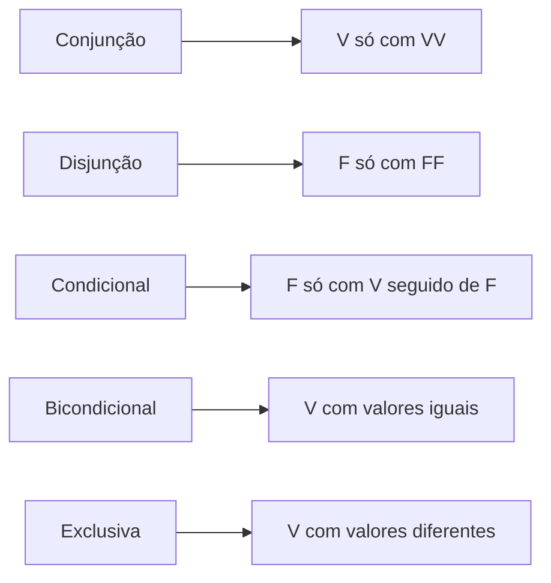

O condicional é o conectivo que mais cai em prova e o que mais derruba candidatos. Parte da dificuldade está na tabela-verdade, com sua única linha falsa. Outra parte, talvez maior, está na linguagem: a mesma ideia "se p, então q" pode vir escrita de uma dúzia de maneiras, e entre elas estão expressões como "condição necessária" e "somente se", que inverteram o raciocínio de muita gente. Este capítulo organiza essas formas, ensina a ler as condições necessária e suficiente e apresenta o bicondicional, o conectivo da "equivalência de valores".

> [!objetivos]
> - Reconhecer o condicional em suas formas alternativas de redação.
> - Distinguir condição necessária de condição suficiente.
> - Calcular o valor de um bicondicional e relacioná-lo ao condicional.
> - Comparar os cinco conectivos pelos seus casos típicos.

## O condicional em dois minutos

Relembrando o capítulo anterior: o condicional **p → q** liga um antecedente p e um consequente q pela estrutura "se p, então q". Seu valor lógico é **falso apenas quando p é verdadeiro e q é falso**. Nas outras três combinações, é verdadeiro.

| p | q | p → q |
| --- | --- | --- |
| V | V | V |
| V | F | F |
| F | V | V |
| F | F | V |

A leitura intuitiva é a da promessa: só se quebra a promessa quando a condição ocorre (p verdadeiro) e o prometido não acontece (q falso).

## Formas alternativas de escrever "se p, então q"

Na prova, a banca raramente escreve "se... então" de maneira óbvia. O quadro reúne as variações. Em todas, p é o antecedente e q é o consequente.

| Forma | Leitura | Antecedente | Consequente |
| --- | --- | --- | --- |
| Se p, então q | Forma clássica | p | q |
| Se p, q | "Então" omitido | p | q |
| q, se p | Inversão da ordem | p | q |
| Quando p, q | Temporal | p | q |
| Sempre que p, q | Generalização | p | q |
| Toda vez que p, q | Generalização | p | q |
| Caso p, q | Condicional | p | q |
| p implica q | Implicação | p | q |
| p é condição suficiente para q | Suficiência | p | q |
| q é condição necessária para p | Necessidade | p | q |
| p somente se q | "Somente se" | p | q |

Em todas as linhas, a seta aponta de p para q. A palavra que acompanha o antecedente é, em geral, "se", "quando", "sempre que" ou "caso". A palavra que acompanha o consequente é "então" ou aparece depois da vírgula.

> [!bizu] "Se" marca o antecedente
> Em "q, se p" e em "q se p", o antecedente é aquilo que vem **depois do "se"**. Por isso, "Eu passo, se estudar" equivale a "Se estudar, passo": estudar é o antecedente e passar é o consequente.

> [!pegadinha] "Somente se" inverte a intuição
> A expressão "p somente se q" **não** quer dizer "se q, então p". Quer dizer: "se p, então q". Exemplo: "Só entra no clube quem é sócio" significa "se entra no clube, então é sócio" (entrar → sócio). Já "p se q" (sem o "somente") é "se q, então p". Memorize a diferença: **"se" marca o antecedente; "somente se" marca o consequente.**

### Condição necessária e condição suficiente

Dois termos da linguagem cotidiana ganham sentido preciso na lógica.

- **Condição suficiente.** Basta que p aconteça para que q aconteça. Se p é suficiente para q, então "se p, então q".
- **Condição necessária.** É preciso que q aconteça para que p aconteça. Se q é necessária para p, então "se p, então q".

Em ambos os casos, a seta vai de p para q. O que muda é o olhar: p **basta** para q (suficiente); q **é exigida** por p (necessária).

| Se p → q, então... | Leitura |
| --- | --- |
| p é condição **suficiente** para q | Ter p garante q |
| q é condição **necessária** para p | Sem q, não há p |

Veja com um exemplo. Sabe-se que "Se uma pessoa nasceu em Recife, então nasceu em Pernambuco". Nascer em Recife é **suficiente** para ter nascido em Pernambuco, mas não é **necessário**: há muitos outros lugares de Pernambuco. Já nascer em Pernambuco é **necessário** para ter nascido em Recife, mas não é **suficiente**: há quem tenha nascido em Olinda.

> [!exemplo] Suficiente ou necessária?
> "Ter 18 anos é condição necessária para obter a habilitação de motorista." Isso significa: "Se obteve a habilitação, então tem 18 anos". Repare que a condição necessária fica no **consequente**: tem 18 anos. A condição suficiente, quando aparecer, estará no antecedente.

Uma dica de memória: **suficiente = vai na frente, necessária = vai atrás**, na seta. O antecedente é suficiente; o consequente é necessário.

## Traduzindo frases do cotidiano

A parte mais difícil do condicional, para quem começa, é encontrar o antecedente e o consequente em frases soltas. O hábito que resolve é sempre **reescrever na forma "se... então"** e só depois montar a fórmula. Veja como funciona em frases variadas.

| Frase original | Reescrita | Forma |
| --- | --- | --- |
| Bianca vai ao cinema, se estiver livre. | Se Bianca está livre, então vai ao cinema. | l → c |
| Toda arquiteta tem curso superior, assim como a engenheira. | Se é arquiteta, então tem curso superior. | a → c |
| Só quem usa camisa marrom entra no parque. | Se entra no parque, então usa camisa marrom. | e → m |
| Quando setembro chega, os atos municipais são publicados. | Se setembro chega, então os atos são publicados. | s → a |
| O filho é casado somente se é maior de idade. | Se é casado, então é maior de idade. | c → i |
| Ser aprovado no exame é condição suficiente para a matrícula. | Se foi aprovado, então se matricula. | e → m |
| Ter a matrícula é condição necessária para frequentar as aulas. | Se frequenta, então tem matrícula. | f → m |
| Nossos atos são livres se e somente se somos responsáveis por eles. | Bicondicional entre "livres" e "responsáveis". | l ⟷ r |

Algumas observações sobre a tabela. A segunda linha usa "toda", um quantificador que também se traduz por "se... então" (todo A é B equivale a "se é A, então é B"). A terceira usa "só", que funciona como "somente se": aquilo que vem depois de "só quem" é o consequente. A sexta e a sétima linhas mostram a assimetria entre suficiente e necessária: na sexta, a condição está no antecedente; na sétima, no consequente.

> [!exemplo] Do texto ao símbolo
> "Anderson só será promovido se for aprovado no exame." O "só... se" indica "somente se". O antecedente é "Anderson será promovido" e o consequente é "Anderson for aprovado": p → q, em que p: ser promovido e q: ser aprovado. Se Anderson foi promovido e não foi aprovado (V e F), a frase é falsa. Se não foi promovido (F), a frase é verdadeira, tenha sido aprovado ou não.

### Verificando uma promessa feita por escrito

Um exercício útil é testar o condicional com uma situação concreta e decidir se a promessa foi **descumprida**. "Se o contrato for assinado em setembro, a obra começará em outubro." Considere quatro situações:

1. Assinou em setembro e a obra começou em outubro: promessa cumprida (V).
2. Assinou em setembro e a obra não começou em outubro: promessa quebrada (F).
3. Não assinou em setembro, mas a obra começou em outubro: a promessa não foi desrespeitada (V).
4. Não assinou em setembro e a obra não começou em outubro: promessa não aplicável (V).

Perceba que apenas a segunda situação torna a frase falsa. Essa mesma lógica vale para qualquer condicional, e é por ela que se resolve a maior parte das questões de "verifique se o enunciado foi contrariado".

> [!pegadinha] Quem contraria o condicional?
> Para provar que um condicional é falso, é necessário e suficiente exibir **um caso** em que o antecedente é verdadeiro e o consequente é falso. Não basta mostrar que o consequente é falso, nem que o antecedente é falso. Na prova, quando a questão pergunta "o que mostra que o enunciado é falso?", a resposta é sempre o caso V e F.

## Calculando o valor do condicional

A regra continua a mesma, mas a prova mistura formas de escrita com valores. Os casos a seguir treinam a leitura.

> [!resolvido] Caso 1: forma invertida
> Sejam p: "Maria estuda" (V) e q: "Maria passa" (F). Qual é o valor de "Maria passa, se Maria estuda"?
>
> **Resolução.** A frase "q, se p" é p → q, ou seja, "se Maria estuda, então Maria passa". Com p verdadeiro e q falso, o condicional é falso.

> [!resolvido] Caso 2: "somente se"
> Sejam p: "Anderson é médico" (F) e q: "Anderson tem diploma" (V). Qual é o valor de "Anderson é médico somente se tem diploma"?
>
> **Resolução.** "p somente se q" é p → q. Com p falso e q verdadeiro, F → V é verdadeiro. A frase é verdadeira.

> [!resolvido] Caso 3: condição suficiente
> Sejam p: "Hoje é domingo" (F) e q: "Há feira na praça" (F). Qual é o valor de "Hoje ser domingo é condição suficiente para haver feira na praça"?
>
> **Resolução.** Ser suficiente significa p → q. Com ambos falsos, F → F é verdadeiro. A frase é verdadeira.

> [!resolvido] Caso 4: condição necessária
> Sejam p: "O candidato foi aprovado" (V) e q: "O candidato tirou nota mínima" (F). Qual é o valor de "Tirar nota mínima é condição necessária para ser aprovado"?
>
> **Resolução.** Se q é necessária para p, então p → q: "se foi aprovado, então tirou nota mínima". Com p verdadeiro e q falso, é falso.

> [!atencao] A direção da seta é a parte crítica
> Nas questões sobre condição necessária, o erro clássico é desenhar a seta de q para p. Antes de qualquer cálculo, escreva a frase na forma "se... então" e identifique antecedente e consequente.

### Recíproca, contrária e contrapositiva

A partir de p → q, formam-se três proposições relacionadas, cujo valor lógico se compara ao do original:

| Nome | Forma | Equivale ao original? |
| --- | --- | --- |
| Condicional original | p → q | — |
| Recíproca | q → p | Não |
| Contrária (inversa) | ~p → ~q | Não |
| Contrapositiva | ~q → ~p | **Sim** |

A única que sempre tem o mesmo valor lógico do original é a **contrapositiva**. Por exemplo, "Se chove, o chão fica molhado" equivale a "Se o chão não fica molhado, não chove". Já a recíproca ("Se o chão fica molhado, chove") não equivale, porque o chão pode estar molhado por outro motivo. Esse tema, as equivalências lógicas, é aprofundado em outro volume, mas vale guardar a contrapositiva desde já.

## Bicondicional: p ⟷ q

O **bicondicional** liga duas proposições pela estrutura "**p se e somente se q**". Escreve-se **p ⟷ q**. É como um condicional que vale nos dois sentidos: "se p, então q **e** se q, então p". Por isso se diz que p e q são **equivalentes em valor**: ambos verdadeiros ou ambos falsos.

| p | q | p ⟷ q |
| --- | --- | --- |
| V | V | V |
| V | F | F |
| F | V | F |
| F | F | V |

**Caso típico:** o bicondicional é verdadeiro quando as duas componentes têm o **mesmo** valor lógico (VV ou FF) e falso quando têm valores **diferentes**.

Uma comparação ajuda: o bicondicional é o **oposto da disjunção exclusiva**. A exclusiva é verdadeira quando os valores são diferentes; o bicondicional é verdadeiro quando são iguais. Isso significa que a negação de p ⟷ q equivale a p ⊻ q.

| p | q | p ⊻ q | p ⟷ q |
| --- | --- | --- | --- |
| V | V | F | V |
| V | F | V | F |
| F | V | V | F |
| F | F | F | V |

### Formas de escrever o bicondicional

| Forma | Observação |
| --- | --- |
| p se e somente se q | Forma clássica |
| p quando e somente quando q | Variante |
| p é condição necessária e suficiente para q | Junta as duas condições |
| Se p então q, e se q então p | Condicional nos dois sentidos |
| p é equivalente a q | Em linguagem informal |

A estrutura (p → q) ∧ (q → p) tem o mesmo valor lógico de p ⟷ q. Por isso, "se e somente se" pode ser entendido como "se p então q, e se q então p".

> [!exemplo] Bicondicional na prática
> "Um número é par se e somente se é divisível por 2." Para qualquer número, as duas partes têm o mesmo valor: se é par, é divisível por 2; se é divisível por 2, é par. A frase é verdadeira. Já "Um número é par se e somente se é múltiplo de 3" é falsa, porque há números pares que não são múltiplos de 3 (como 4) e há múltiplos de 3 que não são pares (como 9).

### Informação forte do bicondicional

Se um bicondicional é verdadeiro, sabe-se que as duas componentes têm o mesmo valor (mas não qual é). Se é falso, sabe-se que têm valores diferentes. Em ambos os casos, a informação é "relativa": conhecendo uma componente, descobre-se a outra.

| Informação | Conclusão |
| --- | --- |
| p ⟷ q é V e p é V | q é V |
| p ⟷ q é V e p é F | q é F |
| p ⟷ q é F e p é V | q é F |
| p ⟷ q é F e p é F | q é V |

> [!bizu] Bicondicional é "copia ou inverte"
> Quando o bicondicional é verdadeiro, a segunda componente **copia** a primeira. Quando é falso, **inverte**. Esse truque resolve problemas em segundos.

## Os cinco conectivos lado a lado

Com o bicondicional, completam-se os conectivos. A tabela reúne o caso típico de cada um, que é o conhecimento mais valioso da primeira etapa da lógica.

| Conectivo | Símbolo | Caso típico |
| --- | --- | --- |
| Conjunção | ∧ | Verdadeira só se as duas são verdadeiras |
| Disjunção inclusiva | ∨ | Falsa só se as duas são falsas |
| Disjunção exclusiva | ⊻ | Verdadeira se os valores são diferentes |
| Condicional | → | Falso só se V → F |
| Bicondicional | ⟷ | Verdadeiro se os valores são iguais |

Aprender a tabela por "linhas" é trabalhoso. Aprender o caso típico e deduzir o resto é rápido. Em cada conectivo, basta lembrar uma situação.

## Treino misto

> [!resolvido] Caso 5: três conectivos
> Sejam p (V), q (F) e r (V). Calcule (p → q) ⟷ (q ∨ ~r).
>
> **Resolução.** Primeiro, p → q = V → F = F. Depois, ~r = F, e q ∨ ~r = F ∨ F = F. O bicondicional é F ⟷ F = V.

> [!resolvido] Caso 6: sabendo o resultado
> Sabe-se que p ⟷ q é falso e que q é verdadeiro. Qual é o valor de p → q?
>
> **Resolução.** Como o bicondicional é falso, p e q têm valores diferentes. Se q é V, então p é F. O condicional p → q é F → V = V.

> [!resolvido] Caso 7: condição necessária e suficiente
> A frase "Receber o salário é condição necessária e suficiente para pagar as contas" é um bicondicional. Se a pessoa recebeu o salário e não pagou as contas, qual é o valor lógico da frase?
>
> **Resolução.** Tem-se p: "recebeu o salário" (V) e q: "pagou as contas" (F). Como os valores são diferentes, o bicondicional é F.

> [!atencao] Cuidado com a leitura natural
> Na linguagem comum, "se" é frequentemente usado com sentido de bicondicional: "Se você estudar, vai passar" pode ser interpretado como "só passa quem estudar". Em lógica, essa leitura não vale. O "se... então" é condicional, e só o "se e somente se" é bicondicional. Em questões, siga a forma lógica e não a intenção implícita.

## Como a banca cobra este assunto

O condicional e o bicondicional geram alguns padrões. O **mais frequente** é a troca entre necessária e suficiente, ou entre "se" e "somente se". Em seguida vêm as **questões de atribuição** (dados V e F, calcule a composta) e as de **informação forte** (dada a composta, descubra as componentes). Muitas questões pedem também a **forma simbólica** de uma frase, com a seta na direção correta. As mais difíceis misturam os cinco conectivos em uma só expressão e exigem calcular de dentro para fora.

## Mapa do capítulo

| Tema | Ideia central | Armadilha |
| --- | --- | --- |
| Condicional | F só em V → F | Achar que antecedente falso torna a frase falsa |
| "Se" | Marca o antecedente | Inverter a seta |
| "Somente se" | Marca o consequente | Tratar como "se" |
| Suficiente | Fica no antecedente | Trocar por necessária |
| Necessária | Fica no consequente | Trocar por suficiente |
| Contrapositiva | ~q → ~p equivale ao original | Confundir com a recíproca |
| Bicondicional | V se os valores são iguais | Confundir com exclusiva |
| Informação forte | Condicional F fixa tudo; bicondicional relaciona | Concluir demais de um condicional V |

### Para fixar

1. O condicional p → q é falso apenas quando p é verdadeiro e q é falso.
2. "Se p, q", "q, se p", "quando p, q", "sempre que p, q" e "p implica q" são formas do condicional.
3. A palavra "se" marca o antecedente; "somente se" marca o consequente.
4. p é condição suficiente para q quando p → q; q é condição necessária para p, na mesma frase.
5. O antecedente é condição suficiente; o consequente é condição necessária.
6. A contrapositiva ~q → ~p equivale ao condicional original; a recíproca e a contrária não equivalem.
7. O bicondicional p ⟷ q é verdadeiro quando p e q têm o mesmo valor e falso quando têm valores diferentes.
8. "Se e somente se" e "condição necessária e suficiente" indicam bicondicional.
9. O bicondicional equivale a (p → q) ∧ (q → p), e sua negação equivale à disjunção exclusiva.
10. Os casos típicos: ∧ só VV; ∨ só F com FF; → só F com V seguido de F; ⟷ igual; ⊻ diferente.
