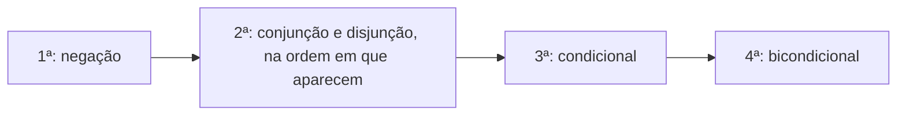

Todo problema de lógica proposicional começa na mesma etapa: traduzir uma frase do português para símbolos. A língua portuguesa é rica, cheia de variações, e uma mesma ideia pode ser dita de vários modos. A linguagem proposicional, ao contrário, é exata e econômica. Para raciocinar com rigor, é preciso converter uma na outra. Este capítulo ensina o processo, mostra a ordem de precedência dos conectivos, o papel das vírgulas e o tratamento das expressões "não é verdade que" e "é falso que".

> [!objetivos]
> - Representar proposições simples por letras e conectivos por símbolos.
> - Aplicar a ordem de precedência da negação e dos conectivos.
> - Reconhecer a vírgula como indicadora de parênteses.
> - Traduzir "não é verdade que" e "é falso que" aplicados a compostas.

## O processo de conversão

A representação matemática de uma frase se apoia em dois fundamentos: letras para as **proposições simples** e símbolos para os **conectivos**. O procedimento tem quatro passos.

1. **Identificar as proposições simples** que formam a frase.
2. **Atribuir uma letra** a cada uma, de preferência minúscula (p, q, r) ou a inicial da ideia.
3. **Localizar os conectivos** e anotar seus símbolos.
4. **Montar a fórmula**, respeitando a precedência e usando parênteses quando necessário.

Considere: "João é meu amigo, portanto empresto dinheiro a ele." O "portanto" indica consequência: se João é meu amigo, então empresto dinheiro. Definindo a: "João é meu amigo" e d: "empresto dinheiro a João", a frase vira **a → d**.

| Palavra na frase | Conectivo | Símbolo |
| --- | --- | --- |
| e, mas, porém, embora | Conjunção | ∧ |
| ou | Disjunção inclusiva | ∨ |
| ou... ou | Disjunção exclusiva | ⊻ |
| se... então, portanto, logo (consequência) | Condicional | → |
| se e somente se | Bicondicional | ⟷ |
| não, é falso que, não é verdade que | Negação | ~ |

> [!bizu] Quando a frase omite o "se"
> Muitas vezes a banca escreve "Hoje não choveu então Maria não foi ao comércio", omitindo o "se". O "então" já indica o condicional. Insira mentalmente o "se" e monte a fórmula como p → q.

## Ordem de precedência

Quando uma fórmula aparece sem parênteses, surge a dúvida: qual operação se faz primeiro? A resposta é uma convenção, a **ordem de precedência**, que organiza a leitura.

| Ordem | Operação |
| --- | --- |
| 1ª | Negação (~), abrangendo o menor enunciado possível |
| 2ª | Conjunção (∧) e disjunção inclusiva (∨), na ordem em que aparecem |
| 3ª | Condicional (→) |
| 4ª | Bicondicional (⟷) |

Veja um exemplo: **~p → q ∧ r**. A negação vale só para p, porque abrange o menor enunciado possível. Depois, faz-se a conjunção q ∧ r. Por último, o condicional. A fórmula, com parênteses explícitos, é **(~p) → (q ∧ r)**.

> [!atencao] A negação cola no que vem logo depois
> Em ~p ∧ q, a negação incide apenas em p. Para negar a composta inteira, a fórmula precisa vir com parênteses: ~(p ∧ q). Essa diferença é a fonte de muitos erros, e aparece de modo explícito nas questões de "qual operação tem maior prioridade".

Outro exemplo envolve o bicondicional: **p ∧ q → r ⟷ s**. Pela ordem, primeiro p ∧ q, depois o condicional (p ∧ q) → r, por último o bicondicional com s: [(p ∧ q) → r] ⟷ s. A banca costuma testar a ideia de que o condicional precede o bicondicional.

### Quando a precedência não basta

Alguns autores dão precedência à conjunção sobre a disjunção inclusiva. Para evitar a ambiguidade, as provas costumam trazer parênteses nesses casos. Se aparecer p ∨ q ∧ r sem parênteses e sem orientação, a leitura prudente é seguir a ordem em que os conectivos aparecem, a menos que o enunciado indique outra coisa. Em qualquer caso, ao escrever você mesmo uma fórmula, use parênteses para eliminar a dúvida.

## Vírgulas que indicam parênteses

Em português, a vírgula marca pausa. Na lógica das provas, ela marca **o conectivo principal**: o que está à esquerda da vírgula forma um bloco, e o que está à direita forma outro.

Compare duas frases. Sejam m: "Pedro é matemático", v: "Pedro passou no vestibular" e s: "Pedro sabe calcular integrais".

- "Se Pedro é matemático, então passou no vestibular, **e** sabe calcular integrais." A vírgula antes do "e" indica que o conectivo principal é o "e": **(m → v) ∧ s**.
- "Se Pedro é matemático, então passou no vestibular **e** sabe calcular integrais." Sem a vírgula, vale a precedência: o "e" prende v e s, e o condicional vem depois: **m → (v ∧ s)**.

| Frase | Fórmula |
| --- | --- |
| Se m, então v, e s | (m → v) ∧ s |
| Se m, então v e s | m → (v ∧ s) |
| Se m, então v, ou s | (m → v) ∨ s |
| Se m, então v ou s | m → (v ∨ s) |

A vírgula funciona, portanto, como um **parêntese invisível**. Quando a frase tiver mais de um conectivo, procure a vírgula e identifique o conectivo que fica logo depois dela; esse é o principal.

> [!pegadinha] Vírgula faz a diferença
> Dois enunciados idênticos, exceto pela vírgula, podem ter valores lógicos diferentes. Tome p falso, q verdadeiro e r falso: p → (q ∧ r) = F → F = V, mas (p → q) ∧ r = V ∧ F = F. Nunca ignore a pontuação ao simbolizar.

## "Não é verdade que" e "é falso que"

Quando uma frase começa com "não é verdade que" ou "é falso que", a negação incide sobre a **proposição inteira que vem depois**, ainda que ela seja composta. Por isso, vem sempre acompanhada de parênteses.

| Frase | Fórmula |
| --- | --- |
| Não é verdade que chove e faz frio. | ~(p ∧ q) |
| É falso que Ana viajou ou Beto ficou. | ~(p ∨ q) |
| Não é verdade que, se estudo, passo. | ~(p → q) |
| Não chove e faz frio. | ~p ∧ q |

Repare na última linha: "Não chove e faz frio" nega apenas "chove", porque o "não" está colado ao verbo da primeira oração. A negação da composta inteira exige a expressão "não é verdade que" ou "é falso que" no início, ou uma construção equivalente.

> [!exemplo] Dois "não" diferentes
> "Não é verdade que o gerente é pontual e honesto" é ~(p ∧ q): nega-se o conjunto, e basta que uma das duas qualidades falte para a frase ser verdadeira. Já "O gerente não é pontual e é honesto" é ~p ∧ q: afirma-se que ele é honesto **e** que lhe falta a pontualidade.

## Análise do significado

A tradução exige mais do que reconhecer palavras: exige entender o **significado**. Algumas expressões merecem atenção.

- **"Nem p nem q"** significa "não p e não q": **~p ∧ ~q**.
- **"Nem sempre"** equivale a "não é verdade que sempre", ou seja, a uma negação.
- **"Somente se"** e **"só se"** são condicionais, com a seta apontando para a condição.
- **"Ou... ou"** é exclusivo; **"ou"** sozinho é inclusivo, salvo indicação contrária.
- **"A menos que"** costuma ser lido como "se não": "Saio, a menos que chova" equivale a "Se não chove, saio" (~q → p).

> [!resolvido] Questão comentada: símbolos para frases
> Sejam A: "A estrada foi interditada", B: "Tony chegou ao trabalho" e C: "Marcos perdeu a reunião". Como se escreve: "A estrada não foi interditada, então Tony chegou ao trabalho e Marcos não perdeu a reunião"?
>
> **Resolução.** Inserindo o "se", a frase é "Se a estrada não foi interditada, então Tony chegou ao trabalho e Marcos não perdeu a reunião". Não há vírgula antes do "e", portanto vale a precedência: o "e" liga as duas últimas ideias e o condicional é o conectivo principal. A fórmula é **~A → (B ∧ ~C)**. Para obter (~A → B) ∧ ~C, seria preciso uma vírgula antes do "e".

> [!resolvido] Questão comentada: negação de maior prioridade
> Na expressão ~p ∧ q → r, qual operação é feita primeiro?
>
> **Resolução.** A negação, que tem a maior precedência. Em seguida vem a conjunção (~p) ∧ q, e por último o condicional. Com parênteses: [(~p) ∧ q] → r.

## Frases com ideia de causa e de alternativa

Algumas frases escondem o conectivo em palavras que parecem apenas explicar. Duas famílias merecem atenção especial.

**Causa e consequência.** Palavras como "portanto", "logo", "por isso" e "consequentemente" indicam condicional. "O aquecimento global é recente, portanto ainda há tempo de agir" vira r → t. Já "porque" e "pois" apontam o antecedente no sentido oposto: "A reunião foi cancelada porque o biólogo não chegou" equivale a "Se o biólogo não chegou, então a reunião foi cancelada". Nesses casos, quem vem depois do "porque" é o antecedente.

**Alternativa e exclusão.** "Ou o inglês é obrigatório, ou o curso é gratuito" é uma exclusiva. "O inglês é obrigatório ou o curso é gratuito" é inclusiva. E "O candidato não fala inglês nem espanhol" é ~i ∧ ~e, em que i: "fala inglês" e e: "fala espanhol".

| Frase | Fórmula | Observação |
| --- | --- | --- |
| A presença é obrigatória, portanto o aluno comparece. | a → c | "Portanto" marca o condicional |
| O aluno comparece porque a presença é obrigatória. | a → c | "Porque" marca o antecedente |
| Ou o ciclo termina, ou a obra continua. | t ⊻ o | Exclusiva |
| O ciclo termina ou a obra continua. | t ∨ o | Inclusiva |
| Nem o ciclo termina nem a obra continua. | ~t ∧ ~o | "Nem... nem" |

Repare na ordem dos termos: em "O aluno comparece porque a presença é obrigatória", a causa vem depois, mas é o antecedente. A leitura pela ordem das palavras engana, e a pergunta certa é "o que é causa e o que é consequência?".

> [!bizu] Causa é antecedente
> Em qualquer frase de causa e consequência, a **causa** vai para o antecedente do condicional e a **consequência** para o consequente, seja qual for a ordem em que aparecem na frase.

## Como a banca cobra este assunto

Os padrões são previsíveis. Primeiro, a **tradução direta**: dada uma frase e as letras, escolher a fórmula. Segundo, a **precedência**: apontar qual operação vem primeiro ou calcular o valor de uma expressão sem parênteses. Terceiro, o efeito da **vírgula**. Quarto, o **alcance da negação**: distinguir ~p ∧ q de ~(p ∧ q). Quinto, as **expressões idiomáticas**, como "nem... nem" e "a menos que".

## Mapa do capítulo

| Tema | Ideia central | Armadilha |
| --- | --- | --- |
| Conversão | Letras para simples, símbolos para conectivos | Esquecer o "se" omitido |
| Precedência | ~, depois ∧ e ∨, depois →, depois ⟷ | Inverter condicional e bicondicional |
| Negação | Cola no menor enunciado | Estender a negação à composta |
| Vírgula | Marca o conectivo principal | Ignorar a pontuação |
| "Não é verdade que" | Nega a composta inteira | Esquecer os parênteses |
| "Nem... nem" | ~p ∧ ~q | Traduzir como disjunção |
| "A menos que" | Equivale a "se não" | Tratar como conjunção |

### Para fixar

1. Converter uma frase é usar letras para as proposições simples e símbolos para os conectivos.
2. A precedência é: negação, conjunção e disjunção inclusiva (na ordem de aparição), condicional e bicondicional.
3. A negação abrange o menor enunciado possível: em ~p ∧ q, ela incide só em p.
4. O condicional tem precedência sobre o bicondicional.
5. A vírgula indica o conectivo principal e funciona como parêntese invisível.
6. "Se p, então q, e r" é (p → q) ∧ r; "se p, então q e r" é p → (q ∧ r).
7. "Não é verdade que" e "é falso que" negam a proposição composta inteira que vem depois.
8. "Nem p nem q" equivale a ~p ∧ ~q.
9. "A menos que" costuma equivaler a "se não".
10. Quando houver dúvida, use parênteses para deixar a ordem explícita.
