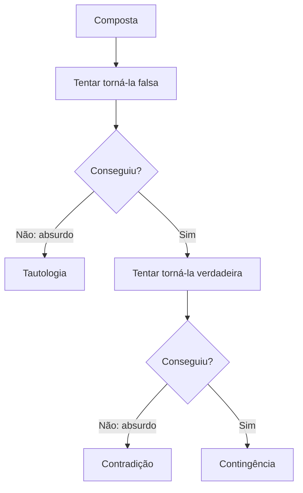

A tabela-verdade é segura, mas tem um defeito: cresce depressa. Com quatro proposições simples, são dezesseis linhas; com cinco, trinta e duas. Em prova, esse tempo faz falta. Por isso existe um segundo método de classificação, a **prova por absurdo**, que trabalha com uma única tentativa em vez de uma tabela inteira. Ele parte de um palpite, tenta contrariá-lo e vê se isso gera uma contradição. Este capítulo ensina o método e, em seguida, apresenta a **implicação lógica**, uma relação entre proposições que aparece em muitos enunciados.

> [!objetivos]
> - Aplicar a prova por absurdo para classificar uma composta como tautologia, contradição ou contingência.
> - Reconhecer o que é um "absurdo" no contexto da lógica.
> - Definir implicação lógica e distingui-la do condicional.
> - Testar uma implicação pelo método do absurdo.

## A ideia do método

O método parte de uma **suspeita**. Se suspeitamos que a composta é uma **tautologia** (sempre verdadeira), tentamos torná-la **falsa**. Se suspeitamos que é uma **contradição** (sempre falsa), tentamos torná-la **verdadeira**. Depois, observa-se o que acontece.

| Suspeita | Tentativa | Se conseguir | Se chegar a um absurdo |
| --- | --- | --- | --- |
| Tautologia | Aplicar o valor F à composta | Não é tautologia | É tautologia |
| Contradição | Aplicar o valor V à composta | Não é contradição | É contradição |

O termo **absurdo** designa uma situação contraditória: ao tentar dar à composta o valor escolhido, obtém-se que alguma proposição simples teria de ser verdadeira e falsa ao mesmo tempo, o que é impossível. Quando isso ocorre, a tentativa é inviável, e conclui-se que a composta **nunca** pode assumir aquele valor.

E a contingência? Se for possível tornar a composta falsa **e** também for possível torná-la verdadeira, ela não é nem tautologia nem contradição: é uma contingência.

> [!bizu] Uma tentativa pode bastar
> Se você suspeita de tautologia e consegue deixar a composta falsa, a questão acaba: não é tautologia. Se for uma pergunta do tipo "qual alternativa é tautologia?", basta eliminar as alternativas em que a composta pode ser falsa.

## Passo a passo com exemplos

A chave do método é saber o que cada conectivo exige para ter o valor desejado:

| Para que... | É preciso que... |
| --- | --- |
| p ∧ q seja V | p e q sejam ambos V |
| p ∨ q seja F | p e q sejam ambos F |
| p → q seja F | p seja V e q seja F |
| p ⟷ q seja F | p e q tenham valores diferentes |
| ~p seja V | p seja F |

### Exemplo 1: uma tautologia

Verificar se [(p ∧ q) → r] → [p → (q → r)] é tautologia.

Suspeita: tautologia. Tentativa: torná-la **falsa**. Um condicional é falso quando o antecedente é V e o consequente é F.

- Consequente falso: p → (q → r) é F. Isso exige p = V e (q → r) = F. Para q → r ser F, q = V e r = F.
- Antecedente verdadeiro: (p ∧ q) → r precisa ser V. Mas, com p = V, q = V e r = F, tem-se (V ∧ V) → F = V → F = F.

O antecedente deveria ser verdadeiro, mas é falso. **Absurdo.** Logo, a composta nunca é falsa: é uma **tautologia**.

### Exemplo 2: uma contradição

Verificar se (p → q) ∧ (p ∧ ~q) é contradição.

Suspeita: contradição. Tentativa: torná-la **verdadeira**. Uma conjunção é V quando as duas partes são V.

- p ∧ ~q verdadeira exige p = V e ~q = V, isto é, q = F.
- p → q verdadeira exige que não se tenha V → F. Com p = V e q = F, tem-se V → F = F.

A primeira parte exige p = V e q = F; a segunda não aceita essa combinação. **Absurdo.** Logo, a composta nunca é verdadeira: é uma **contradição**.

### Exemplo 3: uma contingência

Classificar (p ∨ q) → (p ∧ q).

- Tornar falsa: antecedente V e consequente F. Com p = V e q = F, o antecedente vale V e o consequente vale F. A composta é falsa. Logo, não é tautologia.
- Tornar verdadeira: com p = V e q = V, o antecedente vale V e o consequente vale V. A composta é verdadeira. Logo, não é contradição.

Conseguimos as duas coisas: é uma **contingência**.

> [!resolvido] Exemplo 4: alternativas de múltipla escolha
> Qual das fórmulas é uma tautologia? (A) p ∧ q ∧ r; (B) (p ∨ q) → (r ∨ s); (C) p ∨ q ∨ r ∨ ~s ∨ ~p.
>
> **Resolução.** Em (A), p, q e r todos F tornam a conjunção falsa; todos V tornam-na verdadeira: contingência. Em (B), p = V, q = F, r = F, s = F dá V → F = F, mas outros valores dão V: contingência. Em (C), suspeita de tautologia: para uma disjunção com cinco termos ser falsa, todos têm de ser falsos, inclusive p e ~p ao mesmo tempo. Absurdo. Logo, (C) é tautologia.

> [!atencao] Letras repetidas é a pista
> Em geral, a classificação fica evidente quando as letras **se repetem** em posições que se opõem, como p e ~p. Fórmulas em que cada letra aparece uma única vez costumam ser contingências, porque nada obriga uma parte a conflitar com a outra.

## Implicação lógica

Em muitos textos, aparece a ideia de uma proposição que "implica" outra. A **implicação lógica** é uma relação entre duas proposições: p **implica logicamente** q quando, sempre que p é verdadeira, q também é. Escreve-se **p ⟹ q**.

Há uma ligação direta com o condicional, e é essa ligação que confunde. O condicional p → q é uma proposição composta, que pode ser V ou F conforme as circunstâncias. A implicação lógica p ⟹ q é uma **afirmação sobre a relação** entre p e q, e é verdadeira exatamente quando o condicional p → q é uma **tautologia**.

| Notação | O que é | Como se avalia |
| --- | --- | --- |
| p → q | Proposição composta (condicional) | Tem valor V ou F conforme p e q |
| p ⟹ q | Relação entre p e q | É verdadeira se p → q é tautologia |

Em outras palavras, p ⟹ q significa: não existe nenhuma linha da tabela em que p seja V e q seja F.

### Como testar uma implicação

Aplica-se a prova por absurdo ao condicional. Para verificar se p ⟹ q, tenta-se p = V e q = F. Se isso for impossível, a implicação vale.

> [!exemplo] Três implicações clássicas
> (1) p ∧ q ⟹ p. Tentativa: p ∧ q verdadeira e p falsa. Mas p ∧ q verdadeira exige p verdadeira. Absurdo: a implicação vale.
> (2) p ⟹ p ∨ q. Tentativa: p verdadeira e p ∨ q falsa. Mas p verdadeira torna a disjunção verdadeira. Absurdo: a implicação vale.
> (3) (p → q) ∧ p ⟹ q. Tentativa: (p → q) ∧ p verdadeira e q falsa. A conjunção exige p = V e p → q = V; com q = F, p → q = F. Absurdo: a implicação vale. Essa é a forma lógica do raciocínio "se chove, o chão molha; chove; logo, o chão molha".

Já "p ∨ q ⟹ p" **não vale**: a tentativa p = F e q = V torna p ∨ q verdadeira e p falsa, sem absurdo.

### Implicação, equivalência e a tabela

A equivalência é uma implicação nos dois sentidos: p ≡ q quando p ⟹ q e q ⟹ p. Em termos de tabela, equivale a dizer que o bicondicional p ⟷ q é uma tautologia. Assim, as relações entre proposições se organizam em três graus.

| Relação | Condição | Teste |
| --- | --- | --- |
| Implicação (p ⟹ q) | p → q é tautologia | Não existe V seguido de F |
| Equivalência (p ≡ q) | p ⟷ q é tautologia | Os valores coincidem em todas as linhas |
| Nenhuma | Há linha em que a relação falha | Basta uma linha de contraexemplo |

Quando a relação falha, o **contraexemplo** é uma linha específica: uma combinação de valores que torna p verdadeira e q falsa (para implicação) ou que dá valores diferentes (para equivalência). Exibir um contraexemplo prova que a relação não vale.

> [!pegadinha] Condicional verdadeiro não é implicação
> Dizer que o condicional p → q é verdadeiro **numa situação** não equivale a dizer que p implica q. A implicação exige verdade do condicional em **todas** as situações. Na prova, se a questão disser "p implica logicamente q", ela exige a tautologia.

## Como a banca cobra este assunto

As questões costumam seguir quatro formatos. O primeiro: "assinale a alternativa que é uma tautologia (ou contradição)", em que o método do absurdo elimina alternativas rapidamente. O segundo: "a proposição é sempre verdadeira, independentemente dos valores?", com resposta certo ou errado. O terceiro: "p implica logicamente q?", que se resolve com a tentativa V e F. O quarto: "as proposições são equivalentes?", que se resolve procurando um contraexemplo. Em todos eles, vale mais a clareza do raciocínio do que o tamanho da conta.

## Mapa do capítulo

| Tema | Ideia central | Armadilha |
| --- | --- | --- |
| Método do absurdo | Tentar o valor oposto ao suspeito | Esquecer de checar todos os requisitos |
| Tautologia | Tentar F e chegar a absurdo | Tentar V por engano |
| Contradição | Tentar V e chegar a absurdo | Tentar F por engano |
| Contingência | Conseguir V e conseguir F | Parar na primeira tentativa |
| Implicação | p → q é tautologia | Confundir com o condicional |
| Equivalência | p ⟷ q é tautologia | Confundir com igualdade de assunto |
| Contraexemplo | Uma linha que prova que a relação falha | Achar que é preciso a tabela inteira |

### Para fixar

1. A prova por absurdo classifica uma composta com uma tentativa em vez de uma tabela inteira.
2. Para suspeita de tautologia, tenta-se o valor F; para suspeita de contradição, tenta-se o valor V.
3. Absurdo é a situação em que uma proposição simples teria de ser V e F ao mesmo tempo.
4. Se não houver absurdo na tentativa de falsear, a composta não é tautologia.
5. Se for possível tornar a composta V e também F, ela é contingência.
6. Letras repetidas em posições opostas, como p e ~p, indicam tautologia ou contradição.
7. Implicação lógica p ⟹ q vale quando p → q é tautologia.
8. O condicional é uma proposição composta; a implicação é uma relação entre proposições.
9. Equivalência é implicação nos dois sentidos, ou seja, p ⟷ q é tautologia.
10. Um contraexemplo, isto é, uma linha em que a relação falha, basta para mostrar que ela não vale.
