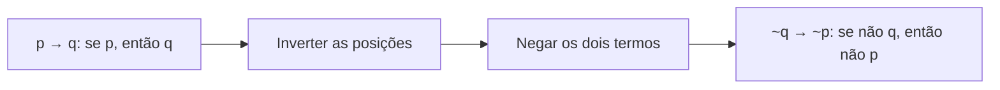
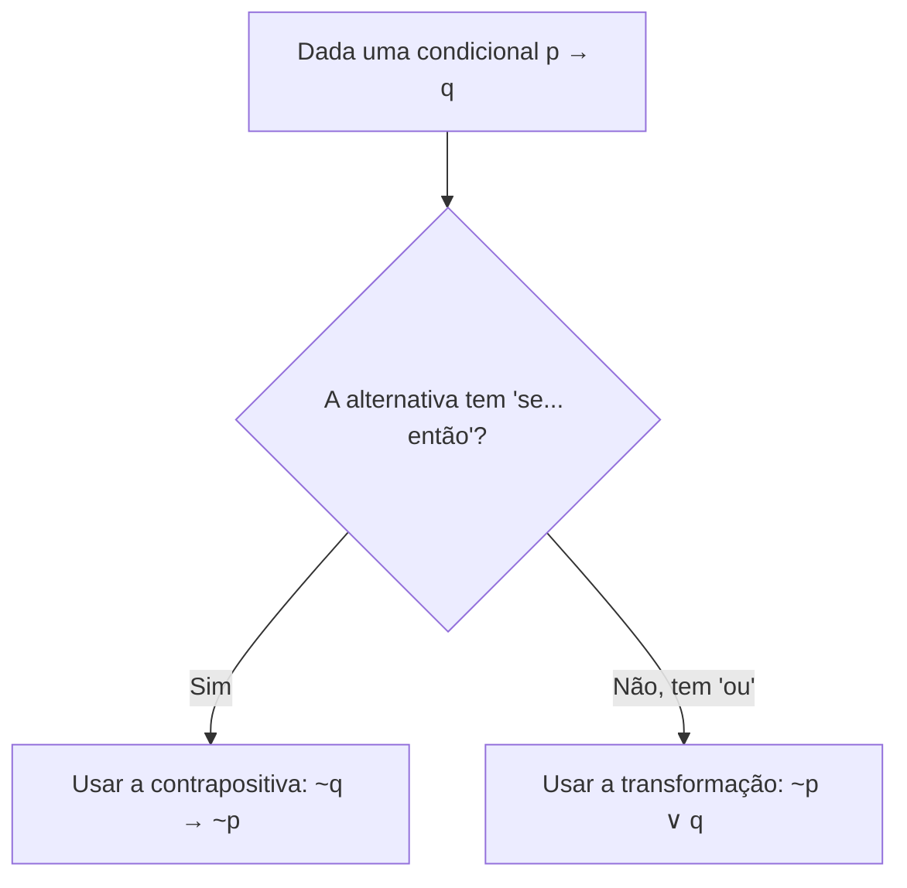

Dizer a mesma coisa de duas maneiras diferentes é uma habilidade que a vida cotidiana pede o tempo todo, e que o raciocínio lógico transforma em técnica. "Se choveu, a rua está molhada" e "se a rua não está molhada, não choveu" soam diferentes, mas afirmam exatamente o mesmo. As provas de concurso exploram essa ideia: dão uma frase e pedem a sua **equivalente**. Quem domina as poucas fórmulas fundamentais resolve a questão em segundos, sem tabela-verdade. Este capítulo apresenta o conceito de equivalência lógica e as três equivalências que mais caem.

> [!objetivos]
> - Definir equivalência lógica e prová-la por meio da tabela-verdade.
> - Aplicar a contrapositiva da condicional e reconhecer o erro da recíproca e da inversa.
> - Transformar uma condicional em disjunção inclusiva (e o contrário).
> - Saber que uma condicional só admite duas equivalências.

## O que é equivalência lógica

Duas proposições são **logicamente equivalentes** quando, para todas as combinações possíveis de valores lógicos das proposições simples que as formam, elas assumem **sempre o mesmo valor**. Em outras palavras, suas tabelas-verdade são idênticas coluna a coluna. Informalmente, têm o mesmo significado.

A equivalência é representada pelo símbolo **≡** (ou por uma seta dupla de duas pontas). Atenção para não confundir: o símbolo de equivalência afirma que duas fórmulas são iguais em valor; o conectivo bicondicional (p ⟷ q) é uma proposição que pode ser verdadeira ou falsa. Há ligação entre os dois, pois **A ≡ B** significa que a bicondicional A ⟷ B é sempre verdadeira, mas são conceitos diferentes.

Um exemplo simples de equivalência é a dupla negação. Se alguém afirma "moro em Recife", a frase "não é verdade que eu não moro em Recife" diz o mesmo. Em símbolos, ~(~p) ≡ p.

### Como provar uma equivalência

O método mecânico é montar a tabela-verdade das duas fórmulas e compará-las. Provemos que a bicondicional equivale à conjunção de duas condicionais: p ⟷ q ≡ (p → q) ∧ (q → p).

| p | q | p → q | q → p | (p → q) ∧ (q → p) | p ⟷ q |
| --- | --- | --- | --- | --- | --- |
| V | V | V | V | V | V |
| V | F | F | V | F | F |
| F | V | V | F | F | F |
| F | F | V | V | V | V |

As duas últimas colunas são iguais em todas as linhas. Logo, as fórmulas são equivalentes. É esse o critério que vale para qualquer equivalência: coluna final idêntica.

> [!bizu] Prova rápida: procure a linha que separa
> Para mostrar que duas fórmulas NÃO são equivalentes, basta uma linha em que elas difiram. Não é preciso completar a tabela inteira. Para mostrar que SÃO equivalentes, é preciso conferir todas as linhas.

## As três equivalências fundamentais

Três equivalências caem em prova com altíssima frequência, e a recomendação é memorizá-las "de olhos fechados":

1. a **contrapositiva** da condicional;
2. a transformação da **condicional em disjunção inclusiva**;
3. a transformação da **disjunção inclusiva em condicional** (que é a anterior lida ao contrário; ela será aprofundada no capítulo seguinte).

## Equivalência contrapositiva

A contrapositiva diz que uma condicional é equivalente a outra condicional obtida por dois movimentos:

**p → q ≡ ~q → ~p**

1. **inverter** as posições do antecedente e do consequente;
2. **negar** os dois termos.

Tome a frase "Se o aluno estudou, então foi aprovado". A contrapositiva é "Se o aluno não foi aprovado, então não estudou". Quem não foi aprovado não pode ter estudado, pois, se tivesse estudado, a primeira frase garantiria a aprovação. Repare que o raciocínio é a própria lógica da condicional: o antecedente verdadeiro obriga o consequente a ser verdadeiro.

### Os dois erros clássicos

As bancas adoram oferecer duas armadilhas que parecem contrapositiva e não são.

| Forma | Como se obtém | Equivale à original? |
| --- | --- | --- |
| Contrapositiva: ~q → ~p | Inverte e nega ambos | Sim |
| Recíproca: q → p | Apenas inverte | Não |
| Inversa: ~p → ~q | Apenas nega | Não |

Voltando ao exemplo: "Se o aluno estudou, foi aprovado". Imagine que ele não estudou. O que se pode concluir sobre a aprovação? Nada: pode ter passado por já saber a matéria, ou não. Por isso, "se não estudou, não foi aprovado" (inversa) **não** equivale à original. Da mesma forma, "se foi aprovado, estudou" (recíproca) não é garantido, porque alguém pode ser aprovado sem ter estudado.

> [!pegadinha] Inverter sem negar, ou negar sem inverter
> Se você fizer só um dos dois movimentos, a frase deixa de ser equivalente. A contrapositiva exige **os dois**: inverter E negar. É o erro mais cobrado, porque na linguagem do dia a dia as pessoas tomam a inversa por verdadeira.

### Verificação por tabela

Confirmamos a contrapositiva com a tabela:

| p | q | p → q | ~q | ~p | ~q → ~p |
| --- | --- | --- | --- | --- | --- |
| V | V | V | F | F | V |
| V | F | F | V | F | F |
| F | V | V | F | V | V |
| F | F | V | V | V | V |

As colunas p → q e ~q → ~p são iguais. A única linha falsa, em ambas, é aquela em que p é verdadeiro e q é falso.

> [!resolvido] Exemplo 1: equivalente de uma condicional
> Considere: "Se o motor da bomba foi ligado, então a mangueira recebeu pressão". Qual das frases é equivalente?
> a) A mangueira não recebeu pressão e o motor da bomba foi ligado.
> b) Se a mangueira não recebeu pressão, então o motor da bomba não foi ligado.
> c) Se o motor da bomba foi ligado, então a mangueira não recebeu pressão.
>
> **Resolução.** Sejam m: "o motor da bomba foi ligado" e r: "a mangueira recebeu pressão". A frase original é m → r. A contrapositiva é ~r → ~m: "Se a mangueira não recebeu pressão, então o motor da bomba não foi ligado". Resposta: b. A alternativa c nega só o consequente, e a alternativa a troca o conectivo por "e", o que muda o sentido.

> [!resolvido] Exemplo 2: com negação no consequente
> Dada "Se o alarme dispara, então o sargento não dorme", qual é a equivalente por contrapositiva?
>
> **Resolução.** Sejam p: "o alarme dispara" e d: "o sargento dorme". A original é p → ~d. Invertemos e negamos: ~(~d) → ~p, e a dupla negação transforma ~(~d) em d. Portanto, d → ~p: "Se o sargento dorme, então o alarme não dispara". Dica prática: quando o termo já traz um "não", a negação o remove em vez de duplicá-lo.

Um detalhe técnico merece registro. Você pode definir a proposição simples como afirmativa ou como negativa, e o resultado final será o mesmo. Se definir a: "Antônio não será aprovado", então a original é p → a, e a contrapositiva é ~a → ~p, ou seja, "se Antônio for aprovado, a prova não está difícil". A escolha só muda a notação, não a resposta.

## Transformação da condicional em disjunção inclusiva

A segunda equivalência troca o "se... então" por um "ou":

**p → q ≡ ~p ∨ q**

Procedimento:

1. **negar** o primeiro termo (o antecedente);
2. **trocar** o "se... então" por "ou";
3. **manter** o segundo termo (o consequente) como está.

Tome "Se hoje choveu, João fez a barba". A equivalente é "Hoje não choveu ou João fez a barba". A lógica é fácil de sentir: se a promessa "se choveu, então fez a barba" é cumprida, ou não choveu (e não há nada a cumprir), ou choveu e a barba foi feita.

### Confirmando com a tabela

| p | q | p → q | ~p | ~p ∨ q |
| --- | --- | --- | --- | --- |
| V | V | V | F | V |
| V | F | F | F | F |
| F | V | V | V | V |
| F | F | V | V | V |

A coluna da condicional e a coluna ~p ∨ q coincidem. A disjunção ~p ∨ q só é falsa quando ~p e q são ambos falsos, isto é, quando p é verdadeiro e q é falso, exatamente a única situação em que a condicional é falsa.

> [!resolvido] Exemplo 3: reconhecer a equivalência com "ou"
> A frase "Se Beatriz é bombeira militar, então sabe nadar" é equivalente a "Beatriz não é bombeira militar ou sabe nadar"?
>
> **Resolução.** Sejam b: "Beatriz é bombeira militar" e n: "Beatriz sabe nadar". A original é b → n, e a transformação dá ~b ∨ n, que é exatamente a frase proposta. A equivalência está correta.

> [!resolvido] Exemplo 4: escolher entre contrapositiva e disjunção
> Qual é a equivalente de "Se o cadete faltou ao treino, então a tropa foi punida"? As opções são: (a) "O cadete não faltou ao treino ou a tropa foi punida"; (b) "O cadete faltou ao treino ou a tropa foi punida".
>
> **Resolução.** Sejam f: "o cadete faltou ao treino" e u: "a tropa foi punida". A original é f → u. Como as opções usam "ou", aplicamos p → q ≡ ~p ∨ q: ~f ∨ u, "o cadete não faltou ao treino ou a tropa foi punida". Resposta: (a). A opção (b) esqueceu de negar o antecedente.

### Quando as opções misturam as duas formas

Muitas questões trazem alternativas de tipos diferentes, algumas com "se... então" e outras com "ou". Nesse caso, teste as duas equivalências. Exemplo: "Se Rui patrulha, então ele não preenche o relatório". Chamando a: "Rui patrulha" e e: "Rui preenche o relatório", a original é a → ~e.

- Pela contrapositiva: ~(~e) → ~a, isto é, e → ~a: "Se Rui preenche o relatório, então não patrulha".
- Pela disjunção: ~a ∨ ~e: "Rui não patrulha ou não preenche o relatório".

Se uma das alternativas trouxer qualquer dessas duas frases, ela é a resposta. Se trouxer "Se Rui não preenche o relatório, então patrulha" (a recíproca da contrapositiva), é armadilha, pois equivale à inversa da original.

## Uma condicional só tem duas equivalências

Uma consequência importante: a condicional p → q possui **apenas duas** formas equivalentes úteis para prova:

- **~q → ~p** (outra condicional, a contrapositiva);
- **~p ∨ q** (uma disjunção inclusiva).

Dito de outro modo, a única família de frases que pode equivaler a uma condicional é a das próprias condicionais (pela contrapositiva) ou a das disjunções inclusivas. Se uma alternativa apresentar uma conjunção ("e") ou uma disjunção exclusiva ("ou... ou") como equivalente de uma condicional, está errada.

> [!atencao] Cuidado com a negação, que é outro assunto
> Equivalente e **negação** são conceitos diferentes. A equivalente repete o significado; a negação diz o contrário. Por exemplo, a negação de p → q é p ∧ ~q, e não está entre as equivalências. O capítulo seguinte trata das negações em detalhe.

## Passo a passo para resolver uma questão

Em prova, o tempo é curto, e vale seguir sempre a mesma sequência.

1. **Nomeie as proposições simples** com letras e escreva a frase original em símbolos. Cuidado para que cada letra represente uma afirmação completa.
2. **Identifique o conectivo principal.** Se for "se... então", pense nas duas equivalências; se for "ou" (inclusivo), pense na transformação inversa, que veremos a seguir.
3. **Olhe para as alternativas**: se há "ou", a transformação em disjunção é o caminho; se há só "se... então", é a contrapositiva.
4. **Aplique a regra com calma**, escrevendo o resultado em símbolos antes de voltar para a linguagem natural.
5. **Elimine as armadilhas**: recíproca, inversa e conjunção não valem.

> [!bizu] Teste de segurança
> Escolha valores para as simples (por exemplo p verdadeira e q falsa) e calcule a frase original e a alternativa. Se divergirem, a alternativa não é equivalente. É um jeito rápido de descartar opções quando você está em dúvida entre duas.

## Como a banca cobra este assunto

As questões costumam pedir "a frase equivalente a" uma condicional, com alternativas que misturam contrapositiva, recíproca, inversa, disjunção e conjunção. O caminho seguro é: identificar a estrutura da frase original, escrever o símbolo, testar a contrapositiva e a transformação em "ou" e eliminar o que não se encaixa. Outra forma comum é julgar (certo ou errado) se duas frases dadas são equivalentes; basta reconhecer o padrão. Treine a leitura em linguagem natural, porque as frases aparecem como "Se Fulano estuda, então passa", e não como símbolos. Também aparecem proposições em que o consequente ou o antecedente já vêm negados, o que exige cuidado com a dupla negação ao aplicar a regra. Por fim, algumas provas misturam a equivalência com a negação, pedindo "a negação da equivalente de" uma frase; resolva um passo de cada vez.

## Mapa do capítulo

| Tema | Fórmula | Armadilha |
| --- | --- | --- |
| Equivalência | Mesma tabela-verdade | Confundir com o bicondicional |
| Contrapositiva | p → q ≡ ~q → ~p | Só inverter (recíproca) ou só negar (inversa) |
| Condicional em disjunção | p → q ≡ ~p ∨ q | Esquecer de negar o antecedente |
| Dupla negação | ~(~p) ≡ p | Deixar a negação duplicada |
| Equivalentes da condicional | Só duas: contrapositiva e disjunção | Aceitar "e" ou "ou... ou" |

### Para fixar

1. Duas proposições são equivalentes quando têm a mesma tabela-verdade.
2. Para refutar uma equivalência, basta uma linha em que as fórmulas diferem.
3. A contrapositiva de p → q é ~q → ~p: inverte-se e nega-se.
4. A recíproca (q → p) e a inversa (~p → ~q) não são equivalentes à original.
5. A dupla negação de uma proposição equivale a ela mesma.
6. p → q equivale a ~p ∨ q: nega-se o antecedente, troca-se por "ou" e mantém-se o consequente.
7. A condicional só possui duas equivalências úteis: ~q → ~p e ~p ∨ q.
8. Uma condicional nunca é equivalente a uma conjunção.
9. Definir a proposição simples como afirmativa ou negativa não altera o resultado.
10. Equivalência repete o sentido; negação diz o contrário.
