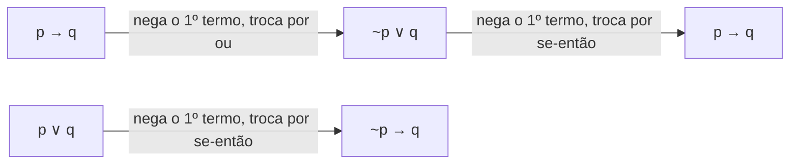
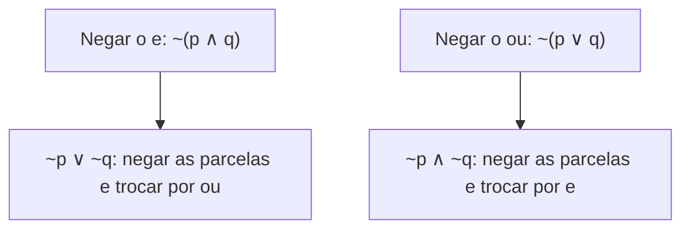

No capítulo anterior você viu que a condicional pode virar um "ou". Aqui o caminho é o inverso: o "ou" também pode virar um "se... então". Em seguida entramos no território das **negações**, as respostas para a pergunta "qual é o contrário desta frase?". Negar corretamente é uma das habilidades mais cobradas em lógica, porque o senso comum erra com frequência: o contrário de "todos passaram" não é "ninguém passou". Começamos pela negação mais simples, a dupla negação, e chegamos às Leis de De Morgan, que ensinam a negar o "e" e o "ou".

> [!objetivos]
> - Transformar uma disjunção inclusiva em condicional e justificar a transformação.
> - Distinguir equivalência de negação lógica.
> - Aplicar a dupla negação.
> - Negar uma conjunção e uma disjunção inclusiva pelas Leis de De Morgan.

## De "ou" para "se... então"

A terceira equivalência fundamental é a inversa da que vimos no capítulo anterior:

**p ∨ q ≡ ~p → q**

O procedimento tem três passos:

1. **negar** o primeiro termo;
2. **trocar** o "ou" por "se... então";
3. **manter** o segundo termo.

Exemplo: "Pedro estuda ou Maria trabalha". A equivalente é "Se Pedro não estuda, então Maria trabalha". A lógica fica clara quando você pensa assim: se a primeira parte do "ou" falhar, a segunda precisa cumprir a frase.

### Por que a fórmula funciona

Não é preciso decorar sem entender. Já sabemos que p → q ≡ ~p ∨ q. Como p e q são letras genéricas, podemos aplicar a fórmula à proposição ~p no lugar de p:

(~p) → q ≡ ~(~p) ∨ q

Pela dupla negação, ~(~p) é igual a p. Logo, (~p) → q ≡ p ∨ q. Lendo ao contrário, p ∨ q ≡ ~p → q. É a equivalência que queríamos.

| p | q | p ∨ q | ~p | ~p → q |
| --- | --- | --- | --- | --- |
| V | V | V | F | V |
| V | F | V | F | V |
| F | V | V | V | V |
| F | F | F | V | F |

A coluna da disjunção e a da condicional ~p → q coincidem nas quatro linhas.

> [!bizu] Uma disjunção, duas condicionais
> Como "ou" é simétrico, p ∨ q também equivale a ~q → p (nega-se o segundo termo e mantém-se o primeiro). Você pode negar qualquer um dos dois termos, desde que mantenha o outro. As bancas costumam oferecer apenas uma das duas versões entre as alternativas.

> [!resolvido] Exemplo 1: ou em se... então
> Qual é a equivalente de "O cabo estudou ou o soldado ficou de plantão"?
>
> **Resolução.** Sejam c: "o cabo estudou" e s: "o soldado ficou de plantão". A original é c ∨ s. Negando o primeiro termo e trocando o conectivo: ~c → s, "Se o cabo não estudou, então o soldado ficou de plantão". Equivale também a ~s → c: "Se o soldado não ficou de plantão, então o cabo estudou".

> [!resolvido] Exemplo 2: com negação no segundo termo
> Dada "A ronda saiu cedo ou eu não ouvi o rádio", qual é a equivalente com "se... então"?
>
> **Resolução.** Sejam r: "a ronda saiu cedo" e o: "eu ouvi o rádio". A original é r ∨ ~o. Negamos o primeiro termo e mantemos o segundo: ~r → ~o, "Se a ronda não saiu cedo, então eu não ouvi o rádio". Observe que o segundo termo já era negativo e foi mantido como estava.

## Negação lógica e equivalência

Antes de estudar as negações, vale uma distinção que evita confusões. **Negar** uma proposição é construir outra que tenha **sempre o valor lógico contrário**. Quando a primeira é verdadeira, a negação é falsa, e vice-versa, em todas as linhas da tabela-verdade.

Ao mesmo tempo, a negação de uma proposição composta é uma proposição como outra qualquer, e podemos escrevê-la de maneira mais simples. Dizer que "a negação de p ∧ q é ~p ∨ ~q" é o mesmo que dizer que "~(p ∧ q) é equivalente a ~p ∨ ~q". Por isso as negações são tratadas como equivalências: elas ensinam como reescrever a expressão ~(...) sem o sinal de negação na frente.

| Conceito | O que faz | Exemplo |
| --- | --- | --- |
| Equivalente | Repete o valor lógico da original | p → q ≡ ~q → ~p |
| Negação | Inverte o valor lógico da original | ~(p ∧ q) ≡ ~p ∨ ~q |

> [!atencao] Pergunta da prova decide a fórmula
> Se a questão pede a **equivalente**, a frase final deve ter o mesmo sentido da original. Se pede a **negação**, deve ter o sentido contrário. Leia o verbo do comando antes de escolher qualquer fórmula.

## Dupla negação

A negação da negação de uma proposição simples é a própria proposição:

**~(~p) ≡ p**

A tabela confirma: se p é V, ~p é F e ~(~p) é V; se p é F, ~p é V e ~(~p) é F. A coluna final repete a de p.

| p | ~p | ~(~p) |
| --- | --- | --- |
| V | F | V |
| F | V | F |

Na prática, "Não é verdade que o juiz não aceitou o recurso" significa "O juiz aceitou o recurso". Esse resultado aparece sempre que uma proposição negativa é negada: o "não" desaparece.

## Leis de De Morgan

As duas leis de De Morgan ensinam a negar conjunções e disjunções. Elas valem ouro em prova, e o jeito de lembrar é um só: **negar tudo e trocar o conectivo**.

### Negação da conjunção

Para negar o "e":

**~(p ∧ q) ≡ ~p ∨ ~q**

1. negam-se as duas parcelas;
2. troca-se o "e" por "ou".

Tome "Comi pão e bebi café". A negação é "Não comi pão ou não bebi café". Para a frase original ser falsa, basta que uma das duas partes seja falsa: ou não comi pão, ou não bebi café (ou ambos).

| p | q | p ∧ q | ~(p ∧ q) | ~p | ~q | ~p ∨ ~q |
| --- | --- | --- | --- | --- | --- | --- |
| V | V | V | F | F | F | F |
| V | F | F | V | F | V | V |
| F | V | F | V | V | F | V |
| F | F | F | V | V | V | V |

As colunas de ~(p ∧ q) e de ~p ∨ ~q são idênticas.

### Negação da disjunção inclusiva

Para negar o "ou":

**~(p ∨ q) ≡ ~p ∧ ~q**

1. negam-se as duas parcelas;
2. troca-se o "ou" por "e".

Tome "Comi pão ou bebi café". A negação é "Não comi pão e não bebi café". Para a frase original ser falsa, as duas partes têm de ser falsas.

| p | q | p ∨ q | ~(p ∨ q) | ~p ∧ ~q |
| --- | --- | --- | --- | --- |
| V | V | V | F | F |
| V | F | V | F | F |
| F | V | V | F | F |
| F | F | F | V | V |

> [!bizu] Mnemônico das duas leis
> Para negar o "e": negue as duas parcelas e troque por "ou". Para negar o "ou": negue as duas parcelas e troque por "e". Nos dois casos o conectivo troca e as parcelas são negadas.

> [!pegadinha] Negar só uma parcela, ou manter o conectivo
> Os erros típicos, que atrapalham a compreensão de estruturas lógicas inteiras, são: negar apenas uma das parcelas; negar as duas e manter o mesmo conectivo; ou usar "se... então". Todas são falsas. Uma checagem rápida: se a frase original tem "e", a negação correta tem "ou", e vice-versa.

> [!resolvido] Exemplo 3: negação de uma conjunção
> Qual é a negação de "O soldado fez a prova e não passou"?
>
> **Resolução.** Sejam f: "o soldado fez a prova" e a: "o soldado passou". A original é f ∧ ~a. Pela lei de De Morgan, ~(f ∧ ~a) ≡ ~f ∨ ~(~a). A dupla negação reduz ~(~a) a a. Resultado: ~f ∨ a, "O soldado não fez a prova ou passou".

> [!resolvido] Exemplo 4: negação de uma disjunção
> Qual é a negação de "O capitão sai ou não volta do campo"?
>
> **Resolução.** Sejam s: "o capitão sai" e v: "o capitão volta do campo". A original é s ∨ ~v. Pela lei de De Morgan, ~(s ∨ ~v) ≡ ~s ∧ ~(~v), isto é, ~s ∧ v: "O capitão não sai e volta do campo".

**Exemplo 5: afirmação precedida de "não é verdade que".** Sabendo-se que "não é verdade que o aluno está atrasado e esqueceu o documento", o que se pode afirmar? Sejam a: "o aluno está atrasado" e d: "o aluno esqueceu o documento". A frase dada é ~(a ∧ d). Pela lei de De Morgan, é equivalente a ~a ∨ ~d: "O aluno não está atrasado ou não esqueceu o documento". O ponto de atenção é que a frase dada já é uma negação; o que se pede é reescrevê-la sem o "não é verdade que".

## Treino com frases de prova

O quadro a seguir reúne frases no estilo das provas, com a operação pedida e a resposta. Tente resolver antes de olhar a última coluna.

| Frase original | Operação pedida | Resposta |
| --- | --- | --- |
| Posso contar com a tropa ou ficarei sem apoio | Equivalente com "se... então" | Se não posso contar com a tropa, ficarei sem apoio |
| Eu fiz dieta e não emagreci | Negação | Eu não fiz dieta ou emagreci |
| Os cantadores saíram na madrugada ou eu não ouço bem | Equivalente com "se... então" | Se os cantadores não saíram na madrugada, eu não ouço bem |
| Caminho ou não saio do lugar | Negação | Não caminho e saio do lugar |
| É falso que o plantonista possa dormir e dirigir a viatura para fins pessoais | Reescrever sem "é falso que" | O plantonista não pode dormir ou não pode dirigir a viatura para fins pessoais |

Observe os padrões. Nas duas primeiras operações de cada tipo, o passo central é o mesmo: negar o primeiro termo (no equivalente) ou negar as duas parcelas e trocar o conectivo (na negação). Na terceira linha, o segundo termo da disjunção já era negativo ("não ouço bem") e permaneceu intacto. Na quarta, a dupla negação de "não saio" faz o "não" desaparecer: "saio do lugar". A quinta é a mais enganosa, porque a frase já começa com uma negação. Como a pergunta pede o que se pode afirmar, aplica-se De Morgan: troca-se o "e" por "ou" e negam-se as duas partes. Esse tipo de exercício exige atenção ao serviço militar na redação, mas a estrutura é a mesma de qualquer outro.

## Como a banca cobra este assunto

O padrão mais comum é uma frase com "e" ou "ou" e a pergunta "qual é a negação lógica?". As alternativas incluem as respostas erradas típicas: apenas uma parcela negada, mesmo conectivo ou parcelas trocadas de posição. Outro formato é dar uma frase com "não é verdade que" e pedir o que se pode afirmar, caso em que se aplica De Morgan para eliminar a negação externa. Há também as questões que misturam a transformação em condicional com a negação. Resolva de dentro para fora, um passo por vez.

## Mapa do capítulo

| Tema | Fórmula | Armadilha |
| --- | --- | --- |
| Disjunção em condicional | p ∨ q ≡ ~p → q | Esquecer de negar o primeiro termo |
| Negação x equivalência | Negação inverte o valor; equivalência o mantém | Confundir o comando |
| Dupla negação | ~(~p) ≡ p | Deixar o "não não" |
| De Morgan, conjunção | ~(p ∧ q) ≡ ~p ∨ ~q | Manter o "e" |
| De Morgan, disjunção | ~(p ∨ q) ≡ ~p ∧ ~q | Manter o "ou" |

### Para fixar

1. p ∨ q equivale a ~p → q: nega-se o primeiro termo e mantém-se o segundo.
2. p ∨ q também equivale a ~q → p.
3. A negação de uma proposição tem sempre o valor lógico contrário ao dela.
4. Equivalente repete o valor lógico; negação o inverte.
5. ~(~p) é equivalente a p.
6. A negação de "p e q" é "não p ou não q".
7. A negação de "p ou q" é "não p e não q".
8. Nas Leis de De Morgan, negam-se as duas parcelas e troca-se o conectivo.
9. Quando a parcela já é negativa, a negação a transforma em afirmativa pela dupla negação.
10. Uma frase "não é verdade que p e q" equivale a "não p ou não q".
