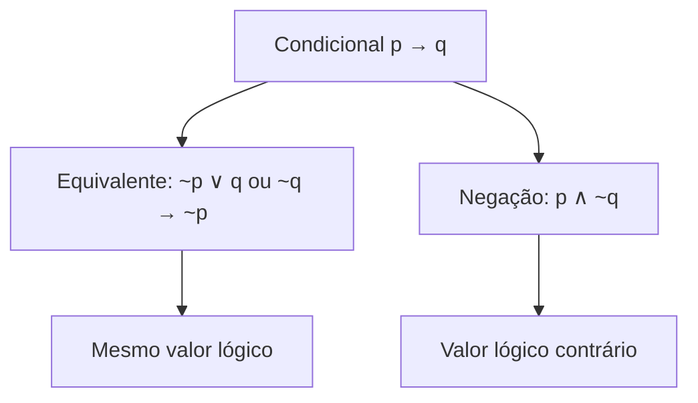
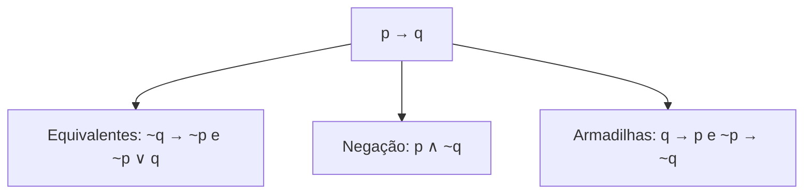

A negação da condicional é uma das cobranças mais frequentes de lógica proposicional, e também uma das mais traiçoeiras. O senso comum tende a responder que o contrário de "se chove, a rua molha" é "se chove, a rua não molha". Está errado. Quando a promessa de uma condicional é quebrada, o que acontece é um fato concreto: a condição ocorreu e o resultado prometido não. Neste capítulo você aprende a negar a condicional, a combinar várias equivalências em um mesmo exercício e a reconhecer outras equivalências de baixa incidência, mas que aparecem nas provas mais exigentes.

> [!objetivos]
> - Negar uma condicional e não confundir a negação com a equivalência.
> - Combinar mais de uma equivalência em um mesmo problema.
> - Escrever a negação da conjunção na forma condicional.
> - Usar as equivalências da conjunção de condicionais com termo comum.
> - Reconhecer as equivalências da disjunção exclusiva.

## Negação da condicional

A condicional p → q só é falsa em uma situação: quando o antecedente é verdadeiro e o consequente é falso. Negar a condicional é, portanto, afirmar exatamente essa situação:

**~(p → q) ≡ p ∧ ~q**

O procedimento é de três passos:

1. **manter** o primeiro termo;
2. **trocar** o "se... então" por "e";
3. **negar** o segundo termo.

Tome "Se eu comi lasanha, então bebi refrigerante". A negação é "Eu comi lasanha e não bebi refrigerante". O que desmente a promessa é o caso em que a lasanha foi comida e o refrigerante não foi bebido.

### Demonstração por De Morgan

Não precisa decorar sem compreender. Começamos pela equivalência p → q ≡ ~p ∨ q e negamos os dois lados:

~(p → q) ≡ ~(~p ∨ q)

O lado direito é a negação de uma disjunção, que se resolve por De Morgan: nega-se cada parcela e troca-se o "ou" por "e":

~(~p ∨ q) ≡ ~(~p) ∧ ~q ≡ p ∧ ~q

Chegamos ao resultado esperado, com a dupla negação cuidando de ~(~p).

A confirmação pela tabela-verdade mostra que as colunas são opostas, como deve ser em uma negação:

| p | q | p → q | p ∧ ~q |
| --- | --- | --- | --- |
| V | V | V | F |
| V | F | F | V |
| F | V | V | F |
| F | F | V | F |

Em todas as linhas, a condicional e a conjunção p ∧ ~q têm valores contrários.

> [!pegadinha] Equivalência da condicional versus negação da condicional
> Duas fórmulas parecidas esperam por você. A equivalência troca o "se... então" por "ou" e nega só o primeiro termo: p → q ≡ ~p ∨ q. A negação troca o "se... então" por "e" e nega só o segundo termo: ~(p → q) ≡ p ∧ ~q. Se o enunciado pede a negação, a resposta tem "e"; se pede a equivalente, a resposta tem "ou" ou outra condicional.

> [!resolvido] Exemplo 1: negação de uma condicional
> Qual é a negação de "Se o treino termina cedo, então a tropa janta no quartel"?
>
> **Resolução.** Sejam t: "o treino termina cedo" e j: "a tropa janta no quartel". A original é t → j. Mantém-se o primeiro termo, troca-se por "e" e nega-se o segundo: t ∧ ~j, "O treino termina cedo e a tropa não janta no quartel".

> [!resolvido] Exemplo 2: condicional com antecedente negativo
> Negue "Se Joana não revisa a matéria, então erra as questões de porcentagem".
>
> **Resolução.** Sejam r: "Joana revisa a matéria" e e: "Joana erra as questões de porcentagem". A original é ~r → e. Mantém-se ~r, troca-se por "e" e nega-se e: ~r ∧ ~e, "Joana não revisa a matéria e não erra as questões de porcentagem". Repare que o antecedente negativo permaneceu como estava.

## Equivalências combinadas

Em muitas questões, um único passo não basta. Você precisa encadear a transformação da condicional, De Morgan e a dupla negação. O método é sempre o mesmo: identificar o conectivo principal da frase, aplicar a regra correspondente e repetir o processo nas partes menores.

### Exemplo com antecedente composto

Julgue: a expressão (A ∨ B) → C é equivalente a (~A ∧ ~B) ∨ C.

O conectivo principal é a condicional. Como a expressão proposta não é uma condicional, vamos pela transformação em disjunção: (A ∨ B) → C ≡ ~(A ∨ B) ∨ C. A parte ~(A ∨ B) é a negação de uma disjunção, e De Morgan a converte em ~A ∧ ~B. Resultado: (~A ∧ ~B) ∨ C. O item está correto.

### Exemplo com consequente composto

Considere: "Se o exame é aprovado, então o candidato recebe a nota e a classificação". Sejam a: "o exame é aprovado", n: "o candidato recebe a nota" e c: "o candidato recebe a classificação". A original é a → (n ∧ c).

- Pela contrapositiva: ~(n ∧ c) → ~a. Por De Morgan, ~(n ∧ c) vira ~n ∨ ~c. Logo, (~n ∨ ~c) → ~a: "Se o candidato não recebe a nota ou não recebe a classificação, então o exame não é aprovado".
- Pela transformação em disjunção: ~a ∨ (n ∧ c): "O exame não é aprovado ou o candidato recebe a nota e a classificação".

As duas formas são equivalentes à original; a banca escolhe uma e coloca a outra fora das alternativas.

### Exemplo de negação com conjunção e condicional

Considere "Estou de plantão e, se o chefe autoriza, então saio". Sejam d: "estou de plantão", m: "o chefe autoriza" e v: "saio". A original é d ∧ (m → v). Para negar:

1. A frase é uma conjunção. Por De Morgan, a negação é ~d ∨ ~(m → v).
2. A parte ~(m → v) é a negação de uma condicional: m ∧ ~v.
3. Resultado: ~d ∨ (m ∧ ~v), "Não estou de plantão ou o chefe autoriza e não saio".

> [!bizu] Encadeamento seguro
> Quando a frase tiver parênteses, resolva de fora para dentro: primeiro o conectivo principal, depois cada parcela. Substitua um pedaço de cada vez e releia o resultado em linguagem natural.

## Outras equivalências e negações

As equivalências desta seção têm incidência menor, mas não custam caro para memorizar. São úteis em provas de nível mais alto.

### Negação da conjunção na forma de condicional

Além de De Morgan, a negação do "e" também pode ser escrita como uma condicional, de duas maneiras:

- **~(p ∧ q) ≡ p → ~q**
- **~(p ∧ q) ≡ q → ~p**

A lógica: dizer que "não é verdade que p e q ocorrem juntos" é dizer que, se p ocorre, q não ocorre. E vice-versa. Para "Comi lasanha e bebi refrigerante", as negações possíveis incluem "Se comi lasanha, não bebi refrigerante" e "Se bebi refrigerante, não comi lasanha".

A prova parte de De Morgan: ~(p ∧ q) ≡ ~p ∨ ~q. Aplicando a transformação do "ou" em condicional (nega-se o primeiro termo e mantém-se o segundo), obtém-se ~(~p) → ~q, que é p → ~q. A segunda forma sai da contrapositiva dessa condicional.

> [!resolvido] Exemplo 3: conjunção negada com condicional nas alternativas
> Dada "Corro e não fico cansado", qual é uma sentença equivalente à negação?
> a) Se corro, então fico cansado.
> b) Não corro e fico cansado.
>
> **Resolução.** Sejam c: "corro" e f: "fico cansado". A original é c ∧ ~f. Por De Morgan, a negação é ~c ∨ f, que não está nas opções. Pela forma condicional, ~(c ∧ ~f) ≡ c → ~(~f) ≡ c → f: "Se corro, então fico cansado". Resposta: a. A alternativa b é uma conjunção e não equivale à negação.

### Conjunção de condicionais

Duas condicionais ligadas por "e" podem, em dois casos, ser compactadas em uma só.

**Termo comum no consequente:**

(p → r) ∧ (q → r) ≡ (p ∨ q) → r

Dizer "se p, então r" e "se q, então r" equivale a dizer "se p ou q, então r". No consequente comum entram os dois antecedentes ligados por **ou**.

**Termo comum no antecedente:**

(p → q) ∧ (p → r) ≡ p → (q ∧ r)

Dizer "se p, então q" e "se p, então r" equivale a "se p, então q e r". No antecedente comum, os consequentes entram ligados por **e**.

| Termo comum | Forma original | Forma compacta |
| --- | --- | --- |
| Consequente (r) | (p → r) ∧ (q → r) | (p ∨ q) → r |
| Antecedente (p) | (p → q) ∧ (p → r) | p → (q ∧ r) |

A verificação da primeira equivalência na tabela-verdade, com três proposições e oito linhas:

| p | q | r | p → r | q → r | (p → r) ∧ (q → r) | p ∨ q | (p ∨ q) → r |
| --- | --- | --- | --- | --- | --- | --- | --- |
| V | V | V | V | V | V | V | V |
| V | V | F | F | F | F | V | F |
| V | F | V | V | V | V | V | V |
| V | F | F | F | V | F | V | F |
| F | V | V | V | V | V | V | V |
| F | V | F | V | F | F | V | F |
| F | F | V | V | V | V | F | V |
| F | F | F | V | V | V | F | V |

As duas colunas destacadas coincidem nas oito linhas.

> [!resolvido] Exemplo 4: conjunção de condicionais com termo comum no antecedente
> As frases "Se há carência de recursos no setor Alfa, o trabalho dos servidores fica prejudicado" e "Se há carência de recursos no setor Alfa, os usuários são mal atendidos" são unidas por "e". É equivalente dizer "Se há carência de recursos no setor Alfa, o trabalho dos servidores fica prejudicado e os usuários são mal atendidos"?
>
> **Resolução.** Sejam c: "há carência de recursos", t: "o trabalho fica prejudicado" e b: "os usuários são mal atendidos". A união é (c → t) ∧ (c → b). O termo comum é o antecedente c, e a forma compacta é c → (t ∧ b). A equivalência está correta.

> [!pegadinha] Trocar o conectivo no lugar errado
> Uma questão clássica pergunta se (P ∨ Q) → S é equivalente a (P → S) ∨ (Q → S). Está errado. A equivalência correta usa **e** entre as condicionais: (P → S) ∧ (Q → S). Quando o termo comum é o consequente, o "ou" fica no antecedente, e o "e" fica entre as condicionais.

### Equivalências da disjunção exclusiva

A disjunção exclusiva ("ou... ou", simbolizada aqui por ⊻) é verdadeira quando exatamente uma das parcelas é verdadeira. Ela possui três equivalências úteis:

- negar as duas parcelas: **p ⊻ q ≡ ~p ⊻ ~q**;
- virar uma bicondicional negando só a primeira: **p ⊻ q ≡ ~p ⟷ q**;
- virar uma bicondicional negando só a segunda: **p ⊻ q ≡ p ⟷ ~q**.

Para "Ou jogo bola, ou jogo sinuca", as formas equivalentes são "Ou não jogo bola, ou não jogo sinuca", "Não jogo bola se e somente se jogo sinuca" e "Jogo bola se e somente se não jogo sinuca".

> [!resolvido] Exemplo 5: ou... ou nas alternativas
> Se a afirmação "Ou Renato é o gerente da loja, ou Rodrigo é o dono da loja" é verdadeira, qual das alternativas é necessariamente verdadeira?
> a) Renato é o gerente se, e somente se, Rodrigo não é o dono.
> b) Se Renato é o gerente, então Rodrigo é o dono.
>
> **Resolução.** Sejam g: "Renato é o gerente" e d: "Rodrigo é o dono". A afirmação é g ⊻ d. Como a alternativa a usa bicondicional, aplicamos g ⊻ d ≡ g ⟷ ~d: "Renato é o gerente se, e somente se, Rodrigo não é o dono". Resposta: a. A alternativa b diria que, sendo Renato gerente, Rodrigo é dono, o que contraria a exclusividade.

## Quatro frases a partir de uma condicional

Para fixar o que muda em cada operação, parta de uma única condicional e observe as quatro frases que as bancas costumam oferecer. Seja a original "Se o soldado treina, então está apto".

| Operação | Fórmula | Frase | Relação com a original |
| --- | --- | --- | --- |
| Contrapositiva | ~q → ~p | Se não está apto, então não treina | Equivalente |
| Disjunção | ~p ∨ q | Não treina ou está apto | Equivalente |
| Recíproca | q → p | Se está apto, então treina | Nem equivalente nem negação |
| Inversa | ~p → ~q | Se não treina, então não está apto | Nem equivalente nem negação |
| Negação | p ∧ ~q | Treina e não está apto | Valor lógico contrário |

Duas conclusões práticas. Primeiro, a recíproca e a inversa são as armadilhas: parecem corretas, mas não equivalem nem negam. Segundo, só a negação tem "e" entre as partes. Se a banca perguntar "a negação" e a alternativa certa não tiver "e", desconfie e releia a frase.

Para tornar o conjunto ainda mais visual, veja o mapa a seguir, que mostra o que se obtém a partir da mesma condicional.

## Como a banca cobra este assunto

A negação da condicional é uma das perguntas mais frequentes, com alternativas que misturam "se... então", "ou" e "e". Quem confunde equivalência com negação erra. Em questões mais difíceis, aparecem fórmulas aninhadas, em que se exige De Morgan, a negação da condicional e a dupla negação em sequência. Há também itens certo/errado sobre a conjunção de condicionais e a disjunção exclusiva. Quando a memória falhar, recorra à tabela-verdade: duas fórmulas são equivalentes se, e somente se, suas colunas coincidem, e uma está negada em relação à outra se as colunas são opostas em todas as linhas.

## Mapa do capítulo

| Tema | Fórmula | Armadilha |
| --- | --- | --- |
| Negação da condicional | ~(p → q) ≡ p ∧ ~q | Manter "se... então" ou negar o primeiro termo |
| Equivalência da condicional | p → q ≡ ~p ∨ q | Confundir com a negação |
| Negação do "e" em condicional | ~(p ∧ q) ≡ p → ~q ≡ q → ~p | Esquecer que há duas formas |
| Termo comum no consequente | (p → r) ∧ (q → r) ≡ (p ∨ q) → r | Trocar o "ou" por "e" no antecedente |
| Termo comum no antecedente | (p → q) ∧ (p → r) ≡ p → (q ∧ r) | Trocar o "e" por "ou" no consequente |
| Disjunção exclusiva | p ⊻ q ≡ ~p ⊻ ~q ≡ ~p ⟷ q ≡ p ⟷ ~q | Negar as duas parcelas e a bicondicional |

### Para fixar

1. A negação de p → q é p ∧ ~q: mantém-se o primeiro termo, troca-se por "e" e nega-se o segundo.
2. A equivalência de p → q é ~p ∨ q: nega-se o primeiro termo e troca-se por "ou".
3. A condicional só é falsa quando o antecedente é verdadeiro e o consequente é falso.
4. A negação do "e" pode ser escrita como p → ~q ou como q → ~p.
5. Em fórmulas aninhadas, resolva o conectivo principal primeiro e as partes depois.
6. (p → r) ∧ (q → r) equivale a (p ∨ q) → r.
7. (p → q) ∧ (p → r) equivale a p → (q ∧ r).
8. (P ∨ Q) → S não equivale a (P → S) ∨ (Q → S).
9. A disjunção exclusiva equivale à bicondicional com uma das parcelas negada.
10. Em caso de dúvida, compare as colunas da tabela-verdade.
