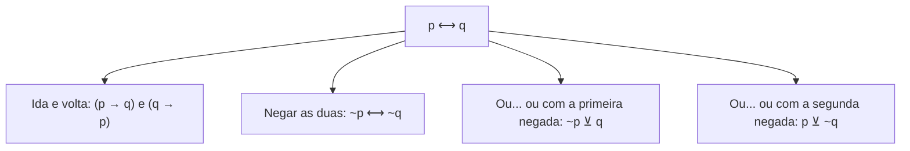
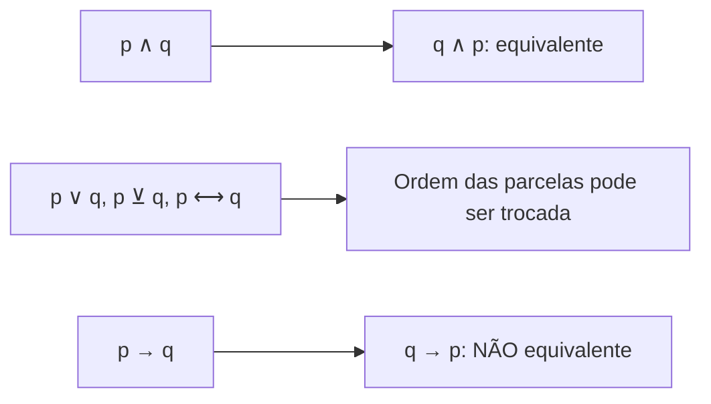

Os dois conectivos mais "simétricos" da lógica são a **disjunção exclusiva** ("ou... ou") e a **bicondicional** ("se e somente se"). Em ambos, trocar a ordem das parcelas não muda nada, e ambos estão ligados entre si por uma relação de opostos: o que a bicondicional afirma como verdadeiro, a disjunção exclusiva afirma como falso, e vice-versa. Neste capítulo você aprende as negações e as equivalências desses dois conectivos, o que fecha o quadro das negações lógicas, e conhece a **propriedade comutativa**, a primeira ferramenta da álgebra de proposições.

> [!objetivos]
> - Negar uma disjunção exclusiva e reconhecer suas formas equivalentes.
> - Escrever as equivalências da bicondicional, inclusive a de "ida e volta".
> - Negar uma bicondicional de quatro maneiras.
> - Aplicar a propriedade comutativa para localizar a resposta nas alternativas.

## Introdução: por que estudar estes dois conectivos

Quem já resolveu questões de equivalência sabe que o "ou... ou" e o "se e somente se" aparecem pouco no enunciado, mas muito nas alternativas. A banca esconde neles a resposta correta: uma frase com "se e somente se" pode ser a negação de outra com "ou... ou", e vice-versa. Quem não domina essas relações fica sem saber se uma alternativa é equivalente ou negação. Por isso este capítulo vale o esforço: ele fecha o conjunto de negações e equivalências que a compreensão de estruturas lógicas exige em provas de nível superior.

Há ainda uma razão prática. As fórmulas deste capítulo têm padrão muito regular: negar uma parcela, negar as duas, trocar o conectivo. Com uma tabela mental de quatro entradas, você resolve a maioria das questões sem montar a tabela-verdade.

## Os dois conectivos em oposição

A **disjunção exclusiva** (p ⊻ q, "ou p, ou q") é verdadeira quando **exatamente uma** das parcelas é verdadeira. É falsa quando as duas têm o mesmo valor. A **bicondicional** (p ⟷ q, "p se e somente se q") é verdadeira quando as parcelas têm o **mesmo valor** e falsa quando têm valores diferentes. A tabela mostra o contraste.

| p | q | p ⊻ q | p ⟷ q |
| --- | --- | --- | --- |
| V | V | F | V |
| V | F | V | F |
| F | V | V | F |
| F | F | F | V |

Em cada linha, as duas últimas colunas têm valores contrários. Isso demonstra, de uma só vez, duas negações:

- **~(p ⊻ q) ≡ p ⟷ q**: a negação da disjunção exclusiva é a bicondicional;
- **~(p ⟷ q) ≡ p ⊻ q**: a negação da bicondicional é a disjunção exclusiva.

> [!bizu] Opostos que se negam
> Sempre que a questão pedir a negação de uma bicondicional e uma das alternativas trouxer "ou... ou" com as mesmas parcelas, é provável que seja a resposta. O mesmo vale ao contrário: a negação de "ou... ou" costuma ser o "se e somente se".

## Negação da disjunção exclusiva

A principal negação de **p ⊻ q** já está dada: p ⟷ q. Para "Ou jogo bola, ou jogo sinuca", a negação é "Jogo bola se e somente se jogo sinuca". Se alguém afirma que faz exatamente um dos dois esportes, o contrário é que faz ambos ou nenhum, e isso é a bicondicional.

Há duas outras formas, que negam **uma única** parcela e mantêm a disjunção exclusiva:

- **~(p ⊻ q) ≡ ~p ⊻ q**
- **~(p ⊻ q) ≡ p ⊻ ~q**

Para o mesmo exemplo: "Ou não jogo bola, ou jogo sinuca" e "Ou jogo bola, ou não jogo sinuca". Veja que as duas formas negam apenas um lado.

| Fórmula | Forma | Exemplo |
| --- | --- | --- |
| ~(p ⊻ q) ≡ p ⟷ q | Bicondicional | Jogo bola se e somente se jogo sinuca |
| ~(p ⊻ q) ≡ ~p ⊻ q | Nega só a primeira | Ou não jogo bola, ou jogo sinuca |
| ~(p ⊻ q) ≡ p ⊻ ~q | Nega só a segunda | Ou jogo bola, ou não jogo sinuca |

> [!pegadinha] Negar as duas parcelas dá a equivalência, não a negação
> Negar **as duas** parcelas da disjunção exclusiva (~p ⊻ ~q) produz uma frase **equivalente** à original, e não a sua negação. Foi o que vimos no capítulo anterior. A negação exige negar **uma só** parcela (ou trocar por bicondicional). Esse é o erro mais comum nas alternativas.

> [!resolvido] Exemplo 1: negação do "ou... ou"
> Qual é uma negação de "Ou Lúcia atua no resgate, ou Lúcia atua na prevenção"?
> a) Ou Lúcia não atua no resgate, ou não atua na prevenção.
> b) Lúcia atua na prevenção se, e somente se, atua no resgate.
> c) Se Lúcia atua no resgate, então atua na prevenção.
>
> **Resolução.** Sejam r: "Lúcia atua no resgate" e v: "Lúcia atua na prevenção". A original é r ⊻ v. As negações possíveis são r ⟷ v, ~r ⊻ v e r ⊻ ~v. Descartamos c, que é uma condicional, e a, que nega as duas parcelas (e por isso é equivalente, não negação). A resposta é b, pois a bicondicional comuta.

> [!resolvido] Exemplo 2: com negação já presente
> Negue "Ou arranjo emprego, ou não me caso".
>
> **Resolução.** Sejam a: "arranjo emprego" e c: "me caso". A original é a ⊻ ~c. Negando só a primeira parcela, obtemos ~a ⊻ ~c: "Ou não arranjo emprego, ou não me caso". Negando só a segunda, a segunda parcela vira ~(~c), isto é, c, e obtemos a ⊻ c: "Ou arranjo emprego, ou me caso". Ambas servem como negação; a banca escolhe uma e deixa a outra de fora.

## Equivalências da bicondicional

A bicondicional possui quatro formas equivalentes de grande utilidade.

**1. Ida e volta:** p ⟷ q ≡ (p → q) ∧ (q → p). Dizer "p se e somente se q" é dizer que p implica q e q implica p. O mnemônico é "ir e voltar com a condicional".

**2. Negar as duas parcelas:** p ⟷ q ≡ ~p ⟷ ~q. Se "durmo se e somente se estou cansado", então "não durmo se e somente se não estou cansado".

**3 e 4. Disjunção exclusiva com uma parcela negada:** p ⟷ q ≡ ~p ⊻ q e p ⟷ q ≡ p ⊻ ~q. Para "Durmo se e somente se estou cansado": "Ou não durmo, ou estou cansado" e "Ou durmo, ou não estou cansado".

| Equivalente de p ⟷ q | Exemplo (durmo, estou cansado) |
| --- | --- |
| (p → q) ∧ (q → p) | Se durmo, estou cansado; e se estou cansado, durmo |
| ~p ⟷ ~q | Não durmo se e somente se não estou cansado |
| ~p ⊻ q | Ou não durmo, ou estou cansado |
| p ⊻ ~q | Ou durmo, ou não estou cansado |

Existe uma variação da ida e volta que cai com certa frequência. Como q → p tem a contrapositiva ~p → ~q, podemos escrever p ⟷ q ≡ (p → q) ∧ (~p → ~q). Por exemplo, "Um número inteiro é par se e somente se o seu quadrado é par" equivale a "Se o número é par, então o quadrado é par, e se o número não é par, então o quadrado não é par".

> [!resolvido] Exemplo 3: procurando a equivalente
> Qual é a equivalente de "Adriano é pai se, e somente se, Giuliano é filho"?
> a) Se Giuliano não é filho, então Adriano não é pai.
> b) Adriano é pai e Giuliano não é filho.
> c) Ou Adriano é pai, ou Giuliano é filho.
> d) Ou Giuliano é filho, ou Adriano não é pai.
>
> **Resolução.** Sejam a: "Adriano é pai" e g: "Giuliano é filho". A original é a ⟷ g. A alternativa a é uma condicional isolada (só um sentido), a b é uma conjunção, e a c é a ⊻ g sem negar nenhuma parcela. A d corresponde a g ⊻ ~a, que é a ~a ⊻ g com as parcelas trocadas, e a disjunção exclusiva é comutativa. Resposta: d.

## Negação da bicondicional

Há quatro formas comuns de negar p ⟷ q:

- **~(p ⟷ q) ≡ p ⊻ q** (a mais cobrada);
- **~(p ⟷ q) ≡ ~p ⟷ q**;
- **~(p ⟷ q) ≡ p ⟷ ~q**;
- **~(p ⟷ q) ≡ (p ∧ ~q) ∨ (q ∧ ~p)**.

A primeira vem de negar os dois lados de ~(p ⊻ q) ≡ p ⟷ q: a dupla negação leva a ~(p ⟷ q) ≡ p ⊻ q. A segunda e a terceira negam uma só parcela, como na disjunção exclusiva. A quarta usa apenas "e" e "ou", e se obtém pelo caminho "ida e volta": nega-se (p → q) ∧ (q → p) por De Morgan, o que dá ~(p → q) ∨ ~(q → p), e negam-se as condicionais, resultando em (p ∧ ~q) ∨ (q ∧ ~p).

| Negação de p ⟷ q | Forma |
| --- | --- |
| p ⊻ q | Disjunção exclusiva |
| ~p ⟷ q | Bicondicional com a primeira parcela negada |
| p ⟷ ~q | Bicondicional com a segunda parcela negada |
| (p ∧ ~q) ∨ (q ∧ ~p) | Só "e" e "ou" |

> [!atencao] Negar as duas parcelas da bicondicional é equivalência
> ~p ⟷ ~q é **equivalente** a p ⟷ q, não a sua negação. A negação nega uma só parcela. Esse detalhe distingue as alternativas corretas das falsas em quase toda questão do assunto.

> [!resolvido] Exemplo 4: negação de "se e somente se"
> A negação de "João passa no concurso se e somente se estuda" é qual das alternativas?
> a) João não passa no concurso se e somente se não estuda.
> b) Ou João passa no concurso, ou João estuda.
>
> **Resolução.** Sejam p: "João passa no concurso" e e: "João estuda". A original é p ⟷ e. Uma negação é p ⊻ e: "Ou João passa no concurso, ou estuda". Resposta: b. A alternativa a nega as duas parcelas e é, portanto, equivalente à original.

> [!resolvido] Exemplo 5: item certo ou errado
> A negação de "A Fênix é imortal se, e somente se, renasce das cinzas" é "Ou a Fênix é imortal, ou renasce das cinzas". O item está correto?
>
> **Resolução.** Sejam i: "a Fênix é imortal" e r: "a Fênix renasce das cinzas". A original é i ⟷ r, e a negação ~(i ⟷ r) é i ⊻ r. O item está correto.

## Álgebra de proposições: a propriedade comutativa

A **álgebra de proposições** é o uso encadeado de equivalências e propriedades para simplificar uma expressão. Ela é um atalho: quase tudo o que ela resolve também se resolve por tabela-verdade, mas com mais rapidez e, às vezes, para "enxergar" uma equivalência escondida nas alternativas. As propriedades que mais caem são a comutativa, a associativa e a distributiva; as duas últimas serão estudadas no capítulo seguinte.

A **propriedade comutativa** diz que a ordem das parcelas não importa. Todos os conectivos têm essa propriedade, **exceto a condicional**:

- p ∧ q ≡ q ∧ p
- p ∨ q ≡ q ∨ p
- p ⊻ q ≡ q ⊻ p
- p ⟷ q ≡ q ⟷ p

A condicional não comuta: p → q e q → p **não** são equivalentes. A equivalência correta para trocar de lado é a contrapositiva, ~q → ~p.

> [!pegadinha] A condicional não comuta
> Trocar as posições de antecedente e consequente sem negar produz a recíproca, que não equivale à original. Só se pode inverter a ordem se ambos os termos forem negados.

### Para que serve na prática

Imagine que a questão peça a negação de "Se eu correr, chego a tempo". Pela regra, a negação é "Corro e não chego a tempo" (p ∧ ~q). Se essa frase não estiver nas alternativas, mas aparecer "Não chego a tempo e corro", marque sem receio: a conjunção comuta, e ~q ∧ p é equivalente a p ∧ ~q.

> [!resolvido] Exemplo 6: negação com propriedade comutativa
> Qual é a negação de "Animais são bípedes ou quadrúpedes, e árvores têm folhas verdes"?
>
> **Resolução.** Sejam b: "animais são bípedes", q: "animais são quadrúpedes" e a: "árvores têm folhas verdes". A original é (b ∨ q) ∧ a. Pela lei de De Morgan, ~[(b ∨ q) ∧ a] ≡ ~(b ∨ q) ∨ ~a. A parcela ~(b ∨ q) é a negação de uma disjunção, que De Morgan transforma em ~b ∧ ~q. Resultado: (~b ∧ ~q) ∨ ~a, "Animais não são bípedes e não são quadrúpedes, ou árvores não têm folhas verdes". Se a alternativa aparecer com as parcelas em outra ordem, a comutativa garante que é a mesma resposta.

## Tabela de decisão: equivalência ou negação

Reúna tudo o que vimos até aqui nesta tabela, que resume o efeito de negar uma ou as duas parcelas.

| Operação sobre as parcelas | Em p ⊻ q | Em p ⟷ q |
| --- | --- | --- |
| Nenhuma | p ⊻ q (a própria) | p ⟷ q (a própria) |
| Negar as duas | Equivalente | Equivalente |
| Negar uma só | Negação | Negação |
| Trocar o conectivo (⊻ por ⟷ ou o inverso) sem negar | Negação | Negação |
| Trocar o conectivo e negar uma | Equivalente | Equivalente |

A regra por trás da tabela é simples: negar **uma** parcela inverte o valor lógico; negar **as duas** o restabelece. Trocar o conectivo (de "ou... ou" para "se e somente se") também inverte. Dois movimentos inversores se cancelam, e é por isso que "trocar o conectivo e negar uma parcela" volta ao mesmo valor. Quando tiver dúvida diante de uma alternativa, conte quantas inversões ela contém: número ímpar é negação, número par é equivalência.

## Como a banca cobra este assunto

As negações da disjunção exclusiva e da bicondicional costumam aparecer em questões com alternativas que misturam bicondicional, "ou... ou", condicional, conjunção e "ou" inclusivo. Eliminar as formas impossíveis (como a condicional) restringe as opções a poucas. A principal distinção cobrada é entre **negar uma** e **negar as duas** parcelas, e entre equivalência e negação. A propriedade comutativa entra como atalho para identificar a resposta com as parcelas em ordem diferente, e a regra de que a condicional não comuta é cobrada de maneira direta.

## Mapa do capítulo

| Tema | Fórmula | Armadilha |
| --- | --- | --- |
| Negação do "ou... ou" | ~(p ⊻ q) ≡ p ⟷ q ≡ ~p ⊻ q ≡ p ⊻ ~q | Negar as duas parcelas |
| Equivalência do "ou... ou" | p ⊻ q ≡ ~p ⊻ ~q | Tomá-la por negação |
| Equivalências da bicondicional | (p → q) ∧ (q → p), ~p ⟷ ~q, ~p ⊻ q, p ⊻ ~q | Aceitar uma só condicional |
| Negação da bicondicional | p ⊻ q, ~p ⟷ q, p ⟷ ~q, (p ∧ ~q) ∨ (q ∧ ~p) | Negar as duas parcelas |
| Comutativa | ∧, ∨, ⊻ e ⟷ comutam | Comutar a condicional |

### Para fixar

1. A disjunção exclusiva e a bicondicional têm sempre valores opostos.
2. A negação de p ⊻ q é p ⟷ q, ou ainda ~p ⊻ q ou p ⊻ ~q.
3. Negar as duas parcelas de p ⊻ q gera uma equivalente, não uma negação.
4. A bicondicional equivale a (p → q) ∧ (q → p), a "ida e volta".
5. A bicondicional também equivale a ~p ⟷ ~q, a ~p ⊻ q e a p ⊻ ~q.
6. A negação de p ⟷ q é p ⊻ q, ou ~p ⟷ q, ou p ⟷ ~q.
7. Há uma negação da bicondicional só com "e" e "ou": (p ∧ ~q) ∨ (q ∧ ~p).
8. A conjunção, a disjunção, a disjunção exclusiva e a bicondicional gozam da propriedade comutativa.
9. A condicional não comuta; a recíproca não equivale à original.
10. A álgebra de proposições é um atalho; em caso de dúvida, use a tabela-verdade.
