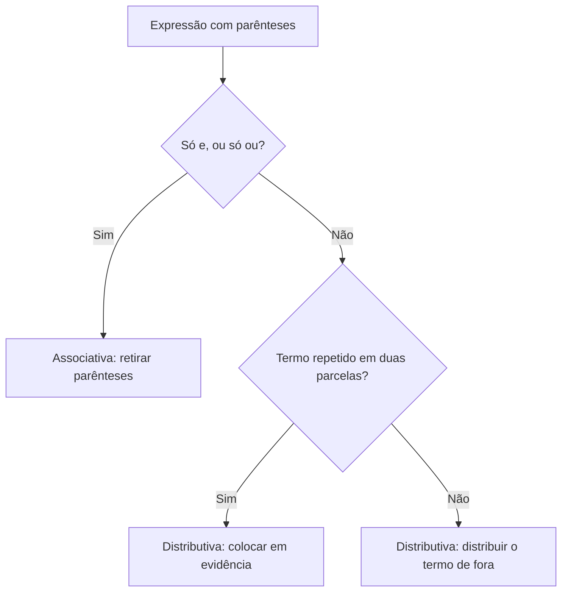
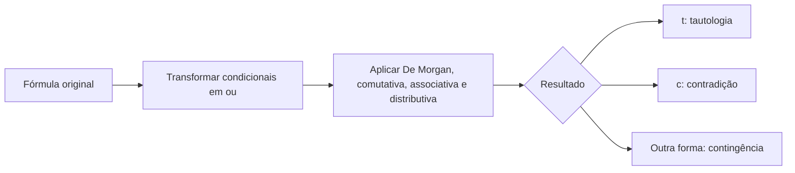

Na álgebra do ensino fundamental você aprendeu que 3 × (5 + 7) é o mesmo que 3 × 5 + 3 × 7, e que (3 × 5) × 7 é o mesmo que 3 × (5 × 7). As proposições lógicas têm propriedades parecidas. Com elas, é possível **simplificar** uma expressão composta, transformar uma fórmula em outra equivalente e descobrir, sem tabela-verdade, se uma proposição é uma tautologia, uma contradição ou uma contingência. Neste capítulo você completa a álgebra de proposições com as propriedades associativa, distributiva, da identidade, da absorção e da idempotência, e vê como usá-las em conjunto.

> [!objetivos]
> - Aplicar a propriedade associativa para retirar parênteses de sequências de "e" ou de "ou".
> - Usar a propriedade distributiva para distribuir e para colocar em evidência.
> - Simplificar expressões com as propriedades da identidade, da absorção e da idempotência.
> - Classificar uma proposição como tautologia, contradição ou contingência por álgebra.
> - Reconhecer a bicondicional entre fórmulas equivalentes e entre fórmulas opostas.

## Propriedade associativa

Na multiplicação de três números, a ordem em que agrupamos os fatores não altera o resultado. Na lógica, a **conjunção** e a **disjunção inclusiva** têm essa mesma propriedade:

- **(p ∧ q) ∧ r ≡ p ∧ (q ∧ r)**
- **(p ∨ q) ∨ r ≡ p ∨ (q ∨ r)**

Quando há uma sequência só de "e", ou só de "ou", os parênteses podem ser retirados sem alterar o valor lógico. O que não vale é misturar: a propriedade associativa **não** troca "e" por "ou" nem mistura os dois conectivos na mesma expressão.

> [!atencao] Associativa só para conectivos iguais
> (p ∧ q) ∨ r **não** é igual a p ∧ (q ∨ r). Se há "e" e "ou" juntos, os parênteses fazem diferença. A propriedade associativa vale apenas dentro de uma sequência de conjunções ou dentro de uma sequência de disjunções inclusivas.

### Uso típico: caçar a tautologia

Um padrão frequente é mostrar que uma expressão é uma tautologia. Para isso, tenta-se chegar a p ∨ ~p, que é sempre verdadeira. Considere p ∨ (q ∨ ~p).

1. Pela comutativa, q ∨ ~p vira ~p ∨ q: p ∨ (~p ∨ q).
2. Pela associativa: (p ∨ ~p) ∨ q.
3. Como p ∨ ~p é tautologia (t): t ∨ q.
4. Uma disjunção em que uma parcela é sempre verdadeira é sempre verdadeira.

Logo, a expressão original é uma tautologia.

> [!resolvido] Exemplo 1: negação de condicional com associativa
> Qual é a proposição equivalente a ~[[A ∧ ~B] → C]?
>
> **Resolução.** A expressão é a negação de uma condicional cujo antecedente é A ∧ ~B e cujo consequente é C. Pela regra ~(p → q) ≡ p ∧ ~q, mantém-se o antecedente, troca-se o conectivo por "e" e nega-se o consequente: [A ∧ ~B] ∧ ~C. Pela associativa, os colchetes podem sair: A ∧ ~B ∧ ~C.

## Propriedade distributiva

Assim como 3 × (5 + 7) = 3 × 5 + 3 × 7, a lógica tem duas distributivas, que valem em dois sentidos: distribuindo e **colocando em evidência**.

**Distributiva da conjunção sobre a disjunção:**

p ∧ (q ∨ r) ≡ (p ∧ q) ∨ (p ∧ r)

**Distributiva da disjunção sobre a conjunção:**

p ∨ (q ∧ r) ≡ (p ∨ q) ∧ (p ∨ r)

| Operação | Antes | Depois |
| --- | --- | --- |
| "e" distribui sobre "ou" | p ∧ (q ∨ r) | (p ∧ q) ∨ (p ∧ r) |
| "ou" distribui sobre "e" | p ∨ (q ∧ r) | (p ∨ q) ∧ (p ∨ r) |
| Evidência do "p e" | (p ∧ q) ∨ (p ∧ r) | p ∧ (q ∨ r) |
| Evidência do "p ou" | (p ∨ q) ∧ (p ∨ r) | p ∨ (q ∧ r) |

Observe a simetria: na distribuição, o conectivo de fora (aquele que acompanha p) aparece repetido no meio das duas parcelas, e o conectivo que estava dentro dos parênteses passa a unir os dois blocos.

> [!pegadinha] Não existe distributiva da conjunção sobre a condicional
> Algumas questões inventam a "propriedade distributiva da conjunção sobre a condicional". Ela não existe. A condicional deve, antes, ser transformada em disjunção (p → q ≡ ~p ∨ q). Só depois as distributivas entram em cena.

### Distribuindo na prática

"Tânia é instrutora e pratica natação ou pratica corrida", lida como "Tânia é instrutora e, pratica natação ou corrida", tem a forma i ∧ (n ∨ c). Pela distributiva: (i ∧ n) ∨ (i ∧ c), isto é, "Tânia é instrutora e pratica natação, ou é instrutora e pratica corrida". A vírgula depois do "e" costuma marcar o parêntese.

Perceba o ganho de tempo: sem a distributiva, o aluno teria de montar uma tabela com oito linhas para comparar a frase original com cada alternativa. Com a propriedade, a transformação cabe em uma linha e a conferência fica por conta de uma simples leitura. É por isso que vale treinar a distributiva nos dois sentidos, porque a banca cobra tanto a distribuição quanto a extração do termo comum.

### Colocando em evidência

Quando você enxerga um termo repetido em duas parcelas, vale colocá-lo em evidência. Considere (a ∧ b) ∨ (a ∧ ~b):

1. Põe-se "a ∧" em evidência: a ∧ (b ∨ ~b).
2. b ∨ ~b é tautologia (t): a ∧ t.
3. Uma conjunção com parcela sempre verdadeira vale o mesmo que a outra parcela: a.

Portanto, (a ∧ b) ∨ (a ∧ ~b) ≡ a.

> [!resolvido] Exemplo 2: de condicional a forma simples
> Qual é a proposição equivalente a (P → Q) ∧ (R ∨ Q)?
> a) Q ∨ (~P ∧ R)
> b) P → (R ∧ Q)
>
> **Resolução.** Transforma-se a condicional em disjunção: (~P ∨ Q) ∧ (R ∨ Q). Pela comutativa, vira (Q ∨ ~P) ∧ (Q ∨ R). Em evidência, "Q ∨": Q ∨ (~P ∧ R). Resposta: a.

> [!resolvido] Exemplo 3: equivalência entre duas fórmulas
> As proposições P ∨ ~(Q → R) e (P ∨ Q) ∧ (P ∨ ~R) são equivalentes?
>
> **Resolução.** Parte-se da primeira. A negação da condicional ~(Q → R) é Q ∧ ~R, de modo que P ∨ (Q ∧ ~R). Distribuindo o "P ∨": (P ∨ Q) ∧ (P ∨ ~R). É exatamente a segunda. São equivalentes.

## Identidade, absorção e idempotência

Estas três propriedades são um "bônus": raramente são cobradas de forma direta, mas aparecem como passos de uma simplificação mais longa. Aqui, **t** é uma tautologia (sempre verdadeira) e **c** é uma contradição (sempre falsa).

### Identidade

A tautologia e a contradição funcionam como elementos neutros ou absorventes.

| Fórmula | Resultado | Por quê |
| --- | --- | --- |
| p ∧ t | p | A parcela sempre verdadeira não altera o valor de p |
| p ∧ c | c | A parcela sempre falsa torna a conjunção sempre falsa |
| p ∨ t | t | A parcela sempre verdadeira torna a disjunção sempre verdadeira |
| p ∨ c | p | A parcela sempre falsa não altera o valor de p |

Uma analogia ajuda a guardar essas quatro linhas. Na aritmética, somar zero não altera o número (a + 0 = a) e multiplicar por zero zera tudo (a × 0 = 0). Na lógica, a contradição c faz o papel do zero para o "ou" (p ∨ c = p) e para o "e" ela absorve (p ∧ c = c). Já a tautologia t faz o papel do "um" para o "e" (p ∧ t = p) e absorve no "ou" (p ∨ t = t). Perceber esse espelhamento evita decorar quatro fórmulas isoladas: o elemento neutro do "e" é a tautologia, o elemento neutro do "ou" é a contradição, e cada um absorve o conectivo oposto.

Exemplo: p ∧ (q ∨ ~p). Distribuindo: (p ∧ q) ∨ (p ∧ ~p). Como p ∧ ~p é contradição, resulta (p ∧ q) ∨ c, e pela identidade, p ∧ q. A expressão equivale a p ∧ q.

### Absorção

- **p ∨ (p ∧ q) ≡ p**
- **p ∧ (p ∨ q) ≡ p**

A parcela maior "absorve" a menor. Intuitivamente: se p é verdadeiro, a primeira fórmula já é verdadeira; se p é falso, p ∧ q também é falso, e o resultado é falso, igual a p. Com isso, a negação de p ∧ (p ∨ q) é simplesmente ~p.

### Idempotência

- **p ∧ p ≡ p**
- **p ∨ p ≡ p**

Repetir a mesma proposição não muda nada. Em [P ∧ ~Q] ∧ ~Q, a associativa permite reagrupar P ∧ (~Q ∧ ~Q), e a idempotência reduz ~Q ∧ ~Q a ~Q. O resultado é P ∧ ~Q.

> [!bizu] Resumo para memorizar
> Identidade: com **t**, o "e" some e o "ou" vira **t**; com **c**, o "ou" some e o "e" vira **c**. Absorção: p engole p ∧ q e p ∨ q. Idempotência: p repetido é p.

> [!resolvido] Exemplo 4: simplificação completa
> A proposição ~[(P → Q) ∨ Q] é equivalente a P ∧ ~Q?
>
> **Resolução.** A expressão é a negação de uma disjunção. Por De Morgan: ~(P → Q) ∧ ~Q. Negando a condicional: [P ∧ ~Q] ∧ ~Q. Pela associativa: P ∧ [~Q ∧ ~Q]. Pela idempotência: P ∧ ~Q. São equivalentes.

### Conferindo a absorção na tabela

Para ver que a absorção funciona, basta olhar as quatro linhas. Em cada uma, p ∨ (p ∧ q) coincide com p.

| p | q | p ∧ q | p ∨ (p ∧ q) | p ∧ (p ∨ q) |
| --- | --- | --- | --- | --- |
| V | V | V | V | V |
| V | F | F | V | V |
| F | V | F | F | F |
| F | F | F | F | F |

As colunas das duas absorções repetem a de p. A leitura é imediata: quando p é verdadeiro, ambas as fórmulas são verdadeiras; quando p é falso, ambas são falsas, não importa o valor de q.

## Como ler a vírgula e o "e... ou" em português

As propriedades dependem de você montar a fórmula corretamente, e o português engana. Na frase "Sueli é instrutora e, pratica ginástica ou pratica corrida", a vírgula depois do "e" separa o bloco "pratica ginástica ou pratica corrida", que fica entre parênteses: s ∧ (g ∨ k). Já em "Sueli é instrutora e pratica ginástica, ou pratica corrida", a vírgula vem depois de "ginástica" e o parêntese cobre a primeira parte: (s ∧ g) ∨ k. As duas frases são diferentes, e o caminho para decidir é sempre a vírgula: o que vem depois dela forma um bloco só.

Com a fórmula certa, a distributiva dá a equivalente: s ∧ (g ∨ k) ≡ (s ∧ g) ∨ (s ∧ k), isto é, "Sueli é instrutora e pratica ginástica, ou é instrutora e pratica corrida". Essa leitura aparece nas provas com frequência, e a vírgula é o detalhe que decide a questão.

> [!pegadinha] Vírgula muda o agrupamento
> "A e B, ou C" e "A e, B ou C" são fórmulas diferentes: (A ∧ B) ∨ C e A ∧ (B ∨ C). Se você ler errado o agrupamento, aplicará a propriedade na parcela errada. Leia o enunciado duas vezes e marque os parênteses antes de começar.

## Roteiro para simplificar expressões

Quando uma questão pede a equivalente de uma fórmula longa, vale seguir sempre o mesmo roteiro, em cinco etapas.

1. **Elimine as condicionais e bicondicionais.** Troque p → q por ~p ∨ q e use a ida e volta para a bicondicional.
2. **Empurre as negações para dentro.** Use De Morgan e a dupla negação até restarem negações só sobre proposições simples.
3. **Use a comutativa e a associativa** para reunir termos parecidos e retirar parênteses.
4. **Distribua ou coloque em evidência** para criar blocos do tipo p ∨ ~p ou p ∧ ~p.
5. **Substitua por t ou c** e aplique a identidade, a absorção e a idempotência até a forma mais simples.

Veja o roteiro em ação com a fórmula (~p ∨ q) ∧ p. A distributiva dá (~p ∧ p) ∨ (q ∧ p). O primeiro bloco é uma contradição c, de modo que o resultado é c ∨ (q ∧ p), e pela identidade a fórmula vale p ∧ q. Em português: "Se p implica q e p ocorre, então p e q ocorrem". É a ideia de que a condicional, quando o antecedente se confirma, garante o consequente.

Um segundo exemplo: p ∧ (p → q). Troca-se a condicional: p ∧ (~p ∨ q). A distributiva dá (p ∧ ~p) ∨ (p ∧ q), que é c ∨ (p ∧ q), ou seja, p ∧ q. Os dois exemplos mostram o mesmo resultado, que é a base de muitos argumentos dedutivos: ter o antecedente e a condicional é o mesmo que ter o antecedente e o consequente.

## Tautologia, contradição e contingência por álgebra

Uma proposição composta pode ser:

- **tautologia**: sempre verdadeira, qualquer que seja o valor das simples;
- **contradição**: sempre falsa;
- **contingência**: às vezes verdadeira, às vezes falsa.

O método por tabela-verdade sempre funciona, mas é lento quando há muitas proposições simples. O método por álgebra desenvolve a fórmula até chegar a uma tautologia **t**, a uma contradição **c** ou a uma contingência (uma proposição simples, uma conjunção etc.).

> [!resolvido] Exemplo 5: ~P → (P → Q) é tautologia?
> Desenvolva a fórmula.
>
> **Resolução.** Transforma-se a condicional externa: ~(~P) ∨ (P → Q), e a dupla negação dá P ∨ (P → Q). Transforma-se a interna: P ∨ (~P ∨ Q). Pela associativa: (P ∨ ~P) ∨ Q, que é t ∨ Q. Pela identidade, t. A fórmula é uma tautologia.

> [!resolvido] Exemplo 6: Q ∨ (Q → P)
> Se P e Q são proposições simples, a composta Q ∨ (Q → P) é tautologia?
>
> **Resolução.** Transformando a condicional: Q ∨ (~Q ∨ P). Pela associativa: (Q ∨ ~Q) ∨ P, isto é, t ∨ P, que é t. É tautologia.

## Bicondicional e tautologia ou contradição

Uma pergunta que as bancas adoram: "esta bicondicional é uma tautologia ou uma contradição?". Lembre que X ⟷ Y é verdadeira quando X e Y têm o mesmo valor e falsa quando têm valores contrários. Daí duas conclusões:

- Se X e Y são **equivalentes**, X ⟷ Y é uma **tautologia** (sempre têm o mesmo valor).
- Se X e Y são **uma a negação da outra**, X ⟷ Y é uma **contradição** (sempre têm valores contrários).

| X | Y | Relação | X ⟷ Y |
| --- | --- | --- | --- |
| p → q | ~q → ~p | Equivalentes | Tautologia |
| p ∧ q | ~p ∨ ~q | Uma é a negação da outra | Contradição |
| p ∨ q | ~p → q | Equivalentes | Tautologia |
| p → q | p ∧ ~q | Uma é a negação da outra | Contradição |

Por isso, para decidir uma bicondicional, não monte a tabela inteira: pergunte-se se as duas fórmulas são equivalentes (tautologia), opostas (contradição) ou nenhuma das duas (contingência).

> [!atencao] Mesma estrutura, mas contingência
> Se X e Y não são equivalentes nem opostas, a bicondicional entre elas é uma contingência. Há linhas em que concordam e linhas em que divergem.

## Como a banca cobra este assunto

As questões costumam apresentar uma fórmula composta e pedir a equivalente mais simples, ou perguntar se determinada expressão é tautologia, contradição ou contingência. Em ambos os casos, o caminho é o mesmo: transformar condicionais em "ou", aplicar De Morgan e as propriedades, e chegar ao resultado. Fique atento à armadilha da associativa com conectivos misturados e à da distributiva "inventada" sobre a condicional. Lembre também que, quando a álgebra emperra, a tabela-verdade resolve o problema, embora mais devagar. As propriedades da identidade, da absorção e da idempotência raramente aparecem sozinhas, mas ajudam na reta final da simplificação. Em itens de certo ou errado, a banca costuma propor uma equivalência já pronta e pedir apenas o julgamento; o caminho mais rápido é partir de um dos lados e tentar chegar ao outro, usando o roteiro anterior. Se, após quatro ou cinco passos, você não chegou a lugar nenhum, considere montar a tabela-verdade: com até três proposições simples, são oito linhas, e o tempo gasto é razoável.

## Mapa do capítulo

| Tema | Fórmula | Armadilha |
| --- | --- | --- |
| Associativa | (p ∧ q) ∧ r ≡ p ∧ (q ∧ r); idem para "ou" | Misturar "e" com "ou" |
| Distributiva do "e" | p ∧ (q ∨ r) ≡ (p ∧ q) ∨ (p ∧ r) | Esquecer de repetir o p |
| Distributiva do "ou" | p ∨ (q ∧ r) ≡ (p ∨ q) ∧ (p ∨ r) | Trocar os conectivos |
| Identidade | p ∧ t ≡ p; p ∨ c ≡ p; p ∨ t ≡ t; p ∧ c ≡ c | Confundir t com c |
| Absorção | p ∨ (p ∧ q) ≡ p; p ∧ (p ∨ q) ≡ p | Esquecer que o p domina |
| Idempotência | p ∧ p ≡ p; p ∨ p ≡ p | Duplicar sem necessidade |
| Bicondicional | Equivalentes: tautologia; opostas: contradição | Tratar como contingência |

### Para fixar

1. A associativa permite retirar parênteses de uma sequência só de "e" ou só de "ou".
2. A associativa não se aplica quando "e" e "ou" aparecem juntos.
3. p ∧ (q ∨ r) equivale a (p ∧ q) ∨ (p ∧ r).
4. p ∨ (q ∧ r) equivale a (p ∨ q) ∧ (p ∨ r).
5. As distributivas funcionam também ao contrário, para colocar um termo em evidência.
6. Não existe distributiva da conjunção sobre a condicional; transforme a condicional em "ou" antes.
7. Com tautologia, p ∧ t é p e p ∨ t é t; com contradição, p ∧ c é c e p ∨ c é p.
8. A absorção e a idempotência reduzem expressões a p.
9. Para classificar uma proposição, desenvolva-a até chegar a t, c ou uma contingência.
10. Uma bicondicional entre fórmulas equivalentes é tautologia; entre fórmulas opostas, contradição.
