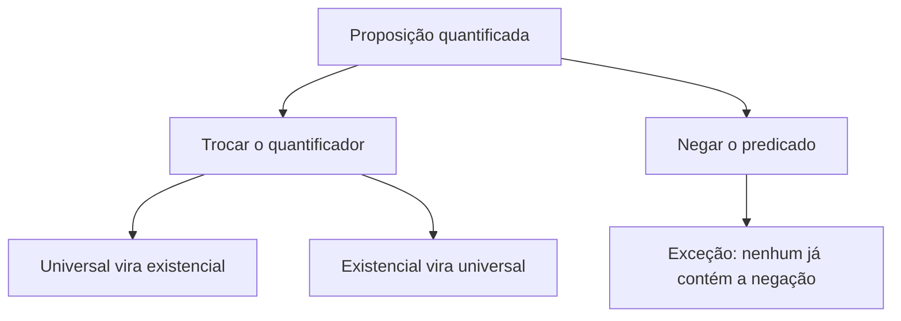

"Todo bombeiro sabe nadar." Essa frase é verdadeira ou falsa? Depende de a quem ela se refere e de quantos casos conhecemos. Basta um bombeiro que não saiba nadar para que a frase deixe de ser verdadeira. Esse tipo de raciocínio é o coração das **proposições quantificadas**, assunto que abre a aula de diagramas lógicos. Antes de desenhar os diagramas no capítulo seguinte, é preciso dominar duas ideias: o que são **sentenças abertas** e como os **quantificadores** as transformam em proposições, e, principalmente, como **negar** uma frase com "todo", "nenhum" ou "algum". É um dos conteúdos mais cobrados em concursos de segurança pública.

> [!objetivos]
> - Distinguir sentença aberta de sentença fechada (proposição).
> - Transformar uma sentença aberta em proposição por substituição ou por quantificador.
> - Reconhecer o quantificador universal e o existencial, inclusive nas formas do dia a dia.
> - Classificar as quatro formas de proposição quantificada.
> - Negar corretamente proposições com "todo", "nenhum", "algum" e "existe".

## Sentenças abertas e fechadas

Uma **sentença aberta** é uma expressão com um termo variável, de modo que não se pode dizer se ela é verdadeira ou falsa até saber quem é a variável. Por isso, **não é proposição**. Exemplos: "x + 10 = 50" e "Ela é bonita". No primeiro caso, se x for 40, a sentença é verdadeira; se for 10, é falsa. No segundo, "ela" não está identificada.

Uma **sentença fechada** é aquela a que se pode atribuir um valor lógico. As proposições são sentenças fechadas.

| Sentença | Aberta ou fechada? | Motivo |
| --- | --- | --- |
| x − 3 = 4 | Aberta | O valor de x decide a verdade |
| 20 + 10 = 50 | Fechada (falsa) | Não há variável; a soma é 30 |
| Ela é bonita | Aberta | Não se sabe quem é "ela" |
| Paulo Freire foi presidente da Coreia do Norte | Fechada (falsa) | Fato verificável |
| 0 · x = 5 | Fechada (falsa) | A variável desaparece e sobra 0 = 5 |

> [!atencao] A variável pode sumir
> Antes de classificar uma equação, simplifique os dois lados. Em 3x + 4 − x − 3 − 2x = 0, as variáveis se anulam e sobra 1 = 0, uma sentença falsa, portanto **fechada**. Já 13 · x = 7 mantém a variável e continua aberta, pois o valor de x decide se é verdadeira (x = 7/13) ou falsa.

### Como fechar uma sentença aberta

Há duas maneiras de transformar uma sentença aberta em proposição:

1. **Atribuir um valor à variável.** Em "x + 10 = 50", se x = 20 ficamos com "20 + 10 = 50", que é falsa; se x = 40, é verdadeira.
2. **Usar um quantificador.** É o que dá origem às proposições quantificadas.

## Os quantificadores

Os quantificadores são palavras ou expressões que, aplicadas a uma sentença aberta, a transformam em proposição. Existem dois.

### Quantificador universal (∀)

O símbolo ∀ lê-se "para todo", "para qualquer", "qualquer que seja". Na linguagem comum, aparecem "todo", "toda", "todos", "qualquer" e "cada". Exemplos:

- ∀x, x + 10 = 50: "qualquer que seja x, x mais dez é cinquenta". A expressão agora tem valor lógico, e é falsa, pois nem todo x serve.
- "Todo atleta treina": proposição quantificada que se julga falsa se houver um atleta que não treina.

### Quantificador existencial (∃)

O símbolo ∃ lê-se "existe", "existe pelo menos um". Na linguagem comum, aparecem "existe", "há", "algum", "alguns", "pelo menos um". Exemplos:

- ∃x: x + 10 = 50: "existe x tal que x mais dez é cinquenta". É verdadeira, com x = 40.
- "Algum bombeiro é paramédico": basta um para que seja verdadeira.

| Quantificador | Símbolo | Palavras usuais |
| --- | --- | --- |
| Universal | ∀ | todo, toda, todos, qualquer, cada, nenhum |
| Existencial | ∃ | existe, há, algum, alguns, pelo menos um |

> [!pegadinha] "Nenhum" é universal
> A palavra "nenhum" parece o oposto de "algum", mas sua natureza é universal: "Nenhuma cobra voa" equivale a "Toda cobra não voa". Ela afirma algo sobre **todas** as cobras. Por isso, "nenhum" é classificado como quantificador universal.

## As quatro formas de proposição quantificada

Combinando o quantificador (universal ou existencial) com o predicado (afirmativo ou negativo), obtemos quatro tipos.

| Tipo | Quantificador | Predicado | Exemplos |
| --- | --- | --- | --- |
| Universal afirmativa | Universal | Afirma | Todo marinheiro é pescador |
| Universal negativa | Universal | Nega | Nenhuma estudante é preguiçosa; Todo brasileiro não é mentiroso |
| Particular afirmativa | Existencial | Afirma | Algum advogado é médico; Existe um matemático que é engenheiro |
| Particular negativa | Existencial | Nega | Algum advogado não é médico; Pelo menos uma empresa não é honesta |

Uma observação útil: "todo... não..." e "nenhum" dizem a mesma coisa. "Todo trabalhador não acorda tarde" é o mesmo que "Nenhum trabalhador acorda tarde". Em prova, a banca troca uma pela outra sem aviso.

### Sujeito e predicado

Para negar com segurança, é preciso separar o **sujeito** do **predicado**. O predicado é tudo o que se declara sobre o sujeito, afirmando ou negando. Em "Todo estudante alcança seus objetivos", o sujeito é "todo estudante" e o predicado é "alcança seus objetivos". Em "Algum engenheiro não faltou à aula", o sujeito é "algum engenheiro" e o predicado é "não faltou à aula".

## Negação de proposições quantificadas

Aqui está o ponto central do capítulo. O erro clássico é achar que a negação de "todo" é "nenhum". Não é.

Tome "Todo bombeiro sabe nadar". Para provar que a frase é falsa, basta encontrar **um** bombeiro que não saiba nadar. Não é preciso que nenhum bombeiro saiba. Portanto, a negação é "Existe bombeiro que não sabe nadar".

A regra tem **dois movimentos**:

1. **trocar o quantificador** (universal por existencial, ou o contrário);
2. **negar o predicado** (afirmativo vira negativo, negativo vira afirmativo).

| Proposição original | Negação |
| --- | --- |
| Todo bombeiro sabe nadar | Existe bombeiro que não sabe nadar |
| Todo trabalhador não acorda tarde | Existe trabalhador que acorda tarde |
| Algum atleta é pontual | Nenhum atleta é pontual |
| Existem pessoas que não pegaram a doença | Todas as pessoas pegaram a doença |
| Nenhum investidor quer perder dinheiro | Pelo menos um investidor quer perder dinheiro |

Observe a última linha. Quando o quantificador é "nenhum", **não é preciso negar o predicado**, porque a negação já está embutida na palavra. "Nenhum investidor quer perder dinheiro" equivale a "Todo investidor não quer perder dinheiro". Negar isso é "Existe investidor que quer perder dinheiro". Então, para "nenhum", basta trocá-lo por "algum" ou "pelo menos um".

> [!bizu] Todo e nenhum não são opostos
> Se alguém diz "todo político é honesto", o contrário não é "nenhum político é honesto"; é "algum político não é honesto". Se diz "nenhum político é honesto", o contrário é "algum político é honesto". Os pares de contrários são todo × algum não, e nenhum × algum.

> [!resolvido] Exemplo 1: negando "todo"
> Qual é a negação de "Todo instrutor de estatística é instrutor de lógica"?
>
> **Resolução.** Trata-se de uma universal afirmativa. Troca-se o quantificador "todo" por "existe" e nega-se o predicado: "Existe instrutor de estatística que não é instrutor de lógica". As alternativas com "todo" ou "nenhum" são descartadas de imediato, porque mantêm um quantificador universal.

> [!resolvido] Exemplo 2: negando "nenhum"
> Qual é a negação de "Nenhuma cobra voa"?
>
> **Resolução.** "Nenhuma cobra voa" é uma universal negativa. Trocando "nenhuma" por "pelo menos uma", sem mexer no predicado: "Pelo menos uma cobra voa". As demais opções, como "Todas as cobras voam", confundem o contrário com o oposto de forma errada. Pense assim: quem disse "nenhuma cobra voa" será desmentido se aparecer uma única cobra que voe.

> [!resolvido] Exemplo 3: negação de existencial, quando a frase é dada como falsa
> Se a afirmação "Existem insetos que não são pretos" é falsa, o que é verdade?
>
> **Resolução.** Se a afirmação é falsa, sua negação é verdadeira. A afirmação tem quantificador existencial e predicado negativo. A negação troca "existem" por "todos" e nega o predicado: "Todo inseto é preto". Resposta: todos os insetos são pretos.

## Termos adicionais que confundem

As bancas gostam de inserir complementos que distraem. Considere: "Com óculos, todas as fotos são nítidas." Se a frase é falsa, o que se pode concluir? Chame de A a condição "com óculos" e perceba que ela faz parte do sujeito ou do contexto da frase, não do predicado a negar. A estrutura é "Com óculos [contexto], todas as fotos [sujeito] são nítidas [predicado]". A negação troca "todas" por "alguma" e nega o predicado: "Com óculos, há pelo menos uma foto que não é nítida". O trecho "com óculos" permanece onde estava. Quem o altera cai na armadilha.

Esse princípio vale para qualquer palavra de apoio. Trocar "com" por "sem", ou "quente" por "frio", ou "noite" por "dia" é um erro, porque essas trocas criam antônimos e a negação lógica não funciona por antônimos. Veja dois exemplos. A frase "À noite, todas as estrelas aparecem no céu" tem como negação "À noite, alguma estrela não aparece no céu"; a noite continua sendo noite. E "Todo dia quente agrada aos turistas" tem como negação "Algum dia quente não agrada aos turistas"; o dia continua quente. O examinador joga esses termos na proposição para tentar fazer o candidato trocá-los por antônimos. A defesa é simples: se você está diante de uma negação de proposição quantificada, só há duas mudanças permitidas, o quantificador e o predicado. O resto permanece exatamente como estava.

> [!atencao] Mantenha o contexto
> Condições como "com óculos", "no município", "em 2024" fazem parte do contexto e não mudam na negação. Troque o quantificador, negue o predicado e deixe o restante igual.

## Como a banca cobra este assunto

Na introdução da aula, a banca costuma começar com a classificação: qual das sentenças a seguir é aberta? Depois migra para a identificação dos quantificadores e, por fim, para a negação, que é o ponto mais rentável. O formato mais comum é: "A negação de 'Todo X é Y' é...", seguida de alternativas que misturam "nenhum", "todo... não", "existe... que não" e variações com termos extras. Também aparecem questões que pedem o que é verdadeiro quando uma afirmação é dada como falsa, que equivale a pedir a negação. Outro formato é a classificação: qual alternativa apresenta uma sentença aberta, ou uma proposição com quantificador existencial, ou a única com quantificador universal. Reconhecer as palavras-chave ("algum", "existe", "há", "pelo menos um" para o existencial; "todo", "qualquer", "nenhum" para o universal) é o que resolve essa parte. Leia com atenção a presença de "não" no predicado, que é onde as bancas escondem o erro.

## Mapa do capítulo

| Tema | Ideia central | Armadilha |
| --- | --- | --- |
| Sentença aberta | Tem variável e não tem valor lógico | Esquecer de simplificar e ver a variável sumir |
| Quantificador universal | ∀: todo, qualquer, cada, nenhum | Achar que "nenhum" é existencial |
| Quantificador existencial | ∃: existe, algum, pelo menos um | Confundir com "um só" |
| Negação de "todo" | Existe... que não... | Responder "nenhum" |
| Negação de "nenhum" | Pelo menos um... | Responder "todo" |
| Negação de "algum" | Nenhum, ou todo... não | Manter o predicado |
| Contexto | Não muda na negação | Alterar "com óculos" ou similares |

### Para fixar

1. Sentença aberta tem variável e, por isso, não é proposição.
2. Atribuir valor à variável ou aplicar um quantificador transforma a sentença aberta em proposição.
3. O quantificador universal (∀) aparece como "todo", "qualquer", "cada" e "nenhum".
4. O quantificador existencial (∃) aparece como "existe", "há", "algum" e "pelo menos um".
5. "Todo... não..." equivale a "nenhum".
6. A negação de proposição quantificada troca o quantificador e nega o predicado.
7. A negação de "todo A é B" é "algum A não é B".
8. A negação de "nenhum A é B" é "algum A é B".
9. A negação de "algum A é B" é "nenhum A é B".
10. Complementos de contexto, como "com óculos", permanecem iguais na negação.
