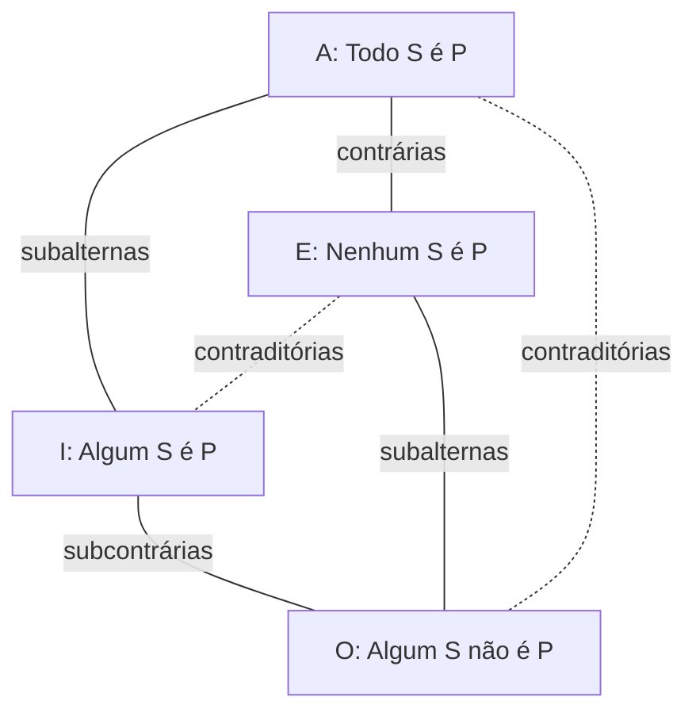
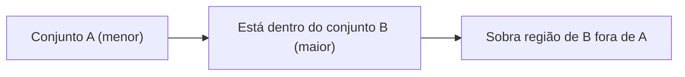

Depois de aprender a negar proposições quantificadas, chegamos à parte visual do assunto: os **diagramas lógicos**. A ideia é transformar frases com "todo", "nenhum" e "algum" em desenhos de conjuntos, de modo que a resposta de uma questão complicada apareça como uma região do desenho. Antes dos desenhos, vem a teoria que os sustenta, as **proposições categóricas**: uma família de quatro frases que relacionam duas categorias entre si. Este capítulo apresenta essas quatro formas, o quadrado lógico que as organiza, a equivalência entre "todo" e "se... então" e o uso dos diagramas para resolver questões e testar argumentos.

> [!objetivos]
> - Identificar as formas A, E, I e O das proposições categóricas.
> - Distinguir proposições contrárias, subcontrárias, subalternas e contraditórias.
> - Reescrever "todo A é B" como condicional e aplicar a contrapositiva.
> - Representar cada proposição categórica por um diagrama de conjuntos.
> - Usar diagramas para julgar conclusões e a validade de argumentos.

## O que é uma proposição categórica

A **proposição categórica** é um tipo de proposição quantificada que estabelece uma relação entre **duas categorias**. Quando dizemos "todo cachorro é obediente", relacionamos a categoria dos cachorros com a dos obedientes, por inclusão. Como são proposições quantificadas, aceitam a classificação do capítulo anterior (universal ou particular, afirmativa ou negativa), mas, neste contexto, ganham nomes próprios.

| Forma | Tipo | Exemplo |
| --- | --- | --- |
| A | Universal afirmativa | Todo engenheiro é responsável |
| E | Universal negativa | Nenhum engenheiro é responsável |
| I | Particular afirmativa | Algum engenheiro é responsável |
| O | Particular negativa | Algum engenheiro não é responsável |

As letras vêm das vogais dos verbos latinos *affirmo* (eu afirmo) e *nego* (eu nego): **A** e **I** são afirmativas; **E** e **O**, negativas.

### Qualidade e quantidade

Duas propriedades organizam as formas. A **quantidade** diz se a proposição é universal ou particular. A **qualidade** diz se é afirmativa ou negativa. Cada forma é um par de valores: A é universal e afirmativa, E é universal e negativa, I é particular e afirmativa, O é particular e negativa.

## Relações entre as formas: o quadrado lógico

Dependendo de como duas proposições combinam quantidade e qualidade, elas recebem um nome:

- **Contrárias:** duas universais de qualidades diferentes (A e E). "Todo marinheiro é pescador" e "Nenhum marinheiro é pescador".
- **Subcontrárias:** duas particulares de qualidades diferentes (I e O). "Algum empresário é rico" e "Algum empresário não é rico".
- **Subalternas:** mesma qualidade, quantidade diferente (A e I; E e O). "Todo estudante é preparado" e "Algum estudante é preparado".
- **Contraditórias:** diferem ao mesmo tempo em quantidade e qualidade (A e O; E e I). "Todo animal é dócil" e "Algum animal não é dócil".

A organização dessas relações é o **quadrado lógico** (ou quadrado das oposições).

| Par | Relação | Característica |
| --- | --- | --- |
| A e E | Contrárias | Não podem ser ambas verdadeiras, mas podem ser ambas falsas |
| I e O | Subcontrárias | Não podem ser ambas falsas, mas podem ser ambas verdadeiras |
| A e O | Contraditórias | Sempre com valores opostos |
| E e I | Contraditórias | Sempre com valores opostos |

> [!pegadinha] Contrário não é contraditório
> A negação de "Todo animal é dócil" (A) é "Algum animal não é dócil" (O), sua **contraditória**. "Nenhum animal é dócil" (E) é apenas sua **contrária**: as duas podem ser falsas ao mesmo tempo, quando alguns animais são dóceis e outros não. Negar de verdade é achar a contraditória, e ela sempre troca quantidade e qualidade.

> [!bizu] Pares de negação
> Memorize os dois pares de contraditórias: **A com O** e **E com I**. É o que o capítulo anterior ensinou em forma de regra: a negação de "todo A é B" é "algum A não é B", e a de "nenhum A é B" é "algum A é B".

## "Todo" como condicional

Uma equivalência bastante cobrada: "Todo engenheiro é responsável" equivale a "Se uma pessoa é engenheira, então é responsável". Se todos os engenheiros são responsáveis, ser engenheiro garante ser responsável, e essa é a leitura de uma condicional. Com isso, tudo o que sabemos sobre a condicional se aplica. Em particular, a **contrapositiva**: p → q ≡ ~q → ~p. Então "Todo engenheiro é responsável" equivale a "Se uma pessoa não é responsável, então não é engenheira".

> [!resolvido] Exemplo 1: equivalente de "todo"
> Qual é a equivalente de "Todo cadete da turma é aluno disciplinado"?
> a) Todo aluno disciplinado é cadete da turma.
> b) Quem não é aluno disciplinado não é cadete da turma.
>
> **Resolução.** "Todo cadete é disciplinado" equivale a "Se é cadete, então é disciplinado". Pela contrapositiva: "Se não é disciplinado, então não é cadete". Resposta: b. A alternativa a é a recíproca e não equivale à original.

## Diagramas lógicos

Os diagramas representam cada proposição como círculos (conjuntos). Eles tornam visíveis situações que o texto esconde.

| Proposição | Como se desenha | Leitura |
| --- | --- | --- |
| Todo A é B (forma A) | Círculo de A inteiro dentro do círculo de B | A é subconjunto de B; sobra região de B fora de A |
| Nenhum A é B (forma E) | Dois círculos separados, sem interseção | Os conjuntos são disjuntos |
| Algum A é B (forma I) | Dois círculos com interseção | Há ao menos um elemento comum |
| Algum A não é B (forma O) | Dois círculos com parte de A fora da interseção | Há elemento de A que está fora de B |

Atenção a um erro comum: "Todo engenheiro é responsável" **não** é o mesmo que "Todo responsável é engenheiro". No desenho, o círculo dos engenheiros cabe dentro do dos responsáveis, mas sobra região, a dos responsáveis que não são engenheiros.

### Resolvendo uma questão por diagramas

Em um município, alguns médicos são instrutores e todo instrutor é funcionário público. O que se pode afirmar? Desenham-se os conjuntos:

1. "Alguns médicos são instrutores": há interseção entre médicos (M) e instrutores (I).
2. "Todo instrutor é funcionário público": o círculo de instrutores fica totalmente dentro do círculo de funcionários públicos (FP).

Daí, os médicos que são instrutores estão dentro de FP. Examinando as conclusões:

- "Todo funcionário público é médico": **não** necessariamente; há funcionários públicos fora de M.
- "Todo médico é funcionário público": **não** necessariamente; pode haver médico que não é instrutor e não é funcionário.
- "Não existe funcionário público que é médico": falso, pois os médicos que são instrutores são funcionários públicos.
- "Existe funcionário público que não é médico": **verdadeira**; basta pensar nos instrutores que não são médicos, ou em funcionários que nem sequer são instrutores.

> [!atencao] "Necessariamente" é a palavra que decide
> Diagramas mostram o que é possível e o que é obrigatório. Uma conclusão só vale se for verdadeira em **todos** os desenhos compatíveis com as premissas. Se existe um desenho em que ela falha, ela não é necessária.

## Validade de argumentos pelos diagramas

Um argumento é **válido** quando, sendo verdadeiras as premissas, a conclusão é necessariamente verdadeira. Os diagramas ajudam a descobrir se uma conclusão decorre ou não das premissas. Analise estes argumentos.

| Argumento | Válido? | Por quê |
| --- | --- | --- |
| Toda ave de rapina está protegida e nenhum pato está protegido; logo nenhum pato é ave de rapina | Sim | Os patos ficam fora do conjunto dos protegidos, que contém as aves de rapina; não há interseção |
| Todas as meninas jogam vôlei e Jonas não é menina; logo Jonas não joga vôlei | Não | Há jogadores de vôlei fora do conjunto das meninas; Jonas pode estar entre eles |
| Muitos retirantes moram em São Paulo e João é retirante; logo João mora em São Paulo | Não | "Muitos" significa alguns, não todos; João pode estar fora de São Paulo |
| Não existem policiais corruptos e Paulo não é corrupto; logo Paulo é policial | Não | Ser não corrupto não coloca Paulo no conjunto dos policiais |
| Todo doce da vitrine é de chocolate e Ana escolheu um doce da vitrine; logo Ana não escolheu doce de chocolate | Não | A conclusão contradiz as premissas: o doce dela é de chocolate |

O segundo e o quarto casos são os erros clássicos: concluir sobre quem está **fora** de um conjunto sem que as premissas permitam. O terceiro chama atenção para a palavra "muitos", que na lógica significa "alguns", e não "todos".

> [!resolvido] Exemplo 2: argumento válido
> Todos os veículos da base são rastreados, e nenhum veículo rastreado é de uso particular. Conclusão: nenhum veículo da base é de uso particular. O argumento é válido?
>
> **Resolução.** Desenha-se o círculo dos veículos da base dentro do círculo dos rastreados, e o círculo dos rastreados separado do círculo dos de uso particular. Se os rastreados não têm interseção com os de uso particular, e os veículos da base estão dentro dos rastreados, também não têm interseção com o uso particular. A conclusão decorre das premissas. O argumento é válido.

## Como a banca cobra este assunto

As bancas cobram, em primeiro lugar, a equivalência entre "todo" e "se... então" com a contrapositiva, porque isso mistura dois assuntos do edital. Em segundo lugar, aparecem as questões em que se dão premissas com "todo", "nenhum" e "algum" e se perguntam quais conclusões são necessárias. Aí o desenho é a ferramenta: desenhe, teste as alternativas e fique com a que é verdadeira em todos os desenhos. A classificação em A, E, I, O e as relações do quadrado lógico caem pouco, mas as contraditórias (A com O, E com I) são cobradas indiretamente, nas negações. Por fim, o julgamento de argumentos válidos exige cuidado com a palavra "necessariamente" e com os falsos silogismos que "tiram" informação de quem está fora de um conjunto.

## Mapa do capítulo

| Tema | Ideia central | Armadilha |
| --- | --- | --- |
| Formas A, E, I, O | Universal ou particular, afirmativa ou negativa | Trocar qualidade por quantidade |
| Contrárias | A e E; podem ser ambas falsas | Tomá-las por contraditórias |
| Contraditórias | A com O; E com I | Negar "todo" com "nenhum" |
| Subalternas | Mesma qualidade, quantidade diferente | Confundir com equivalência |
| Todo como condicional | Todo A é B ≡ se A, então B | Aceitar a recíproca |
| Diagramas | Círculos, subconjunto, interseção, disjuntos | Concluir sobre quem está fora |
| Validade de argumentos | Conclusão verdadeira em todos os diagramas | Ignorar "necessariamente" |

### Para fixar

1. Proposição categórica relaciona duas categorias e tem quatro formas: A, E, I e O.
2. A é universal afirmativa; E, universal negativa; I, particular afirmativa; O, particular negativa.
3. Contrárias (A e E) podem ser ambas falsas; subcontrárias (I e O) podem ser ambas verdadeiras.
4. Contraditórias (A com O; E com I) têm sempre valores opostos e são a negação uma da outra.
5. "Todo A é B" equivale a "se A, então B" e à contrapositiva "se não B, então não A".
6. "Todo A é B" não equivale a "todo B é A".
7. No diagrama, "todo A é B" põe A inteiro dentro de B; "nenhum" separa os círculos; "algum" cria interseção.
8. Uma conclusão só é necessária se vale em todos os diagramas compatíveis com as premissas.
9. "Muitos" significa "alguns", e não "todos".
10. Não se pode concluir sobre quem está fora de um conjunto a partir de uma premissa de inclusão.
