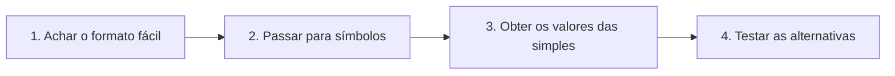
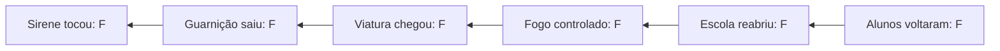

Um tipo de questão aparece em quase toda prova de raciocínio lógico: o enunciado traz meia dúzia de afirmações sobre pessoas ("Se Ana viajou, então Bruno trabalhou", "Carlos não saiu de casa ou Dora estudou") e pergunta qual alternativa **decorre** do que foi dito. Parece um quebra-cabeça de interpretação de texto, mas é, na verdade, um problema de valores lógicos. Quem domina as tabelas dos cinco conectivos resolve em poucos minutos, com um método que não falha. Este capítulo apresenta esse método, o das **quatro etapas**, e o aplica a questões clássicas, base de todo o estudo de argumentos que vem a seguir.

> [!objetivos]
> - Recordar as condições de verdade e de falsidade dos cinco conectivos.
> - Reconhecer os quatro "formatos fáceis" que dão o valor de proposições simples de graça.
> - Aplicar o método das quatro etapas para obter valores lógicos a partir de afirmações.
> - Resolver questões em que algumas afirmações são dadas como falsas.

## Antes de começar: os cinco conectivos "no sangue"

Para resolver essas questões, você precisa reconhecer de imediato quando cada conectivo é verdadeiro ou falso. Memorize a regra do caso **único** de cada um.

| Conectivo | Símbolo | Quando é verdadeiro | Quando é falso |
| --- | --- | --- | --- |
| Conjunção ("e") | p ∧ q | Só quando as duas parcelas são verdadeiras | Se qualquer parcela for falsa |
| Disjunção inclusiva ("ou") | p ∨ q | Se pelo menos uma parcela for verdadeira | Só quando as duas parcelas são falsas |
| Disjunção exclusiva ("ou... ou") | p ⊻ q | Quando as parcelas têm valores diferentes | Quando têm o mesmo valor |
| Condicional ("se... então") | p → q | Em todos os casos, menos V → F | Só quando p é verdadeiro e q é falso |
| Bicondicional ("se e somente se") | p ⟷ q | Quando as parcelas têm o mesmo valor | Quando têm valores diferentes |

A conjunção e a disjunção inclusiva são o espelho uma da outra: a conjunção tem **um** caso verdadeiro (V e V) e a disjunção inclusiva tem **um** caso falso (F e F). A condicional tem um único caso falso (V seguido de F). Esses casos únicos são o ponto de partida de todas as questões deste capítulo.

## O que são as questões clássicas

Em uma questão clássica, o enunciado apresenta um conjunto de **afirmações** e pede uma **consequência verdadeira**. Um exemplo típico: "Se Paulo está contente, então Rita está calma. Se Marta é atleta, então Tomás é leve. Sabe-se que Paulo está contente e Tomás não é leve. Logo, é correto afirmar que..." seguido de cinco alternativas.

As regras do jogo são três:

- as afirmações do enunciado são tomadas como **verdadeiras**, a não ser que a questão diga que alguma é falsa;
- a resposta é a alternativa cujo valor lógico é **verdadeiro**, com os valores das proposições simples que se consegue deduzir;
- em itens de certo ou errado, há uma única consequência a julgar.

## O método das quatro etapas

1. **Identificar as afirmações em "formato fácil".**
2. **Esquecer o contexto** e passar as afirmações do português para a linguagem simbólica.
3. **Descobrir os valores das proposições simples**, sempre que possível, começando pelo formato fácil.
4. **Conferir as alternativas** e marcar a que for verdadeira.

### Os quatro formatos fáceis

Nesses quatro casos, a afirmação entrega o valor de alguma proposição simples "de graça":

| Afirmação | O que se conclui |
| --- | --- |
| Proposição simples, verdadeira ou falsa | O valor da própria proposição |
| Conjunção verdadeira | Todas as parcelas são verdadeiras |
| Disjunção inclusiva falsa | Todas as parcelas são falsas |
| Condicional falsa | O antecedente é verdadeiro e o consequente é falso |

Escolha sempre um desses formatos como ponto de partida. A partir do que você descobrir, procure outras afirmações que contenham as mesmas proposições e repita o processo. Como um dominó, cada valor obtido abre o próximo.

> [!bizu] Qual afirmação atacar primeiro
> Procure, nesta ordem: proposição simples, conjunção verdadeira, disjunção inclusiva falsa, condicional falsa. Se não houver nenhuma, a questão provavelmente exige outro método, como o da tabela-verdade ou o do caso hipotético.

## Exemplo 1: uma conjunção verdadeira abre o caminho

Imagine que Marcos, um candidato brasileiro a um concurso, seja descrito por afirmações todas verdadeiras:

I. Marcos pratica natação ou é bombeiro.
II. Marcos tem filhos e não pratica natação.
III. Marcos não mora no interior ou não é bombeiro.
IV. Se Marcos conhece Recife, então Marcos mora no interior.

**Etapa 1.** A afirmação II é uma conjunção verdadeira. É por ela que se começa.

**Etapa 2.** Sejam n: "Marcos pratica natação"; b: "Marcos é bombeiro"; f: "Marcos tem filhos"; i: "Marcos mora no interior"; r: "Marcos conhece Recife". As afirmações são:

- I. n ∨ b (V)
- II. f ∧ ~n (V)
- III. ~i ∨ ~b (V)
- IV. r → i (V)

**Etapa 3.**
- De II (conjunção verdadeira): f é V e ~n é V, logo n é F.
- De I (disjunção verdadeira): como n é F, b precisa ser V.
- De III (disjunção verdadeira): ~b é F (pois b é V), logo ~i é V e i é F.
- De IV (condicional verdadeira): como i é F, r não pode ser V (V → F seria falsa). Logo, r é F.

Valores: f = V, n = F, b = V, i = F, r = F.

**Etapa 4.** Qualquer alternativa que afirme algo coerente com esses valores é a resposta. Por exemplo, "Marcos é bombeiro, não conhece Recife e mora no interior" seria falsa (porque i é F). Já "Marcos é bombeiro, não conhece Recife e não mora no interior" é uma conjunção de três verdadeiros: b, ~r e ~i.

> [!atencao] Contexto não importa
> Na etapa 2, deixe de lado o significado das frases. Se Marcos é bombeiro ou não, se mora no interior ou não, é só um conjunto de letras. Quem tenta "imaginar a vida de Marcos" costuma se enrolar. O raciocínio é puramente de valores V e F.

## Exemplo 2: cadeia de condicionais

Considere um dia de plantão na vizinhança de uma escola, em que Luana assiste televisão enquanto escuta o rádio da corporação. Ela ouve o seguinte: "Se a sirene toca, então a guarnição sai. Se a guarnição sai, então a viatura chega ao local. Se a viatura chega ao local, então o fogo é controlado. Se o fogo é controlado, então a diretora fecha o relatório e a escola reabre. Se a escola reabre, então os alunos voltam. Ora, os alunos não voltaram." Para simplificar, trate "a diretora fecha o relatório e a escola reabre" como uma única proposição. O que se pode afirmar?

**Etapa 1.** "Os alunos não voltaram" é uma proposição simples verdadeira.

**Etapa 2 e 3.** Sejam s, g, v, f, e, a as proposições, na ordem. As afirmações são s → g, g → v, v → f, f → e, e → a e ~a (V). Como ~a é V, a é F. Cada condicional é verdadeira e tem o consequente falso, então cada antecedente é falso: e é F (de e → a), f é F (de f → e), v é F, g é F e s é F. Todas as proposições da cadeia são falsas.

**Etapa 4.** Consequências verdadeiras: "A viatura não chegou ao local", "A sirene não tocou", "A escola não reabriu". Consequências falsas: qualquer uma que afirme que algum dos eventos ocorreu.

A moral: numa cadeia de condicionais cujo último consequente é falso, **todos os elementos anteriores são falsos**, de trás para a frente. É a mesma ideia da contrapositiva aplicada várias vezes.

## Exemplo 3: disjunções verdadeiras e a palavra "nem"

Otávio faz três afirmações sobre a rotina do almoço. A primeira diz que ele come carne ou então frango. A segunda, que ele come legumes ou deixa de comer carne. A terceira, que ele come macarrão ou deixa de comer frango. Em determinado dia, ficou claro que Otávio não comeu macarrão. Quais conclusões são seguras para esse dia? Todas as três afirmações são tomadas como verdadeiras, e a informação sobre o macarrão também.

**Etapa 1.** "Otávio não comeu macarrão" é uma proposição simples verdadeira.

**Etapas 2 e 3.** Sejam c: "come carne"; f: "come frango"; l: "come legumes"; m: "come macarrão". As afirmações são c ∨ f (V), l ∨ ~c (V), m ∨ ~f (V) e ~m (V).
- De ~m verdadeiro: m é F.
- De m ∨ ~f (V) com m falso: ~f precisa ser V, logo f é F.
- De c ∨ f (V) com f falso: c é V.
- De l ∨ ~c (V) com ~c falso: l é V.

Valores: m = F, f = F, c = V, l = V.

**Etapa 4.** "Comeu legumes e carne" (l ∧ c) é verdadeira. "Não comeu frango nem carne" é falsa. Para esta última, lembre que **"nem" equivale a "e não"**: "não comeu frango nem carne" é ~f ∧ ~c. Como ~c é F, a conjunção é falsa.

> [!pegadinha] "Nem" é "e não"
> A palavra "nem" esconde uma conjunção de duas negações. "Não fui ao cinema nem ao teatro" significa "não fui ao cinema **e** não fui ao teatro". Quem lê "nem" como "ou" erra a negação e o valor.

## Exemplo 4: quando o enunciado diz que algumas afirmações são falsas

O enunciado pode avisar que determinadas afirmações devem ser consideradas falsas. Considere:

I. "Se Ana é generosa, então Bruno é gastador" (V).
II. "Bruno é gastador ou Cláudia é gentil" (V).
III. "Eduardo é tímido e Cláudia é gentil" (F).
IV. "Ou Gerson é ligeiro ou Eduardo é tímido" (V).
V. "Bruno é gastador" (F).
VI. "Se Hugo é rico, então Ana é generosa" (V).

**Etapa 1.** A afirmação V é uma proposição simples falsa: Bruno **não** é gastador.

**Etapa 3.**
- b é F (de V).
- I é condicional verdadeira com consequente falso (b): o antecedente é falso, então Ana não é generosa (a = F).
- VI é condicional verdadeira com consequente falso (a): Hugo não é rico (h = F).
- II é disjunção verdadeira, com b falso: Cláudia é gentil (c = V).
- III é conjunção falsa, com c verdadeiro: a outra parcela é falsa, Eduardo não é tímido (e = F).
- IV é disjunção exclusiva verdadeira: as parcelas têm valores diferentes. Como e é F, Gerson é ligeiro (g = V).

**Etapa 4.** Consequências verdadeiras: "Hugo não é rico", "Ana não é generosa", "Cláudia é gentil", "Gerson é ligeiro". Falsas: "Cláudia não é gentil", "Gerson não é ligeiro", "Eduardo é tímido", "Ana é generosa".

> [!resolvido] Resolva você: sequência com disjunção exclusiva
> São verdadeiras: (I) "Ou Lia chega cedo ou Paulo se atrasa"; (II) "Lia não chega cedo". O que se conclui sobre Paulo?
>
> **Resolução.** De II, c (Lia chega cedo) é F. Em I, a disjunção exclusiva exige parcelas com valores diferentes; como c é F, Paulo se atrasa (p = V).

## O que fazer quando um valor não pode ser determinado

Nem sempre as afirmações bastam para fixar o valor de todas as proposições simples. Pode acontecer de uma letra ficar sem valor. Nesse caso, o raciocínio muda de postura: a alternativa correta é a que é verdadeira **independentemente** do valor que falta. Por exemplo, se você sabe que p é V, mas não sabe nada de q, então "p ∨ q" é necessariamente verdadeira, enquanto "p ∧ q" depende de q e, portanto, não é consequência garantida. Uma alternativa só é resposta se for verdadeira em todos os cenários compatíveis com as afirmações.

> [!atencao] Consequência necessária
> O enunciado pede o que é **logicamente verdadeiro**, não o que é possível. Se uma alternativa pode ser verdadeira ou falsa conforme o valor de uma proposição indeterminada, ela não é consequência das afirmações.

Este tipo de raciocínio é o primeiro contato com a lógica de argumentação, em que se fazem **inferências, deduções e conclusões** a partir de premissas. As questões clássicas já têm essa estrutura: as afirmações do enunciado são as premissas; a alternativa correta é uma conclusão que decorre delas. No restante do volume, você verá argumentos cada vez mais gerais, mas o raciocínio básico é o mesmo.

## Roteiro rápido para a prova

1. Leia tudo e marque as afirmações que são falsas segundo o enunciado.
2. Escreva as proposições simples com letras curtas e as afirmações em símbolos.
3. Ataque o formato fácil e vá abrindo as demais afirmações.
4. Se uma proposição não puder ser determinada, **não a invente**: ela aparecerá em alternativas falsas por falta de informação.
5. Confira as alternativas uma a uma, com cuidado nas conjunções de três termos: basta uma parcela falsa para derrubá-las.

## Como a banca cobra este assunto

Este formato é um dos mais previsíveis do raciocínio lógico. Os enunciados trazem de quatro a seis afirmações, quase sempre misturando condicionais, disjunções e conjunções, e as alternativas são conjunções de duas ou três proposições. O erro mais comum é tentar a tabela-verdade completa, que é demorada, em vez do método dos valores. Outro erro é ler "nem" e "ou" de forma trocada. Alguns enunciados indicam que certas afirmações são falsas, e é preciso respeitar essa informação ao transformar em símbolos. Em itens de certo ou errado, a consequência a julgar pode estar expressa por uma condicional ou uma disjunção, e basta calcular o valor com as proposições simples obtidas.

## Mapa do capítulo

| Tema | Ideia central | Armadilha |
| --- | --- | --- |
| Cinco conectivos | Cada um tem um caso único (verdadeiro ou falso) | Confundir os casos únicos |
| Formatos fáceis | Simples, conjunção V, disjunção F e condicional F | Começar por afirmação que não dá valor |
| Método das quatro etapas | Formato fácil, símbolos, valores, alternativas | Tentar a tabela inteira |
| Cadeia de condicionais | Último consequente falso derruba os anteriores | Ler a cadeia na ordem errada |
| "Nem" | Equivale a "e não" | Tratá-lo como "ou" |
| Afirmações falsas | Respeitar a indicação do enunciado | Tomá-las como verdadeiras |
| Disjunção exclusiva | Valores diferentes nas parcelas | Usá-la como inclusiva |

### Para fixar

1. A conjunção só é verdadeira com as duas parcelas verdadeiras.
2. A disjunção inclusiva só é falsa com as duas parcelas falsas.
3. A condicional só é falsa quando o antecedente é verdadeiro e o consequente é falso.
4. A disjunção exclusiva é verdadeira quando as parcelas têm valores diferentes.
5. A bicondicional é verdadeira quando as parcelas têm o mesmo valor.
6. Os formatos fáceis são: proposição simples, conjunção verdadeira, disjunção inclusiva falsa e condicional falsa.
7. As afirmações do enunciado valem como verdadeiras, a não ser que a questão as declare falsas.
8. Numa cadeia de condicionais verdadeiras com o último consequente falso, todos os antecedentes são falsos.
9. "Nem" equivale a "e não".
10. Na etapa 2 do método, o contexto das frases é ignorado e só importam os valores V e F.
