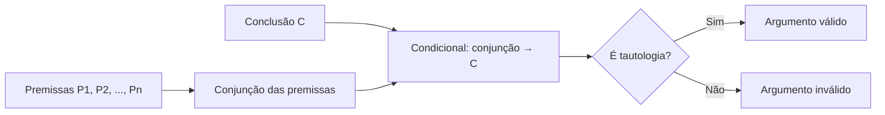

O capítulo anterior ensinou o método das quatro etapas e apresentou os formatos fáceis. Mas as provas gostam de variar. Há questões em que duas afirmações estão em formato fácil ao mesmo tempo, questões em que o enunciado declara de antemão que algumas afirmações são falsas, questões em que não é possível descobrir o valor de todas as proposições e questões em que uma informação do enunciado se esconde dentro de uma frase que parece condicional. Este capítulo percorre essas variações e, ao final, oferece uma **visão geral dos argumentos dedutivos**, para que você enxergue como as questões clássicas se encaixam num assunto maior.

> [!objetivos]
> - Resolver questões com mais de um formato fácil e com valores parcialmente indeterminados.
> - Julgar itens em que "nada se pode afirmar" sobre uma proposição.
> - Identificar quando uma proposição simples está disfarçada na pergunta.
> - Reconhecer os conceitos básicos de argumento dedutivo, premissa, conclusão, validade e veracidade.
> - Conhecer os métodos de verificação da validade que serão estudados nos capítulos seguintes.

## Dois formatos fáceis na mesma questão

Às vezes o enunciado traz duas afirmações em formato fácil. O roteiro é o mesmo, mas convém atacar as duas.

**Exemplo.** Para saber quais profissões Ícaro, Berta, Dario, Elisa, Lúcia e Paulo exercem, afirmou-se o seguinte, sobre se Ícaro é arquiteto (a), se Berta é cineasta (c), se Dario é dançarino (d), se Elisa é escultora (e), se Lúcia é literata (l) e se Paulo é pintor (p):

I. Se Ícaro é arquiteto, então Berta não é cineasta.
II. Se Dario não é dançarino, então Elisa é escultora.
III. Se Lúcia é literata, então Berta é cineasta e Elisa é escultora.
IV. Se Ícaro não é arquiteto e Dario é dançarino, então Paulo é pintor.
V. Berta não é cineasta ou Elisa é escultora.

O enunciado informa que **III e V são falsas** e que as demais são verdadeiras.

**Etapa 1.** III é uma condicional falsa e V é uma disjunção inclusiva falsa: dois formatos fáceis.

**Etapa 3.**
- V (disjunção inclusiva falsa): as duas parcelas são falsas. Como ~c é F, c é V; como e é F, Elisa não é escultora.
- III (condicional falsa): o antecedente l é V e o consequente (c ∧ e) é F. Como c é V e e é F, a conjunção é mesmo F. A condição está coerente: l é V.
- I (condicional verdadeira): o consequente ~c é F, então o antecedente a é F.
- II (condicional verdadeira): o consequente e é F, então o antecedente ~d é F, logo d é V.
- IV (condicional verdadeira): o antecedente (~a ∧ d) é V (porque ~a é V e d é V), então o consequente p precisa ser V.

Valores: a = F, c = V, d = V, e = F, l = V, p = V.

**Etapa 4.** Uma alternativa verdadeira: "Se Paulo não é pintor, então Ícaro é arquiteto", que é F → F, uma condicional verdadeira. Já "Se Lúcia é literata, então Ícaro é arquiteto" é V → F, falsa.

> [!bizu] Condicional com antecedente falso
> Uma condicional cujo antecedente é falso é **sempre verdadeira**, não importa o consequente. Por isso, a alternativa "Se Paulo não é pintor, então Ícaro é arquiteto" se mostra verdadeira mesmo sem nenhuma relação aparente entre as frases: o antecedente é falso.

## Uma condicional falsa dentro de um par de afirmações

Imagine duas sentenças: "Paulo é carioca ou Bernardo é paulista" (verdadeira) e "Se Sérgio é amazonense, então Paulo é carioca" (falsa). O que se conclui?

A segunda é uma condicional falsa, formato fácil: o antecedente é V e o consequente é F. Logo, Sérgio é amazonense (V) e Paulo **não** é carioca (F). Voltando à primeira, uma disjunção inclusiva verdadeira com a parcela "Paulo é carioca" falsa: Bernardo é paulista (V). Valores: p = F, b = V, s = V.

Com isso, a conjunção "Paulo não é carioca, Bernardo é paulista e Sérgio é amazonense" é a única verdadeira dentre as alternativas típicas. Em conjunções de três termos, basta uma parcela falsa para derrubar a alternativa.

## Quando nem tudo pode ser determinado

Sobre a rotina de Rafael, sabe-se que, sempre que ele sai de moto, não leva o filho à escola, e que, quando está de folga e o dia não é feriado, ele sai de moto. Hoje Rafael levou o filho à escola. O que se segue necessariamente?

**Etapa 1.** "Hoje Rafael levou o filho à escola" é uma proposição simples verdadeira.

**Etapa 2.** Sejam m: "sai de moto"; e: "leva o filho à escola"; g: "está de folga"; h: "é feriado". As afirmações são m → ~e, (g ∧ ~h) → m e e.

**Etapa 3.**
- e é V.
- m → ~e é verdadeira com consequente ~e falso. Logo, o antecedente m é F.
- (g ∧ ~h) → m é verdadeira com consequente m falso. Logo, o antecedente (g ∧ ~h) é F. Mas isso **não** determina g nem h: basta que uma das duas parcelas, g ou ~h, seja falsa.

**Etapa 4.** As alternativas que falam em folga ou em feriado dependem de g e de h, que não se conhece. A única que decorre das afirmações é "Rafael **não** saiu de moto" (~m), que é verdadeira.

> [!atencao] Não force um valor que não existe
> Se um valor não se determina, as alternativas que dependem dele **não** são consequências garantidas. É a lógica da frase "o que é necessariamente verdadeiro". Marque a alternativa que usa só as proposições que você sabe valorar.

### Quando o antecedente falso trava a dedução

Há ainda a situação em que uma condicional verdadeira não dá informação alguma. Veja: "Se Marcos figura no quadro de associados e está em dia, então tem direito a receber os benefícios" (P) e "Marcos não figura no quadro, mas está em dia" (Q). Q é uma conjunção verdadeira: Marcos não figura no quadro (a = F) e está em dia (p = V). Em P, o antecedente (a ∧ p) é F, pois a é F. Uma condicional com antecedente falso é verdadeira de qualquer jeito, então nada se sabe sobre o consequente b. Logo, "não se pode afirmar que Marcos não tem direito aos benefícios" é um item **certo**: de fato, as premissas não dizem que ele não tem direito.

## O enunciado ambíguo: "se não joguei futebol, então..."

Algumas questões trazem uma estrutura parecida com uma condicional, mas a informação é, na verdade, uma proposição simples. Veja: "Aos sábados, (I) leio jornal ou não vou à praça; (II) caminho ou assisto ao jogo; (III) vou à praça ou não caminho. Se, no último sábado, não assisti ao jogo, então..." A tentação é ler "não assisti ao jogo" como antecedente de uma condicional e procurar o consequente nas alternativas. Mas a leitura correta é outra: "no último sábado, não assisti ao jogo" é uma **afirmação verdadeira** a mais, e as alternativas são conclusões possíveis.

**Etapa 3.** Sejam j: "leio jornal"; p: "vou à praça"; c: "caminho"; g: "assisto ao jogo".
- ~g é V, então g é F.
- II (c ∨ g, disjunção verdadeira): como g é F, c (caminhei) é V.
- III (p ∨ ~c, disjunção verdadeira): como ~c é F, p (fui à praça) é V.
- I (j ∨ ~p, disjunção verdadeira): como ~p é F, j (li jornal) é V.

A alternativa "caminhei e fui à praça" (c ∧ p) é verdadeira.

> [!resolvido] Treino 1: reescreva em símbolos
> Em "Aos sábados, leio jornal ou não vou à praça", como se escreve?
>
> **Resolução.** Com j: "leio jornal" e p: "vou à praça", a frase é j ∨ ~p. A negação da segunda parcela vem da expressão "não vou". Escrever assim na etapa 2 evita erros de leitura na etapa 3.

> [!pegadinha] Antecedente da pergunta é afirmação
> Quando o enunciado diz "se hoje fiz tal coisa, então..." depois de listar afirmações, trate o trecho "hoje fiz tal coisa" como mais uma **afirmação verdadeira**, e não como parte de uma condicional a testar. Confirme se o enunciado não deixa claro que as alternativas é que são a condicional inteira.

## Três treinos para resolver

Resolva mentalmente antes de ler a resposta. Em cada caso, todas as afirmações são verdadeiras.

**Treino A.** "Se Alice é estudante, então Bruno é soldado. Bruno não é soldado ou Cecília é pintora. Cecília não é pintora." Qual é a conclusão segura? Cecília não é pintora (c é F). Na segunda afirmação, ~b ∨ c é V com c falso, então ~b é V: Bruno não é soldado. Na primeira, o consequente (Bruno é soldado) é F, então o antecedente é F: Alice **não** é estudante.

**Treino B.** "Ou Dani viaja ou Edu trabalha. Edu não trabalha. Se Dani viaja, então Fábio descansa." Edu não trabalha (e = F). Na disjunção exclusiva verdadeira, as parcelas têm valores diferentes: Dani viaja (d = V). Na condicional verdadeira, com antecedente V, o consequente é V: Fábio descansa.

**Treino C.** "Gil estuda e Hana trabalha. Se Hana trabalha, então Iara estuda. Iara não estuda ou João viaja." A conjunção verdadeira dá g = V e h = V. A condicional verdadeira, com antecedente V, dá i = V (Iara estuda). A disjunção ~i ∨ j é V com ~i falso, então j = V: João viaja.

> [!bizu] Reconheça o padrão
> Todo treino acima segue o mesmo trilho: ache o formato fácil, atualize os valores e vá soltando as afirmações uma a uma. Se você fizer isso com calma, a questão tem poucas chances de surpreender.

## Visão geral: o que é um argumento dedutivo

Todas as questões clássicas fazem o mesmo movimento: partem de **premissas** (as afirmações do enunciado) e chegam a uma **conclusão** (a alternativa correta). Esse movimento tem nome em lógica: **argumento**. Os próximos capítulos estudam os argumentos em profundidade. Vale já guardar os conceitos centrais.

- **Argumento:** relação entre um conjunto de premissas e uma conclusão que elas sustentam.
- **Premissas:** proposições que se consideram verdadeiras para chegar à conclusão. Também se chamam hipóteses.
- **Argumento dedutivo:** o que não produz conhecimento novo; a conclusão já está contida nas premissas.
- **Silogismo:** argumento dedutivo com duas premissas e uma conclusão.
- **Argumentos categóricos** usam proposições categóricas (todo, nenhum, algum); **argumentos hipotéticos** usam conectivos.

### Validade e veracidade

A **validade** é característica do argumento: ele é válido quando, consideradas as premissas verdadeiras, a conclusão é **necessariamente** verdadeira. É inválido quando a conclusão não é necessariamente verdadeira, e então se fala em sofisma ou falácia formal. A **veracidade** é característica das proposições: cada uma é verdadeira ou falsa. As duas coisas não se confundem.

| Premissas | Conclusão | Argumento válido? |
| --- | --- | --- |
| Verdadeiras | Verdadeira | Pode ser válido ou inválido |
| Verdadeiras | Falsa | Nunca válido |
| Falsas | Verdadeira | Pode ser válido ou inválido |
| Falsas | Falsa | Pode ser válido ou inválido |

A segunda linha é a que decide: **não existe argumento válido com premissas verdadeiras e conclusão falsa**. Fora disso, a veracidade da conclusão não diz nada sobre a validade.

### A forma simbólica

Todo argumento dedutivo pode ser escrito como uma condicional: o antecedente é a conjunção das premissas e o consequente é a conclusão.

**(P1 ∧ P2 ∧ ... ∧ Pn) → C**

O argumento é válido se, e somente se, essa condicional é uma **tautologia**: nunca é possível ter todas as premissas verdadeiras e a conclusão falsa.

## Erros mais comuns e como evitá-los

Três erros respondem pela maior parte das perdas de pontos nessas questões.

**Erro 1: inverter a condicional.** Diante de uma condicional verdadeira "p → q" e de q verdadeiro, muita gente conclui que p é verdadeiro. Não é assim. Com consequente verdadeiro, o antecedente pode ser V ou F. O que se garante é: com antecedente V, o consequente é V; com consequente F, o antecedente é F.

**Erro 2: ler a disjunção como exclusiva.** Na disjunção inclusiva verdadeira, se uma parcela é V, a outra pode ser V ou F. Só quando uma parcela é F se garante que a outra é V. Na exclusiva, ao contrário, os valores são sempre diferentes, e saber uma parcela define a outra.

**Erro 3: ignorar o que o enunciado declara falso.** O enunciado pode mandar considerar uma afirmação falsa. Se você a trata como verdadeira, todos os valores que dependem dela saem trocados. Marque a lápis, ao lado de cada afirmação, a letra V ou F que o enunciado atribui.

Uma dica de organização: monte uma tabelinha de duas linhas com as letras e os valores que você vai descobrindo, e risque cada afirmação já utilizada. Ao final, todas as afirmações devem ter sido usadas e nenhuma pode ficar em contradição com os valores obtidos. Se aparecer contradição, você leu errado alguma afirmação.

## Os métodos que virão

Para verificar a validade, o estudo desenvolve vários métodos, que serão vistos nos capítulos seguintes.

| Método | Quando usar |
| --- | --- |
| Premissas verdadeiras | Quando há formato fácil: é a questão clássica |
| Tabela-verdade da condicional associada | Quando poucas proposições simples |
| Conclusão falsa | Quando a conclusão é simples, disjunção ou condicional |
| Transitividade da condicional | Quando as premissas são condicionais em cadeia |
| Regras de inferência | Atalho para padrões conhecidos |
| Diagramas lógicos | Quando o argumento é categórico |

O método das premissas verdadeiras é exatamente o das questões clássicas: se você aprendeu a resolvê-las, já domina um dos métodos principais. Os demais métodos entram em cena quando não há formato fácil ou quando as premissas não são afirmações simples, e cada um tem seu capítulo.

## Como a banca cobra este assunto

As provas de nível mais alto misturam, no mesmo enunciado, afirmações com formato fácil, afirmações declaradas falsas e valores que ficam indeterminados. A banca costuma incluir uma alternativa que parece plausível, mas que depende de um valor impossível de determinar, e outra que é uma condicional com antecedente falso. Itens de certo ou errado costumam julgar frases como "não se pode afirmar que...", que são verdadeiras exatamente quando o valor não é determinado. Em relação aos conceitos, a banca cobra a distinção entre validade e veracidade, a forma simbólica do argumento e o fato de que não existe argumento válido com premissas verdadeiras e conclusão falsa.

## Mapa do capítulo

| Tema | Ideia central | Armadilha |
| --- | --- | --- |
| Dois formatos fáceis | Atacar os dois | Esquecer um deles |
| Antecedente falso | A condicional é verdadeira | Concluir algo sobre o consequente |
| Valor indeterminado | Alternativas dependentes não são necessárias | Forçar um valor |
| Enunciado ambíguo | "Não joguei futebol" é afirmação | Tratar como antecedente a testar |
| Argumento dedutivo | Conclusão contida nas premissas | Confundir com argumento indutivo |
| Validade | Premissas verdadeiras exigem conclusão verdadeira | Confundir com veracidade |
| Forma simbólica | (P1 ∧ ... ∧ Pn) → C | Esquecer de usar a conjunção |

### Para fixar

1. Quando há dois formatos fáceis, atacam-se os dois.
2. Condicional com antecedente falso é verdadeira, qualquer que seja o consequente.
3. Se um valor não pode ser determinado, as alternativas que dependem dele não são consequências garantidas.
4. Em "não se pode afirmar que...", o item é certo quando as premissas realmente não decidem a questão.
5. Uma informação do tipo "hoje não fiz tal coisa" é uma afirmação do enunciado, e não necessariamente um antecedente.
6. Premissas são proposições consideradas verdadeiras; a conclusão é o que delas se deduz.
7. Um argumento dedutivo não produz conhecimento novo.
8. Validade é característica do argumento; veracidade, das proposições.
9. Não existe argumento válido com premissas verdadeiras e conclusão falsa.
10. O argumento é válido se, e somente se, a condicional (P1 ∧ ... ∧ Pn) → C é uma tautologia.
