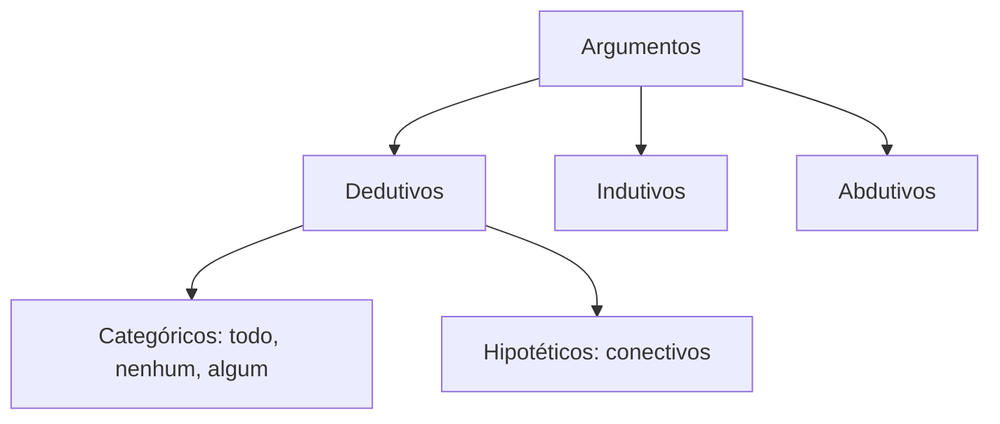
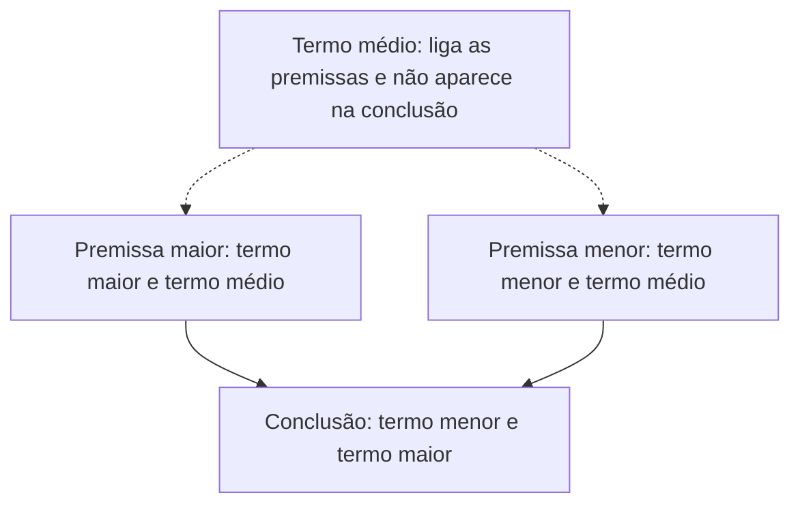

Argumentar é defender uma conclusão a partir de razões. A lógica estuda quando essa defesa é **boa**, no sentido de que a conclusão decorre mesmo das razões apresentadas. Neste capítulo, você conhece os **argumentos dedutivos**, aprende a distinguir **validade** de **veracidade**, confere a forma simbólica do argumento e estuda o **silogismo categórico**, a estrutura clássica de Aristóteles, com seus termos, seus modos, suas figuras e suas oito regras de validade.

> [!objetivos]
> - Distinguir argumentos dedutivos, indutivos e abdutivos e classificar os dedutivos em categóricos e hipotéticos.
> - Explicar a diferença entre validade e veracidade e usar a tabela das combinações possíveis.
> - Escrever a condicional associada a um argumento.
> - Identificar os termos e as premissas de um silogismo categórico.
> - Aplicar as regras de validade do silogismo categórico.

## O que é um argumento

**Argumento** é a relação entre um conjunto de **premissas** e uma **conclusão** que elas pretendem sustentar. As premissas, também chamadas de hipóteses, são proposições que se **consideram verdadeiras** para chegar à conclusão. Os argumentos podem ser de três tipos:

| Tipo | Ideia | Exemplo |
| --- | --- | --- |
| Dedutivo | A conclusão está contida nas premissas | Todo soldado é treinado; Mário é soldado; logo, Mário é treinado |
| Indutivo | Generaliza a partir de casos observados | Os três plantões de março foram tranquilos; logo, o plantão de abril será tranquilo |
| Abdutivo | Busca a melhor explicação para um fato | A rua está molhada; a melhor explicação é que choveu |

Este volume trata do argumento **dedutivo**, que pertence à lógica proposicional. Ele é aquele que **não produz conhecimento novo**: a informação da conclusão já estava nas premissas. Se a premissa afirma que Carlos e Débora foram à festa, a conclusão "Carlos foi à festa" só torna explícito o que já estava dito.

Quando o argumento dedutivo tem exatamente **duas premissas e uma conclusão**, chama-se **silogismo**. Um exemplo: "Se o cabo foi à base, então o portão estava aberto. O cabo foi à base. Logo, o portão estava aberto."

### Categóricos e hipotéticos

Os argumentos dedutivos se dividem em dois grandes grupos:

- **Categóricos:** usam proposições categóricas, com quantificadores como "todo", "nenhum", "algum", "existe". Exemplo: "Todo ser humano é mortal. Joana é ser humano. Logo, Joana é mortal."
- **Hipotéticos:** não usam proposições categóricas e se valem dos conectivos (conjunção, disjunções, condicional, bicondicional).

## Validade e veracidade

Esta é a distinção mais cobrada do assunto, porque as palavras parecem sinônimas e não são.

- **Validade** é característica dos **argumentos**: um argumento é válido ou inválido.
- **Veracidade** é característica das **proposições**: uma proposição é verdadeira ou falsa.

### Argumento válido

Um argumento dedutivo é **válido** quando a conclusão se segue **de modo inevitável** das premissas, isto é, quando seria impossível aceitar as premissas e rejeitar a conclusão. Importa a palavra "consideradas" nessa definição: não se discute se as premissas são verdadeiras no mundo real. Observe:

*Premissa 1: Todos os gatos têm asas.*
*Premissa 2: Frajola é um gato.*
*Conclusão: Logo, Frajola tem asas.*

No mundo dos fatos, gatos não têm asas, e a premissa 1 é falsa. Mesmo assim, o argumento é **válido**, porque, aceitando a premissa 1 como verdadeira, a conclusão decorre inevitavelmente. A validade depende da **forma** do argumento, e não do conteúdo.

### Argumento inválido

É **inválido** quando, consideradas as premissas verdadeiras, a conclusão **não é necessariamente verdadeira**. O argumento inválido também se chama **falácia formal** ou sofisma. Exemplo:

*Premissa 1: Todos os cães são animais.*
*Premissa 2: Totó não é um cão.*
*Conclusão: Logo, Totó não é um animal.*

As premissas não garantem a conclusão: Totó pode ser um gato, que é animal e não é cão. Logo, o argumento é inválido, ainda que as premissas sejam verdadeiras.

### As combinações possíveis

| Premissas | Conclusão | Argumento válido | Argumento inválido |
| --- | --- | --- | --- |
| Verdadeiras | Verdadeira | Possível | Possível |
| Verdadeiras | Falsa | **Impossível** | Possível |
| Falsas | Verdadeira | Possível | Possível |
| Falsas | Falsa | Possível | Possível |

A única combinação impossível é a de **argumento válido com premissas verdadeiras e conclusão falsa**. Todas as outras podem ocorrer. Por isso, não existe relação direta entre a validade do argumento e a veracidade da conclusão: um argumento válido pode ter conclusão falsa (se alguma premissa for falsa), e um argumento inválido pode ter conclusão verdadeira.

> [!pegadinha] Argumento válido não garante conclusão verdadeira
> Itens de certo ou errado costumam afirmar: "Se o argumento é válido, a conclusão é verdadeira" ou "Em um argumento inválido, a conclusão é falsa". As duas frases são **erradas**. A validade se refere à relação entre premissas e conclusão, e não à verdade da conclusão no mundo real.

> [!bizu] Duas frases para memorizar
> Válido: **se** as premissas fossem verdadeiras, a conclusão teria que ser verdadeira. Inválido: **mesmo com** premissas verdadeiras, a conclusão poderia ser falsa.

> [!resolvido] Questão comentada: o que significa ser premissa
> Uma proposição como "Se treino, passo no teste físico" aparece como premissa de um argumento. O que isso quer dizer?
> a) Para avaliar a validade, ela deve ser tomada como verdadeira.
> b) Ela é verdadeira no mundo real.
> c) Se for verdadeira, o argumento é necessariamente válido.
>
> **Resolução.** A resposta é a. Para avaliar a validade, as premissas são **consideradas** verdadeiras, mesmo que não sejam. A b erra porque ser premissa não torna a proposição verdadeira na vida real. A c erra porque a validade depende da forma do argumento, e não da veracidade da premissa.

## Representação simbólica do argumento

Um argumento com n premissas (P1, P2, ..., Pn) e conclusão C pode ser representado por uma condicional, chamada **condicional associada ao argumento**:

**(P1 ∧ P2 ∧ ... ∧ Pn) → C**

O antecedente é a **conjunção das premissas**, e o consequente é a **conclusão**. A ideia é intuitiva: "se todas as premissas forem verdadeiras, então a conclusão é verdadeira". O argumento é válido se, e somente se, essa condicional for uma **tautologia**, isto é, se não houver nenhuma linha da tabela-verdade em que as premissas são todas V e a conclusão é F.

Exemplo de escrita simbólica. As premissas "Se a rede cai, o sistema reinicia" (r → s), "Se o sistema reinicia, os dados são salvos" (s → d) e a conclusão "Se a rede cai, os dados são salvos" (r → d) formam a condicional associada [(r → s) ∧ (s → d)] → (r → d), que é tautologia: o argumento é válido.

## Silogismo categórico

O **silogismo categórico** é o silogismo formado por proposições categóricas. Sua estrutura clássica vem de Aristóteles.

### Termos e premissas

Todo silogismo categórico tem **três termos**:

- **termo maior:** o que aparece no **predicado da conclusão**;
- **termo menor:** o que aparece no **sujeito da conclusão**;
- **termo médio:** o que aparece nas premissas e **não** aparece na conclusão; é o elo entre as duas premissas.

Cada premissa recebe um nome pelo termo que contém:

- **premissa maior:** a que contém o termo maior e o termo médio;
- **premissa menor:** a que contém o termo menor e o termo médio.

Exemplo: "Todo bombeiro é treinado (premissa maior). Todo cabo é bombeiro (premissa menor). Logo, todo cabo é treinado (conclusão)." O termo maior é "treinado" (predicado da conclusão). O termo menor é "cabo" (sujeito da conclusão). O termo médio é "bombeiro", que aparece nas premissas e some na conclusão.

### Modos

O **modo** do silogismo é formado por três letras entre A, E, I e O (as formas das proposições categóricas), na ordem **premissa maior, premissa menor, conclusão**. O exemplo anterior é "Todo, todo, todo": AAA. O modo EAE seria, por exemplo, "Nenhum A é B; todo C é A; logo, nenhum C é B".

### Figuras

A **figura** depende da posição do termo médio nas premissas:

| Figura | Posição do termo médio |
| --- | --- |
| Primeira | Sujeito na premissa maior e predicado na menor |
| Segunda | Predicado nas duas premissas |
| Terceira | Sujeito nas duas premissas |
| Quarta | Predicado na premissa maior e sujeito na menor |

## As regras de validade

Para que um silogismo categórico seja válido, devem ser respeitadas oito regras. A tabela as traduz em linguagem simples.

| Regra | Em linguagem simples | Exemplo de violação |
| --- | --- | --- |
| 1 | O silogismo trabalha com três termos, nem mais nem menos | Usar "soldado", "militar" e "policial" e "cabo" ao mesmo tempo |
| 2 | O termo médio precisa abranger todo o grupo em pelo menos uma premissa | "Algum A é B; algum C é B": o médio B é particular nas duas |
| 3 | O termo médio some na conclusão | Repetir o termo médio na conclusão |
| 4 | A conclusão não pode afirmar sobre um grupo mais do que as premissas permitem | Concluir sobre "todos" a partir de "alguns" |
| 5 | A conclusão acompanha a premissa mais fraca | Premissa negativa e conclusão afirmativa |
| 6 | Duas premissas afirmativas geram conclusão afirmativa | Duas afirmativas e conclusão negativa |
| 7 | Duas premissas particulares não geram conclusão | "Algum A é B; algum B é C" |
| 8 | Duas premissas negativas não geram conclusão | "Nenhum A é B; nenhum B é C" |

> [!atencao] Regra 5: o "mais fraco" é o negativo e o particular
> Entre negativo e afirmativo, o negativo é mais fraco; entre particular e universal, o particular é mais fraco. Se uma premissa é particular e a outra é negativa, a conclusão será particular negativa (forma O).

### Aplicando as regras

Considere: "Algum policial é atleta. Todo atleta é disciplinado. Logo, algum policial é disciplinado." Premissa 1: forma I (particular afirmativa). Premissa 2: forma A (universal afirmativa). Conclusão: forma I. Verificação: há três termos (policial, atleta, disciplinado); o termo médio "atleta" é universal na segunda premissa (sujeito de uma universal afirmativa é universal); o médio não está na conclusão; a conclusão é afirmativa, como as premissas; é particular, acompanhando a premissa mais fraca. O silogismo é válido.

Agora, "Todos os cães são animais. Totó não é cão. Logo, Totó não é animal." O termo "animal" é predicado de uma afirmativa (particular) na premissa, mas é predicado de uma negativa (universal) na conclusão. Ele ficou **mais extenso na conclusão** do que na premissa, o que viola a regra 4. O silogismo é inválido, como já vimos.

> [!resolvido] Questão comentada: duas premissas negativas
> "Nenhum soldado é covarde. Nenhum covarde é vitorioso. Logo, nenhum soldado é vitorioso." O silogismo é válido?
>
> **Resolução.** Não. Pela regra 8, de duas premissas negativas não há conclusão. Mesmo que a conclusão pareça razoável, o argumento é inválido: ele não decorre das premissas.

## Dois exemplos para fixar os termos

Vamos analisar mais dois silogismos, agora com cenários variados.

**Exemplo 1.** "Nenhum animal voa. Todas as vacas são animais. Logo, nenhuma vaca voa." A conclusão é "nenhuma vaca voa": o sujeito é "vaca" (termo menor) e o predicado é "voa" (termo maior). O termo "animal" aparece nas premissas e some na conclusão: é o termo médio. A premissa maior é "Nenhum animal voa", que contém o maior e o médio. A premissa menor é "Todas as vacas são animais", que contém o menor e o médio. As formas são: premissa maior E (universal negativa), premissa menor A (universal afirmativa) e conclusão E. O modo, na ordem maior, menor e conclusão, é **EAE**. O médio é sujeito na premissa maior e predicado na menor, de modo que se trata da **primeira figura**.

**Exemplo 2.** "Quem faz o teste físico cansa. Os atletas da equipe fazem o teste físico. Logo, os atletas da equipe cansam." É o mesmo padrão de AAA: termo médio "teste físico", maior "cansa", menor "atletas da equipe". Mesmo que fosse falso que o teste cansa, o argumento seria válido pela forma.

A lição desses exemplos é sempre procurar primeiro **o termo que some na conclusão**, que é o médio. Esse hábito poupa tempo e evita confusões entre os dois extremos do silogismo. Faça isso sempre com lápis na mão. Uma vez achado o médio, o resto se organiza: a premissa que contém o sujeito da conclusão é a menor, e a que contém o predicado da conclusão é a maior. Treine esse reconhecimento até que ele fique automático, porque ele é o primeiro passo de qualquer questão sobre silogismos categóricos e porque os diagramas lógicos do volume anterior servem para conferir o resultado visualmente. Depois, identifique o sujeito e o predicado da conclusão: eles dão o menor e o maior.

## Validade não é veracidade: mais um olhar

Recapitule com o seguinte quadro, que combina o que vimos. Imagine três argumentos.

| Argumento | Premissas no mundo real | Conclusão no mundo real | Válido? |
| --- | --- | --- | --- |
| Todo mamífero respira; toda baleia é mamífero; logo toda baleia respira | Verdadeiras | Verdadeira | Sim |
| Todo peixe voa; todo tubarão é peixe; logo todo tubarão voa | Falsa e verdadeira | Falsa | Sim |
| Alguns peixes nadam; alguns animais nadam; logo todos os animais são peixes | Verdadeiras | Falsa | Não |

No primeiro, tudo é verdadeiro e o argumento é válido. No segundo, uma premissa é falsa e a conclusão é falsa, mas o argumento é válido. No terceiro, as premissas são verdadeiras, a conclusão é falsa e o argumento é inválido. Nenhuma dessas combinações viola a regra de ouro: o que não existe é um argumento válido que parte de premissas verdadeiras e termina em conclusão falsa.

## Como a banca cobra este assunto

As bancas cobram os conceitos em itens de certo ou errado: "o argumento é válido se a conclusão for verdadeira", "um argumento inválido tem conclusão falsa", "a validade depende da veracidade das premissas". Todos esses itens são errados, e quem tem em mente a tabela das combinações responde sem dificuldade. Também aparece a condicional associada ao argumento e sua relação com a tautologia. Sobre o silogismo categórico, as cobranças mais comuns pedem para identificar o termo médio, o maior e o menor, classificar o modo e a figura ou aplicar uma das oito regras para dizer se o silogismo é válido. Há ainda questões que usam um argumento absurdo no conteúdo, mas válido na forma, para testar o candidato.

## Mapa do capítulo

| Tema | Ideia central | Armadilha |
| --- | --- | --- |
| Argumento dedutivo | A conclusão já está nas premissas | Confundir com indutivo |
| Validade | Característica do argumento; depende da forma | Associar à verdade das premissas |
| Veracidade | Característica da proposição | Aplicá-la ao argumento |
| Combinações | Válido não admite premissas V e conclusão F | Achar que válido garante conclusão verdadeira |
| Condicional associada | (P1 ∧ ... ∧ Pn) → C; válido se tautologia | Esquecer a conjunção das premissas |
| Termos | Maior (predicado da conclusão), menor (sujeito), médio (some) | Trocar maior e menor |
| Regras | Três termos, médio universal, sem médio na conclusão | Ignorar premissas negativas ou particulares |

### Para fixar

1. Argumento é a relação entre premissas e uma conclusão por elas sustentada.
2. Os argumentos podem ser dedutivos, indutivos ou abdutivos; os dedutivos não produzem conhecimento novo.
3. O silogismo é um argumento dedutivo com duas premissas e uma conclusão.
4. Argumentos categóricos usam proposições categóricas; os hipotéticos usam conectivos.
5. Validade é característica dos argumentos; veracidade, das proposições.
6. Um argumento é válido quando, consideradas as premissas verdadeiras, a conclusão é necessariamente verdadeira.
7. Não existe argumento válido com premissas verdadeiras e conclusão falsa.
8. Argumento válido pode ter conclusão falsa; argumento inválido pode ter conclusão verdadeira.
9. A condicional associada é (P1 ∧ ... ∧ Pn) → C, e o argumento é válido se ela for tautologia.
10. No silogismo categórico, de duas premissas negativas ou de duas particulares não há conclusão.
